# Devicetree Explorer — GUI Guide

This guide walks through every part of the Devicetree Explorer user interface. The screenshots
come from the MASTERs 2026 class *26020 RTOS4* (SAM E54 Xplained Pro, Zephyr 4.3). To regenerate
them, run `docs/make_screenshots.py`.

The window has three areas:

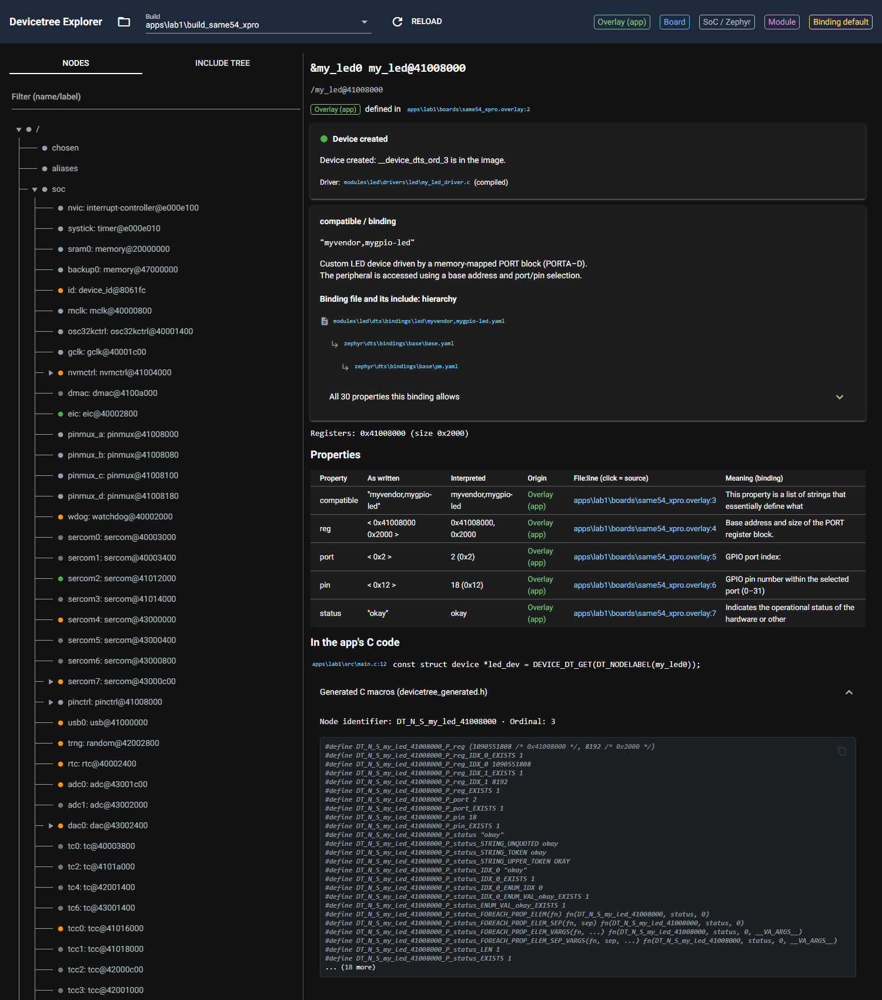

| Area | Content |
|---|---|
| **Header** (top) | Build selection, reload, New build…, Full build, Port to board…, Board nodes…, Legend |
| **Left panel** | Tabs: **Nodes** (the devicetree), **Include tree** (the source files), **Pins**, **Package** (the chip's pins), **Board** (the connectors), **Draft** (pending configurator changes) |
| **Right panel** | Details of whatever is selected on the left; the overview when nothing is selected |

---

## 0. Start

When started without an argument, the tool first opens a **folder dialog**. Select a west
workspace, an app folder or a single build folder; every build below it is offered in the
**Build** list. The dialog starts in the last folder you used. With a path argument
(`dt_explorer.bat D:\ws`), the tool skips the dialog.

## 1. Header

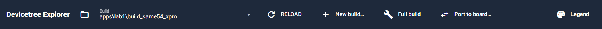

- **Folder button** (left): opens the folder dialog again and switches to another workspace
  without restarting. Its tooltip shows the current folder.
- **Build**: lists every Zephyr build folder found under the workspace, i.e. every folder that
  contains `zephyr/edt.pickle`. Picking an entry loads that build.
- **Reload**: scans for builds again and reloads the current one. Press it after every
  `west build`.
- **New build…** and **Full build**: start a build from the explorer (see below).
- **Port to board…**: ports the app of the current build to another board (section 1.3).
- **Board nodes…**: adds LEDs, buttons, PWM LEDs, aliases and chosen entries to the draft (section 10.3).
- **Legend** (right end of the header): a menu with the text colours used in both trees and in the
  *Origin* column. It tells you **which kind of file** something comes from. Click it to open the key:

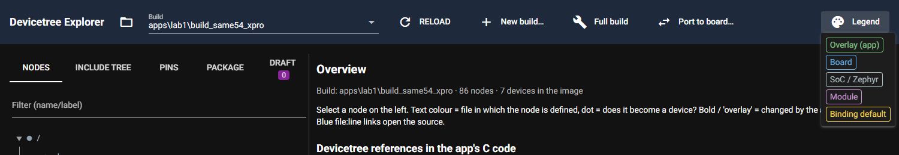


| Colour | Category | Typical files |
|---|---|---|
| green | Overlay (app) | `apps/<lab>/boards/<board>.overlay` |
| blue | Board | `zephyr/boards/.../<board>.dts`, `...-pinctrl.dtsi` |
| grey | SoC / Zephyr | `zephyr/dts/arm/...dtsi`, `zephyr/include/.../dt-bindings/*.h` |
| purple | Module | `modules/...` (e.g. pinctrl headers from `hal_atmel`) |
| yellow | Binding default | Value written in no `.dts` file; it comes only from `default:` in the binding YAML |

### 1.1 New build…

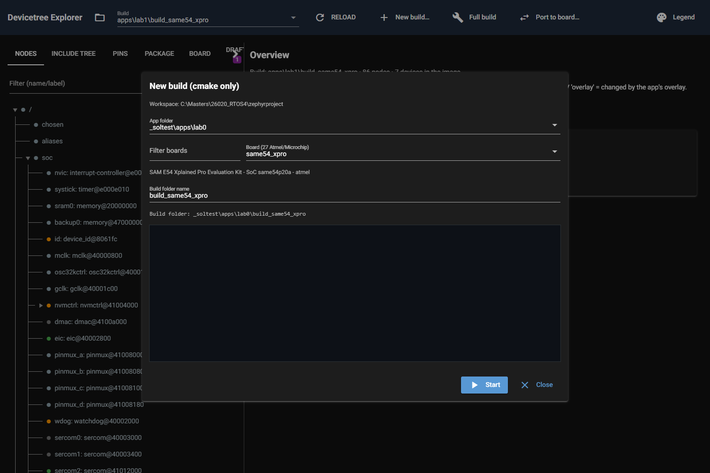

Creates a new build, for example for another app or board, without leaving the explorer.

- **App folder** and **Board** (with a filter): the app to build and the board to build it for.
- **Build folder name**: defaults to `build_<board>`; the full path is shown below it.
- **Start**: runs a cmake-only build, which is quick but does not link the image. Its devices show
  the cyan *Driver built, not linked yet* state until a full build has run (see 1.2).
- When the build finishes, the list is refreshed and the new build is selected.
- **Cancel build** stops a running build; **Close** hides the dialog.

### 1.2 Full build

**Full build** runs `west build -d <build folder>` for the build selected in the header. The log
streams into the dialog. When the build succeeds, the explorer reloads it: the cyan states turn into
green (device created) or red (driver built, no device). Use it after a cmake-only build, or after
changing the app. **Cancel build** stops it.

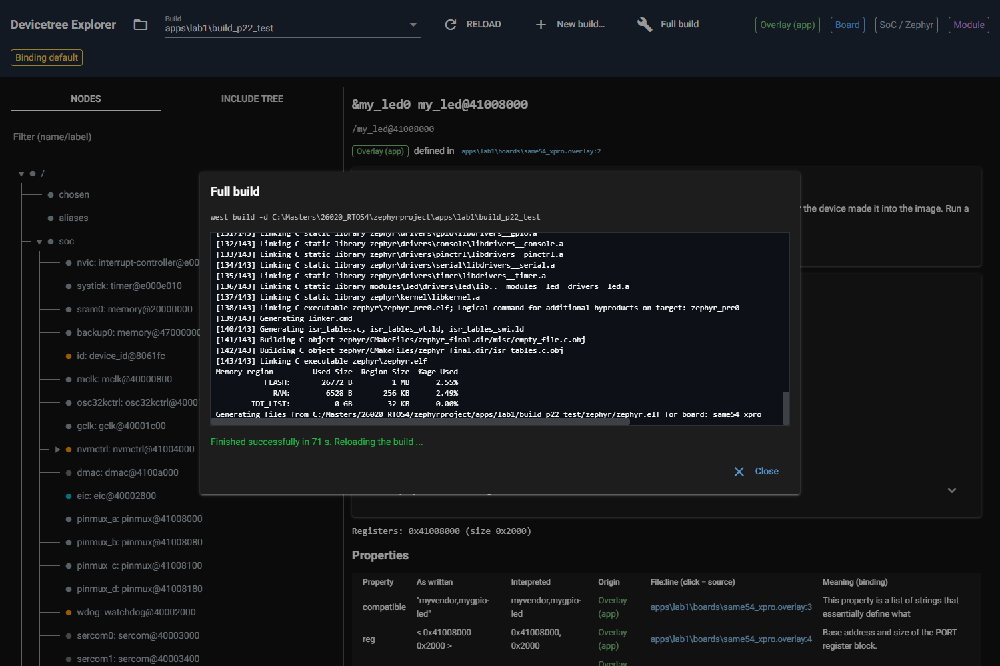

### 1.3 Port to board…

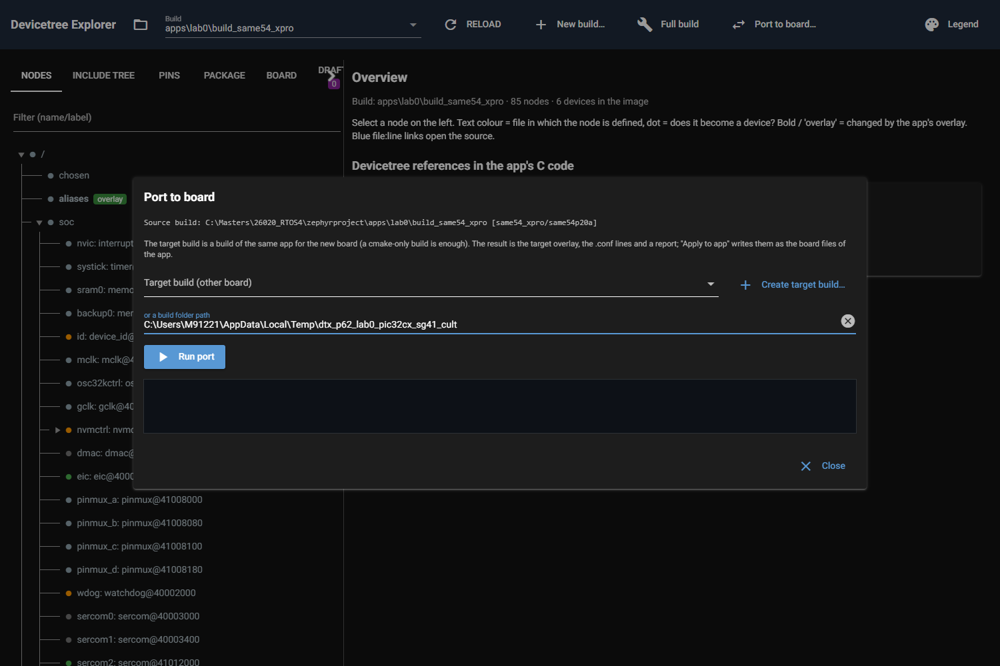

**Port to board…** takes the app of the current build and shows what it would look like on another
board of the same app: the overlay and `.conf` lines for the target, and a report of what could not be
carried over. The source build is not changed. Nothing is written into the app until you press **Apply to app…** and confirm (below).

- **Target build**: a build of the same app for another board (the list shows only builds of a different
  board). **Create target build…** opens New build… for it; a cmake-only build is enough. Or type a build
  folder path below the list.
- **Run port**: runs the port. The log shows the steps, and the result appears below the log.

The result has these parts:

- **Target overlay** and **Target .conf**: the text for the target, with **Copy** and **Download**.
- **Port report**: numbered sections, each one expandable:

| Section | Content |
|---|---|
| 1. Nodes: translated and untranslatable properties | Each node of the source and its translation to the target's binding. Lines say what is identical, what is not emitted, or why a node is not ported (`no_target`: the target workspace has no binding or driver for it; `no_node`: the target build has no such node) |
| 2. Kconfig differences | Each `prj.conf` line of the source with its value in the source and in the target `.config`, e.g. a symbol that the target Kconfig tree does not define |
| 3. Node references in src/ that the target does not resolve | Each `DT_NODELABEL(...)` / `DT_ALIAS(...)` of the app that the target lacks, with a suggestion |
| 4. Pins not available on the target SoC | Pins that the source uses but the target package does not have |
| 5. Nodes without translation and not representable children | Nodes that have to be carried over by hand, and child nodes that the draft cannot represent yet |
| 5b. App-defined nodes of the app overlay | Nodes that the app's overlay defines, and whether each is carried over to the target (`carried:`) |
| 7. Connector roles of the used pads | For each connector pin that the port uses: the pin's role and pad on both boards, e.g. `EXT1 pin 16 (MOSI): PB27 on same54_xpro → PB24 on pic32cx_sg41_cult`, with the node that uses it. A pin is `not available` when its net does not reach the SoC. Needs a board description for both boards; without one the section is left out |

  Below the sections, **Fast check on the target build** lists the findings of the same check as in the
  Draft tab (section 11) on the ported overlay.

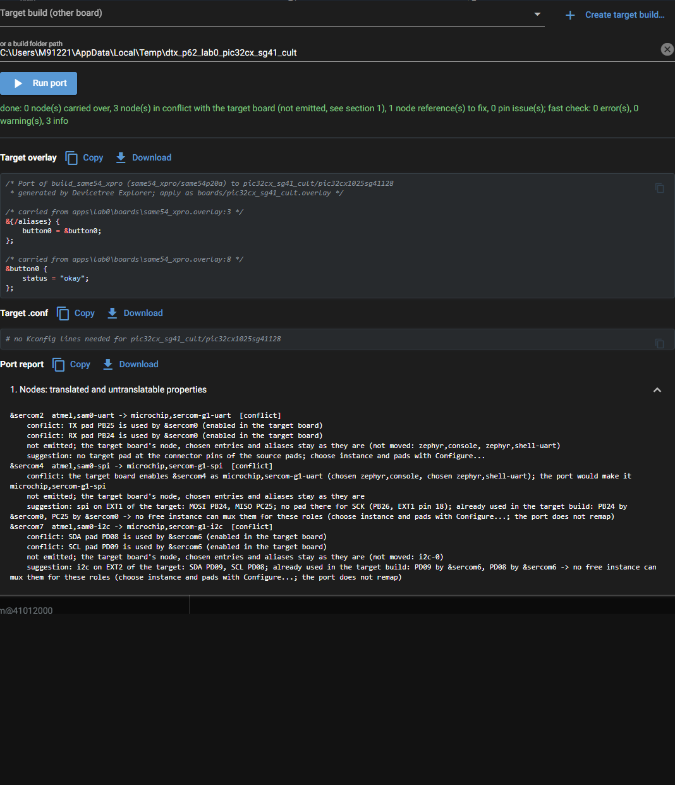

The example ports lab0 (SAME54 Xplained Pro) to the PIC32CX SG41 Curiosity Ultra test build of lab0 (typed into the "or a build folder path" field, since it is not in the workspace). The first picture shows section 1 with three `conflict` nodes: `&sercom2` (its TX/RX pads PB25/PB24 are used by `&sercom0`, which the target board enables), `&sercom4` (the target board enables it as the UART console, so an SPI port would take it over) and `&sercom7` (SDA/SCL PD08/PD09 are used by `&sercom6`). Each conflict has a `suggestion:` line; the port does not remap pins itself. The second picture shows section 7 with the connector roles, and section 3 flags `DT_ALIAS(button0)` as missing because `/buttons/button_0` is not carried over yet.

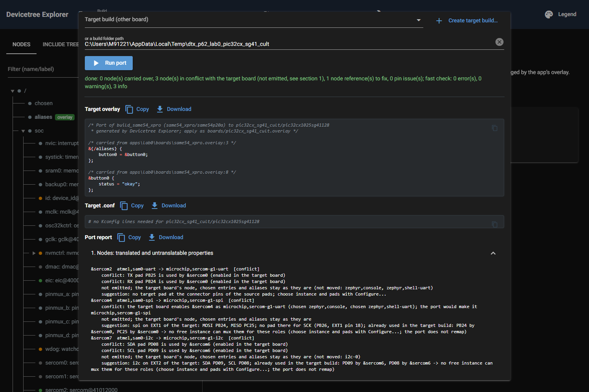

- **Verify with west**: runs Zephyr's own check of the port on the target: a cmake-only build of the target
  board into a scratch folder with the target overlay and `.conf` (about 30 s). The target build is not
  touched. A green line says that Zephyr accepts the port; a red line says it rejects it, and the errors are
  shown under the log.


#### Conflicts with the target board

When a node of the source would collide with the target board, the port does not emit it. Section 1 then shows a `conflict:` line per reason, a `not emitted; …` line and a `suggestion:` line. The status line counts them (`3 node(s) in conflict with the target board`). There are three kinds: (a) the target board enables the same node with another `compatible` (the target's `chosen` and `aliases` are named); (b) a pad the port needs is used by another enabled node of the target build; (c) a pad is not on the target package. A `DT_NODELABEL(...)` or `DT_ALIAS(...)` in `src/` that points at a conflicting node is listed in section 3 instead of resolving silently.

The suggestions are text only. They name the target pads at the same connector pins, the instances that could mux those pads for the same roles, and the pads already in use. Choose instance and pads with **Configure…** in the Draft workflow (section 10); the port itself does not remap pins.

#### Apply to app…

**Apply to app…** appears below the fast check and **Verify with west**. It is the only action in this dialog that writes files, and it asks before it does:

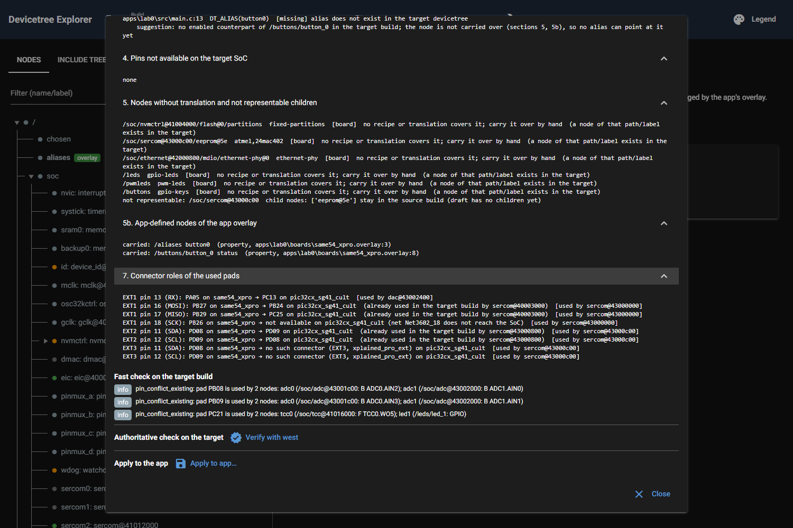

1. **Plan** (shown after the click), one block per board file of the port result:
   - **NEW**: the file does not exist in the app yet; it is written by **Write files**.
   - **EXISTS**: the file exists and differs. Default is **append**: the app's own content stays and the port result goes into a block marked `/* dt_explorer port begin <date> */ … /* dt_explorer end */` (`id=port-apply-diff-<kind>` shows the file after the append; applying again replaces only that block; a `.conf` gets its lines added once, lines the file already has are left out). The block is valid DTS because the overlay may repeat `&label { };` and `/ { };`; an `#include` in the result stays inside the block (cpp accepts it there). **Replace** is the explicit alternative: tick **Replace the existing … instead of appending** (`id=port-apply-replace-<kind>`); the fold-out *Replace instead* (`id=port-apply-diff-replace-<kind>`) shows that diff.
   - **identical** (grey): the existing file already has this content; nothing is written.
   - **SKIP (COMMENTS ONLY)**: the port result holds only comments, e.g. a `.conf` with no Kconfig lines; it is not written.
2. **Write files** writes the files that are not skipped, and shows the result. The next step is the hint `west build -b <target board> <app>` (or **New build…** for a new build folder).

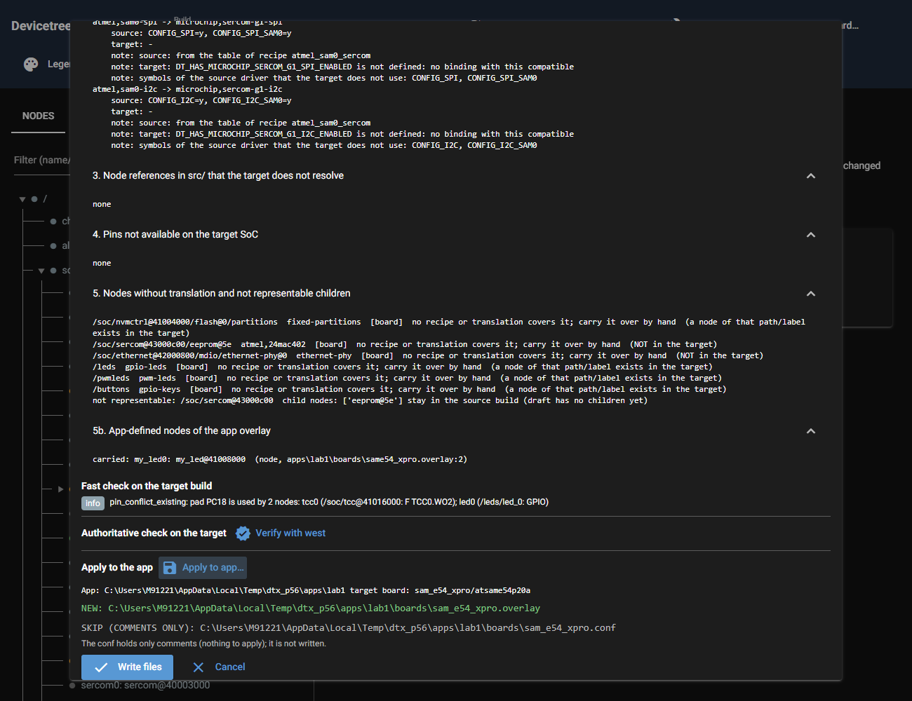

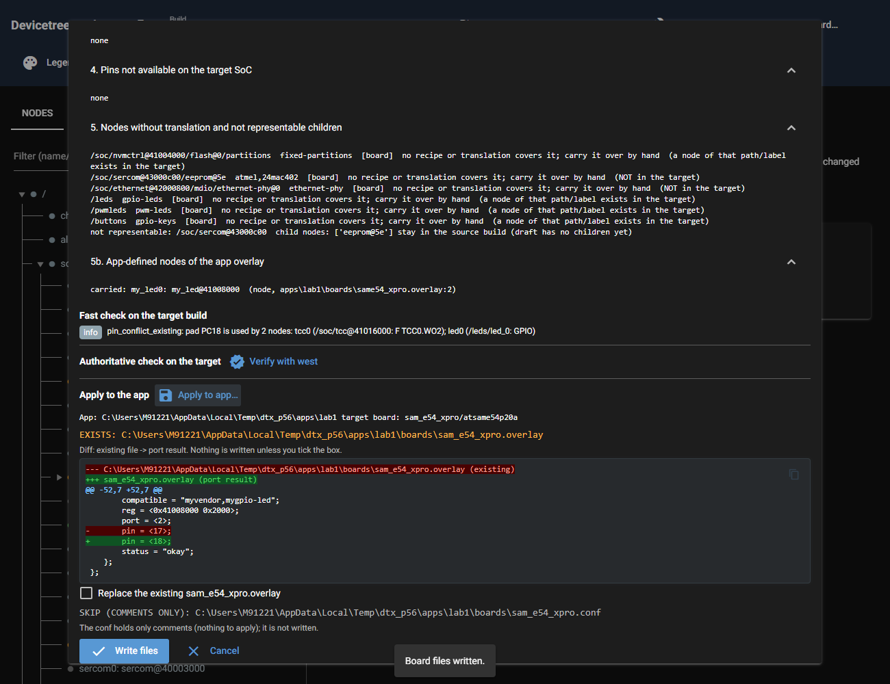

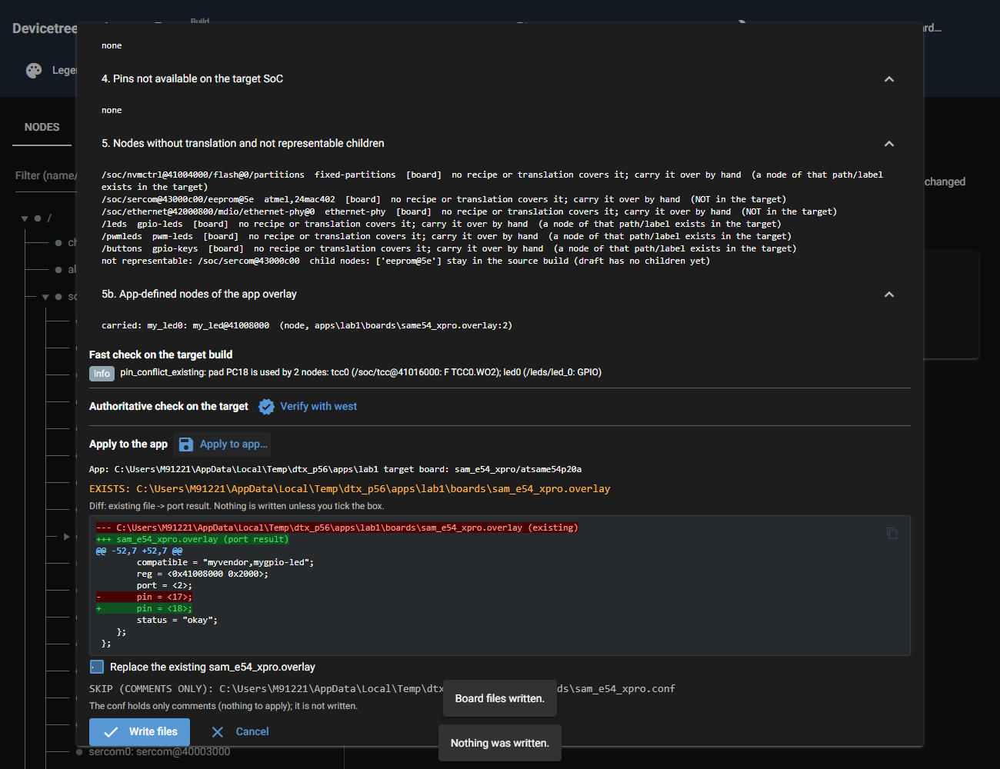

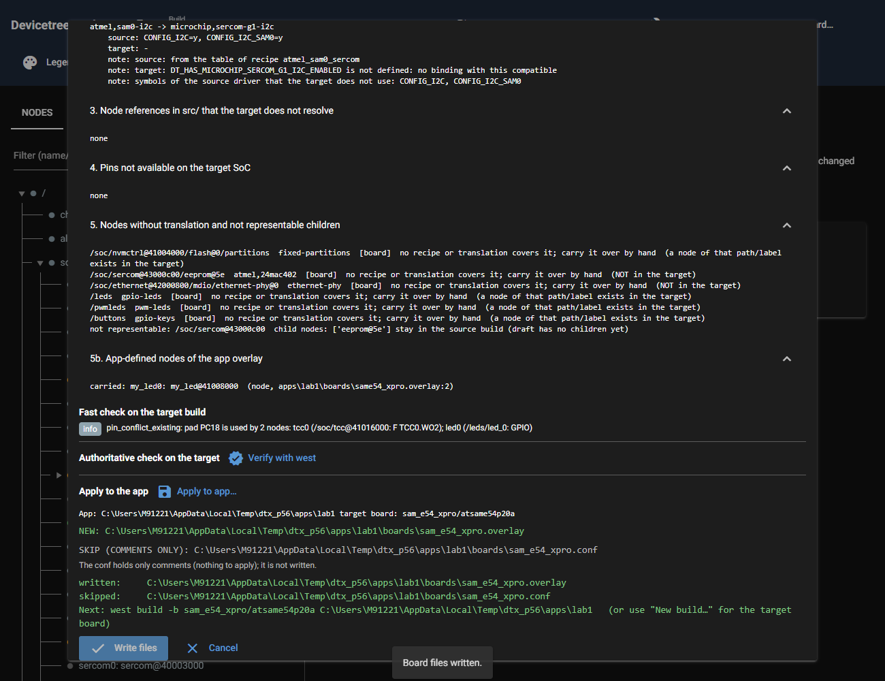

The file names follow Zephyr's board-file rules: `boards/<board>.overlay` and `boards/<board>.conf` when the target's `board.yml` lists exactly one SoC (true for both boards here), otherwise `boards/<board>_<qualifiers>` with `/` replaced by `_`. Zephyr finds these files on its own, so `west build -b <board>` uses them without extra options. Only `<app>/boards/` is written. The source build and `src/` are not touched, and applying to the source board itself is refused. The four plan and result pictures are from a test run on a copy of lab1 in the temp folder, because the button itself writes into the app.

---

## 2. Warning banner: driver without a node

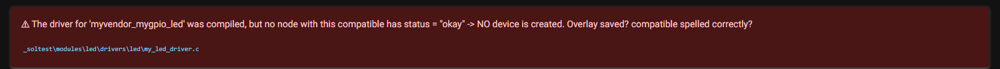

This banner appears above everything else when a driver **from the app or a module** was compiled,
but no devicetree node with that `compatible` has `status = "okay"`. The build succeeds anyway,
but **no device is created**, and the app does nothing.

Typical causes:
- The overlay was edited in the editor but not saved, so it is still empty on disk.
- `compatible` is misspelled.
- The node has `status = "disabled"`.

The file path in the banner opens the driver source.

---

## 3. Left panel — tab **Nodes**

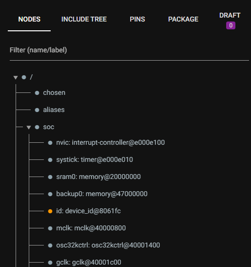

- **Filter**: shows only nodes whose label contains the text, e.g. `sercom` or `led`.
- **Tree**: the **final** devicetree after board, SoC and overlay have been merged. The entries
  read `label: name@unit-address`, e.g. `my_led0: my_led@41008000`. A label is what C code
  uses in `DT_NODELABEL(...)`.
- **Text colour**: the file that **defines** the node (see legend).
- **Bold + `overlay` badge**: the node is defined somewhere else, but the app overlay **changed**
  it, e.g. set `status = "okay"`.
- **Dot**: traffic light that shows whether the node became a device:

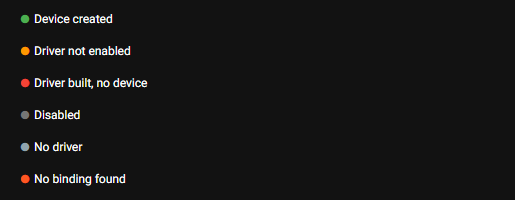

| Dot | Meaning | Is it a problem? |
|---|---|---|
| green: *Device created* | The image contains `__device_dts_ord_<n>`. | — |
| orange: *Driver not enabled* | A driver exists, but Kconfig did not enable it. | Usually fine. Only a problem if the app needs this hardware. |
| red: *Driver built, no device* | The driver was compiled, but no device exists for this node. | Yes. Check the driver macro and the binding. |
| cyan: *Driver built, not linked yet* | The driver was compiled, but the build has no `zephyr.elf`/`zephyr.map` yet (e.g. `west build --cmake-only`), so it is unknown whether the device is in the image. | No. Run a full build and press Reload. |
| dark grey: *Disabled* | `status = "disabled"`. | Only if you expected it to be on. |
| blue-grey: *No driver* | CPU, memory, a container, or a child node that the parent or the app reads directly. | Usually fine. |
| deep orange: *No binding found* | The node has a `compatible`, but no binding YAML matches it. Zephyr does not evaluate its properties and generates no `DT_PROP()` macros. | Yes, if your code uses the node. Typical causes: a typo in `compatible`, or a missing `dts_root` / `dts/bindings` folder for out-of-tree bindings. |

---

## 4. Right panel — overview (nothing selected)

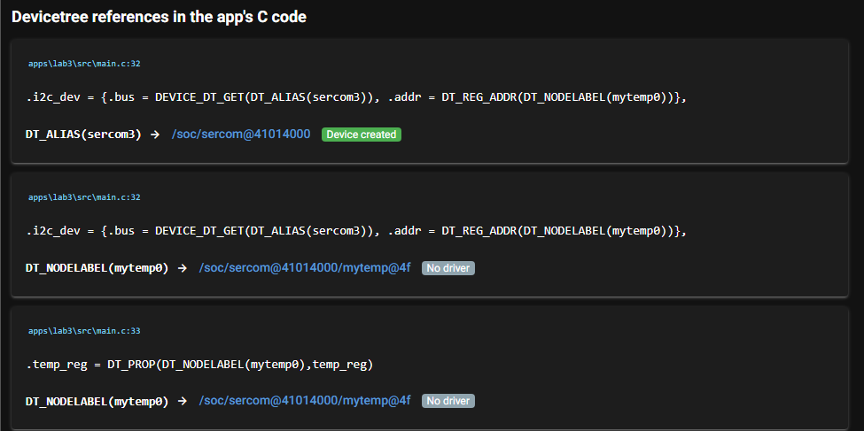

The overview lists every `DT_NODELABEL(...)`, `DT_ALIAS(...)` and `DT_CHOSEN(...)` in the app's
`src/` folder. Each card shows:

- **File:line** (blue): opens the C source at that line.
- **The code line** itself.
- **Macro → node**: the devicetree node that the macro resolves to. Click the node to open it.
  The badge shows its traffic-light state.
- If a macro cannot be resolved, the card says **"not in the devicetree!"** in red. The usual
  cause is an unsaved overlay or a misspelled label or alias.

---

## 5. Right panel — node details

### 5.1 Title, origin and status

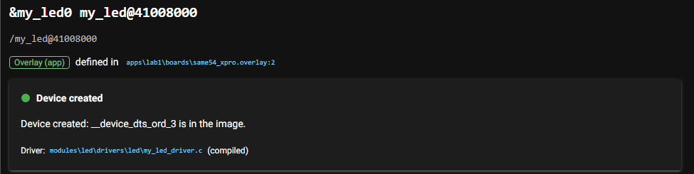

- **Title**: all labels (`&my_led0`), the node name, and the full path.
- **Origin badge + "defined in"**: the file and line that create the node. Click it to open the
  source. All lines of this node are marked there.
- **Status card**: the traffic-light state with an explanation. **Driver** shows the C file whose
  `#define DT_DRV_COMPAT` matches this node, and whether it was compiled. Click the path to open
  the driver at its `DT_DRV_COMPAT` line.
- **Configure…** button: shown on a disabled node of a supported peripheral. It opens the
  configurator (section 10).
- **Edit pins…** button: shown on an enabled node of a supported peripheral. It opens the same
  dialog, filled with the node's current pins (section 10.1).

For child nodes without their own `compatible` (for example a button below `gpio-keys`), the
card explains that the parent's binding describes them and that the app reads them directly:

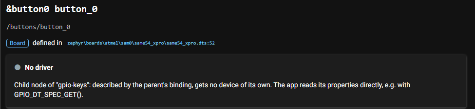

### 5.2 compatible / binding

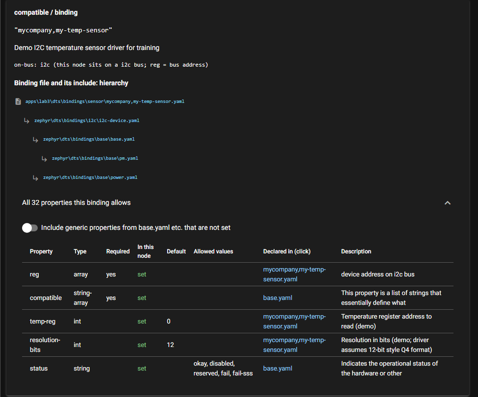

The example shows the I2C temperature sensor of lab3, whose binding lives in the app.

- **`compatible`** strings of the node and the **description** from the binding.
- **Binding facts** (shown when they apply):
  - `on-bus`: the node is a device on that bus, and its `reg` is the bus address (here I2C 0x4f).
  - `bus`: child nodes of this node are devices on that bus.
  - `<space>-cells`: the names of the cells that a reference passes. For example,
    `gpio-cells: pin, flags` explains why `<&portb 31 0x11>` means pin 31 with flags 0x11.
  - `child-binding`: the child nodes are described by this binding.
- **Binding file and its include: hierarchy**: the matched YAML file and every file it includes,
  recursively. Here the chain is `my-temp-sensor.yaml` → `i2c-device.yaml` → `base.yaml` / `pm.yaml`,
  plus `power.yaml`. Click any file to open it.
- **All N properties this binding allows** (expandable table):

| Column | Meaning |
|---|---|
| Type, Required | As declared in the binding |
| In this node | **set** (written in a `.dts` file) · **default** (only the binding's `default:` applies) · **not set** |
| Default, Allowed values | `default:` and `enum:` / `const:` from the binding |
| Declared in | Which YAML file in the hierarchy declares the property. Click it to open the file at the declaration |

  The table shows set, required and own properties. The switch adds the generic, unset
  properties that come from `base.yaml` and similar files.

In this example the binding default of `resolution-bits` is 12, and the overlay sets it to 9.

If no binding matches, the card says so and the status card turns deep orange:

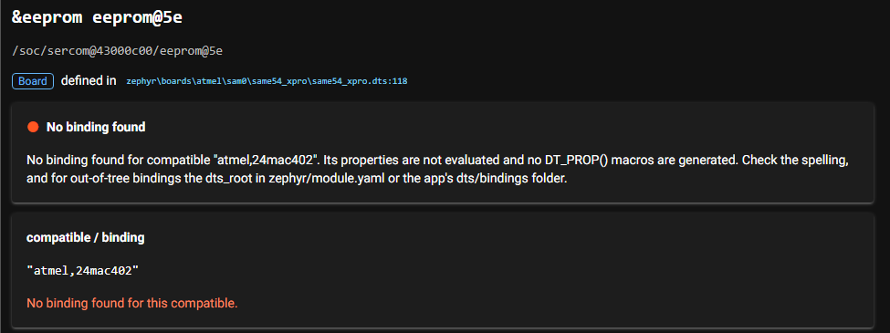

Below the card, **Registers** shows the decoded `reg` entries (address and size).

### 5.3 Properties

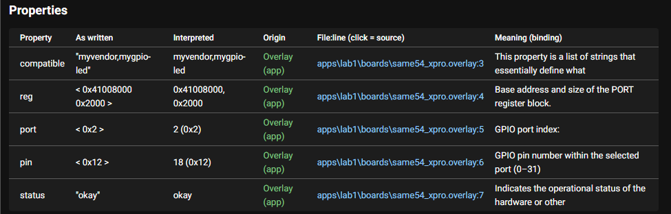

| Column | Meaning |
|---|---|
| Property | Name as in the devicetree |
| As written | Value as it appears in `zephyr.dts`, with references like `&portb` |
| Interpreted | Value as Zephyr understands it through the binding. Numbers are shown in decimal and hex, references are resolved, and GPIO flags are decoded, e.g. `0x11 = ACTIVE_LOW \| PULL_UP` |
| Origin | Category of the file that **set this value last** (see legend). **Binding default** rows (yellow) list values that no `.dts` file contains. They still end up in the generated C macros. |
| File:line | That exact location. **Click** to open the source |
| Meaning (binding) | First line of the property description in the binding |

One node can mix several origins. On `button_0` in lab0, for example, `gpios` comes from the
board and `status` comes from the overlay.

### 5.4 References, C code and generated macros

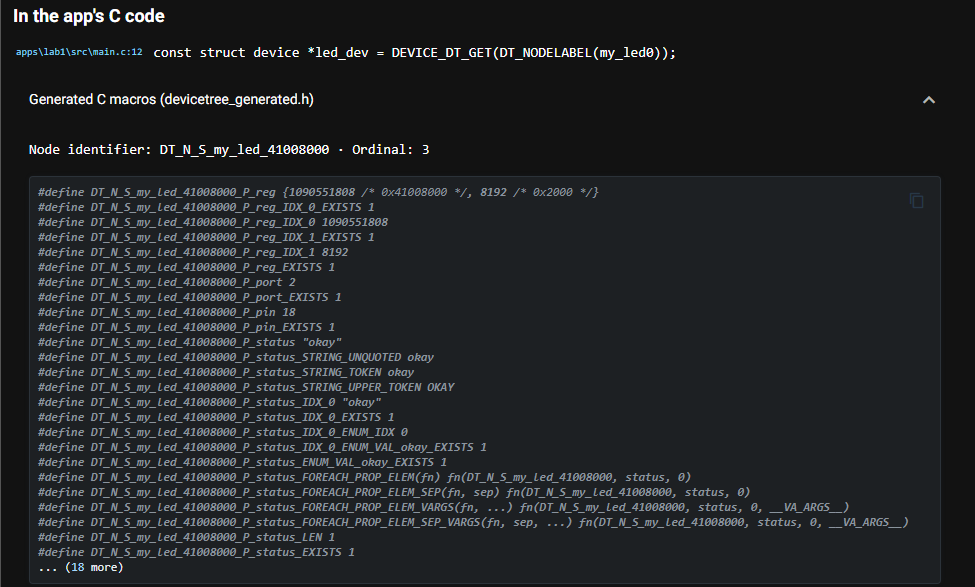

- **Depends on / Used by**: other nodes that this node references (for example the GPIO port),
  and nodes that reference this one. Click a name to jump to that node.
- **In the app's C code**: the lines in `src/` that use this node.
- **Generated C macros**: the `#define`s that Zephyr created in `devicetree_generated.h` for this
  node: the node identifier (`DT_N_S_...`), its ordinal, and the property macros
  (`..._P_<property>`). This is what `DT_PROP(...)` and the other macros expand to in the end.

---

## 6. Left panel — tab **Include tree**

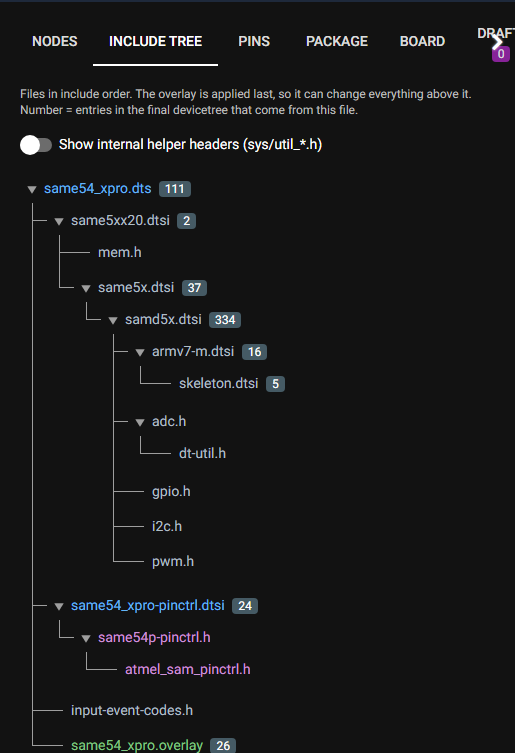

This tab shows which files include which, in the order the C preprocessor processed them. The tool
rebuilds it from the line markers in `zephyr.dts.pre`.

- The **root** is the board `.dts`. It pulls in the SoC chain (`same5xx20.dtsi` → `same5x.dtsi`
  → `samd5x.dtsi` → `armv7-m.dtsi` → `skeleton.dtsi`) and the board pinctrl file.
- **The app overlay comes last.** That is why it can change everything above it.
- **Badge number**: how many entries (nodes and properties) in the **final** devicetree come from
  this file. A file without a badge contributes no values directly; it only includes other files
  or provides `#define` constants.
- **Show internal helper headers**: also shows Zephyr's internal macro headers
  (`sys/util_*.h`). They are hidden by default.

### 6.1 Selected file: `.dts` / `.dtsi` / overlay

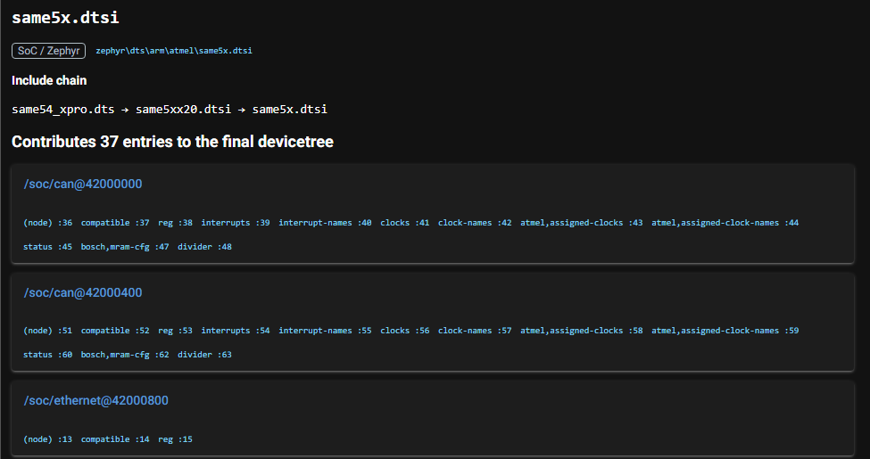

- **File path** (blue): click to open the whole file.
- **Include chain**: how the board file reached this file.
- **Contributes N entries**: one card per node. The node name jumps to the node in the Nodes tab.
  Each `property :line` link opens the source at that line.

### 6.2 Selected file: header (`.h`)

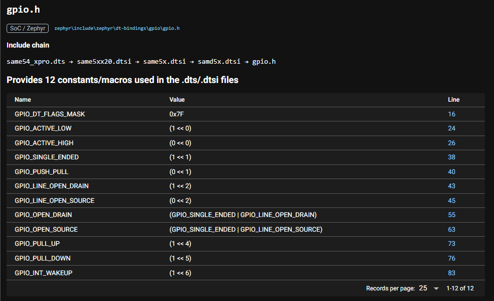

A header contributes no nodes. It provides **constants** that the `.dts` files use, such as
`GPIO_ACTIVE_LOW`, `GPIO_PULL_UP` or the pinctrl names `PA22C_SERCOM3_PAD0`. The table lists each
constant with its value. The **Line** column opens the header at the definition.

---

## 7. Source viewer

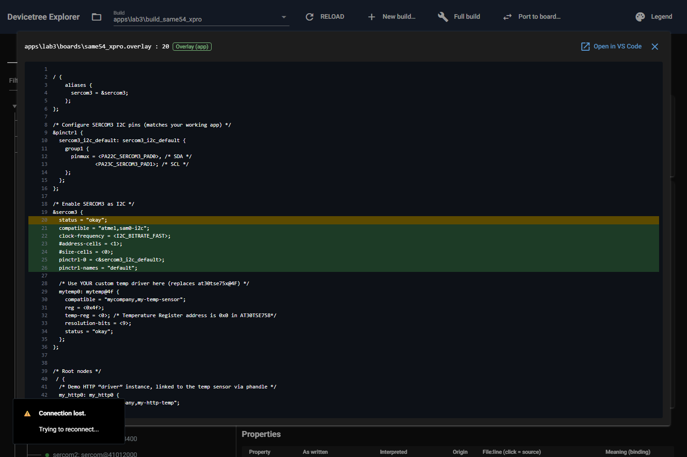

The source viewer opens when you click any blue *file:line* link.

- **Yellow** line: the line that was clicked.
- **Green** lines: the other lines in this file that belong to the same node.
- **Open in VS Code**: opens the file at the same line in VS Code. This button only appears if
  the `code` command is in your PATH.
- **×** or **Esc** closes the viewer.

---

## 8. Left panel — tab **Pins**

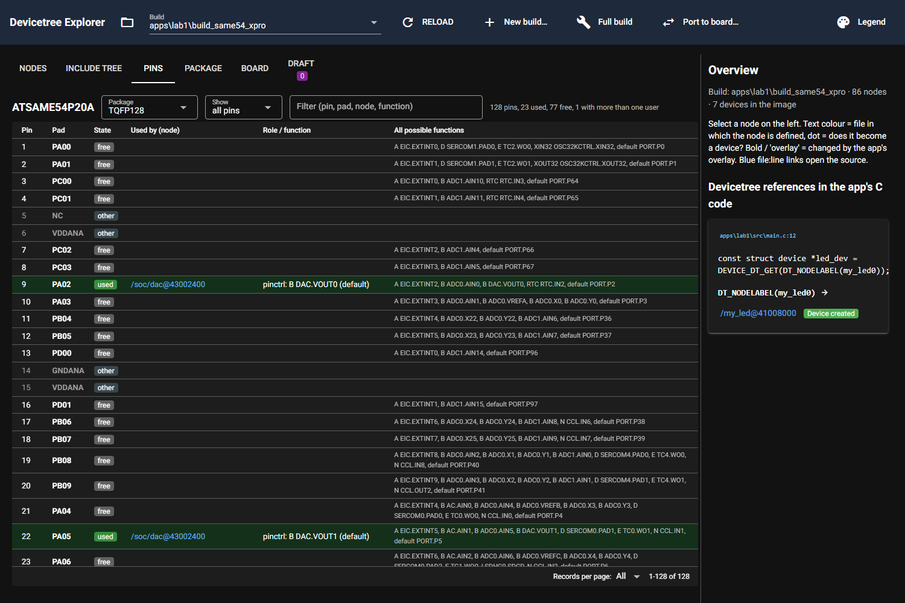

One row per pin of the chip's package, in pin-number order. If the device has several packages,
the **Package** list picks one.

- **Summary line**, e.g. `128 pins, 23 used, 77 free, 1 with more than one user`.
- **Show**: all pins, used pins only, or free pins only.
- **Filter**: any text in the pin, pad, node or function columns.

| Column | Meaning |
|---|---|
| Pin, Pad | Pin number and pad name, e.g. `PC22` |
| State | **free** (nothing uses it) · **used** (one node) · **conflict** (more than one node uses it) · **other** (power, ground, NC, reset) |
| Used by (node) | Node paths that use the pin. Click a path to open the node in the Nodes tab |
| Role / function | What the node does with the pin, e.g. `pinctrl: B DAC.VOUT0 (default)` |
| All possible functions | Every function the pin can take on this chip; the default is marked |

---

## 9. Left panel — tab **Package**

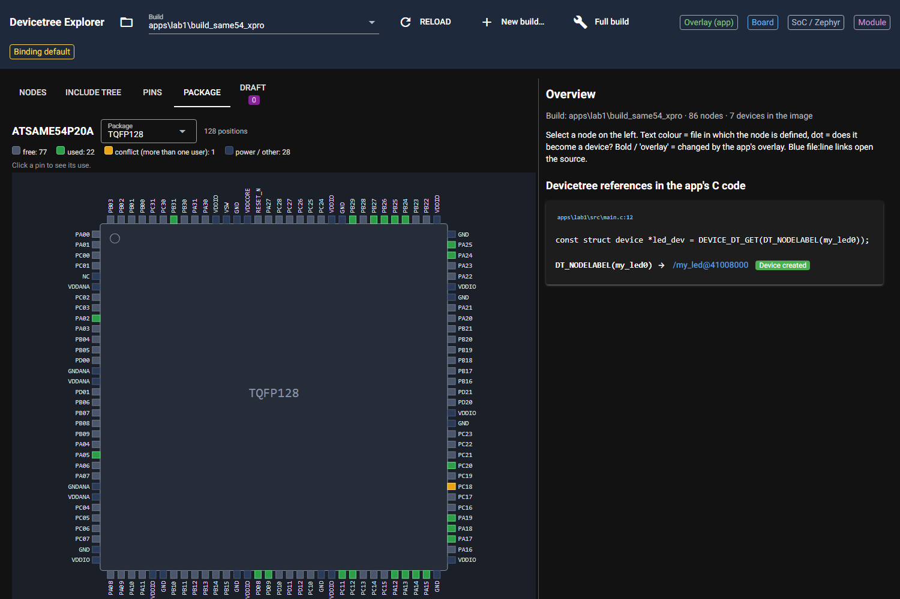

The same pin states drawn on the package outline. Pin 1 is at the top left of a QFP and ball A1 at
the top left of a BGA; the numbering runs counter-clockwise.

- **Package** list: switch to another package of the device.
- **Legend with counts**: free (grey) · used (green) · conflict (orange) · power / other (dark blue) ·
  draft (purple, not built yet).
- **Click a pin**: the panel below shows its users and function, with links to the nodes.

---

### 9.1 Left panel — tab **Board**

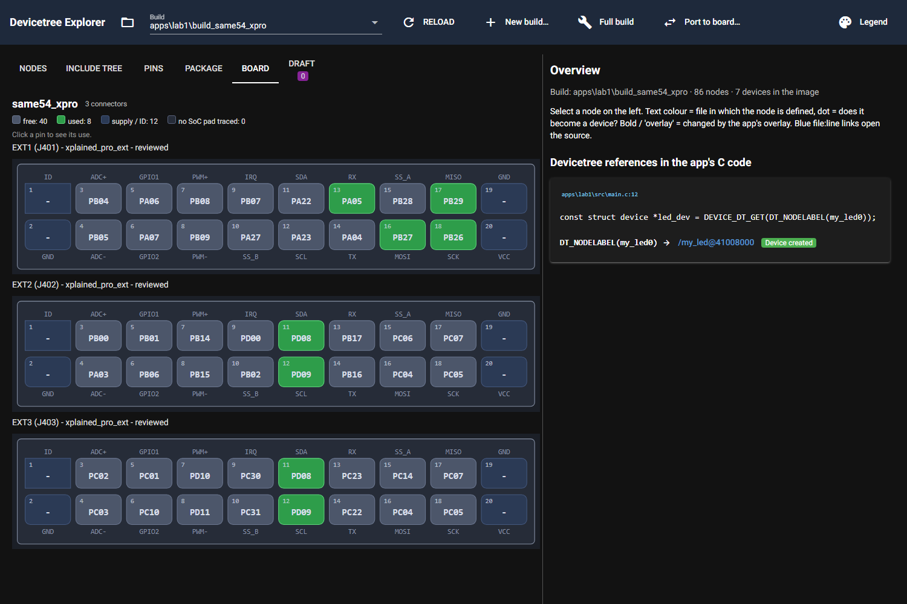

The connectors of the board as they sit on it. Each connector is drawn with its pins in two rows (odd pins above, even pins below, pin 1 at the top left). The example is the SAME54 Xplained Pro of lab1 (`apps/lab1/build_same54_xpro`): EXT1 uses SPI (MOSI, MISO, SCK) and the DAC, EXT2 and EXT3 use the I2C instance on PD08/PD09.

- **Connector heading**: name, designator (e.g. `J401`), connector type, and the status of the entry, `reviewed` or `suggested`.
- **Pin**: number, the role printed above or below it (e.g. `MOSI`, `SDA`), and the SoC pad behind it (e.g. `PB27`).
- **Colour**: green = used by the devicetree, orange = conflict (more than one user), purple = draft (not built yet), grey = free, dark blue = supply / ID, and a dark tile = no SoC pad traced. The counts above the connectors give the totals (here `used: 8`).
- **Click a pin**: below the board it shows the pin, its role and pad, the state, the nodes that use it (click a node to open it in the Nodes tab) and the possible functions of the pad. A pin that no node uses says so.

The view needs a board description, `dt_explorer/boards/<board>.yaml`, for the build's board. Without one the tab says `No board description for '<board>'`. The same tab works for the other boards that have a description, e.g. the PIC32CX SG41 Curiosity Ultra build below.

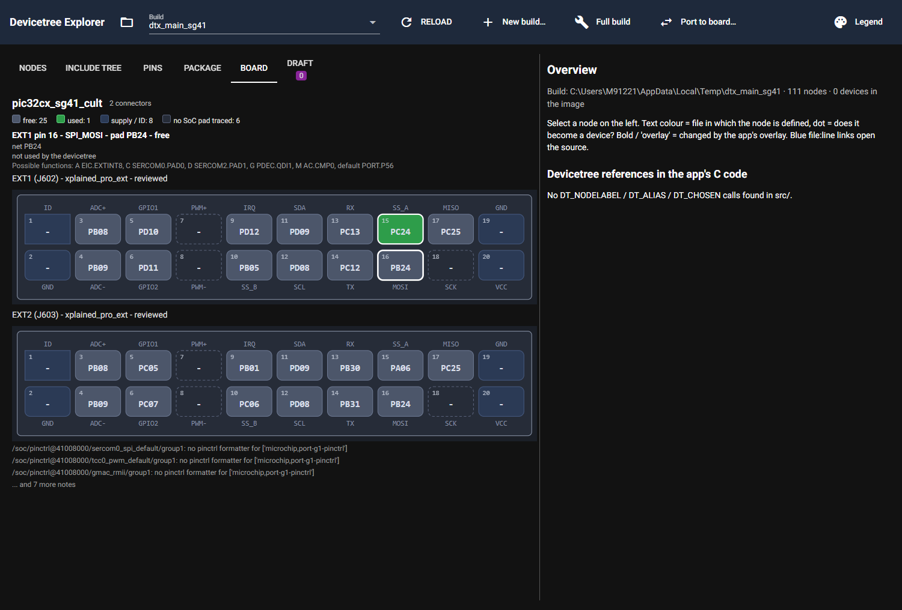

---

## 10. Configurator — **Configure…** dialog

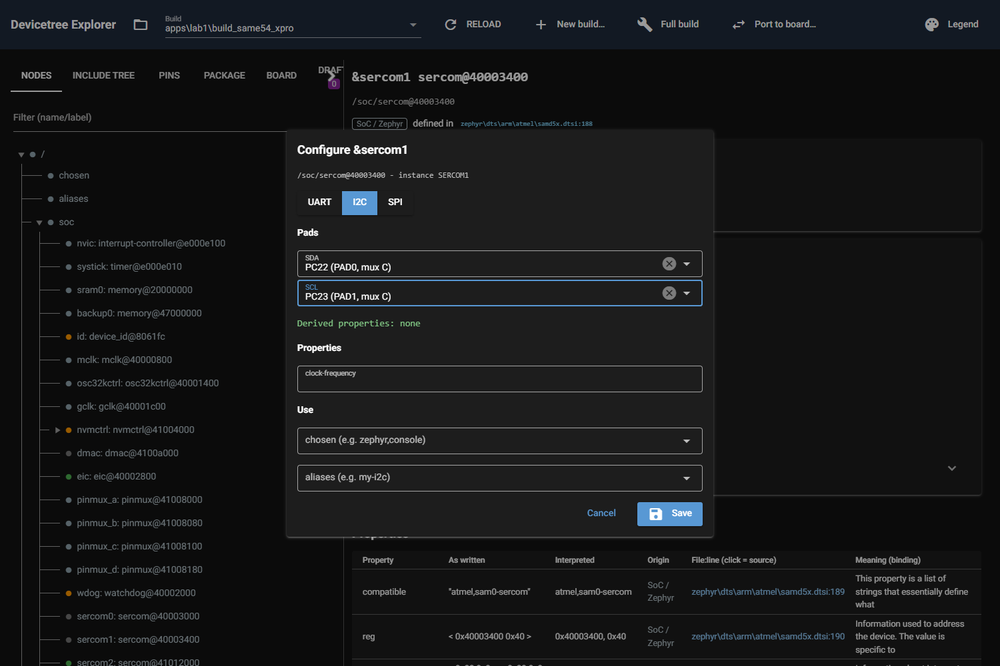

The dialog opens from the **Configure…** button of a disabled node (section 5.1). The example turns
SERCOM1 into an I2C controller: SDA on PC22, SCL on PC23.

1. **Class** (UART, I2C, SPI): the pads and properties below change with it.
2. **Pads**: one pad per role. Pads that other nodes already use are still offered; the check
   (section 11) reports the conflict. *Derived properties* lists the pads that are still to assign
   (orange).
3. **Properties**: the class properties, e.g. `clock-frequency`.
4. **Use**: `chosen` and `aliases` entries for the node, if needed.
5. **Save** adds the node to the draft and opens the Draft tab. **Cancel** closes the dialog.

The draft is kept for this build. Saving the dialog does not build anything; use the check in the
Draft tab, and copy the snippet into your app overlay.

### 10.1 Edit pins… (enabled nodes)

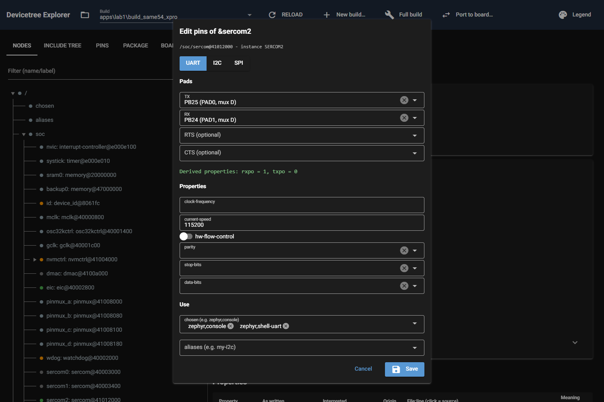

On an enabled node (`status = "okay"`), **Edit pins…** opens the same dialog for changing the pads and
properties of that node. The example is SERCOM2 of lab1 as UART: TX PB25, RX PB24, filled in from the
node as it is built.

- The change goes to the draft as an edit of the node. Its pinctrl group gets the name
  `<label>_<class>_edit` (for example `sercom2_uart_edit`), so the board's own group is not changed.
- **Cancel** closes the dialog and changes nothing.

### 10.2 Generic form (nodes without a recipe)

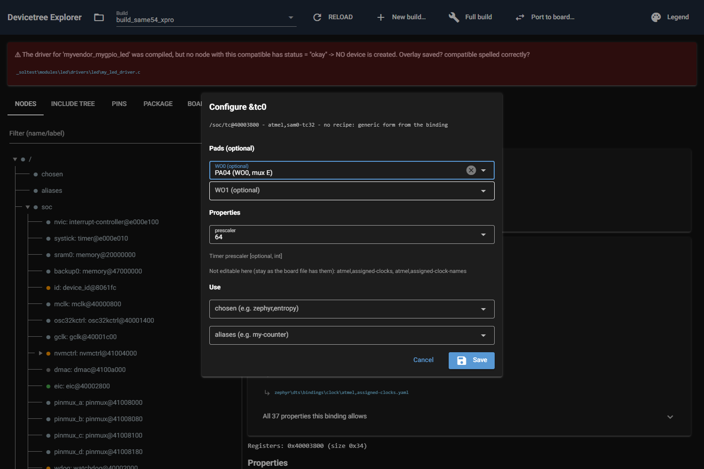

When no recipe covers the `compatible` of a disabled node but the build has its binding, **Configure…**
still appears and opens a form generated from the binding. The example is `&tc0`
(`atmel,sam0-tc32`).

1. **Pads (optional)**: one pad list per signal role of the node's peripheral, taken from the device
   data. It appears only when the binding takes `pinctrl-0` and the device data knows the peripheral.
   A pad that carries several signals of the peripheral is reported under *To fix* because the overlay
   cannot choose between them without a recipe.
2. **Properties**: one field per scalar property of the binding chain (`int`, `string`, `boolean`),
   with its enum as a list, the description and `[required|optional, type, default]` below it. A
   required property is marked `*`. A value that the SoC or board file already sets is filled in; only
   changes appear in the overlay.
3. **To fix** at the top lists every problem (required field empty, text that is not a number, value not
   in the enum, a boolean the board sets that cannot be switched off by an overlay). While it is not
   empty, **Save** is off, and the field is outlined in red.
4. A grey line names the properties the form cannot edit (clocks, interrupts, ...). They stay as the
   board file has them.
5. **Use** and **Save** work as in section 10. The draft node has the class `generic`; its pinctrl
   group is named `<label>_generic_default`.

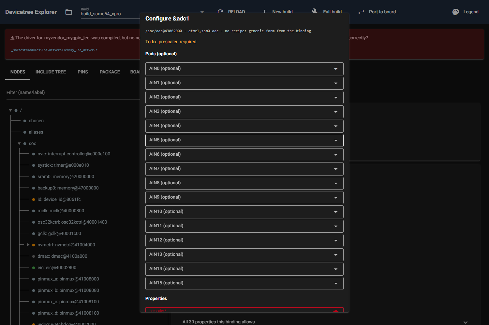

The second picture is `&adc1` with the required `prescaler` emptied.

A node that is already enabled and has no recipe (for example `wdog`) has no button in the node view.

### 10.3 Child devices on a bus (I2C, SPI)

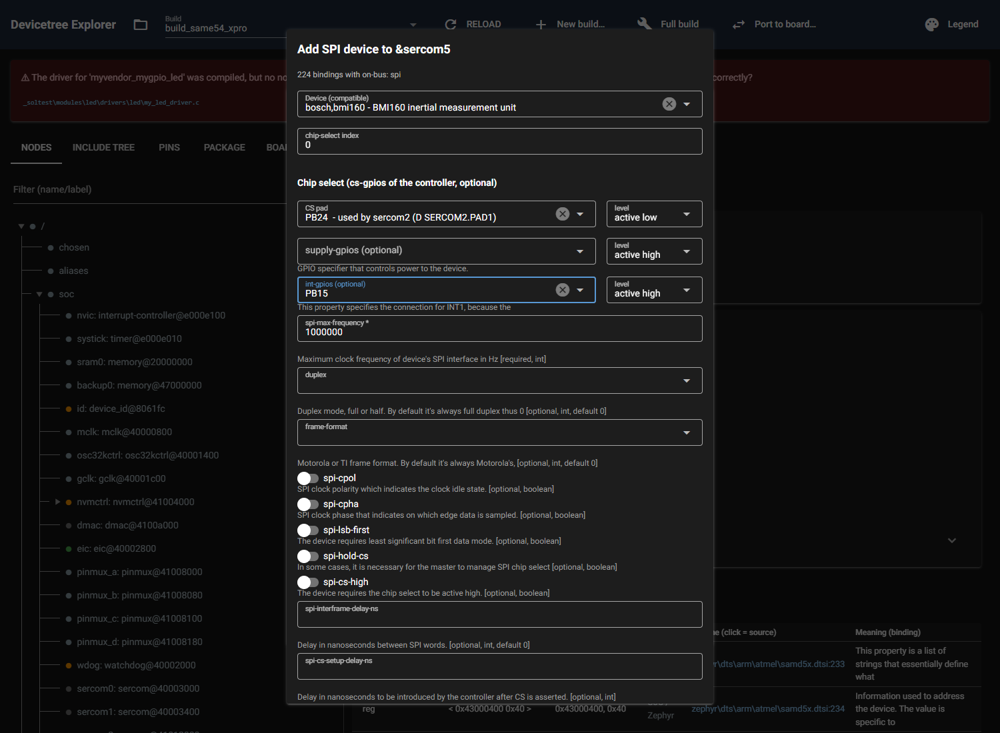

When the class is I2C or SPI, the dialog has a **Child devices** list below *Properties* and the button
**Add child device…** (`cfg-child-add`). It opens a second dialog (`child-dialog`). The example is a
`bosch,bmi160` on `&sercom5` as SPI.

1. **Device (compatible)**: the bindings of the workspace whose `on-bus` is the bus of the node (type to
   search). A bus controller is not offered. One compatible can have a binding per bus
   (`bosch,bme280-i2c.yaml`, `bosch,bme280-spi.yaml`); the one for this bus is used.
2. **Address** (`child-address`): for I2C the 7-bit address in hex (`76` or `0x76`), for SPI the chip-select
   index, preset to the next free one. It becomes `reg` and the unit address (`bme280@76`). If another
   device of this bus already has the address, an orange line names it; the dialog still saves, Check then
   reports the error. Two devices of the same compatible get distinct node names (`bme280`, `bme280-2`), so
   the compiler does not merge them.
3. **Chip select (SPI only)**: a pad list (`child-cs-pad`) and the level (active low is preset). It writes
   entry *index* of the controller's `cs-gpios`. The index must follow the entries that exist.
4. **GPIO properties** of the binding (`int-gpios`, `reset-gpios`, `supply-gpios`, ...) are pad lists with a
   level each (`child-gpio-<property>`); a required one must be set. Pads that something else uses are
   listed with their users but not hidden: the overlay then reports the clash.
5. **Properties**: the scalar properties of the binding (including `spi-max-frequency` and the other bus
   properties), as in the generic form. **To fix** (`child-problems`) lists what is missing; **Add**
   (`child-save`) stays off until it is empty.

The list in the main dialog shows each child with a delete button (`cfg-child-remove-<name>-<unit>`). A child
that the board file already has (for example `eeprom@5e` on `&sercom7`) is shown as *from the board* and
cannot be removed. **Save** puts the children into the draft node; they render inside the node:

```
&sercom5 {
	...
	cs-gpios = <&portb 14 1>;
	bmi160_0: bmi160@0 {
		compatible = "bosch,bmi160";
		reg = <0x0>;
		spi-max-frequency = <1000000>;
		int-gpios = <&portb 15 0>;
	};
};
```

The Draft tab suggests the driver symbols of the children (for example `CONFIG_BME280=y`). **Check** adds these
rules: `bus_address_duplicate` (two I2C devices at one address or two SPI devices at one chip select, error),
`spi_cs_missing` (chip select beyond the `cs-gpios` list, error) and `pin_conflict` for a GPIO pad that another
node, or the same node's pinctrl, also uses (error).

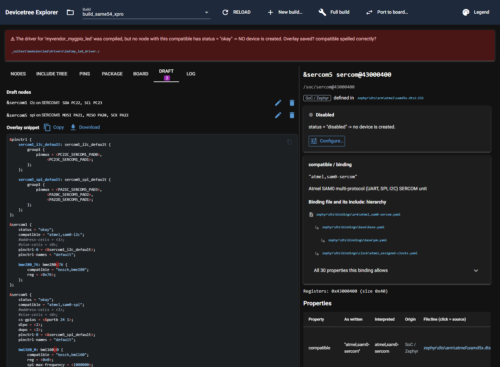

### 10.4 Board nodes… (LEDs, buttons, PWM LEDs, aliases, chosen)

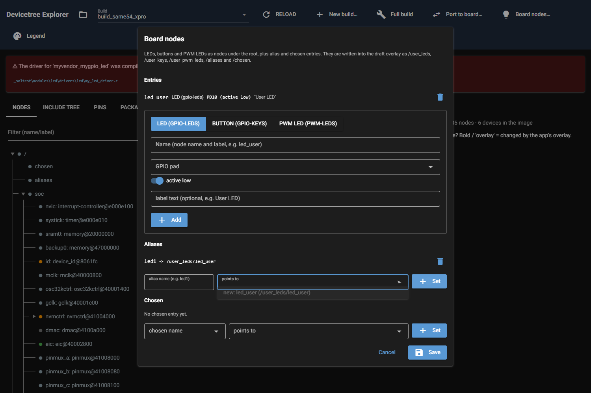

The header button **Board nodes…** edits the nodes that belong to the board, not to a peripheral:

1. **Entries**: pick LED (`gpio-leds`), Button (`gpio-keys`) or PWM LED (`pwm-leds`; offered only when the
   build has a PWM controller). Give it a **Name** (lower case letters, digits and `_`; it becomes the node
   name and the label). An LED or button takes a **GPIO pad** (every pad shows who already uses it),
   **active low**, and for a button **pull** (a button starts as pull-up, active low) and an optional
   `zephyr,code`. A PWM LED takes the **PWM controller**, the **channel** and the **period** in ms. The
   optional **label text** becomes the `label` property. **Add** refuses a bad name, a label the build
   already has, and a pad or PWM channel used twice in the dialog.
2. **Aliases** and **Chosen**: a name and the node it points at (a node of the build or one of the new board
   nodes). The chosen name offers the common `zephyr,...` names and takes any other. Both are written as
   path strings (`led1 = "/user_leds/led_user";`). Removing an entry removes the aliases that pointed at it.
3. The line under the title lists the problems. A pad that something else already uses is a
   **warning** here; the **Check** in the Draft tab reports it as the error `pin_conflict`. An alias or chosen
   name that the build already has is a warning too (the overlay replaces it).
4. **Save** puts one draft node in the Draft tab (row **board nodes**, pencil = edit again, trash = remove all).
   An empty dialog removes it. The overlay writes `&{/} { user_leds { ... }; user_keys { ... };
   user_pwm_leds { ... }; aliases { ... }; chosen { ... }; };`; the board's own `leds`, `buttons` and
   `aliases` stay as they are.

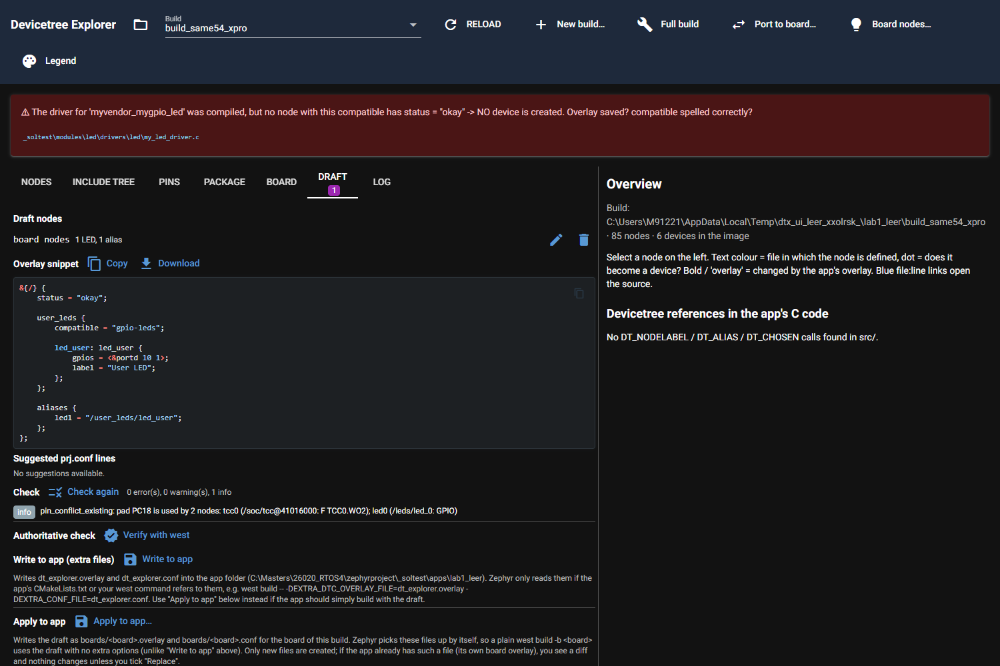

Limits: the pad of an LED or button needs the GPIO controllers to map onto the device's pads (the same
mapping the Pins tab uses); a PWM LED does not touch pins (the controller's own pinctrl does). Port to board…
does not carry board nodes over.

---

## 11. Left panel — tab **Draft**

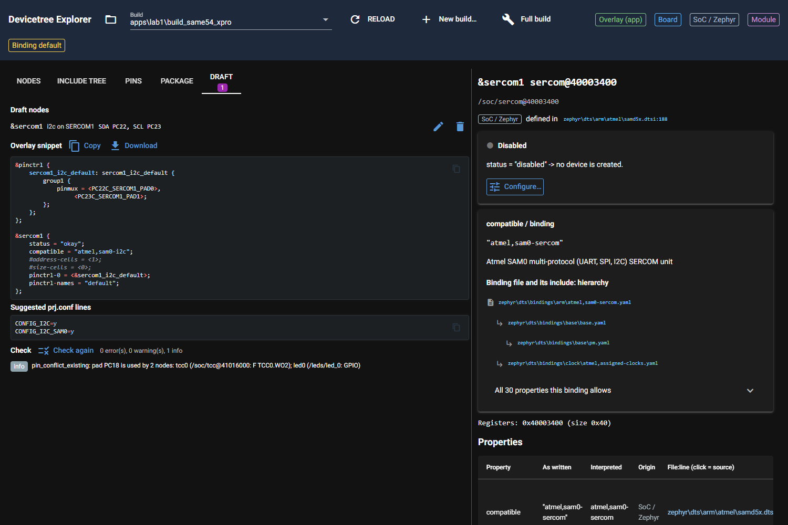

The pending changes of the current build. The number on the tab counts the draft nodes.

- **Draft nodes**: one line per node. The pencil opens it in the Configure dialog; the bin removes
  it from the draft.
- **Overlay snippet**: the devicetree overlay for the draft. **Copy** puts it on the clipboard,
  **Download** saves it as `draft.overlay`. Paste it into the app overlay yourself.
- **Suggested prj.conf lines**: the Kconfig options the class needs, e.g. `CONFIG_I2C=y` and
  `CONFIG_I2C_SAM0=y`.
- **Check**: **Check again** runs the validation on the overlay. It takes a few seconds; a spinner
  shows while it runs. The line above the results counts the errors, warnings and infos. Each
  finding has a badge and a message that names the nodes and pins involved.

| Badge | Meaning |
|---|---|
| error (red) | The overlay would not work, e.g. two nodes use the same pin or a required property is missing |
| warning (orange) | The overlay works but needs attention, e.g. a pinmux IOSET mix |
| info (grey) | For information, e.g. a pin conflict that already exists in the build |

### 11.1 Authoritative check: Verify with west and Write to app

The **Check** above is a fast check in Python. The two buttons below use Zephyr itself.

**Verify with west** runs `west build --cmake-only` of the build's board into a scratch folder in
`%TEMP%`, with the draft overlay and the Kconfig lines (about 15–45 s). The build folder is not touched.
A green line says that Zephyr accepts the draft; a red line says that it rejects it, and the errors are
shown under the log.

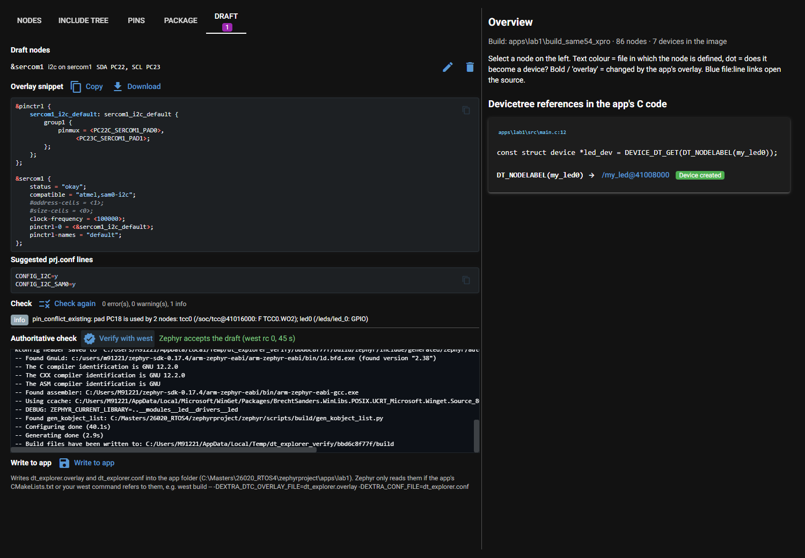

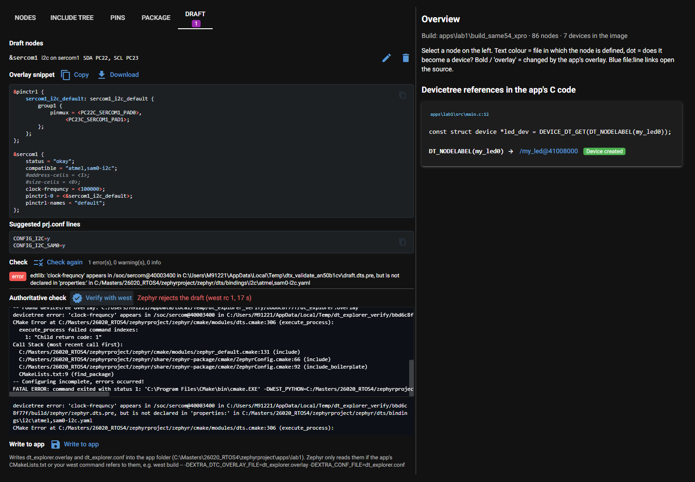

**Write to app** copies the draft into the app folder as `dt_explorer.overlay` and `dt_explorer.conf`.
A confirmation first names the folder and lists the files that would be overwritten. Zephyr reads the two
files only if the app's `CMakeLists.txt` or your west command refers to them, for example with
`-DEXTRA_DTC_OVERLAY_FILE=dt_explorer.overlay -DEXTRA_CONF_FILE=dt_explorer.conf`.

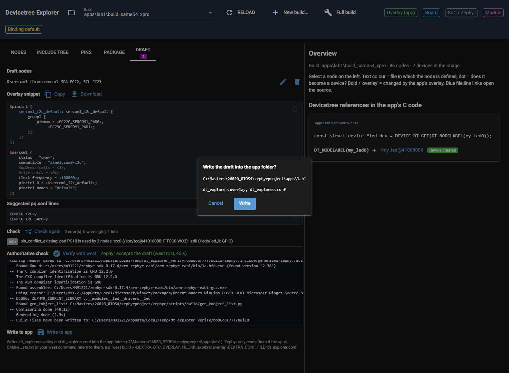

### 11.2 Apply to app… (the build's own board)

**Apply to app…** (below Write to app, `id=draft-apply`) writes the draft as `boards/<board>.overlay` and
`boards/<board>.conf` of the app, for the board this build was configured for. Zephyr picks these files up by itself, so
a plain `west build -b <board> <app>` uses the draft without extra options. This is the difference to **Write to app**,
which writes `dt_explorer.overlay`/`.conf` that you must hand to west yourself. The file name follows Zephyr's rule
(the short name `<board>` for a single-SoC board, else `<board>_<soc>…`), the same as in the port dialog.

The button first shows a plan, per file `NEW`, `EXISTS`, `IDENTICAL` or a note that the `.conf` is empty. A missing file
is created. If the app already has the file (apps usually have their own `boards/<board>.overlay`), the default is
**append**: the app's content stays and the draft is added as a block `/* dt_explorer draft begin <date> */ … /* dt_explorer end */`.
The diff of the file after the append is shown first (`id=draft-apply-diff-<kind>`); applying again replaces only that block
(your edits outside it survive), and a block that is already up to date is skipped. In the `.conf` the lines are appended once:
lines the file already has are left out, with a note. **Replace** is the explicit alternative: the fold-out *Replace instead*
(`id=draft-apply-diff-replace-<kind>`) shows the diff existing file -> draft, and the box **Replace the existing … instead of
appending** (`id=draft-apply-replace-<kind>`) makes **Write files** overwrite the file, dropping everything the draft does not
contain. **Write files** (`id=draft-apply-confirm`) then writes; the result lines end with the west
command for the next build. `src/` and other files are never touched.

The Draft tab opens by itself after Save. Use `tab=draft` in a link to open it directly.

### 11.3 Generate code (the device module `dtx_devices/`)

**Generate code…** (below Apply to app, `id=draft-codegen`) turns the devices of the draft into a small C module in the
app folder, so that the application calls `dtx_bme280_76_read(&d)` instead of writing `DT_NODELABEL` and driver calls by
hand. Devices are the child nodes with a node label: a sensor on an I2C or SPI bus, an LED below `gpio-leds`, any other
child with a compatible. A child without a label is left out with a note (`DT_NODELABEL` needs one). The button shows a
plan first and writes nothing (`id=codegen-box`):


* **Devices** (`id=codegen-device-<node>`). A sensor has a channel list (`id=codegen-chan-<node>`), pre-filled from the
  `SENSOR_CHAN_*` that the driver's `channel_get` names (found through the driver index; a heuristic). Add or remove
  channels; each channel becomes one `struct sensor_value` field in `struct dtx_<node>_data`.
* **Files** (`id=codegen-file-<name>`): `CMakeLists.txt`, `include/dtx_devices.h` (umbrella, `dtx_devices_init()` calls
  `device_is_ready()` for all), and per device `include/dtx_<node>.h` and `src/dtx_<node>.c`. Sensor: `dtx_<node>_read()`
  (`sensor_sample_fetch` and `sensor_channel_get` per channel). LED: `dtx_<node>_set(bool)`. Other: `dtx_<node>_get()`.
  State per file: `NEW`, `UNCHANGED`, `REGENERATE` (the tool's own file, now different: it is rewritten, the diff is
  shown), `EDITED` (see below). **Write files** (`id=codegen-write`) writes the `NEW` and `REGENERATE` files.
* **Header and checksum.** Every file starts with `generated by dt_explorer (dtx_devices), checksum <hex>`; the checksum
  covers the text below that line. If you edit a generated file, the checksum no longer matches: the file is shown as
  `EDITED`, is **not** overwritten, and the diff to what would be generated is shown (`id=codegen-diff-<name>`). A file
  without the header is treated the same way. A generated file whose device left the draft is listed as `STALE` and not deleted.


* **CMakeLists.txt of the app.** The module needs one line, `add_subdirectory(dtx_devices)`. The tab shows the diff of
  `CMakeLists.txt` (`id=codegen-cmake-diff`); **Add the line…** (`id=codegen-cmake-add`) opens a confirmation dialog with
  the same diff (`id=codegen-cmake-dialog`, `codegen-cmake-ok` / `codegen-cmake-cancel`). Only after OK is the line
  appended, and never twice. This is the only change outside `dtx_devices/`; `src/` is never touched.
* **prj.conf.** The Kconfig lines (the driver symbols of the draft plus `CONFIG_SENSOR=y` / `CONFIG_GPIO=y` when the module
  needs them) are appended to the app's `prj.conf` as a marked block `# dt_explorer codegen begin <date>` … `# dt_explorer end`
  (`id=codegen-conf-diff`, button `id=codegen-conf-confirm`); lines the file already has are left out, applying again replaces
  only that block.

The application then includes `dtx_devices.h` from its own `src/main.c` (you write that part). The overlay itself still
goes through **Apply to app…**.

---

## 11a. Left panel — tab **Log**

Shows the log of the tool (see README, section Log) while it runs; the lines are the same as in the log file
`%USERPROFILE%\.dt_explorer\logs\dtx_<date>.log`, which is named above the lines. Direct link: `tab=log`.

- **Level** hides lines below DEBUG, INFO or WARNING. The buffer holds the last 5000 lines.
- **DEBUG** switches the detail level of the tool itself: with it on, the tool also records a line for every node
  with the reason for its traffic-light dot (status, compatible, binding found, driver files and whether they
  were compiled, linked or not), for example
  `state wdog (/soc/watchdog@40002000): nobuild/orange [status="okay"; compatible=atmel,sam0-watchdog; binding=yes; driver files: wdt_sam0.c (compiled: none); linked=True] - A driver exists but is disabled in Kconfig ...`.
  Start with `--debug` to have it on from the first line.
- **Copy** puts the context header (tool commit, Python, NiceGUI, Zephyr version, workspace, build, board, SoC,
  ATDF file, plugins) and the visible lines on the clipboard.
- The arrow button scrolls to the newest line.

The log contains local paths including the user name; read it before you send it to someone.

## 11b. Left panel — tab **Changes**

Shows what git sees in the app folder of the open build (`APPLICATION_SOURCE_DIR`), for example after **Apply to app…**.
It is read only: the tool never commits, reverts or checks out. Direct link: `tab=changes`.

- The list is git's own: `git status --porcelain` limited to the app folder (modified `M`, added `A`, deleted `D`,
  renamed `R`, untracked `?`). Files matched by `.gitignore` do not appear.
- A purple **dtx** badge marks files the tool writes: `boards/<board>.overlay` and `.conf` of the build's board,
  `dt_explorer.overlay` / `dt_explorer.conf`, anything below `dtx_devices/` or `.dt_explorer/`, and any file that
  contains a `/* dt_explorer ... begin ... */` ... `/* dt_explorer end */` block (also a `CMakeLists.txt` that names
  `dtx_devices`). The badge does not change the list.
- Click a file name: the source viewer opens with `git diff` against HEAD. Added lines are green, removed lines red,
  hunk headers blue. An untracked file is shown whole as added; a binary file is only named.
- The number on the tab is the number of changed files. It appears after the first read.
- git is read when the tab opens and when you press **Refresh**, never in between. The line under the button shows the
  time of the last read, the branch and the short HEAD hash (`HEAD (no commits yet)` for a new repository).
- If the app folder is not inside a git repository, or git is not on PATH, the tab shows a message instead of the list;
  everything else works as before.

## 12. Direct links (URL parameters)

Every view can be opened directly, for example from slides or lab instructions:

| Parameter | Example | Effect |
|---|---|---|
| `build` | `build=apps/lab1/build_same54_xpro` | Load this build (path relative to the workspace) |
| `node` | `node=/my_led@41008000` | Select this node |
| `macros=1` | | Expand the generated-macro section |
| `bprops=1` | | Expand the table of all binding properties |
| `tab` | `tab=pins` | Start on a tab: `include`, `pins`, `package`, `board`, `draft`, `log` or `changes` (default: Nodes) |
| `file` | `file=zephyr\dts\arm\atmel\same5x.dtsi` | Select this file in the include tree |
| `src`, `line` | `src=apps\lab3\boards\same54_xpro.overlay&line=20` | Open the source viewer |

URL-encode the values: `/` becomes `%2F`, `@` becomes `%40` and `\` becomes `%5C`.
For example:
`http://localhost:8765/?build=apps/lab1/build_same54_xpro&node=%2Fmy_led%4041008000`
