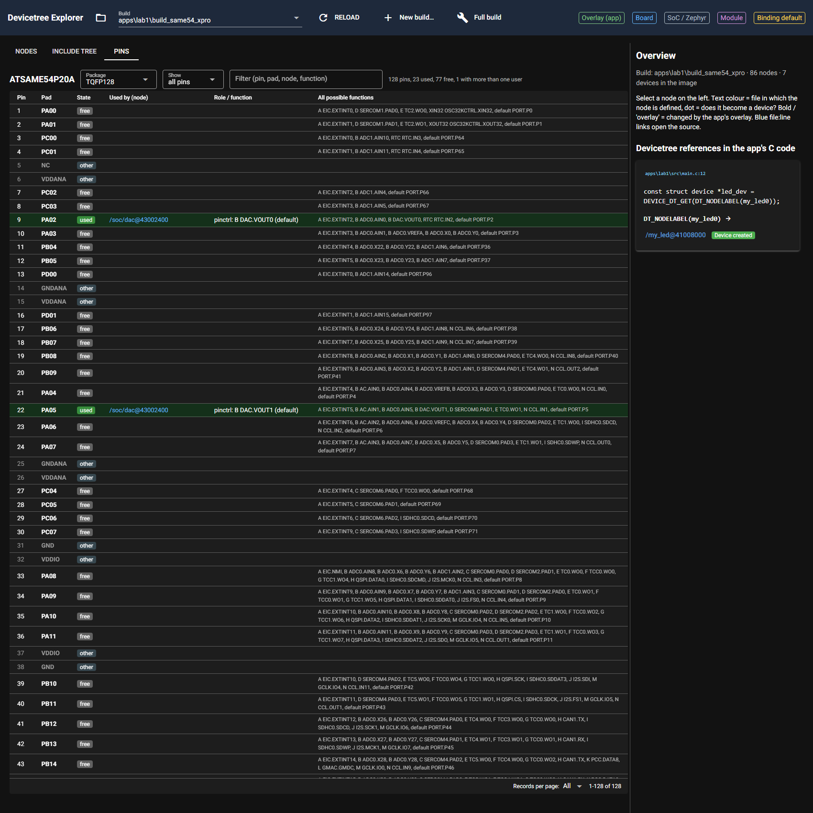

# P1.6 evidence: pin map table (read-only)

## 1. Used pins of lab1 (unit test, full output)

```text
$ py -m pytest -q -rs -s tests/test_pins.py

--- lab1 used pins ---
PA02   pinctrl  /soc/dac@43002400  VOUT0  [B DAC.VOUT0]  state=default
PA05   pinctrl  /soc/dac@43002400  VOUT1  [B DAC.VOUT1]  state=default
PA12   pinctrl  /soc/ethernet@42000800/ethernet  GRX1  [L GMAC.GRX1]  state=default
PA13   pinctrl  /soc/ethernet@42000800/ethernet  GRX0  [L GMAC.GRX0]  state=default
PA14   pinctrl  /soc/ethernet@42000800/ethernet  GTXCK  [L GMAC.GTXCK]  state=default
PA15   pinctrl  /soc/ethernet@42000800/ethernet  GRXER  [L GMAC.GRXER]  state=default
PA17   pinctrl  /soc/ethernet@42000800/ethernet  GTXEN  [L GMAC.GTXEN]  state=default
PA18   pinctrl  /soc/ethernet@42000800/ethernet  GTX0  [L GMAC.GTX0]  state=default
PA19   pinctrl  /soc/ethernet@42000800/ethernet  GTX1  [L GMAC.GTX1]  state=default
PA24   pinctrl  /soc/usb@41000000  DM  [H USB.DM]  state=default
PA25   pinctrl  /soc/usb@41000000  DP  [H USB.DP]  state=default
PB24   pinctrl  /soc/sercom@41012000  PAD1  [D SERCOM2.PAD1]  state=default
PB25   pinctrl  /soc/sercom@41012000  PAD0  [D SERCOM2.PAD0]  state=default
PB26   pinctrl  /soc/sercom@43000000  PAD1  [D SERCOM4.PAD1]  state=default
PB27   pinctrl  /soc/sercom@43000000  PAD0  [D SERCOM4.PAD0]  state=default
PB29   pinctrl  /soc/sercom@43000000  PAD3  [D SERCOM4.PAD3]  state=default
PB31   gpio     /buttons/button_0  gpios  [GPIO]  state=None
PC11   pinctrl  /soc/ethernet@42000800/mdio  GMDC  [L GMAC.GMDC]  state=default
PC12   pinctrl  /soc/ethernet@42000800/mdio  GMDIO  [L GMAC.GMDIO]  state=default
PC18   pinctrl  /soc/tcc@41016000  WO2  [F TCC0.WO2]  state=default
PC18   gpio     /leds/led_0  gpios  [GPIO]  state=None
PC20   pinctrl  /soc/ethernet@42000800/ethernet  GRXDV  [L GMAC.GRXDV]  state=default
PD08   pinctrl  /soc/sercom@43000c00  PAD0  [C SERCOM7.PAD0]  state=default
PD09   pinctrl  /soc/sercom@43000c00  PAD1  [C SERCOM7.PAD1]  state=default
..
2 passed in 5.05s
```

## 2. Screenshot



Deep link: `/?build=apps/lab1/build_same54_xpro&tab=pins`.

## 3. Whole suite (DTX_RTOS4_WS set)

```text
$ py -m pytest -q -rs
.ssss...............................ss.................................. [ 43%]
...............................................
--- lab1 used pins ---
PA02   pinctrl  /soc/dac@43002400  VOUT0  [B DAC.VOUT0]  state=default
PA05   pinctrl  /soc/dac@43002400  VOUT1  [B DAC.VOUT1]  state=default
PA12   pinctrl  /soc/ethernet@42000800/ethernet  GRX1  [L GMAC.GRX1]  state=default
PA13   pinctrl  /soc/ethernet@42000800/ethernet  GRX0  [L GMAC.GRX0]  state=default
PA14   pinctrl  /soc/ethernet@42000800/ethernet  GTXCK  [L GMAC.GTXCK]  state=default
PA15   pinctrl  /soc/ethernet@42000800/ethernet  GRXER  [L GMAC.GRXER]  state=default
PA17   pinctrl  /soc/ethernet@42000800/ethernet  GTXEN  [L GMAC.GTXEN]  state=default
PA18   pinctrl  /soc/ethernet@42000800/ethernet  GTX0  [L GMAC.GTX0]  state=default
PA19   pinctrl  /soc/ethernet@42000800/ethernet  GTX1  [L GMAC.GTX1]  state=default
PA24   pinctrl  /soc/usb@41000000  DM  [H USB.DM]  state=default
PA25   pinctrl  /soc/usb@41000000  DP  [H USB.DP]  state=default
PB24   pinctrl  /soc/sercom@41012000  PAD1  [D SERCOM2.PAD1]  state=default
PB25   pinctrl  /soc/sercom@41012000  PAD0  [D SERCOM2.PAD0]  state=default
PB26   pinctrl  /soc/sercom@43000000  PAD1  [D SERCOM4.PAD1]  state=default
PB27   pinctrl  /soc/sercom@43000000  PAD0  [D SERCOM4.PAD0]  state=default
PB29   pinctrl  /soc/sercom@43000000  PAD3  [D SERCOM4.PAD3]  state=default
PB31   gpio     /buttons/button_0  gpios  [GPIO]  state=None
PC11   pinctrl  /soc/ethernet@42000800/mdio  GMDC  [L GMAC.GMDC]  state=default
PC12   pinctrl  /soc/ethernet@42000800/mdio  GMDIO  [L GMAC.GMDIO]  state=default
PC18   pinctrl  /soc/tcc@41016000  WO2  [F TCC0.WO2]  state=default
PC18   gpio     /leds/led_0  gpios  [GPIO]  state=None
PC20   pinctrl  /soc/ethernet@42000800/ethernet  GRXDV  [L GMAC.GRXDV]  state=default
PD08   pinctrl  /soc/sercom@43000c00  PAD0  [C SERCOM7.PAD0]  state=default
PD09   pinctrl  /soc/sercom@43000c00  PAD1  [C SERCOM7.PAD1]  state=default
......................... [ 87%]
..........
--- source props (from lab1 edt.pickle) ---
sercom2 {
	reg = <1090592768 64>;
	interrupts = <54 0 55 0 56 0 57 0>;
	clocks = <&sercom2 23>, <&sercom2 24 9>;
	clock-names = "GCLK", "MCLK";
	atmel,assigned-clocks = <&sercom2 0>;
	atmel,assigned-clock-names = "GCLK";
	status = "okay";
	compatible = "atmel,sam0-uart";
	current-speed = <115200>;
	rxpo = <1>;
	txpo = <0>;
	#address-cells = <1>;
	#size-cells = <0>;
	pinctrl-0 = <&sercom2_uart_default>;
	pinctrl-names = "default";
};
--- translated node ---
&sercom2 {
	compatible = "microchip,sercom-g1-uart";
	reg = <1090592768 64>;
	interrupts = <54 0 55 0 56 0 57 0>;
	clocks = <&mclkperiph CLOCK_MCHP_MCLKPERIPH_ID_APBB_SERCOM2>, <&gclkperiph CLOCK_MCHP_GCLKPERIPH_ID_SERCOM2_CORE>;
	clock-names = "mclk", "gclk";
	status = "okay";
	current-speed = <115200>;
	rxpo = <1>;
	txpo = <0>;
	#address-cells = <1>;
	#size-cells = <0>;
	pinctrl-0 = <&sercom2_uart_default>;
	pinctrl-names = "default";
};
--- report lines ---
atmel,assigned-clocks: generator 0 moves to the clock controller. Add in the target board file: &clock { gclkperiph { sercom2 { subsystem = <CLOCK_MCHP_GCLKPERIPH_ID_SERCOM2_CORE>; gclkperiph-src = "gclk0"; gclkperiph-en = <1>; }; }; mclkperiph { sercom2 { subsystem = <CLOCK_MCHP_MCLKPERIPH_ID_APBB_SERCOM2>; mclk-en = <1>; }; }; };
dropped 'atmel,assigned-clock-names' (atmel,sam0-uart -> microchip,sercom-g1-uart): names the generator entry, which moves to gclkperiph-src on the clock controller
--- edtlib: matched microchip,sercom-g1-uart binding microchip,sercom-g1-uart.yaml ---
...........                                                    [100%]
=========================== short test summary info ===========================
SKIPPED [2] tests\test_altium_pcbdoc.py:34: DTX_DESIGN_FILES not set: board design files (not in the repo)
SKIPPED [1] tests\test_altium_pcbdoc.py:42: DTX_DESIGN_FILES not set: board design files (not in the repo)
SKIPPED [1] tests\test_altium_pcbdoc.py:59: DTX_DESIGN_FILES not set: board design files (not in the repo)
SKIPPED [1] tests\test_conftest.py:47: DTX_DESIGN_FILES not set: board design files (not in the repo)
SKIPPED [1] tests\test_conftest.py:52: DTX_MAIN_WS not set: main west workspace (current Zephyr, created at P6.1)
159 passed, 6 skipped in 181.18s (0:03:01)
```

## 4. Vendor terms in core/UI modules

```text
$ grep -nE "ATDF|IOSET|mchp_packs|P[A-D][0-9]{2}" dt_explorer/core/pins.py dt_explorer/ui/pinmap.py
(exit code 1; 1 = no hits)
```
