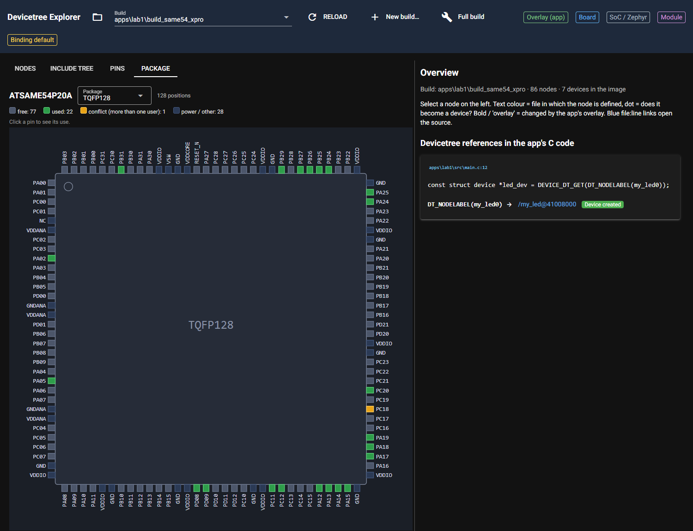
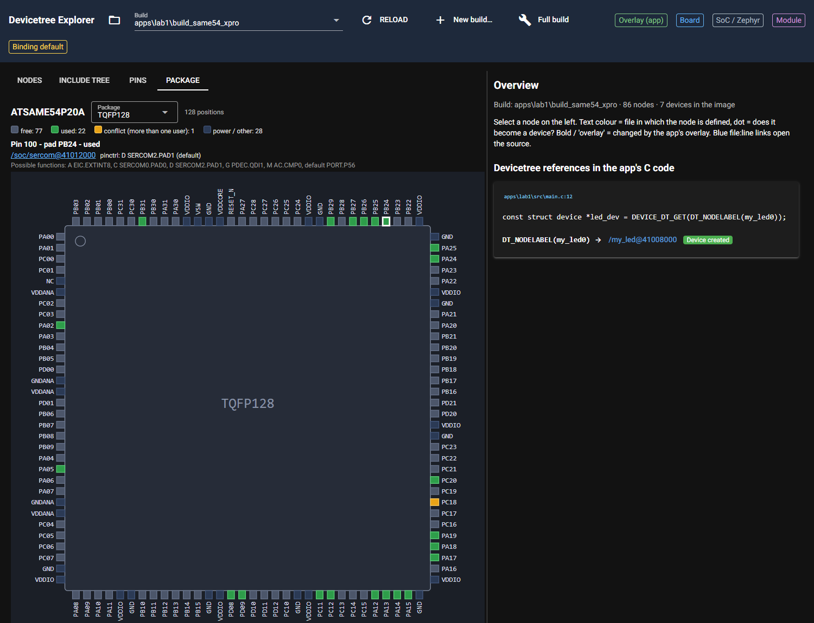
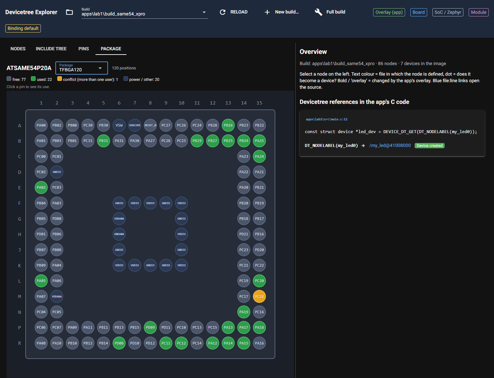
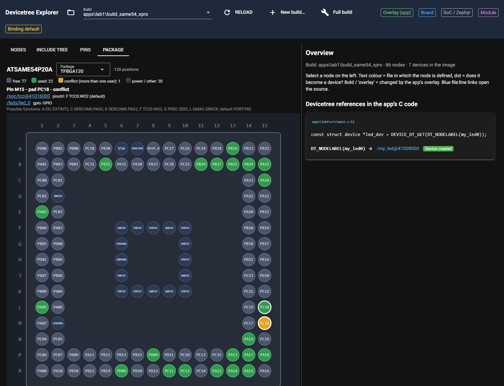

# P1.7 evidence: package view (read-only)

## 1. Geometry tests (complete output)

```text
$ py -m pytest -v -s tests/test_package_layout.py
============================= test session starts =============================
platform win32 -- Python 3.14.8, pytest-9.1.1, pluggy-1.6.0 -- C:\Program Files\Python314\python.exe
cachedir: .pytest_cache
rootdir: C:\Masters\dt_explorer\.claude\worktrees\agent-a458501a5ea6a9a73
configfile: pyproject.toml
plugins: anyio-4.13.0
collecting ... collected 9 items

tests/test_package_layout.py::test_qfp128_pin1_left_top PASSED
tests/test_package_layout.py::test_qfp128_32_per_side PASSED
tests/test_package_layout.py::test_qfp128_counter_clockwise PASSED
tests/test_package_layout.py::test_pins_inside_body_outline PASSED
tests/test_package_layout.py::test_exposed_pad_goes_to_extras PASSED
tests/test_package_layout.py::test_bad_input PASSED
tests/test_package_layout.py::test_bga_a1_top_left_and_jedec_gap PASSED
tests/test_package_layout.py::test_bga_rows_skip_jedec_letters PASSED
tests/test_package_layout.py::test_real_packages 
TFBGA120: rows=['A', 'B', 'C', 'D', 'E', 'F', 'G', 'H', 'J', 'K', 'L', 'M', 'N', 'P', 'R'] (15), cols=[1, 2, 3, 4, 5, 6, 7, 8, 9, 10, 11, 12, 13, 14, 15] (15), balls=120, extras=[]
PASSED

============================== 9 passed in 0.19s ==============================
```

Label rotation is 90 degrees on the top and bottom sides (the pitch is narrower than a pad name) and 0 on
the left and right sides.

## 2. Screenshots (lab1, apps/lab1/build_same54_xpro)

Headless Chrome (Playwright) against a server on port 8791 (port 8765 was occupied by another process).
URL: `/?build=apps/lab1/build_same54_xpro&tab=package`. Console errors in the browser: none. Used pins are
green (PB24/PB25 console on SERCOM2, ...), PC18 is orange (conflict: led_0 gpio + TCC0 WO2 pinctrl), power
and other positions are dark blue, free pins grey.









## 3. Whole suite and vocabulary grep

```text
$ py -m pytest -q -rs        (DTX_RTOS4_WS=C:/Masters/26020_RTOS4/zephyrproject; stdout, 116 lines)
.ssss........................................................
round trip uart: 6 valid combinations checked
.
round trip spi: 6 valid combinations checked
.
round trip i2c: 1 valid combinations checked
.exhaustive uart: 6 accepted, 618 rejected
exhaustive i2c: 1 accepted, 23 rejected
exhaustive spi: 6 accepted, 618 rejected
.sercom2 {'compatible': 'atmel,sam0-uart', 'rxpo': 1, 'txpo': 0} pads={'PAD0': 'PB25', 'PAD1': 'PB24'} -> {'TX': 'PB25', 'RX': 'PB24'}
sercom4 {'compatible': 'atmel,sam0-spi', 'dipo': 3, 'dopo': 0} pads={'PAD1': 'PB26', 'PAD0': 'PB27', 'PAD3': 'PB29'} -> {'MOSI': 'PB27', 'MISO': 'PB29', 'SCK': 'PB26'}
sercom7 {'compatible': 'atmel,sam0-i2c'} pads={'PAD0': 'PD08', 'PAD1': 'PD09'} -> {'SDA': 'PD08', 'SCL': 'PD09'}
.sercom2 {'compatible': 'atmel,sam0-uart', 'rxpo': 1, 'txpo': 0} pads={'PAD0': 'PB25', 'PAD1': 'PB24'} -> {'TX': 'PB25', 'RX': 'PB24'}
sercom4 {'compatible': 'atmel,sam0-spi', 'dipo': 3, 'dopo': 0} pads={'PAD1': 'PB26', 'PAD0': 'PB27', 'PAD3': 'PB29'} -> {'MOSI': 'PB27', 'MISO': 'PB29', 'SCK': 'PB26'}
sercom7 {'compatible': 'atmel,sam0-i2c'} pads={'PAD0': 'PD08', 'PAD1': 'PD09'} -> {'SDA': 'PD08', 'SCL': 'PD09'}
...... [ 28%]
..............ss........................................................ [ 56%]
..sssssss....................................................
TFBGA120: rows=['A', 'B', 'C', 'D', 'E', 'F', 'G', 'H', 'J', 'K', 'L', 'M', 'N', 'P', 'R'] (15), cols=[1, 2, 3, 4, 5, 6, 7, 8, 9, 10, 11, 12, 13, 14, 15] (15), balls=120, extras=[]
.
--- lab1 used pins ---
PA02   pinctrl  /soc/dac@43002400  VOUT0  [B DAC.VOUT0]  state=default
PA05   pinctrl  /soc/dac@43002400  VOUT1  [B DAC.VOUT1]  state=default
PA12   pinctrl  /soc/ethernet@42000800/ethernet  GRX1  [L GMAC.GRX1]  state=default
PA13   pinctrl  /soc/ethernet@42000800/ethernet  GRX0  [L GMAC.GRX0]  state=default
PA14   pinctrl  /soc/ethernet@42000800/ethernet  GTXCK  [L GMAC.GTXCK]  state=default
PA15   pinctrl  /soc/ethernet@42000800/ethernet  GRXER  [L GMAC.GRXER]  state=default
PA17   pinctrl  /soc/ethernet@42000800/ethernet  GTXEN  [L GMAC.GTXEN]  state=default
PA18   pinctrl  /soc/ethernet@42000800/ethernet  GTX0  [L GMAC.GTX0]  state=default
PA19   pinctrl  /soc/ethernet@42000800/ethernet  GTX1  [L GMAC.GTX1]  state=default
PA24   pinctrl  /soc/usb@41000000  DM  [H USB.DM]  state=default
PA25   pinctrl  /soc/usb@41000000  DP  [H USB.DP]  state=default
PB24   pinctrl  /soc/sercom@41012000  PAD1  [D SERCOM2.PAD1]  state=default
PB25   pinctrl  /soc/sercom@41012000  PAD0  [D SERCOM2.PAD0]  state=default
PB26   pinctrl  /soc/sercom@43000000  PAD1  [D SERCOM4.PAD1]  state=default
PB27   pinctrl  /soc/sercom@43000000  PAD0  [D SERCOM4.PAD0]  state=default
PB29   pinctrl  /soc/sercom@43000000  PAD3  [D SERCOM4.PAD3]  state=default
PB31   gpio     /buttons/button_0  gpios  [GPIO]  state=None
PC11   pinctrl  /soc/ethernet@42000800/mdio  GMDC  [L GMAC.GMDC]  state=default
PC12   pinctrl  /soc/ethernet@42000800/mdio  GMDIO  [L GMAC.GMDIO]  state=default
PC18   pinctrl  /soc/tcc@41016000  WO2  [F TCC0.WO2]  state=default
PC18   gpio     /leds/led_0  gpios  [GPIO]  state=None
PC20   pinctrl  /soc/ethernet@42000800/ethernet  GRXDV  [L GMAC.GRXDV]  state=default
PD08   pinctrl  /soc/sercom@43000c00  PAD0  [C SERCOM7.PAD0]  state=default
PD09   pinctrl  /soc/sercom@43000c00  PAD1  [C SERCOM7.PAD1]  state=default
.......... [ 84%]
.........................
--- source props (from lab1 edt.pickle) ---
sercom2 {
	reg = <1090592768 64>;
	interrupts = <54 0 55 0 56 0 57 0>;
	clocks = <&sercom2 23>, <&sercom2 24 9>;
	clock-names = "GCLK", "MCLK";
	atmel,assigned-clocks = <&sercom2 0>;
	atmel,assigned-clock-names = "GCLK";
	status = "okay";
	compatible = "atmel,sam0-uart";
	current-speed = <115200>;
	rxpo = <1>;
	txpo = <0>;
	#address-cells = <1>;
	#size-cells = <0>;
	pinctrl-0 = <&sercom2_uart_default>;
	pinctrl-names = "default";
};
--- translated node ---
&sercom2 {
	compatible = "microchip,sercom-g1-uart";
	reg = <1090592768 64>;
	interrupts = <54 0 55 0 56 0 57 0>;
	clocks = <&mclkperiph CLOCK_MCHP_MCLKPERIPH_ID_APBB_SERCOM2>, <&gclkperiph CLOCK_MCHP_GCLKPERIPH_ID_SERCOM2_CORE>;
	clock-names = "mclk", "gclk";
	status = "okay";
	current-speed = <115200>;
	rxpo = <1>;
	txpo = <0>;
	#address-cells = <1>;
	#size-cells = <0>;
	pinctrl-0 = <&sercom2_uart_default>;
	pinctrl-names = "default";
};
--- report lines ---
atmel,assigned-clocks: generator 0 moves to the clock controller. Add in the target board file: &clock { gclkperiph { sercom2 { subsystem = <CLOCK_MCHP_GCLKPERIPH_ID_SERCOM2_CORE>; gclkperiph-src = "gclk0"; gclkperiph-en = <1>; }; }; mclkperiph { sercom2 { subsystem = <CLOCK_MCHP_MCLKPERIPH_ID_APBB_SERCOM2>; mclk-en = <1>; }; }; };
dropped 'atmel,assigned-clock-names' (atmel,sam0-uart -> microchip,sercom-g1-uart): names the generator entry, which moves to gclkperiph-src on the clock controller
--- edtlib: matched microchip,sercom-g1-uart binding microchip,sercom-g1-uart.yaml ---
...........F..                                  [100%]
================================== FAILURES ===================================
____________ test_list_boards_rtos4_default_vendors_from_providers ____________

rtos4_ws = WindowsPath('C:/Masters/26020_RTOS4/zephyrproject')

    def test_list_boards_rtos4_default_vendors_from_providers(rtos4_ws):
        from dt_explorer.app import load_plugins
        from dt_explorer.core import plugins
        load_plugins()
        vendors = plugins.board_vendors()
>       assert vendors == ("atmel", "microchip")
E       AssertionError: assert () == ('atmel', 'microchip')
E         
E         Right contains 2 more items, first extra item: 'atmel'
E         Use -v to get more diff

tests\test_west_tools.py:67: AssertionError
=========================== short test summary info ===========================
SKIPPED [2] tests\test_altium_pcbdoc.py:34: DTX_DESIGN_FILES not set: board design files (not in the repo)
SKIPPED [1] tests\test_altium_pcbdoc.py:42: DTX_DESIGN_FILES not set: board design files (not in the repo)
SKIPPED [1] tests\test_altium_pcbdoc.py:59: DTX_DESIGN_FILES not set: board design files (not in the repo)
SKIPPED [1] tests\test_conftest.py:47: DTX_DESIGN_FILES not set: board design files (not in the repo)
SKIPPED [1] tests\test_conftest.py:52: DTX_MAIN_WS not set: main west workspace (current Zephyr, created at P6.1)
SKIPPED [2] tests\test_import_pipeline.py:186: DTX_DESIGN_FILES not set: board design files (not in the repo)
SKIPPED [1] tests\test_import_pipeline.py:204: DTX_DESIGN_FILES not set: board design files (not in the repo)
SKIPPED [1] tests\test_import_pipeline.py:212: DTX_DESIGN_FILES not set: board design files (not in the repo)
SKIPPED [1] tests\test_import_pipeline.py:220: DTX_DESIGN_FILES not set: board design files (not in the repo)
SKIPPED [1] tests\test_import_pipeline.py:244: DTX_DESIGN_FILES not set: board design files (not in the repo)
SKIPPED [1] tests\test_import_pipeline.py:263: DTX_DESIGN_FILES not set: board design files (not in the repo)
1 failed, 241 passed, 13 skipped in 158.10s (0:02:38)

$ grep -nEi "ATDF|IOSET|mchp|atmel|microchip|P[A-D][0-9]{2}" dt_explorer/core/package_layout.py dt_explorer/ui/package_view.py
(no output, exit status 1)
```

Result: 241 passed, 13 skipped, 1 failed. The failure,
`tests/test_west_tools.py::test_list_boards_rtos4_default_vendors_from_providers`
(`assert () == ('atmel', 'microchip')`), is not caused by this card: it fails identically with
`--ignore=tests/test_package_layout.py` (232 passed, 1 failed), passes when the file runs alone or after
`test_pins.py` / `test_package_layout.py`, and no test imports `ui/package_view.py` or `ui/page.py`.
Cause: an earlier test empties the plugin registry and `load_plugins()` does not re-register modules that
are already imported, so `plugins.board_vendors()` returns `()` (test-order dependency).
