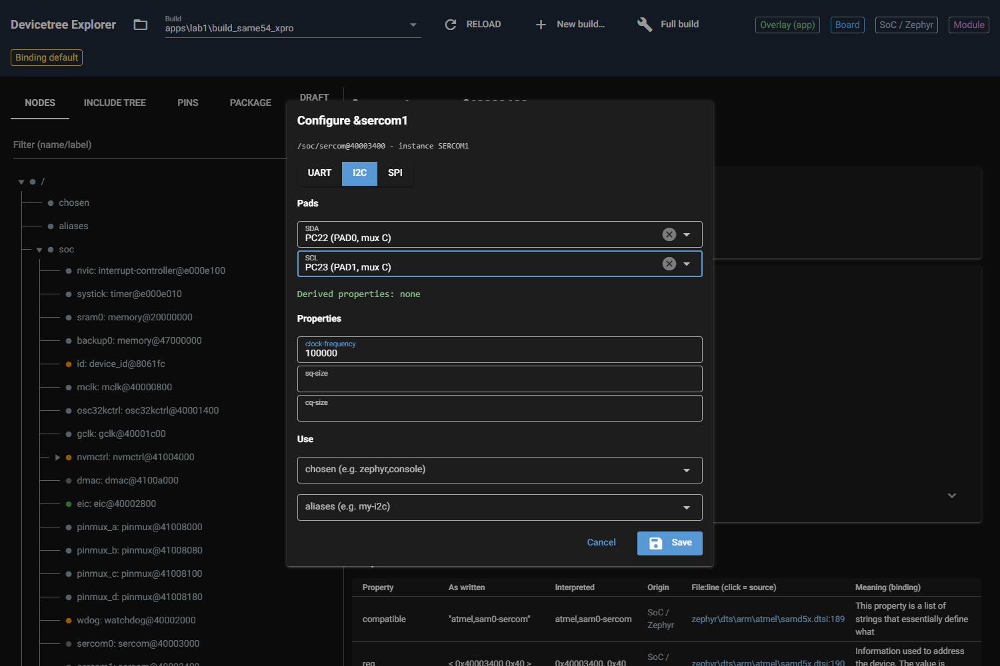
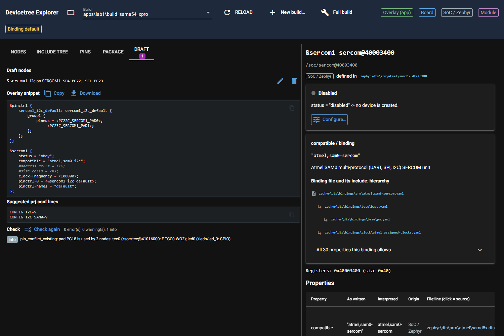
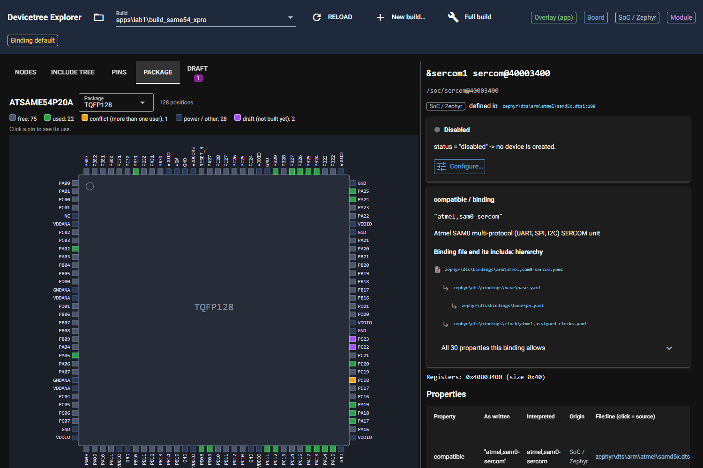
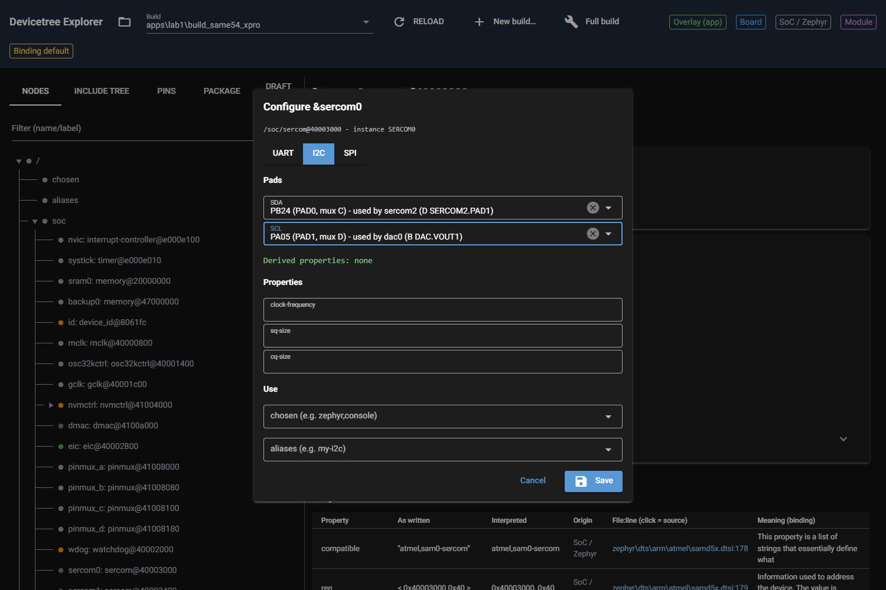
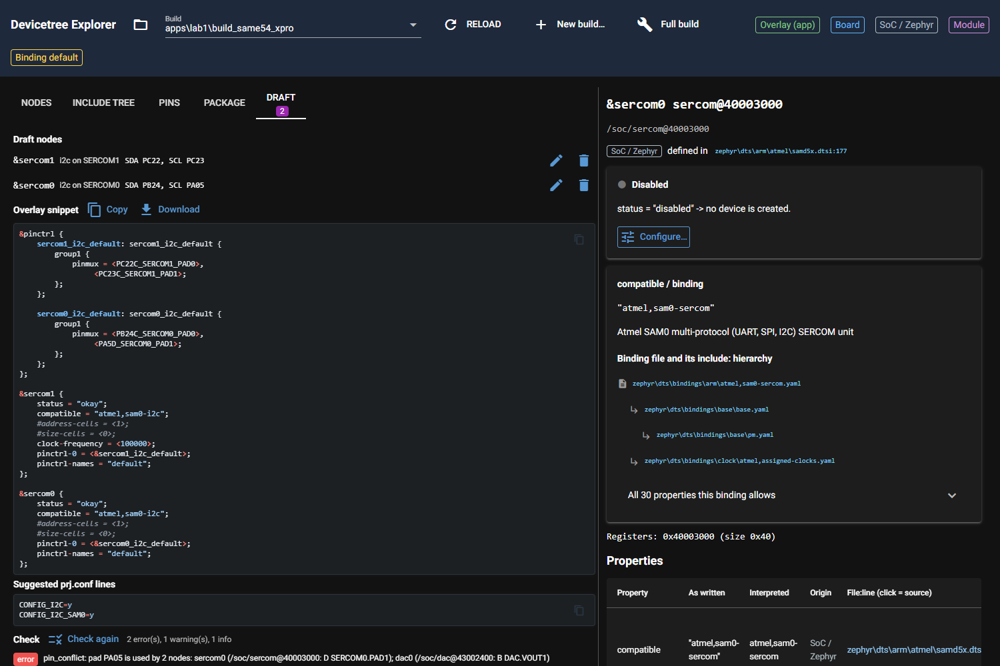

# P3.5 evidence: configurator UI

Server: `py dt_explorer.py C:/Masters/26020_RTOS4/zephyrproject --no-browser` (port 8765, PID stopped afterwards; the
builder's server on 8766 was not touched). Browser: Playwright + headless Chrome, viewport 1500x1000, lab1
`apps/lab1/build_same54_xpro`. The draft file the UI writes goes to the real app folder
(`apps\lab1\.dt_explorer\build_same54_xpro.draft.json`, because `APPLICATION_SOURCE_DIR` is in the build's
CMakeCache); it was **deleted after each run**, `apps\lab1` holds no `.dt_explorer` folder now (listing at the end
of section 2).

Changes in this card: `ui/configure.py` (helpers + dialog), `ui/draft_tab.py`, `ui/package_view.py` (draft colour),
`ui/page.py` (Configure… button, Draft tab with count badge, `tab=draft` deep link), `core/render.py` (see 4).

## 1. End to end: SERCOM1 as I2C (acceptance 1)

Steps (script output below): open `/?build=apps/lab1/build_same54_xpro&node=/soc/sercom@40003400`, press
"Configure…", class I2C, SDA = PC22, SCL = PC23, clock-frequency 100000, Save. The Draft tab opens by itself, renders
the snippet and runs `validate()` in a worker thread (spinner while it runs).

```text
$ py e2e.py
SCL options after SDA=PC22: ['PA01 (PAD1, mux D)', 'PA17 (PAD1, mux C) - used by gmac (L GMAC.GTXEN)', 'PC23 (PAD1, mux C)', 'PC28 (PAD1, mux C)']
DERIVED: Derived properties: none
--- I2C on SERCOM1 PC22/PC23
SNIPPET:
&pinctrl {
    sercom1_i2c_default: sercom1_i2c_default {
        group1 {
            pinmux = <PC22C_SERCOM1_PAD0>,
                 <PC23C_SERCOM1_PAD1>;
        };
    };
};

&sercom1 {
    status = "okay";
    compatible = "atmel,sam0-i2c";
    #address-cells = <1>;
    #size-cells = <0>;
    clock-frequency = <100000>;
    pinctrl-0 = <&sercom1_i2c_default>;
    pinctrl-names = "default";
};

content_copy
KCONFIG:
CONFIG_I2C=y
CONFIG_I2C_SAM0=y

content_copy
CHECK STATUS: 0 error(s), 0 warning(s), 1 info
FINDINGS:
info
pin_conflict_existing: pad PC18 is used by 2 nodes: tcc0 (/soc/tcc@41016000: F TCC0.WO2); led0 (/leds/led_0: GPIO)
BADGE: 1
DRAFT PINS IN SVG: ['PC22', 'PC23']
CONSOLE ERRORS: []
```

* SCL list after SDA = PC22 shows only PAD1 pads; PA17 is offered but marked "used by gmac" (taken pads stay
  selectable, the check reports the conflict, see section 2).
* Snippet contains `#address-cells = <1>; #size-cells = <0>;` from the binding chain (render change, section 4).
* Kconfig suggestions: `CONFIG_I2C=y`, `CONFIG_I2C_SAM0=y` (recipe table).
* Check: 0 errors, 0 warnings, 1 info (the PC18 conflict that already exists in the build).
* Package view: exactly the two pins PC22 and PC23 carry the draft colour (purple), the legend gets an entry
  "draft (not built yet): 2".
* No console errors in the browser.

Screenshots:







## 2. Negative case: pads already used by another node (acceptance 2)

Second node `&sercom0` as I2C with SDA = PB24 (used by sercom2 as UART RX) and SCL = PA05 (used by dac0).
The dialog lists the users next to the pads. The same run then opens the pencil of `&sercom1` to check that Edit
reloads the saved pads.

```text
$ py neg.py
SDA options: ['PA04 (PAD0, mux D)', 'PA08 (PAD0, mux C)', 'PB24 (PAD0, mux C) - used by sercom2 (D SERCOM2.PAD1)', 'PC17 (PAD0, mux D)']
SCL options: ['PA05 (PAD1, mux D) - used by dac0 (B DAC.VOUT1)', 'PA09 (PAD1, mux C)', 'PB25 (PAD1, mux C) - used by sercom2 (D SERCOM2.PAD0)', 'PC16 (PAD1, mux D)']
SNIPPET:
&pinctrl {
    sercom1_i2c_default: sercom1_i2c_default {
        group1 {
            pinmux = <PC22C_SERCOM1_PAD0>,
                 <PC23C_SERCOM1_PAD1>;
        };
    };

    sercom0_i2c_default: sercom0_i2c_default {
        group1 {
            pinmux = <PB24C_SERCOM0_PAD0>,
                 <PA5D_SERCOM0_PAD1>;
        };
    };
};

&sercom1 {
    status = "okay";
    compatible = "atmel,sam0-i2c";
    #address-cells = <1>;
    #size-cells = <0>;
    clock-frequency = <100000>;
    pinctrl-0 = <&sercom1_i2c_default>;
    pinctrl-names = "default";
};

&sercom0 {
    status = "okay";
    compatible = "atmel,sam0-i2c";
    #address-cells = <1>;
    #size-cells = <0>;
    pinctrl-0 = <&sercom0_i2c_default>;
    pinctrl-names = "default";
};

content_copy
CHECK STATUS: 2 error(s), 1 warning(s), 1 info
FINDINGS:
error
pin_conflict: pad PA05 is used by 2 nodes: sercom0 (/soc/sercom@40003000: D SERCOM0.PAD1); dac0 (/soc/dac@43002400: B DAC.VOUT1)
error
pin_conflict: pad PB24 is used by 2 nodes: sercom0 (/soc/sercom@40003000: C SERCOM0.PAD0); sercom2 (/soc/sercom@41012000: D SERCOM2.PAD1)
info
pin_conflict_existing: pad PC18 is used by 2 nodes: tcc0 (/soc/tcc@41016000: F TCC0.WO2); led0 (/leds/led_0: GPIO)
warning
provider_constraint: sercom0 (SERCOM0): PA05: group 3, PB24: group 2. Pads of one peripheral instance should come from the same IOSET; pads from different IOSETs may violate the device's timing/electrical specification.
EDIT sercom1 dialog SDA/SCL: PC22 (PAD0, mux C) | PC23 (PAD1, mux C)
```





Draft file written by the two runs (`apps\lab1\.dt_explorer\build_same54_xpro.draft.json`, then deleted):

```json
{
  "version": 1,
  "build": "build_same54_xpro",
  "nodes": [
    {
      "cls": "i2c",
      "roles": [
        "SDA",
        "SCL"
      ],
      "props": {
        "clock-frequency": 100000
      },
      "use": {
        "chosen": [],
        "aliases": []
      },
      "instance": "SERCOM1",
      "pins": {
        "SDA": "PC22",
        "SCL": "PC23"
      },
      "vendor_props": {},
      "compatible": "atmel,sam0-i2c",
      "label": "sercom1"
    },
    {
      "cls": "i2c",
      "roles": [
        "SDA",
        "SCL"
      ],
      "props": {},
      "use": {
        "chosen": [],
        "aliases": []
      },
      "instance": "SERCOM0",
      "pins": {
        "SDA": "PB24",
        "SCL": "PA05"
      },
      "vendor_props": {},
      "compatible": "atmel,sam0-i2c",
      "label": "sercom0"
    }
  ]
}
```

```text
$ ls -a /c/Masters/26020_RTOS4/zephyrproject/apps/lab1
.  ..  CMakeLists.txt  boards  build.log  build_same54_xpro  prj.conf  src
```

## 3. Tests and vocabulary grep (acceptance 3, 4)

```text
$ py -m pytest -v tests/test_configure.py
============================= test session starts =============================
platform win32 -- Python 3.14.8, pytest-9.1.1, pluggy-1.6.0 -- C:\Program Files\Python314\python.exe
cachedir: .pytest_cache
rootdir: C:\Masters\dt_explorer
configfile: pyproject.toml
plugins: anyio-4.13.0
collecting ... collected 15 items
tests/test_configure.py::test_find_instance_by_address_then_label PASSED [  6%]
tests/test_configure.py::test_required_and_optional_roles PASSED         [ 13%]
tests/test_configure.py::test_i2c_candidates_follow_the_fixed_pads PASSED [ 20%]
tests/test_configure.py::test_uart_roles_are_filtered_by_recipe_validity PASSED [ 26%]
tests/test_configure.py::test_spi_mosi_choice_narrows_miso PASSED        [ 33%]
tests/test_configure.py::test_taken_pads_stay_selectable_but_say_who_uses_them PASSED [ 40%]
tests/test_configure.py::test_recipe_without_valid_assignments_offers_every_signal PASSED [ 46%]
tests/test_configure.py::test_derive_props PASSED                        [ 53%]
tests/test_configure.py::test_build_node_drops_empty_roles_and_values PASSED [ 60%]
tests/test_configure.py::test_parse_prop PASSED                          [ 66%]
tests/test_configure.py::test_neutral_specs_skip_generic_and_const PASSED [ 73%]
tests/test_configure.py::test_class_options_come_from_the_recipe PASSED  [ 80%]
tests/test_configure.py::test_const_props_of_binding_chain PASSED        [ 86%]
tests/test_configure.py::test_kconfig_lines_and_summary PASSED           [ 93%]
tests/test_configure.py::test_mark_draft_colours_only_pad_rows PASSED    [100%]
============================= 15 passed in 1.05s ==============================
```

Whole suite (`DTX_RTOS4_WS=C:/Masters/26020_RTOS4/zephyrproject DTX_MAIN_WS=C:/Masters/zephyr-main
DTX_DESIGN_FILES=C:/Masters/board_design_files`, goldens untouched). The log is 312 lines; **tail only** (last 12 lines):

```text
$ py -m pytest -q -rs
	#address-cells = <1>;
	#size-cells = <0>;
	pinctrl-0 = <&sercom2_uart_default>;
	pinctrl-names = "default";
};
--- report lines ---
atmel,assigned-clocks: generator 0 moves to the clock controller. Add in the target board file: &clock { gclkperiph { sercom2 { subsystem = <CLOCK_MCHP_GCLKPERIPH_ID_SERCOM2_CORE>; gclkperiph-src = "gclk0"; gclkperiph-en = <1>; }; }; mclkperiph { sercom2 { subsystem = <CLOCK_MCHP_MCLKPERIPH_ID_APBB_SERCOM2>; mclk-en = <1>; }; }; };
dropped 'atmel,assigned-clock-names' (atmel,sam0-uart -> microchip,sercom-g1-uart): names the generator entry, which moves to gclkperiph-src on the clock controller
--- edtlib: matched microchip,sercom-g1-uart binding microchip,sercom-g1-uart.yaml ---
........ [ 95%]
.............                                                            [100%]
301 passed in 223.06s (0:03:43)
```

Before this card: 286 passed (P6.1 evidence); now 301 = 286 + 15 new tests in `tests/test_configure.py`.

```text
$ grep -nEi "ATDF|IOSET|mchp|P[A-D][0-9]{2}" dt_explorer/ui/configure.py dt_explorer/ui/draft_tab.py
(no output, exit code 1)
```

## 4. Render change: const properties of the binding chain

`core/render.py`: new `const_props(compatible, index)` and `RenderContext.bindings` (a `BindingIndex`). The renderer adds
every property that the binding chain of the node's compatible declares with `const` (other than `compatible` and
`status`), before the user's neutral properties. For `atmel,sam0-i2c` / `-spi` that is `#address-cells = <1>` and
`#size-cells = <0>` (`i2c-controller.yaml`, `spi-controller.yaml`). Nothing vendor-specific; without `bindings`
the output is unchanged (tests/test_render.py green: part of the 301).

## 5. Notes and findings

* **Pre-existing bug found and fixed in page.py (tab handler):** `on_tab` compared `tabs.value == tab_pins`, but a click
  on a tab delivers the tab *name* (str) in NiceGUI 3.17.1; only `set_value(<tab element>)` delivered the element.
  Before the fix, clicking "Pins" or "Package" showed an empty panel (earlier evidence used `&tab=` URLs). Now
  `is_(tab)` accepts both. Reproduced with Playwright on the unmodified tab logic (0 pins / 0 tables after a click).
* `tests/test_render.py` run **alone** fails in `test_sercom2_overlay_equals_board_block` (`ModuleNotFoundError: devicetree`); this also happens with my render.py change stashed, i.e. an existing order dependence on the `devicetree` import path that earlier tests of the full suite provide. In the full suite it passes.
* Taken pads stay selectable (the negative case needs it) and show "used by ..." in the option text; "greyed out"
  from CONFIGURATOR.md is not done.
* The SERCOM node of the SoC dtsi has compatible `atmel,sam0-sercom` (no recipe). Classes are offered from the
  recipes whose `pin_roles(instance)` is not empty, their `compatibles` mapped to a class with `detect_class`.
* Optional roles and required roles are derived from `recipe.valid_assignments(cls)` (roles present in every valid
  assignment are required); `valid_assignments`/`roles_for` are not in the `Recipe` protocol, the helpers fall back to
  "every signal of the instance qualifies" without them.
* Not done (out of scope here): "Edit pins…" for enabled nodes, a `draft` badge in the node tree, writing the snippet
  to a file (Copy and Download are there), README/GUI.md (P3.6).
