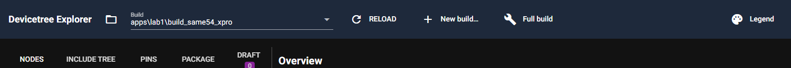
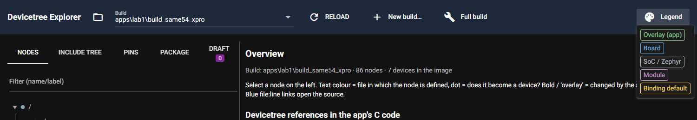
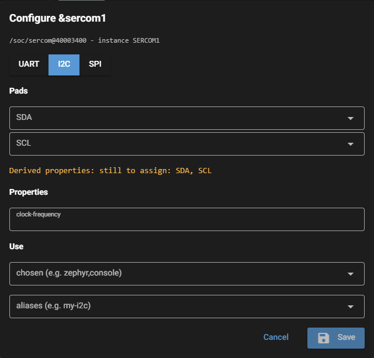

# P3.7 evidence: compact header, no noise fields

Worktree `agent-a9bc9257030f0b86c`, reset to `master` (0aa461c) first. Scope: `dt_explorer/ui/page.py` (header block
only), `dt_explorer/ui/configure.py` (property field list only), `tests/test_configure.py`, this file, `docs/evidence/img/P3.7_*.png`.

## 1. Findings that changed the approach

* **Header:** at 1500 px the five origin chips wrapped onto a second line (header 115 px high, `P3.7_header_before.png`).
  Fix: the chips moved into a **Legend** menu button (`id=legend-btn`); the menu lists the same five entries with the
  same colours and captions (`ORIGIN_STYLE`, "other" still omitted as before). Header is one row (74 px, all items at y=16..19).
* **Noise fields:** the card's premise ("from an RTIO include") does not hold for the RTOS4 workspace. `sq-size` and
  `cq-size` are declared **directly in `zephyr/dts/bindings/i2c/i2c-controller.yaml`** (Zephyr v4.3.0), next to
  `clock-frequency`. A rule "only properties of the class base binding's own file" therefore keeps them, and no
  other include in the chain declares them. The generic rule was not sufficient, so the fix is a small explicit deny
  list `NOISE_PROPS = {"sq-size", "cq-size"}` in `configure.py`. No other base-binding property was removed (uart, spi unchanged).

## 2. Property field lists (lab1, SERCOM1, `neutral_specs` of each class)

Produced by a script that loads `BuildModel(apps/lab1/build_same54_xpro)`, the real `BindingIndex`, and calls
`configure.neutral_specs(option, index)` for the recipe's option of each class.

```text
before:
uart (atmel,sam0-uart): clock-frequency, current-speed, hw-flow-control, parity, stop-bits, data-bits
i2c (atmel,sam0-i2c): clock-frequency, sq-size, cq-size
spi (atmel,sam0-spi): clock-frequency, overrun-character

after:
uart (atmel,sam0-uart): clock-frequency, current-speed, hw-flow-control, parity, stop-bits, data-bits
i2c (atmel,sam0-i2c): clock-frequency
spi (atmel,sam0-spi): clock-frequency, overrun-character
```

UART `current-speed` and I2C `clock-frequency` are still shown. Only `sq-size` and `cq-size` are gone.

## 3. Screenshots (Playwright, headless Chrome, viewport 1500x1000, lab1)

Server: `dt_explorer` on port 8791 (own launcher that patches `ui.run`'s port; 8765/8766 not touched).
Before: server started from the unmodified code. After: restarted after the change.







Before (for comparison): `img/P3.7_header_before.png` (two header rows), `img/P3.7_i2c_dialog_before.png` (shows sq-size, cq-size).

Browser console errors on both pages: none. Dialog text after (`#cfg-dialog` innerText, I2C selected):

```text
Configure &sercom1
/soc/sercom@40003400 - instance SERCOM1
UART
I2C
SPI
Pads
SDA
arrow_drop_down
SCL
arrow_drop_down
Derived properties: still to assign: SDA, SCL
Properties
clock-frequency
Use
chosen (e.g. zephyr,console)
arrow_drop_down
aliases (e.g. my-i2c)
arrow_drop_down
Cancel
save
Save
console errors: []
```

Legend menu text: `Overlay (app) | Board | SoC / Zephyr | Module | Binding default`.

Header element tops after the change (`.q-btn, .q-field, label` in the header): `[16, 17, 19]`, i.e. one row; header box 1500 x 74.

Lab1 check: no `.dt_explorer*` file in `apps\lab1` after the runs (the screenshots never clicked Save).

## 4. Acceptance commands (complete output)

### 4.1 `py -m pytest -q -rs tests/test_configure.py` with DTX_RTOS4_WS set

```text
$ DTX_RTOS4_WS=C:/Masters/26020_RTOS4/zephyrproject py -m pytest -q -rs tests/test_configure.py
......................                                                   [100%]
22 passed in 11.36s
```

New test: `test_neutral_specs_hide_rtio_queue_sizes` (i2c-controller with clock-frequency, sq-size, cq-size → only
clock-frequency).

### 4.2 Full suite (builder will rerun; run here for safety)

Log is over 200 lines; the tail is shown (it contains the summary line; the full log was checked for failures: none).

```text
$ DTX_RTOS4_WS=C:/Masters/26020_RTOS4/zephyrproject py -m pytest -q -rs
(… earlier lines not captured; the tail below is the end of the -rs listing and the summary …)
test_altium_pcbdoc.py:42: DTX_DESIGN_FILES not set: board design files (not in the repo)
SKIPPED [1] tests\test_altium_pcbdoc.py:59: DTX_DESIGN_FILES not set: board design files (not in the repo)
SKIPPED [1] tests\test_conftest.py:47: DTX_DESIGN_FILES not set: board design files (not in the repo)
SKIPPED [1] tests\test_conftest.py:52: DTX_MAIN_WS not set: main west workspace (current Zephyr, created at P6.1)
SKIPPED [2] tests\test_import_pipeline.py:186: DTX_DESIGN_FILES not set: board design files (not in the repo)
SKIPPED [1] tests\test_import_pipeline.py:204: DTX_DESIGN_FILES not set: board design files (not in the repo)
SKIPPED [1] tests\test_import_pipeline.py:212: DTX_DESIGN_FILES not set: board design files (not in the repo)
SKIPPED [1] tests\test_import_pipeline.py:220: DTX_DESIGN_FILES not set: board design files (not in the repo)
SKIPPED [1] tests\test_import_pipeline.py:244: DTX_DESIGN_FILES not set: board design files (not in the repo)
SKIPPED [1] tests\test_import_pipeline.py:263: DTX_DESIGN_FILES not set: board design files (not in the repo)
SKIPPED [2] tests\test_model_host.py:56: DTX_MAIN_WS not set: main west workspace (current Zephyr, created at P6.1)
SKIPPED [1] tests\test_model_host.py:75: DTX_MAIN_WS not set: main west workspace (current Zephyr, created at P6.1)
SKIPPED [1] tests\test_model_host.py:91: DTX_MAIN_WS not set: main west workspace (current Zephyr, created at P6.1)
298 passed, 17 skipped in 241.73s (0:04:01)
exit code 0
```

## 5. Not done in this card (out of write scope)

* `docs/GUI.md` section 1 still describes the chip row and has the "Known issue" paragraph about the wrap, and
  `docs/img/el_header.png` still shows the old header. Both are now stale. Update them in a docs follow-up
  (outside P3.7's write scope).
* `README.md` may describe the origin chips; not checked (out of scope).
