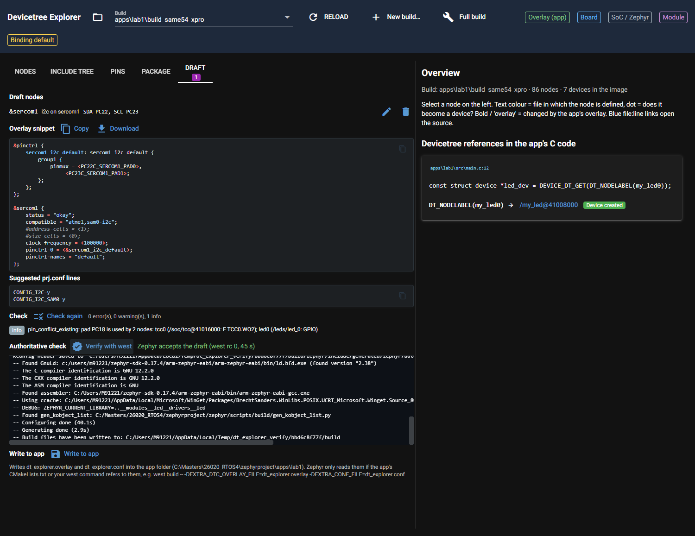
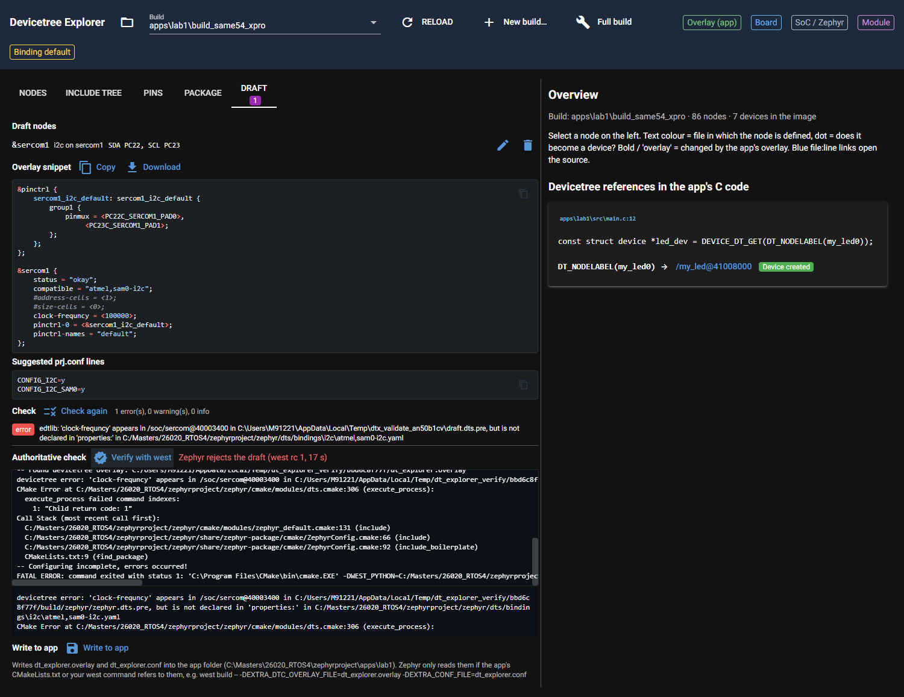

# P4.1 evidence: Verify with west and file output

Changes: `dt_explorer/core/verify.py` (new), `dt_explorer/ui/draft_tab.py` (Verify button, streamed log,
spinner, result line, extracted errors; "Write to app" with confirmation), `tests/test_verify.py` (7 tests).

How it works: `verify.start()` reads app dir, workspace, board (`CONFIG_BOARD_TARGET`, here
`same54_xpro/same54p20a`; fallback CMakeCache `BOARD`/`CACHED_BOARD`, `@rev` appended when a revision is set) and
python (`<ws>\.venv\Scripts\python.exe`) from the build. It writes `dt_explorer.overlay` / `dt_explorer.conf` into
`%TEMP%\dt_explorer_verify\<sha1(build path)[:10]>\`, deletes that scratch `build\` folder (never the user's) and runs
`west build -b <board> -d <scratch>\build --cmake-only <app> -- -DEXTRA_DTC_OVERLAY_FILE=<fwd/slash path> -DEXTRA_CONF_FILE=<fwd/slash path>`.
The UI explains next to "Write to app" that Zephyr only reads `dt_explorer.overlay/.conf` when the app's
CMakeLists.txt or the west command refers to them.

## 1. Valid draft (SERCOM1 I2C on PC22/PC23, 100 kHz, CONFIG_I2C + CONFIG_I2C_SAM0)

Core call (`verify.verify(build, overlay, conf)`; log tail = last 15 lines, the log has 37 lines):

```text
True 0 28.65576549999969

--
Merged configuration 'C:/Masters/26020_RTOS4/zephyrproject/apps/lab1/prj.conf'
Merged configuration 'C:/Users/M91221/AppData/Local/Temp/dt_explorer_verify/bbd6c8f77f/dt_explorer.conf'
Configuration saved to 'C:/Users/M91221/AppData/Local/Temp/dt_explorer_verify/bbd6c8f77f/build/zephyr/.config'
Kconfig header saved to 'C:/Users/M91221/AppData/Local/Temp/dt_explorer_verify/bbd6c8f77f/build/zephyr/include/generated/zephyr/autoconf.h'
-- Found GnuLd: c:/users/m91221/zephyr-sdk-0.17.4/arm-zephyr-eabi/arm-zephyr-eabi/bin/ld.bfd.exe (found version "2.38")
-- The C compiler identification is GNU 12.2.0
-- The CXX compiler identification is GNU 12.2.0
-- The ASM compiler identification is GNU
-- Found assembler: C:/Users/M91221/zephyr-sdk-0.17.4/arm-zephyr-eabi/bin/arm-zephyr-eabi-gcc.exe
-- Using ccache: C:/Users/M91221/AppData/Local/Microsoft/WinGet/Packages/BrechtSanders.WinLibs.POSIX.UCRT_Microsoft.Winget.Source_8wekyb3d8bbwe/mingw64/bin/ccache.exe
-- DEBUG: ZEPHYR_CURRENT_LIBRARY=..__modules__led__drivers__led
-- Found gen_kobject_list: C:/Masters/26020_RTOS4/zephyrproject/zephyr/scripts/build/gen_kobject_list.py
-- Configuring done (26.5s)
-- Generating done (0.9s)
-- Build files have been written to: C:/Users/M91221/AppData/Local/Temp/dt_explorer_verify/bbd6c8f77f/build
```

Same case through the UI (Playwright, script output; screenshot `img/P4.1_ok.png`, `img/P4.1_write_dialog.png`):

```text
check status: 0 error(s), 0 warning(s), 1 info
spinner visible during run: True | status: west is configuring …
verify took 45.5 s in the UI
RESULT LINE: Zephyr accepts the draft (west rc 0, 45 s)
RESULT COLOR CLASS: text-sm text-green-4
LOG LINES: 37
WRITE STATUS: Wrote dt_explorer.overlay, dt_explorer.conf
console errors: []
```

Timing: 28.7 s core call (26.5 s CMake "Configuring done"), 45.5 s in the UI run (machine load differs between
runs; the first run after a restart also loads the model). Task text said 35-45 s; the failing case stops
earlier, 13-18 s.



## 2. Misspelled property `clock-frequncy` (acceptance 2)

Core call:

```text
$ py v1.py bad
False 1 13.538610800000242
devicetree error: 'clock-frequncy' appears in /soc/sercom@40003400 in C:/Users/M91221/AppData/Local/Temp/dt_explorer_verify/bbd6c8f77f/build/zephyr/zephyr.dts.pre, but is not declared in 'properties:' in C:/Masters/26020_RTOS4/zephyrproject/zephyr/dts/bindings\i2c\atmel,sam0-i2c.yaml
CMake Error at C:/Masters/26020_RTOS4/zephyrproject/zephyr/cmake/modules/dts.cmake:306 (execute_process):
--
devicetree error: 'clock-frequncy' appears in /soc/sercom@40003400 in C:/Users/M91221/AppData/Local/Temp/dt_explorer_verify/bbd6c8f77f/build/zephyr/zephyr.dts.pre, but is not declared in 'properties:' in C:/Masters/26020_RTOS4/zephyrproject/zephyr/dts/bindings\i2c\atmel,sam0-i2c.yaml
CMake Error at C:/Masters/26020_RTOS4/zephyrproject/zephyr/cmake/modules/dts.cmake:306 (execute_process):
  execute_process failed command indexes:

    1: "Child return code: 1"

Call Stack (most recent call first):
  C:/Masters/26020_RTOS4/zephyrproject/zephyr/cmake/modules/zephyr_default.cmake:131 (include)
  C:/Masters/26020_RTOS4/zephyrproject/zephyr/share/zephyr-package/cmake/ZephyrConfig.cmake:66 (include)
  C:/Masters/26020_RTOS4/zephyrproject/zephyr/share/zephyr-package/cmake/ZephyrConfig.cmake:92 (include_boilerplate)
  CMakeLists.txt:9 (find_package)


-- Configuring incomplete, errors occurred!
FATAL ERROR: command exited with status 1: 'C:\Program Files\CMake\bin\cmake.EXE' -DWEST_PYTHON=C:/Masters/26020_RTOS4/zephyrproject/.venv/Scripts/python.exe '-BC:\Users\M91221\AppData\Local\Temp\dt_explorer_verify\bbd6c8f77f\build' -GNinja -DBOARD=same54_xpro/same54p20a -DEXTRA_DTC_OVERLAY_FILE=C:/Users/M91221/AppData/Local/Temp/dt_explorer_verify/bbd6c8f77f/dt_explorer.overlay -DEXTRA_CONF_FILE=C:/Users/M91221/AppData/Local/Temp/dt_explorer_verify/bbd6c8f77f/dt_explorer.conf '-SC:\Masters\26020_RTOS4\zephyrproject\apps\lab1'
```

(The log printed in full is 28 lines; the `FATAL ERROR` line is long and was cut at 1500 characters here only.)

Exact Zephyr error text (first extracted line):

```text
devicetree error: 'clock-frequncy' appears in /soc/sercom@40003400 in C:/Users/M91221/AppData/Local/Temp/dt_explorer_verify/bbd6c8f77f/build/zephyr/zephyr.dts.pre, but is not declared in 'properties:' in C:/Masters/26020_RTOS4/zephyrproject/zephyr/dts/bindings\i2c\atmel,sam0-i2c.yaml
```

Through the UI (screenshot `img/P4.1_fail.png`: red result line "Zephyr rejects the draft (west rc 1, 17 s)", the streamed
log, and the extracted error block):

```text
check status: 1 error(s), 0 warning(s), 0 info
spinner visible during run: True | status: west is configuring …
verify took 18.3 s in the UI
RESULT LINE: Zephyr rejects the draft (west rc 1, 17 s)
RESULT COLOR CLASS: text-sm text-red-4
EXTRACTED ERROR TEXT:
devicetree error: 'clock-frequncy' appears in /soc/sercom@40003400 in C:/Users/M91221/AppData/Local/Temp/dt_explorer_verify/bbd6c8f77f/build/zephyr/zephyr.dts.pre, but is not declared in 'properties:' in C:/Masters/26020_RTOS4/zephyrproject/zephyr/dts/bindings\i2c\atmel,sam0-i2c.yaml
CMake Error at C:/Masters/26020_RTOS4/zephyrproject/zephyr/cmake/modules/dts.cmake:306 (execute_process):
LOG LINES: 28
console errors: []
```

Note: the fast check (edtlib, `validate()`) already reports the same typo as an error in the Check section; the screenshot
shows both. `west` needs 13-18 s to say the same.



## 3. The user's build folder is untouched (acceptance 3)

`snap.py` walks `apps\lab1\build_same54_xpro` (every file: path, size, mtime_ns, and SHA-256 over path + bytes).
Before = before any UI run of this card; after = after the UI runs of both cases, "Write to app" and the pytest run
of `test_verify.py` (whose test also compares a snapshot itself).

```text
$ py snap.py <build>     (before)
root mtime_ns : 1791895322028836600  (Tue Oct 13 14:42:02 2026)
newest file mtime_ns : 1791895322028836600  (Tue Oct 13 14:42:02 2026)
files : 416   bytes : 14825717
manifest sha256 (path,size,mtime_ns) : 52a0c30b7a738cec59bb0def7804a8275eefafe133190ff860af31a07ce401de
content  sha256 (path+bytes)         : 69d858f97e3c8f8e6f2617525438eab1f97e2eff2d403dc2c5e1d23423118290
$ py snap.py <build>     (after)
root mtime_ns : 1791895322028836600  (Tue Oct 13 14:42:02 2026)
newest file mtime_ns : 1791895322028836600  (Tue Oct 13 14:42:02 2026)
files : 416   bytes : 14825717
manifest sha256 (path,size,mtime_ns) : 52a0c30b7a738cec59bb0def7804a8275eefafe133190ff860af31a07ce401de
content  sha256 (path+bytes)         : 69d858f97e3c8f8e6f2617525438eab1f97e2eff2d403dc2c5e1d23423118290
```

Identical: 416 files, same mtime (Oct 13 14:42:02, the original build time), same manifest hash and content hash.

## 4. Write to app

Clicking "Write to app" opens a confirmation dialog (`img/P4.1_write_dialog.png`, lists overwritten files if they
exist); "Write" created `apps\lab1\dt_explorer.overlay` and `dt_explorer.conf` (status "Wrote dt_explorer.overlay,
dt_explorer.conf"; conf = `CONFIG_I2C=y` / `CONFIG_I2C_SAM0=y`). Both files were **deleted afterwards**.

## 5. Cleanup of apps\lab1

```text
$ ls -a apps/lab1
.  ..  CMakeLists.txt  boards  build.log  build_same54_xpro  prj.conf  src
```

No `dt_explorer.overlay`, `dt_explorer.conf` or `.dt_explorer` folder left. The server on 8765 was stopped (PID by
`netstat`, 8766 not touched). Scratch folder `%TEMP%\dt_explorer_verify\bbd6c8f77f` stays (reused by the next verify).

## 6. Full suite (acceptance 4)

```text
$ DTX_RTOS4_WS=C:/Masters/26020_RTOS4/zephyrproject DTX_MAIN_WS=C:/Masters/zephyr-main DTX_DESIGN_FILES=C:/Masters/board_design_files py -m pytest -q -rs --durations=4
(last 20 lines of the output; the full output is several hundred lines of print output of other tests)
	current-speed = <115200>;
	rxpo = <1>;
	txpo = <0>;
	#address-cells = <1>;
	#size-cells = <0>;
	pinctrl-0 = <&sercom2_uart_default>;
	pinctrl-names = "default";
};
--- report lines ---
atmel,assigned-clocks: generator 0 moves to the clock controller. Add in the target board file: &clock { gclkperiph { sercom2 { subsystem = <CLOCK_MCHP_GCLKPERIPH_ID_SERCOM2_CORE>; gclkperiph-src = "gclk0"; gclkperiph-en = <1>; }; }; mclkperiph { sercom2 { subsystem = <CLOCK_MCHP_MCLKPERIPH_ID_APBB_SERCOM2>; mclk-en = <1>; }; }; };
dropped 'atmel,assigned-clock-names' (atmel,sam0-uart -> microchip,sercom-g1-uart): names the generator entry, which moves to gclkperiph-src on the clock controller
--- edtlib: matched microchip,sercom-g1-uart binding microchip,sercom-g1-uart.yaml ---
........ [ 93%]
....................                                                     [100%]
============================= slowest 4 durations =============================
50.12s call     tests/test_west_tools.py::test_cmake_only_build_and_failure
41.36s setup    tests/test_golden.py::test_cmake_only_lab1
31.38s call     tests/test_lift.py::test_lift_renders_back_to_original_nodes[apps/lab3/build_same54_xpro]
27.37s call     tests/test_verify.py::test_valid_draft_verifies_and_build_is_untouched
308 passed in 322.92s (0:05:22)

real	5m26.162s
user	0m0.421s
sys	0m0.952s
```

308 passed, 0 skipped, 322.9 s. The two verify tests take 27.4 s (valid draft) and about 17 s (misspelled property);
`py -m pytest tests/test_verify.py` alone: 7 passed in 61.5 s on the first run. They are not marked `slow` (the marker
would need registering in `pyproject.toml`, outside this card's scope).

## Findings

* The first UI attempt showed a console error `Anchor: target "#c117" not found`; cause: a `.tooltip()` on the Verify
  button (Quasar tooltip target in the re-rendered tab). Replaced by a `title` attribute; console errors now `[]`.
* `session_for(model)` caches the `ConfigSession` (and its draft) per server process. A draft file written from outside
  (as this test script does) is only seen after a server restart. Not an issue for UI use.
