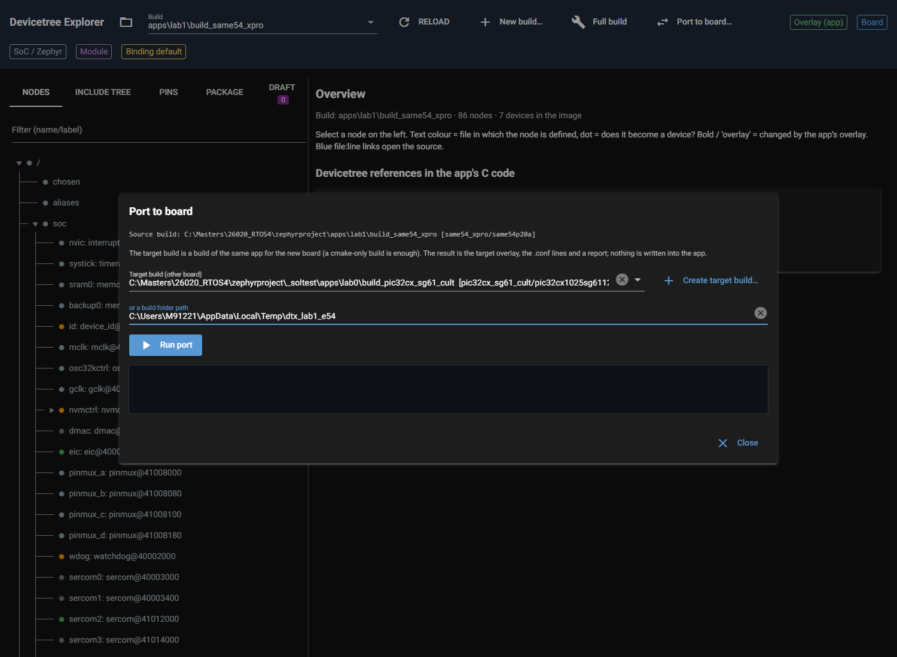
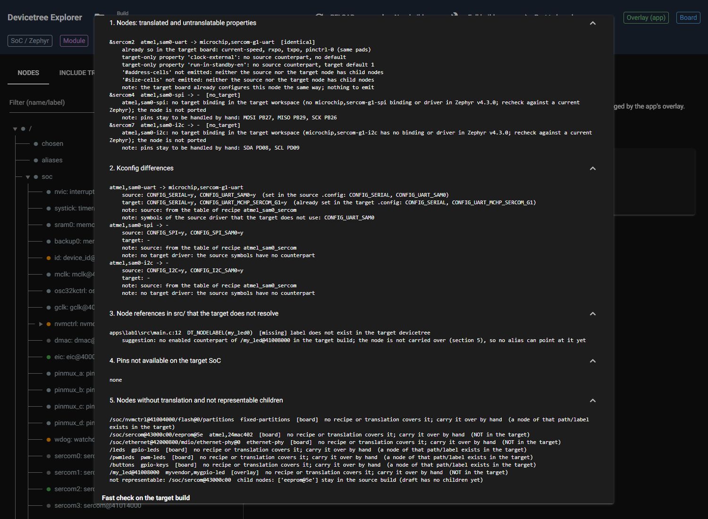
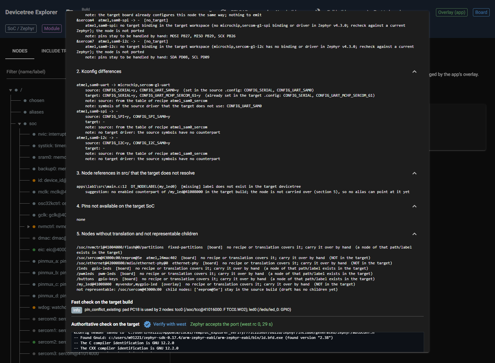

# P5.4 evidence: "Port to board..." UI and report

Environment: `DTX_RTOS4_WS=C:\Masters\26020_RTOS4\zephyrproject`, `DTX_MAIN_WS=C:\Masters\zephyr-main`,
`DTX_DESIGN_FILES=C:\Masters\board_design_files`; source builds `apps\lab1\build_same54_xpro` and
`apps\lab3\build_same54_xpro` (old `atmel` port); target builds are cmake-only builds for `sam_e54_xpro` in
`%TEMP%`, created from the workspace root with
`.venv\Scripts\python.exe -m west build -b sam_e54_xpro --cmake-only -d %TEMP%\dtx_lab1_e54 apps\lab1`
(and `dtx_lab3_e54` / `apps\lab3`). Both configured without error (Zephyr 4.3.0, `Board: sam_e54_xpro, qualifiers:
atsame54p20a`): the app overlays `boards\same54_xpro.overlay` are not picked up for the other board name, which is the
point of the port. Server for the UI run: own launcher on port 8797 (patches `ui.run`'s port as in P1.7; 8765/8766
untouched). The pipeline never writes into the app: after all runs `apps\lab1` and `apps\lab3` contain exactly
their original files (no `.dt_explorer`, `dt_explorer.*`, `boards\sam_e54_xpro.*`).

## What was built

* `dt_explorer/core/port_report.py`: `port_build(source, target, check=True, on_step=None) -> PortResult(overlay, conf, report, draft)`.
  Steps: lift the source (`lift_build`); per covered node match the target node (label, else first register
  address), pick the translation `source -> target` from the registry, translate the node's properties (plus what the source
  recipe derives from the roles, e.g. `rxpo`/`txpo`) with `Translation.translate` and keep its report lines; emit only
  what the target board does not already have (properties, pins, chosen, aliases; an enabled node whose pads differ gets a
  group of its own name `<label>_<cls>_edit`, as in P5.7); render with the *target* build's pinctrl formatter and device
  model; Kconfig suggestions for source and target compatibles (`kconfig_suggest`) and `prj.conf` symbols whose value differs
  between the two `.config` files; `DT_NODELABEL/ALIAS/CHOSEN` references of `BuildModel.code_refs` against the target
  devicetree (also labels that exist but whose node is disabled and not enabled by the overlay) with a `DT_ALIAS`/`DT_CHOSEN`
  suggestion and the alias entry for the overlay; pads of the source build that are not on the target package (default
  package of the target provider); nodes written by board or app without translation (with an "exists in the
  target" flag) and child nodes from the `LiftReport`; fast check (`validate`) on the target build with the overlay.
  Vendor knowledge only through plugins: translation registry, recipe, formatter, provider.
* `dt_explorer/ui/port.py`: dialog (target select filtered to builds of a different board, free path field, "Create target
  build..." reusing `new_build.open_new_build`), background run with progress log, overlay and conf with Copy/Download,
  five report sections as expansions, fast-check findings, "Verify with west" on the target (streamed log, rc, errors).
  `dt_explorer/ui/page.py`: one header button "Port to board...".

## 1. lab1 -> sam_e54_xpro (complete output of `py acc.py lab1`)

```text
$ port_build(C:\Masters\26020_RTOS4\zephyrproject\apps\lab1\build_same54_xpro, C:\Users\M91221\AppData\Local\Temp\dtx_lab1_e54)   [12.0 s]

--- target overlay ---
/* Port of build_same54_xpro (same54_xpro/same54p20a) to sam_e54_xpro/atsame54p20a
 * generated by Devicetree Explorer; apply as boards/sam_e54_xpro.overlay */
/* nothing to add: the target board already covers the ported nodes */

--- target .conf ---
# Kconfig lines for sam_e54_xpro/atsame54p20a
# CONFIG_SERIAL=y  (already set in the target build)
# CONFIG_UART_MCHP_SERCOM_G1=y  (already set in the target build)

--- report ---
port report: build_same54_xpro (same54_xpro/same54p20a) -> dtx_lab1_e54 (sam_e54_xpro/atsame54p20a)

1. Nodes: translated and untranslatable properties
  &sercom2  atmel,sam0-uart -> microchip,sercom-g1-uart  [identical]
      already so in the target board: current-speed, rxpo, txpo, pinctrl-0 (same pads)
      target-only property 'clock-external': no source counterpart, no default
      target-only property 'run-in-standby-en': no source counterpart, target default 1
      '#address-cells' not emitted: neither the source nor the target node has child nodes
      '#size-cells' not emitted: neither the source nor the target node has child nodes
      note: the target board already configures this node the same way; nothing to emit
  &sercom4  atmel,sam0-spi -> -  [no_target]
      atmel,sam0-spi: no target binding in the target workspace (no microchip,sercom-g1-spi binding or driver in Zephyr v4.3.0; recheck against a current Zephyr); the node is not ported
      note: pins stay to be handled by hand: MOSI PB27, MISO PB29, SCK PB26
  &sercom7  atmel,sam0-i2c -> -  [no_target]
      atmel,sam0-i2c: no target binding in the target workspace (microchip,sercom-g1-i2c has no binding or driver in Zephyr v4.3.0; recheck against a current Zephyr); the node is not ported
      note: pins stay to be handled by hand: SDA PD08, SCL PD09

2. Kconfig differences
  atmel,sam0-uart -> microchip,sercom-g1-uart
      source: CONFIG_SERIAL=y, CONFIG_UART_SAM0=y  (set in the source .config: CONFIG_SERIAL, CONFIG_UART_SAM0)
      target: CONFIG_SERIAL=y, CONFIG_UART_MCHP_SERCOM_G1=y  (already set in the target .config: CONFIG_SERIAL, CONFIG_UART_MCHP_SERCOM_G1)
      note: source: from the table of recipe atmel_sam0_sercom
      note: symbols of the source driver that the target does not use: CONFIG_UART_SAM0
  atmel,sam0-spi -> -
      source: CONFIG_SPI=y, CONFIG_SPI_SAM0=y
      target: -
      note: source: from the table of recipe atmel_sam0_sercom
      note: no target driver: the source symbols have no counterpart
  atmel,sam0-i2c -> -
      source: CONFIG_I2C=y, CONFIG_I2C_SAM0=y
      target: -
      note: source: from the table of recipe atmel_sam0_sercom
      note: no target driver: the source symbols have no counterpart

3. Node references in src/ that the target does not resolve
  apps\lab1\src\main.c:12  DT_NODELABEL(my_led0)  [missing] label does not exist in the target devicetree
      suggestion: no enabled counterpart of /my_led@41008000 in the target build; the node is not carried over (section 5), so no alias can point at it yet

4. Pins not available on the target SoC
  none

5. Nodes without translation and not representable children
  /soc/nvmctrl@41004000/flash@0/partitions  fixed-partitions  [board]  no recipe or translation covers it; carry it over by hand  (a node of that path/label exists in the target)
  /soc/sercom@43000c00/eeprom@5e  atmel,24mac402  [board]  no recipe or translation covers it; carry it over by hand  (NOT in the target)
  /soc/ethernet@42000800/mdio/ethernet-phy@0  ethernet-phy  [board]  no recipe or translation covers it; carry it over by hand  (NOT in the target)
  /leds  gpio-leds  [board]  no recipe or translation covers it; carry it over by hand  (a node of that path/label exists in the target)
  /pwmleds  pwm-leds  [board]  no recipe or translation covers it; carry it over by hand  (a node of that path/label exists in the target)
  /buttons  gpio-keys  [board]  no recipe or translation covers it; carry it over by hand  (a node of that path/label exists in the target)
  /my_led@41008000  myvendor,mygpio-led  [overlay]  no recipe or translation covers it; carry it over by hand  (NOT in the target)
  not representable: /soc/sercom@43000c00  child nodes: ['eeprom@5e'] stay in the source build (draft has no children yet)

6. Fast check on the target build
  info: pin_conflict_existing: pad PC18 is used by 2 nodes: tcc0 (/soc/tcc@41016000: F TCC0.WO2); led0 (/leds/led_0: GPIO)

--- Verify with west on the target build (core/verify.py) ---
cmd: C:\Masters\26020_RTOS4\zephyrproject\.venv\Scripts\python.exe -m west build -b sam_e54_xpro/atsame54p20a -d C:\Users\M91221\AppData\Local\Temp\dtx_p54_verify\771c221eb7\build --cmake-only C:\Masters\26020_RTOS4\zephyrproject\apps\lab1 -- -DEXTRA_DTC_OVERLAY_FILE=C:/Users/M91221/AppData/Local/Temp/dtx_p54_verify/771c221eb7/dt_explorer.overlay -DEXTRA_CONF_FILE=C:/Users/M91221/AppData/Local/Temp/dtx_p54_verify/771c221eb7/dt_explorer.conf
ok=True returncode=0 duration=28.0 s
errors: []
warnings: []
west log: 36 lines, tail 12:
Kconfig header saved to 'C:/Users/M91221/AppData/Local/Temp/dtx_p54_verify/771c221eb7/build/zephyr/include/generated/zephyr/autoconf.h'
-- Found GnuLd: c:/users/m91221/zephyr-sdk-0.17.4/arm-zephyr-eabi/arm-zephyr-eabi/bin/ld.bfd.exe (found version "2.38")
-- The C compiler identification is GNU 12.2.0
-- The CXX compiler identification is GNU 12.2.0
-- The ASM compiler identification is GNU
-- Found assembler: C:/Users/M91221/zephyr-sdk-0.17.4/arm-zephyr-eabi/bin/arm-zephyr-eabi-gcc.exe
-- Using ccache: C:/Users/M91221/AppData/Local/Microsoft/WinGet/Packages/BrechtSanders.WinLibs.POSIX.UCRT_Microsoft.Winget.Source_8wekyb3d8bbwe/mingw64/bin/ccache.exe
-- DEBUG: ZEPHYR_CURRENT_LIBRARY=..__modules__led__drivers__led
-- Found gen_kobject_list: C:/Masters/26020_RTOS4/zephyrproject/zephyr/scripts/build/gen_kobject_list.py
-- Configuring done (25.5s)
-- Generating done (1.1s)
-- Build files have been written to: C:/Users/M91221/AppData/Local/Temp/dtx_p54_verify/771c221eb7/build
```

Reading: the target board already configures the console SERCOM2 exactly as the source board does
(`current-speed`, `rxpo`, `txpo`, same pads PB25/PB24, chosen console/shell-uart), so the overlay is empty by design ("emit only what
differs"). The report carries the actual work: SPI (sercom4) and I2C (sercom7) have `no_target` in v4.3.0, the custom node
`my_led@41008000` of the app overlay and the EEPROM child are listed as not ported, `DT_NODELABEL(my_led0)` in `main.c:12`
does not exist in the target, the source driver symbols `CONFIG_UART_SAM0`/`_I2C_SAM0`/`_SPI_SAM0` have no target counterpart.
Fast check on the target: 0 errors (the PC18 info is pre-existing: led0 and tcc0 share the pad on the board itself).

## 2. lab3 -> sam_e54_xpro (complete output of `py acc.py lab3`)

```text
$ port_build(C:\Masters\26020_RTOS4\zephyrproject\apps\lab3\build_same54_xpro, C:\Users\M91221\AppData\Local\Temp\dtx_lab3_e54)   [11.0 s]

--- target overlay ---
/* Port of build_same54_xpro (same54_xpro/same54p20a) to sam_e54_xpro/atsame54p20a
 * generated by Devicetree Explorer; apply as boards/sam_e54_xpro.overlay */
/* nothing to add: the target board already covers the ported nodes */

--- target .conf ---
# Kconfig lines for sam_e54_xpro/atsame54p20a
# CONFIG_SERIAL=y  (already set in the target build)
# CONFIG_UART_MCHP_SERCOM_G1=y  (already set in the target build)

--- report ---
port report: build_same54_xpro (same54_xpro/same54p20a) -> dtx_lab3_e54 (sam_e54_xpro/atsame54p20a)

1. Nodes: translated and untranslatable properties
  &sercom2  atmel,sam0-uart -> microchip,sercom-g1-uart  [identical]
      already so in the target board: current-speed, rxpo, txpo, pinctrl-0 (same pads)
      target-only property 'clock-external': no source counterpart, no default
      target-only property 'run-in-standby-en': no source counterpart, target default 1
      '#address-cells' not emitted: neither the source nor the target node has child nodes
      '#size-cells' not emitted: neither the source nor the target node has child nodes
      note: the target board already configures this node the same way; nothing to emit
  &sercom3  atmel,sam0-i2c -> -  [no_target]
      atmel,sam0-i2c: no target binding in the target workspace (microchip,sercom-g1-i2c has no binding or driver in Zephyr v4.3.0; recheck against a current Zephyr); the node is not ported
      note: pins stay to be handled by hand: SDA PA22, SCL PA23
  &sercom4  atmel,sam0-spi -> -  [no_target]
      atmel,sam0-spi: no target binding in the target workspace (no microchip,sercom-g1-spi binding or driver in Zephyr v4.3.0; recheck against a current Zephyr); the node is not ported
      note: pins stay to be handled by hand: MOSI PB27, MISO PB29, SCK PB26
  &sercom7  atmel,sam0-i2c -> -  [no_target]
      atmel,sam0-i2c: no target binding in the target workspace (microchip,sercom-g1-i2c has no binding or driver in Zephyr v4.3.0; recheck against a current Zephyr); the node is not ported
      note: pins stay to be handled by hand: SDA PD08, SCL PD09

2. Kconfig differences
  atmel,sam0-uart -> microchip,sercom-g1-uart
      source: CONFIG_SERIAL=y, CONFIG_UART_SAM0=y  (set in the source .config: CONFIG_SERIAL, CONFIG_UART_SAM0)
      target: CONFIG_SERIAL=y, CONFIG_UART_MCHP_SERCOM_G1=y  (already set in the target .config: CONFIG_SERIAL, CONFIG_UART_MCHP_SERCOM_G1)
      note: source: from the table of recipe atmel_sam0_sercom
      note: symbols of the source driver that the target does not use: CONFIG_UART_SAM0
  atmel,sam0-i2c -> -
      source: CONFIG_I2C=y, CONFIG_I2C_SAM0=y  (set in the source .config: CONFIG_I2C, CONFIG_I2C_SAM0)
      target: -
      note: source: from the table of recipe atmel_sam0_sercom
      note: no target driver: the source symbols have no counterpart
  atmel,sam0-spi -> -
      source: CONFIG_SPI=y, CONFIG_SPI_SAM0=y
      target: -
      note: source: from the table of recipe atmel_sam0_sercom
      note: no target driver: the source symbols have no counterpart
  prj.conf CONFIG_NET_ARP: source .config 'y', target .config None  not set in the target build (a dependency is not met there)

3. Node references in src/ that the target does not resolve
  apps\lab3\src\main.c:32  DT_ALIAS(sercom3)  [missing] alias does not exist in the target devicetree
      suggestion: no enabled counterpart of /soc/sercom@41014000 in the target build; the node is not carried over (section 5), so no alias can point at it yet
  apps\lab3\src\main.c:32  DT_NODELABEL(mytemp0)  [missing] label does not exist in the target devicetree
      suggestion: no enabled counterpart of /soc/sercom@41014000/mytemp@4f in the target build; the node is not carried over (section 5), so no alias can point at it yet
  apps\lab3\src\main.c:33  DT_NODELABEL(mytemp0)  [missing] label does not exist in the target devicetree
      suggestion: no enabled counterpart of /soc/sercom@41014000/mytemp@4f in the target build; the node is not carried over (section 5), so no alias can point at it yet
  apps\lab3\src\main.c:37  DT_NODELABEL(my_http0)  [missing] label does not exist in the target devicetree
      suggestion: no enabled counterpart of /my_http0 in the target build; the node is not carried over (section 5), so no alias can point at it yet
  apps\lab3\src\main.c:38  DT_NODELABEL(my_http0)  [missing] label does not exist in the target devicetree
      suggestion: no enabled counterpart of /my_http0 in the target build; the node is not carried over (section 5), so no alias can point at it yet
  apps\lab3\src\main.c:39  DT_NODELABEL(my_http0)  [missing] label does not exist in the target devicetree
      suggestion: no enabled counterpart of /my_http0 in the target build; the node is not carried over (section 5), so no alias can point at it yet
  apps\lab3\src\main.c:167  DT_NODELABEL(my_http0)  [missing] label does not exist in the target devicetree
      suggestion: no enabled counterpart of /my_http0 in the target build; the node is not carried over (section 5), so no alias can point at it yet
  apps\lab3\src\main.c:169  DT_NODELABEL(my_http0)  [missing] label does not exist in the target devicetree
      suggestion: no enabled counterpart of /my_http0 in the target build; the node is not carried over (section 5), so no alias can point at it yet
  apps\lab3\src\main.c:170  DT_NODELABEL(my_http0)  [missing] label does not exist in the target devicetree
      suggestion: no enabled counterpart of /my_http0 in the target build; the node is not carried over (section 5), so no alias can point at it yet
  apps\lab3\src\main.c:191  DT_NODELABEL(my_http0)  [missing] label does not exist in the target devicetree
      suggestion: no enabled counterpart of /my_http0 in the target build; the node is not carried over (section 5), so no alias can point at it yet

4. Pins not available on the target SoC
  none

5. Nodes without translation and not representable children
  /soc/nvmctrl@41004000/flash@0/partitions  fixed-partitions  [board]  no recipe or translation covers it; carry it over by hand  (a node of that path/label exists in the target)
  /soc/sercom@41014000/mytemp@4f  mycompany,my-temp-sensor  [overlay]  no recipe or translation covers it; carry it over by hand  (NOT in the target)
  /soc/sercom@43000c00/eeprom@5e  atmel,24mac402  [board]  no recipe or translation covers it; carry it over by hand  (NOT in the target)
  /soc/ethernet@42000800/mdio/ethernet-phy@0  ethernet-phy  [board]  no recipe or translation covers it; carry it over by hand  (NOT in the target)
  /leds  gpio-leds  [board]  no recipe or translation covers it; carry it over by hand  (a node of that path/label exists in the target)
  /pwmleds  pwm-leds  [board]  no recipe or translation covers it; carry it over by hand  (a node of that path/label exists in the target)
  /buttons  gpio-keys  [board]  no recipe or translation covers it; carry it over by hand  (a node of that path/label exists in the target)
  /my_http0  mycompany,my-http-temp  [overlay]  no recipe or translation covers it; carry it over by hand  (NOT in the target)
  not representable: /soc/sercom@41014000  child nodes: ['mytemp@4f'] stay in the source build (draft has no children yet)
  not representable: /soc/sercom@43000c00  child nodes: ['eeprom@5e'] stay in the source build (draft has no children yet)

6. Fast check on the target build
  info: pin_conflict_existing: pad PC18 is used by 2 nodes: tcc0 (/soc/tcc@41016000: F TCC0.WO2); led0 (/leds/led_0: GPIO)

--- Verify with west on the target build (core/verify.py) ---
cmd: C:\Masters\26020_RTOS4\zephyrproject\.venv\Scripts\python.exe -m west build -b sam_e54_xpro/atsame54p20a -d C:\Users\M91221\AppData\Local\Temp\dtx_p54_verify\aab7fdded5\build --cmake-only C:\Masters\26020_RTOS4\zephyrproject\apps\lab3 -- -DEXTRA_DTC_OVERLAY_FILE=C:/Users/M91221/AppData/Local/Temp/dtx_p54_verify/aab7fdded5/dt_explorer.overlay -DEXTRA_CONF_FILE=C:/Users/M91221/AppData/Local/Temp/dtx_p54_verify/aab7fdded5/dt_explorer.conf
ok=True returncode=0 duration=32.6 s
errors: []
warnings: ["warning: NET_ARP (defined at subsys/net/l2/ethernet/Kconfig:68) was assigned the value 'y' but got"]
west log: 48 lines, tail 12:
-- Found assembler: C:/Users/M91221/zephyr-sdk-0.17.4/arm-zephyr-eabi/bin/arm-zephyr-eabi-gcc.exe
-- Using ccache: C:/Users/M91221/AppData/Local/Microsoft/WinGet/Packages/BrechtSanders.WinLibs.POSIX.UCRT_Microsoft.Winget.Source_8wekyb3d8bbwe/mingw64/bin/ccache.exe
-- Found gen_kobject_list: C:/Masters/26020_RTOS4/zephyrproject/zephyr/scripts/build/gen_kobject_list.py
CMake Warning at C:/Masters/26020_RTOS4/zephyrproject/zephyr/CMakeLists.txt:1129 (message):
  No SOURCES given to Zephyr library: drivers__entropy

  Excluding target from build.


-- Configuring done (30.0s)
-- Generating done (1.0s)
-- Build files have been written to: C:/Users/M91221/AppData/Local/Temp/dtx_p54_verify/aab7fdded5/build
```

The 10 code references of lab3 (P0.1 golden) are all listed in section 3 with the reason: `DT_ALIAS(sercom3)` (alias of the
app overlay; sercom3 is a disabled I2C node in the target and there is no g1 I2C binding), `DT_NODELABEL(mytemp0)` x2 and
`DT_NODELABEL(my_http0)` x7 (custom app nodes, no counterpart). Each suggestion says that the node is not carried over
and no alias can point at it yet; an alias entry is only generated when a matching enabled target node exists.
The "Verify with west" warning `NET_ARP ... was assigned the value 'y' but got` matches the report's prj.conf finding
`CONFIG_NET_ARP` (set in the source `.config`, unset in the target `.config`): the report predicted it.

## 3. Emission path on real data: a source whose console was moved to other pads

lab1 and lab3 already match the target board for the only translatable node, so the overlay path is exercised with a second
real source: `%TEMP%\dtx_p57`, the scratch build of P5.7 (lab1 on `same54_xpro` with the console SERCOM2 moved from
PB25/PB24 to PA09/PA08). Ported to the same lab1 target (`py acc.py lab1 %TEMP%\dtx_p57`):

```text
$ port_build(C:\Users\M91221\AppData\Local\Temp\dtx_p57, C:\Users\M91221\AppData\Local\Temp\dtx_lab1_e54)   [10.0 s]

--- target overlay ---
/* Port of dtx_p57 (same54_xpro/same54p20a) to sam_e54_xpro/atsame54p20a
 * generated by Devicetree Explorer; apply as boards/sam_e54_xpro.overlay */

/* &sercom2: atmel,sam0-uart -> microchip,sercom-g1-uart */
&pinctrl {
	sercom2_uart_edit: sercom2_uart_edit {
		group1 {
			pinmux = <PA9D_SERCOM2_PAD0>,
				 <PA8D_SERCOM2_PAD1>;
		};
	};
};

&sercom2 {
	pinctrl-0 = <&sercom2_uart_edit>;
	pinctrl-names = "default";
};

--- target .conf ---
# Kconfig lines for sam_e54_xpro/atsame54p20a
# CONFIG_SERIAL=y  (already set in the target build)
# CONFIG_UART_MCHP_SERCOM_G1=y  (already set in the target build)

--- report ---
port report: dtx_p57 (same54_xpro/same54p20a) -> dtx_lab1_e54 (sam_e54_xpro/atsame54p20a)

1. Nodes: translated and untranslatable properties
  &sercom2  atmel,sam0-uart -> microchip,sercom-g1-uart  [emitted]
      already so in the target board: current-speed, rxpo, txpo
      target-only property 'clock-external': no source counterpart, no default
      target-only property 'run-in-standby-en': no source counterpart, target default 1
      '#address-cells' not emitted: neither the source nor the target node has child nodes
      '#size-cells' not emitted: neither the source nor the target node has child nodes
      note: the target board puts this node on other pads; the overlay overrides them (group sercom2_uart_edit)
  &sercom4  atmel,sam0-spi -> -  [no_target]
      atmel,sam0-spi: no target binding in the target workspace (no microchip,sercom-g1-spi binding or driver in Zephyr v4.3.0; recheck against a current Zephyr); the node is not ported
      note: pins stay to be handled by hand: MOSI PB27, MISO PB29, SCK PB26
  &sercom7  atmel,sam0-i2c -> -  [no_target]
      atmel,sam0-i2c: no target binding in the target workspace (microchip,sercom-g1-i2c has no binding or driver in Zephyr v4.3.0; recheck against a current Zephyr); the node is not ported
      note: pins stay to be handled by hand: SDA PD08, SCL PD09

2. Kconfig differences
  atmel,sam0-uart -> microchip,sercom-g1-uart
      source: CONFIG_SERIAL=y, CONFIG_UART_SAM0=y  (set in the source .config: CONFIG_SERIAL, CONFIG_UART_SAM0)
      target: CONFIG_SERIAL=y, CONFIG_UART_MCHP_SERCOM_G1=y  (already set in the target .config: CONFIG_SERIAL, CONFIG_UART_MCHP_SERCOM_G1)
      note: source: from the table of recipe atmel_sam0_sercom
      note: symbols of the source driver that the target does not use: CONFIG_UART_SAM0
  atmel,sam0-spi -> -
      source: CONFIG_SPI=y, CONFIG_SPI_SAM0=y
      target: -
      note: source: from the table of recipe atmel_sam0_sercom
      note: no target driver: the source symbols have no counterpart
  atmel,sam0-i2c -> -
      source: CONFIG_I2C=y, CONFIG_I2C_SAM0=y
      target: -
      note: source: from the table of recipe atmel_sam0_sercom
      note: no target driver: the source symbols have no counterpart

3. Node references in src/ that the target does not resolve
  apps\lab1\src\main.c:12  DT_NODELABEL(my_led0)  [missing] label does not exist in the target devicetree
      suggestion: no enabled counterpart of /my_led@41008000 in the target build; the node is not carried over (section 5), so no alias can point at it yet

4. Pins not available on the target SoC
  none

5. Nodes without translation and not representable children
  /soc/nvmctrl@41004000/flash@0/partitions  fixed-partitions  [board]  no recipe or translation covers it; carry it over by hand  (a node of that path/label exists in the target)
  /soc/sercom@43000c00/eeprom@5e  atmel,24mac402  [board]  no recipe or translation covers it; carry it over by hand  (NOT in the target)
  /soc/ethernet@42000800/mdio/ethernet-phy@0  ethernet-phy  [board]  no recipe or translation covers it; carry it over by hand  (NOT in the target)
  /leds  gpio-leds  [board]  no recipe or translation covers it; carry it over by hand  (a node of that path/label exists in the target)
  /pwmleds  pwm-leds  [board]  no recipe or translation covers it; carry it over by hand  (a node of that path/label exists in the target)
  /buttons  gpio-keys  [board]  no recipe or translation covers it; carry it over by hand  (a node of that path/label exists in the target)
  /my_led@41008000  myvendor,mygpio-led  [overlay]  no recipe or translation covers it; carry it over by hand  (NOT in the target)
  not representable: /soc/sercom@43000c00  child nodes: ['eeprom@5e'] stay in the source build (draft has no children yet)

6. Fast check on the target build
  info: pin_conflict_existing: pad PC18 is used by 2 nodes: tcc0 (/soc/tcc@41016000: F TCC0.WO2); led0 (/leds/led_0: GPIO)

--- Verify with west on the target build (core/verify.py) ---
cmd: C:\Masters\26020_RTOS4\zephyrproject\.venv\Scripts\python.exe -m west build -b sam_e54_xpro/atsame54p20a -d C:\Users\M91221\AppData\Local\Temp\dtx_p54_verify\771c221eb7\build --cmake-only C:\Masters\26020_RTOS4\zephyrproject\apps\lab1 -- -DEXTRA_DTC_OVERLAY_FILE=C:/Users/M91221/AppData/Local/Temp/dtx_p54_verify/771c221eb7/dt_explorer.overlay -DEXTRA_CONF_FILE=C:/Users/M91221/AppData/Local/Temp/dtx_p54_verify/771c221eb7/dt_explorer.conf
ok=True returncode=0 duration=28.4 s
errors: []
warnings: []
west log: 36 lines, tail 12:
Kconfig header saved to 'C:/Users/M91221/AppData/Local/Temp/dtx_p54_verify/771c221eb7/build/zephyr/include/generated/zephyr/autoconf.h'
-- Found GnuLd: c:/users/m91221/zephyr-sdk-0.17.4/arm-zephyr-eabi/arm-zephyr-eabi/bin/ld.bfd.exe (found version "2.38")
-- The C compiler identification is GNU 12.2.0
-- The CXX compiler identification is GNU 12.2.0
-- The ASM compiler identification is GNU
-- Found assembler: C:/Users/M91221/zephyr-sdk-0.17.4/arm-zephyr-eabi/bin/arm-zephyr-eabi-gcc.exe
-- Using ccache: C:/Users/M91221/AppData/Local/Microsoft/WinGet/Packages/BrechtSanders.WinLibs.POSIX.UCRT_Microsoft.Winget.Source_8wekyb3d8bbwe/mingw64/bin/ccache.exe
-- DEBUG: ZEPHYR_CURRENT_LIBRARY=..__modules__led__drivers__led
-- Found gen_kobject_list: C:/Masters/26020_RTOS4/zephyrproject/zephyr/scripts/build/gen_kobject_list.py
-- Configuring done (26.2s)
-- Generating done (0.9s)
-- Build files have been written to: C:/Users/M91221/AppData/Local/Temp/dtx_p54_verify/771c221eb7/build
```

The target node is enabled but on other pads: the overlay overrides them in the group `sercom2_uart_edit` and leaves out the
redundant `status` and properties; Zephyr accepts it (rc 0).

## 4. UI end to end (Playwright, headless Chrome)

Script `ui_e2e.py` (drives `#port-open`, fills the path of `%TEMP%\dtx_lab1_e54`, `#port-run`, waits for `#port-report`,
`#port-verify`) and its complete output:

```text
dialog source: Source build: C:\Masters\26020_RTOS4\zephyrproject\apps\lab1\build_same54_xpro [same54_xpro/same54p20a]
status: done: 1 node(s) carried over, 1 node reference(s) to fix, 0 pin issue(s); fast check: 0 error(s), 0 warning(s), 1 info
overlay:
 /* Port of build_same54_xpro (same54_xpro/same54p20a) to sam_e54_xpro/atsame54p20a
 * generated by Devicetree Explorer; apply as boards/sam_e54_xpro.overlay */
/* nothing to add: the target board already covers the ported nodes */

content_copy
conf:
 # Kconfig lines for sam_e54_xpro/atsame54p20a
# CONFIG_SERIAL=y  (already set in the target build)
# CONFIG_UART_MCHP_SERCOM_G1=y  (already set in the target build)

content_copy
report:
 1. Nodes: translated and untranslatable properties
keyboard_arrow_down
&sercom2  atmel,sam0-uart -> microchip,sercom-g1-uart  [identical]
    already so in the target board: current-speed, rxpo, txpo, pinctrl-0 (same pads)
    target-only property 'clock-external': no source counterpart, no default
    target-only property 'run-in-standby-en': no source counterpart, target default 1
    '#address-cells' not emitted: neither the source nor the target node has child nodes
    '#size-cells' not emitted: neither the source nor the target node has child nodes
    note: the target board already configures this node the same way; nothing to emit
&sercom4  atmel,sam0-spi -> -  [no_target]
    atmel,sam0-spi: no target binding in the target workspace (no microchip,sercom-g1-spi binding or driver in Zephyr v4.3.0; recheck against a current Zephyr); the node is not ported
    note: pins stay to be handled by hand: MOSI PB27, MISO PB29, SCK PB26
&sercom7  atmel,sam0-i2c -> -  [no_target]
    atmel,sam0-i2c: no target binding in the target workspace (microchip,sercom-g1-i2c has no binding or driver in Zephyr v4.3.0; recheck against a current Zephyr); the node is not ported
    note: pins stay to be handled by hand: SDA PD08, SCL PD09
2. Kconfig differences
keyboard_arrow_down
atmel,sam0-uart -> microchip,sercom-g1-uart
    source: CONFIG_SERIAL=y, CONFIG_UART_SAM0=y  (set in the source .config: CONFIG_SERIAL, CONFIG_UART_SAM0)
    target: CONFIG_SERIAL=y, CONFIG_UART_MCHP_SERCOM_G1=y  (already set in the target .config: CONFIG_SERIAL, CONFIG_UART_MCHP_SERCOM_G1)
    note: source: from the table of recipe atmel_sam0_sercom
    note: symbols of the source driver that the target does not use: CONFIG_UART_SAM0
atmel,sam0-spi -> -
    source: CONFIG_SPI=y, CONFIG_SPI_SAM0=y
    target: -
    note: source: from the table of recipe atmel_sam0_sercom
    note: no target driver: the source symbols have no counterpart
atmel,sam0-i2c -> -
    source: CONFIG_I2C=y, CONFIG_I2C_SAM0=y
    target: -
    note: source: from the table of recipe atmel_sam0_sercom
    note: no target driver: the source symbols have no counterpart
3. Node references in src/ that the target does not resolve
keyboard_arrow_down
apps\lab1\src\main.c:12  DT_NODELABEL(my_led0)  [missing] label does not exist in the target devicetree
    suggestion: no enabled counterpart of /my_led@41008000 in the target build; the node is not carried over (section 5), so no alias can point at it yet
4. Pins not available on the target SoC
keyboard_arrow_down
none
5. Nodes without translation and not representable children
keyboard_arrow_down
/soc/nvmctrl@41004000/flash@0/partitions  fixed-partitions  [board]  no recipe or translation covers it; carry it over by hand  (a node of that path/label exists in the target)
/soc/sercom@43000c00/eeprom@5e  atmel,24mac402  [board]  no recipe or translation covers it; carry it over by hand  (NOT in the target)
/soc/ethernet@42000800/mdio/ethernet-phy@0  ethernet-phy  [board]  no recipe or translation covers it; carry it over by hand  (NOT in the target)
/leds  gpio-leds  [board]  no recipe or translation covers it; carry it over by hand  (a node of that path/label exists in the target)
/pwmleds  pwm-leds  [board]  no recipe or translation covers it; carry it over by hand  (a node of that path/label exists in the target)
/buttons  gpio-keys  [board]  no recipe or translation covers it; carry it over by hand  (a node of that path/label exists in the target)
/my_led@41008000  myvendor,mygpio-led  [overlay]  no recipe or translation covers it; carry it over by hand  (NOT in the target)
not representable: /soc/sercom@43000c00  child nodes: ['eeprom@5e'] stay in the source build (draft has no children yet)
Fast check on the target build
info
pin_conflict_existing: pad PC18 is used by 2 nodes: tcc0 (/soc/tcc@41016000: F TCC0.WO2); led0 (/leds/led_0: GPIO)
verify: Zephyr accepts the port (west rc 0, 29 s)
console/page errors: []
```

Screenshots:   
(the select preselects the first build of another board in the list; the typed path wins when it is filled in).

## 5. Unit tests (synthetic inputs, no environment variables) and the whole suite

```text
$ py -m pytest -v tests/test_port_report.py
============================= test session starts =============================
platform win32 -- Python 3.14.8, pytest-9.1.1, pluggy-1.6.0 -- C:\Program Files\Python314\python.exe
cachedir: .pytest_cache
rootdir: C:\Masters\dt_explorer
configfile: pyproject.toml
plugins: anyio-4.13.0
collecting ... collected 7 items

tests/test_port_report.py::test_alias_name_is_dtc_safe PASSED            [ 14%]
tests/test_port_report.py::test_same_value_ignores_representation PASSED [ 28%]
tests/test_port_report.py::test_strip_status_and_rename PASSED           [ 42%]
tests/test_port_report.py::test_report_sections_are_always_present PASSED [ 57%]
tests/test_port_report.py::test_port_build_synthetic PASSED              [ 71%]
tests/test_port_report.py::test_pin_override_on_an_enabled_node PASSED   [ 85%]
tests/test_port_report.py::test_pad_that_the_instance_lacks_is_reported_not_raised PASSED [100%]

============================== 7 passed in 0.11s ==============================
```

Covered: `_alias_name`, `_same_value`, status/group helpers, report sections; fake source/target builds with fake recipe,
formatter, translation and device model: identical node emits nothing, disabled target node is enabled with translated
properties/new pins/chosen/alias, node without counterpart (`no_node`), translation with `no_target`, node references
(resolved/missing/alias), pads missing on the package or the device, Kconfig rows and `prj.conf` diff, pin override on an enabled
node, a pad the instance lacks is reported and not raised.

```text
$ py -m pytest -q -rs     (all three env vars set; 312 lines of output, tail 12 shown)
	txpo = <0>;
	#address-cells = <1>;
	#size-cells = <0>;
	pinctrl-0 = <&sercom2_uart_default>;
	pinctrl-names = "default";
};
--- report lines ---
atmel,assigned-clocks: generator 0 moves to the clock controller. Add in the target board file: &clock { gclkperiph { sercom2 { subsystem = <CLOCK_MCHP_GCLKPERIPH_ID_SERCOM2_CORE>; gclkperiph-src = "gclk0"; gclkperiph-en = <1>; }; }; mclkperiph { sercom2 { subsystem = <CLOCK_MCHP_MCLKPERIPH_ID_APBB_SERCOM2>; mclk-en = <1>; }; }; };
dropped 'atmel,assigned-clock-names' (atmel,sam0-uart -> microchip,sercom-g1-uart): names the generator entry, which moves to gclkperiph-src on the clock controller
--- edtlib: matched microchip,sercom-g1-uart binding microchip,sercom-g1-uart.yaml ---
............................                                        [100%]
321 passed in 215.93s (0:03:35)
```

## Findings

* On this pair (`same54_xpro` -> `sam_e54_xpro`) the target board file already covers the console UART, so the generated
  overlay for lab1/lab3 is empty: all the value is in the report. The non-empty path is shown in section 3.
* The cmake-only target builds of lab1 and lab3 did not fail: devicetree and Kconfig of the apps do not depend on the
  source board's nodes. A full build of the target would fail in `main.c` (`DT_NODELABEL(my_led0)`; lab3: `my_http0`,
  `mytemp0`, `sercom3`), which is what section 3 of the report lists (P5.5/P5.6 territory).
* Clock enablement for a UART on a SERCOM that the target board does not configure is only a report note (from the
  translation's clock rule); the overlay does not yet emit the `&clock { gclkperiph ... mclkperiph ... }` children. Not hit by lab1/lab3.
* Reported only, not carried over: the app's own overlay nodes, children on buses (`eeprom@5e`, `mytemp@4f`: no draft children yet), I2C/SPI (no g1 binding in v4.3.0).
* Not tested: the "Create target build..." path inside the port dialog (it reuses `open_new_build`, tested in P2.2), a
  target workspace different from the source's (P6), SG61 pin availability on real data (the check is generic and unit-tested).
