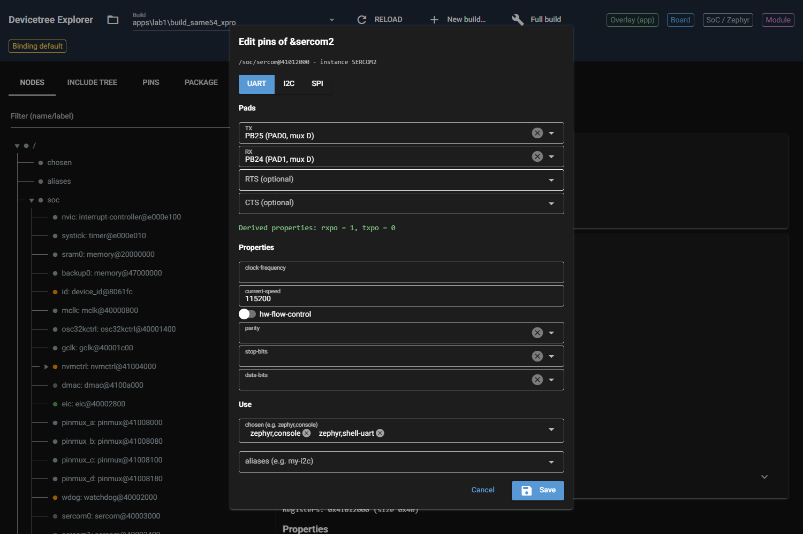
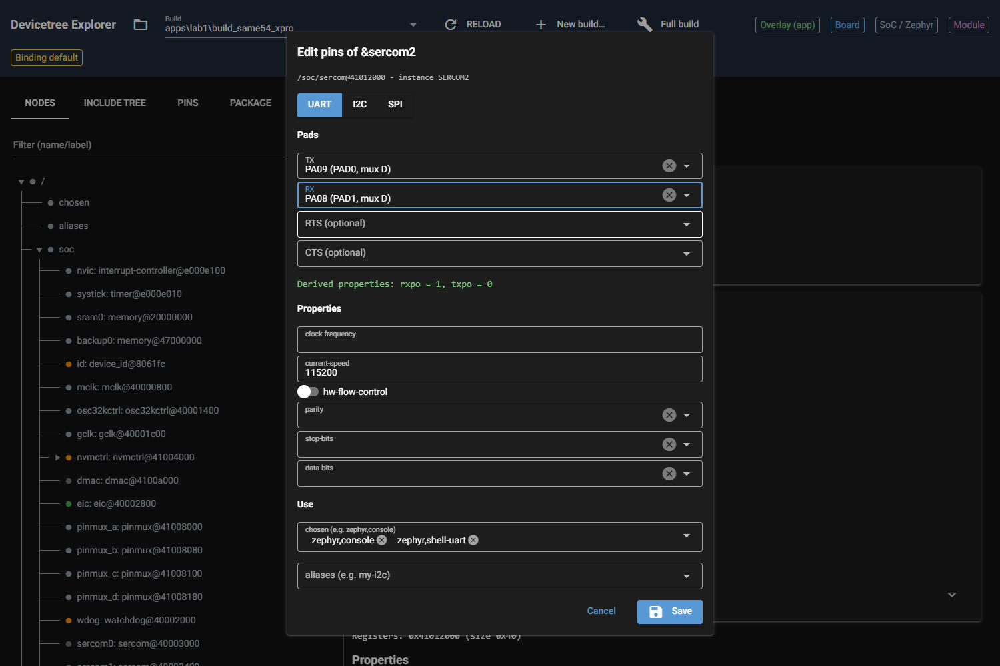
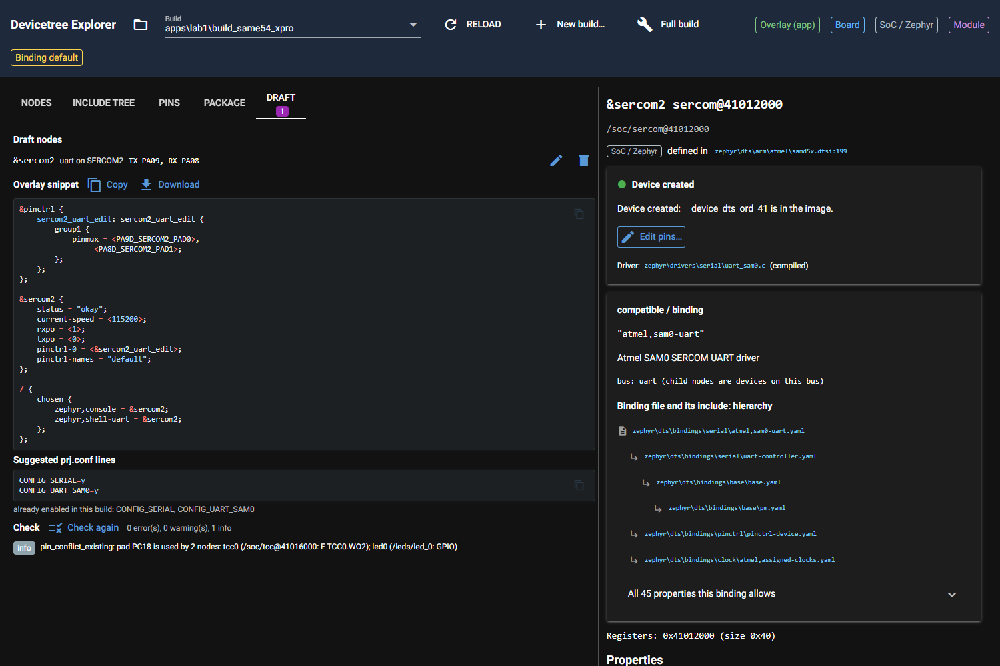

# P5.7 evidence: "Edit pins..." for enabled nodes

Server: own launcher on port **8793** (`launch.py` patches `ui.run`'s port as P1.7 did; 8765/8766 untouched). The
launcher also redirects `configure.load_draft/save_draft` to a scratch folder, because `apps\lab1\.dt_explorer`
holds a draft of another agent: the real lab1 app folder was neither read nor written by the UI runs. Browser:
Playwright + headless Chrome, 1500x1000, lab1 `apps/lab1/build_same54_xpro`, node `/soc/sercom@41012000`.

Changes: `ui/configure.py` (lift per label, edit mode of the dialog, new group name), `ui/page.py` ("Edit pins..."
button only), `tests/test_configure.py` (6 tests).

## 0. Design

* **Lift:** `ConfigSession.lifted_node(label)` runs `core.lift.lift_build` once per session and picks the node by
  label (lift.py has no per-node entry point; no change needed there). `can_edit_pins(session, node)` = node is
  `okay`, a recipe offers classes for its instance, and the lift covers it.
* **Dialog:** `open_configure(..., edit=True)` (also chosen automatically for `okay` nodes, so the pencil in the
  Draft tab works) starts from the draft node if the draft already changes this node, else from the lifted one:
  class, TX/RX pads, neutral properties (`current-speed`), `chosen` entries. The pads of the node itself are not
  listed as "used by sercom2" (`used_by(skip_path=...)`).
* **pinctrl override:** the renderer names the group `<label>_<cls>_default`; for `sercom2` that is
  `sercom2_uart_default`, the board's own group (`same54_xpro-pinctrl.dtsi:50`). Emitting it again would merge into
  the board group. `ConfigSession.overlay()` therefore renames the group of every draft node whose label is an
  enabled node to `<label>_<cls>_edit` (`edit_group_name`, `rename_group`: definition and `pinctrl-0` reference,
  whole words only). The board group stays in the tree unused; `pinctrl-0 = <&sercom2_uart_edit>` replaces the
  property of the node, so the resolved pinctrl state has exactly the new pads (section 3).
* `render_context()` fills `existing_compatibles` for enabled nodes, so the overlay does not repeat `compatible`.
* Derived properties come from the recipe as before (`derive_props` in the dialog, `render` in the overlay).
* Side fix: the `chosen`/`aliases` selects of the dialog got their current values as options, otherwise Quasar
  showed no chips for a prefilled value (seen in the first screenshot of this card).

## 1. New pads (acceptance 1)

SERCOM2 UART: TX on PAD0 (txpo 0), RX on PAD1 (rxpo 1). Candidates from the device model with TX/RX offered by
the dialog (`role_candidates`, from `explore`): TX PA09 (PAD0, D, free), PA12 (PAD0, C, used by gmac), PB26 (PAD0, C,
used by sercom4); RX for TX=PA09: PA08 (PAD1, D, free), PA13 (PAD1, C, used by gmac), PB24 (PAD1, D, the old pad),
PB27 (PAD1, C, used by sercom4). **Chosen: TX = PA09, RX = PA08** (mux D, SERCOM2 PAD0/PAD1): both pads are free
in the build (no user in the pin map, so no conflict), same pad roles as before so the board's `rxpo = 1, txpo = 0`
stays valid. PA12/PA13 are taken by GMAC. A pair with a different RX pad, PA09 / PA10 (PAD2), gives `rxpo = 2` and is
covered by a unit test (derived props are recomputed).

UI run (`e2e.py`, complete output):

```text
Configure button count: 0  Edit pins button count: 1
DIALOG TITLE: Edit pins of &sercom2
PREFILLED TX: PB25 (PAD0, mux D)
PREFILLED RX: PB24 (PAD1, mux D)
DERIVED: Derived properties: rxpo = 1, txpo = 0
DIALOG TEXT: Edit pins of &sercom2 | /soc/sercom@41012000 - instance SERCOM2 | UART | I2C | SPI | Pads | TX | PB25 (PAD0, mux D) | cancel | arrow_drop_down | RX | PB24 (PAD1, mux D) | cancel | arrow_drop_down | RTS (optional) | arrow_drop_down | CTS (optional) | arrow_drop_down | Derived properties: rxpo = 1, txpo = 0 | Properties | clock-frequency | current-speed | hw-flow-control | parity | cancel | arrow_drop_down | stop-bits | cancel | arrow_drop_down | data-bits | cancel | arrow_drop_down | Use | chosen (e.g. zephyr,console) | zephyr,console | cancel | zephyr,shell-uart | cancel | arrow_drop_down | al
INPUTS: ['PB25  (PAD0, mux D)', 'PB24  (PAD1, mux D)', '', '', '', '115200', 'on', '', '', '', '', '']
DERIVED: Derived properties: rxpo = 1, txpo = 0
SNIPPET:
&pinctrl {
    sercom2_uart_edit: sercom2_uart_edit {
        group1 {
            pinmux = <PA9D_SERCOM2_PAD0>,
                 <PA8D_SERCOM2_PAD1>;
        };
    };
};

&sercom2 {
    status = "okay";
    current-speed = <115200>;
    rxpo = <1>;
    txpo = <0>;
    pinctrl-0 = <&sercom2_uart_edit>;
    pinctrl-names = "default";
};

/ {
    chosen {
        zephyr,console = &sercom2;
        zephyr,shell-uart = &sercom2;
    };
};

content_copy
CHECK STATUS: 0 error(s), 0 warning(s), 1 info
FINDINGS: info | pin_conflict_existing: pad PC18 is used by 2 nodes: tcc0 (/soc/tcc@41016000: F TCC0.WO2); led0 (/leds/led_0: GPIO)
REOPEN TX/RX: PA09 (PAD0, mux D) / PA08 (PAD1, mux D)
CONSOLE ERRORS: []
```

Screenshots: dialog prefilled from the lifted node (PB25 / PB24, rxpo = 1, txpo = 0, 115200, chosen
zephyr,console and zephyr,shell-uart):



After the change (TX = PA09, RX = PA08):



Draft tab after Save (snippet and check):



Same through the helper API (`move.py PA09 PA08`; this run also prints the lifted node; `validate()` result at the end):

```text
can_edit_pins: True
lift 0.0s
lifted: DraftNode(cls='uart', roles=['TX', 'RX'], props={'current-speed': 115200, '#address-cells': 1, '#size-cells': 0}, use=Use(chosen=['zephyr,console', 'zephyr,shell-uart'], aliases=[]), instance='SERCOM2', pins={'TX': 'PB25', 'RX': 'PB24'}, vendor_props={}, compatible='atmel,sam0-uart', label='sercom2')
derived: {'rxpo': 1, 'txpo': 0} None
&pinctrl {
	sercom2_uart_edit: sercom2_uart_edit {
		group1 {
			pinmux = <PA9D_SERCOM2_PAD0>,
				 <PA8D_SERCOM2_PAD1>;
		};
	};
};

&sercom2 {
	status = "okay";
	current-speed = <115200>;
	rxpo = <1>;
	txpo = <0>;
	pinctrl-0 = <&sercom2_uart_edit>;
	pinctrl-names = "default";
};

/ {
	chosen {
		zephyr,console = &sercom2;
		zephyr,shell-uart = &sercom2;
	};
};

findings: 1
Finding(severity='info', kind='pin_conflict_existing', message='pad PC18 is used by 2 nodes: tcc0 (/soc/tcc@41016000: F TCC0.WO2); led0 (/leds/led_0: GPIO)', node='/soc/tcc@41016000', pad='PC18', nodes=('/soc/tcc@41016000', '/leds/led_0'), overlay=False)
```

`validate()`: 0 errors, 0 warnings, 1 info (PC18 conflict that exists in the build already).

## 2. Authoritative check, "Verify with west" equivalent (acceptance 2)

P4.1 is not on master yet, so the check is run by hand. `overlay.dts` is the rendered overlay of section 1 (the
snippet of the UI, identical to the file written by `move.py`).

```text
$ cd C:\Masters\26020_RTOS4\zephyrproject
$ .venv\Scripts\python.exe -m west build -b same54_xpro --cmake-only -d %TEMP%\dtx_p57 apps\lab1 -- -DEXTRA_DTC_OVERLAY_FILE=C:/Users/M91221/AppData/Local/Temp/dtx57/overlay.dts
rc=0
-- west build: generating a build system
-- DEBUG: CMAKE_SOURCE_DIR is: C:/Masters/26020_RTOS4/zephyrproject/apps/lab1
python.exe : Loading Zephyr default modules (Zephyr base).
 
-- Application: C:/Masters/26020_RTOS4/zephyrproject/apps/lab1
-- CMake version: 4.1.2
-- Found Python3: C:/Masters/26020_RTOS4/zephyrproject/.venv/Scripts/python.exe (found suitable version "3.12.10", minimum required is "3.10") found components: Interpreter
-- Cache files will be written to: C:/Masters/26020_RTOS4/zephyrproject/zephyr/.cache
-- Zephyr version: 4.3.0 (C:/Masters/26020_RTOS4/zephyrproject/zephyr)
-- Found west (found suitable version "1.5.0", minimum required is "0.14.0")
-- Board: same54_xpro, qualifiers: same54p20a
-- ZEPHYR_TOOLCHAIN_VARIANT not set, trying to locate Zephyr SDK
-- Found host-tools: zephyr 0.17.4 (C:/Users/M91221/zephyr-sdk-0.17.4)
-- Found toolchain: zephyr 0.17.4 (C:/Users/M91221/zephyr-sdk-0.17.4)
-- Found Dtc: C:/Users/M91221/AppData/Local/Microsoft/WinGet/Packages/oss-winget.dtc_Microsoft.Winget.Source_8wekyb3d8bbwe/usr/bin/dtc.exe (found suitable version "1.6.1", minimum required is "1.4.6")
-- Found BOARD.dts: C:/Masters/26020_RTOS4/zephyrproject/zephyr/boards/atmel/sam0/same54_xpro/same54_xpro.dts
-- Found devicetree overlay: C:/Masters/26020_RTOS4/zephyrproject/apps/lab1/boards/same54_xpro.overlay
-- Found devicetree overlay: C:/Users/M91221/AppData/Local/Temp/dtx57/overlay.dts
-- Generated zephyr.dts: C:/Users/M91221/AppData/Local/Temp/dtx_p57/zephyr/zephyr.dts
-- Generated pickled edt: C:/Users/M91221/AppData/Local/Temp/dtx_p57/zephyr/edt.pickle
-- Generated devicetree_generated.h: C:/Users/M91221/AppData/Local/Temp/dtx_p57/zephyr/include/generated/zephyr/devicetree_generated.h
Parsing C:/Masters/26020_RTOS4/zephyrproject/zephyr/Kconfig
Loaded configuration 'C:/Masters/26020_RTOS4/zephyrproject/zephyr/boards/atmel/sam0/same54_xpro/same54_xpro_defconfig'
Merged configuration 'C:/Masters/26020_RTOS4/zephyrproject/apps/lab1/prj.conf'
Configuration saved to 'C:/Users/M91221/AppData/Local/Temp/dtx_p57/zephyr/.config'
Kconfig header saved to 'C:/Users/M91221/AppData/Local/Temp/dtx_p57/zephyr/include/generated/zephyr/autoconf.h'
-- Found GnuLd: c:/users/m91221/zephyr-sdk-0.17.4/arm-zephyr-eabi/arm-zephyr-eabi/bin/ld.bfd.exe (found version "2.38")
-- The C compiler identification is GNU 12.2.0
-- The CXX compiler identification is GNU 12.2.0
-- The ASM compiler identification is GNU
-- Found assembler: C:/Users/M91221/zephyr-sdk-0.17.4/arm-zephyr-eabi/bin/arm-zephyr-eabi-gcc.exe
-- Using ccache: C:/Users/M91221/AppData/Local/Microsoft/WinGet/Packages/BrechtSanders.WinLibs.POSIX.UCRT_Microsoft.Winget.Source_8wekyb3d8bbwe/mingw64/bin/ccache.exe
-- DEBUG: ZEPHYR_CURRENT_LIBRARY=..__modules__led__drivers__led
-- Found gen_kobject_list: C:/Masters/26020_RTOS4/zephyrproject/zephyr/scripts/build/gen_kobject_list.py
-- Configuring done (38.8s)
-- Generating done (3.4s)
-- Build files have been written to: C:/Users/M91221/AppData/Local/Temp/dtx_p57
```

## 3. Generated `pinctrl-0` of sercom2 (acceptance 2)

Lines of the scratch build's `zephyr/zephyr.dts` (the file has 943 lines; lines with the sercom2 `pinctrl-0`, `rxpo`, `txpo` that come from the overlay):

```text
276: rxpo = < 0x1 >;                        /* in ..\..\..\Users\M91221\AppData\Local\Temp\dtx57\overlay.dts:13 */
277: txpo = < 0x0 >;                        /* in ..\..\..\Users\M91221\AppData\Local\Temp\dtx57\overlay.dts:14 */
278: pinctrl-0 = < &sercom2_uart_edit >;    /* in ..\..\..\Users\M91221\AppData\Local\Temp\dtx57\overlay.dts:15 */
```

The old board group and the new group, as generated:

```text
492: sercom2_uart_default: sercom2_uart_default {
493: 
494: /* node '/soc/pinctrl@41008000/sercom2_uart_default/group1' defined in zephyr\boards\atmel\sam0\same54_xpro\same54_xpro-pinctrl.dtsi:51 */
495: group1 {
496: pinmux = < 0x3391 >,
497: < 0x3381 >; /* in zephyr\boards\atmel\sam0\same54_xpro\same54_xpro-pinctrl.dtsi:52 */
498: };
524: sercom2_uart_edit: sercom2_uart_edit {
525: phandle = < 0x4 >; /* in ..\..\..\Users\M91221\AppData\Local\Temp\dtx57\overlay.dts:15 */
526: 
527: /* node '/soc/pinctrl@41008000/sercom2_uart_edit/group1' defined in ..\..\..\Users\M91221\AppData\Local\Temp\dtx57\overlay.dts:3 */
528: group1 {
529: pinmux = < 0x3290 >,
530: < 0x3280 >; /* in ..\..\..\Users\M91221\AppData\Local\Temp\dtx57\overlay.dts:4 */
531: };
532: };
```

The same through edtlib on the scratch build's `edt.pickle` (`resolve.py`): `pinctrl-0` resolves to exactly one
group with exactly the new pads (0x3290 = PA9 D, 0x3280 = PA8 D; the board group had 0x3391 / 0x3381 = PB25 / PB24).

```text
status okay compat ['atmel,sam0-uart'] rxpo 1 txpo 0
state default ['/soc/pinctrl@41008000/sercom2_uart_edit']
   /soc/pinctrl@41008000/sercom2_uart_edit/group1 ['0x3290', '0x3280']
chosen console -> /soc/sercom@41012000
```

## 4. Tests and suite (acceptance 3)

```text
$ py -m pytest -v tests/test_configure.py
cachedir: .pytest_cache
rootdir: C:\Masters\dt_explorer\.claude\worktrees\agent-a30a2a52f586fe2c1
configfile: pyproject.toml
plugins: anyio-4.13.0
collecting ... collected 21 items

tests/test_configure.py::test_find_instance_by_address_then_label PASSED [  4%]
tests/test_configure.py::test_required_and_optional_roles PASSED         [  9%]
tests/test_configure.py::test_i2c_candidates_follow_the_fixed_pads PASSED [ 14%]
tests/test_configure.py::test_uart_roles_are_filtered_by_recipe_validity PASSED [ 19%]
tests/test_configure.py::test_spi_mosi_choice_narrows_miso PASSED        [ 23%]
tests/test_configure.py::test_taken_pads_stay_selectable_but_say_who_uses_them PASSED [ 28%]
tests/test_configure.py::test_recipe_without_valid_assignments_offers_every_signal PASSED [ 33%]
tests/test_configure.py::test_derive_props PASSED                        [ 38%]
tests/test_configure.py::test_build_node_drops_empty_roles_and_values PASSED [ 42%]
tests/test_configure.py::test_parse_prop PASSED                          [ 47%]
tests/test_configure.py::test_neutral_specs_skip_generic_and_const PASSED [ 52%]
tests/test_configure.py::test_class_options_come_from_the_recipe PASSED  [ 57%]
tests/test_configure.py::test_const_props_of_binding_chain PASSED        [ 61%]
tests/test_configure.py::test_kconfig_lines_and_summary PASSED           [ 66%]
tests/test_configure.py::test_mark_draft_colours_only_pad_rows PASSED    [ 71%]
tests/test_configure.py::test_rename_group_whole_words_only PASSED       [ 76%]
tests/test_configure.py::test_edit_group_name_differs_from_board_group PASSED [ 80%]
tests/test_configure.py::test_enabled_node_can_be_edited_and_is_lifted PASSED [ 85%]
tests/test_configure.py::test_own_pads_are_not_reported_as_taken_while_editing PASSED [ 90%]
tests/test_configure.py::test_edit_overlay_uses_a_new_group_and_recomputes_derived_props PASSED [ 95%]
tests/test_configure.py::test_edit_overlay_checks_without_errors PASSED  [100%]

============================= 21 passed in 21.13s =============================
```

Whole suite (`DTX_RTOS4_WS=C:/Masters/26020_RTOS4/zephyrproject DTX_MAIN_WS=C:/Masters/zephyr-main
DTX_DESIGN_FILES=C:/Masters/board_design_files`). The log is 312 lines; **tail only** (last 12 lines). Goldens
untouched; before this card 301 passed (P3.5), now 301 + 6 new tests = 307.

```text
$ py -m pytest -q -rs
	#address-cells = <1>;
	#size-cells = <0>;
	pinctrl-0 = <&sercom2_uart_default>;
	pinctrl-names = "default";
};
--- report lines ---
atmel,assigned-clocks: generator 0 moves to the clock controller. Add in the target board file: &clock { gclkperiph { sercom2 { subsystem = <CLOCK_MCHP_GCLKPERIPH_ID_SERCOM2_CORE>; gclkperiph-src = "gclk0"; gclkperiph-en = <1>; }; }; mclkperiph { sercom2 { subsystem = <CLOCK_MCHP_MCLKPERIPH_ID_APBB_SERCOM2>; mclk-en = <1>; }; }; };
dropped 'atmel,assigned-clock-names' (atmel,sam0-uart -> microchip,sercom-g1-uart): names the generator entry, which moves to gclkperiph-src on the clock controller
--- edtlib: matched microchip,sercom-g1-uart binding microchip,sercom-g1-uart.yaml ---
.. [ 93%]
...................                                                      [100%]
307 passed in 342.18s (0:05:42)
```

## 5. Clean up

The draft the UI wrote went to the scratch folder, not to the app folder. During the session another agent's files (`dt_explorer.conf`, `dt_explorer.overlay`, a `.dt_explorer` folder with a draft) appeared in `apps\lab1` and later disappeared; this card never touched them. Final state, `apps\lab1` holds no `.dt_explorer` folder:

```text
$ ls -a apps/lab1
. .. CMakeLists.txt boards build.log build_same54_xpro prj.conf src 
$ ls -a apps/lab1/.dt_explorer
```

