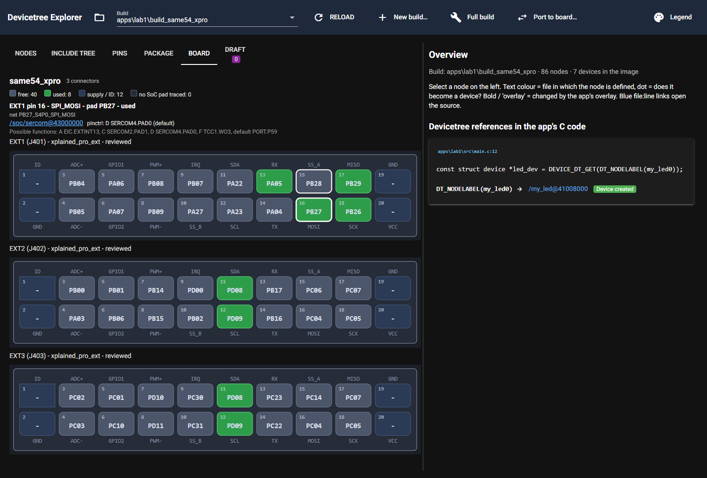

# P7.4 evidence: board view and connector roles in the port report

Environment: `DTX_RTOS4_WS=C:\Masters\26020_RTOS4\zephyrproject`, `DTX_MAIN_WS=C:\Masters\zephyr-main`,
`DTX_DESIGN_FILES=C:\Masters\board_design_files`. Source build `apps\lab1\build_same54_xpro`; target build
`%TEMP%\dtx_main_sg41` (hello_world for `pic32cx_sg41_cult`, from P6.0). Nothing was written into `apps\`.
Servers for the screenshots: own launcher that patches `ui.run`'s port (8841 for the RTOS4 root, 8842 with the sg41 build
folder as root); 8765/8766 untouched.

## What was built

* `dt_explorer/core/board_desc.py` (new, generic): `load_board(board_name, dirs)` finds `<board>.yaml` in a list of
  directories (`BOARD_DIRS`, default `dt_explorer/boards`) and returns a `BoardDesc` (connectors with name, type, pins:
  role/pad/net/gap). The display name comes from the optional `title:` key, else the Zephyr board name.
* `dt_explorer/core/port_report.py`: new report section **7. Connector roles of the used pads**
  (`connector_role_lines`, `PortReport.connector_roles`; `None` = section absent, also when neither board has a file).
  Sections 1 to 6 are unchanged.
* `dt_explorer/ui/board_view.py` (new) and `dt_explorer/ui/page.py` (tab only): tab **Board**, deep link `tab=board`.
  Connectors are drawn as 2-row headers (odd pins above even pins, pin 1 top left with square corners), each pin with
  number, role (above or below) and pad. Colours: used, conflict, free, draft, supply/ID, "no SoC pad traced" (dashed).
  A click on a pin lists its uses (links to the nodes) and the possible functions of the pad.

## 1. Report section for lab1 (same54_xpro) -> main sg41 (pic32cx_sg41_cult)

`port_build` itself cannot render a port to the SG41 yet (run C below): the existing pinctrl formatter only derives
header names for the same5x family. The section is therefore produced with `connector_role_lines` on the real pin usage
of both builds (the same call `port_build` makes). A uses the built-in board files; B uses a copy of them with a `title:`
line added. Run D shows that a port to a board without a file (`sam_e54_xpro`) is unchanged except for section 7.

```text
$ py rep74.py        (DTX_RTOS4_WS set; script in the session scratchpad, calls dt_explorer.app.load_plugins() first)
boards: same54_xpro -> pic32cx_sg41_cult; source used pads 23, target used pads 5

A) built-in board files (no title key: the Zephyr board name is the display name)
7. Connector roles of the used pads
  EXT1 pin 13 (RX): PA05 on same54_xpro → PC13 on pic32cx_sg41_cult  [used by dac@43002400]
  EXT1 pin 16 (MOSI): PB27 on same54_xpro → PB24 on pic32cx_sg41_cult  [used by sercom@43000000]
  EXT1 pin 17 (MISO): PB29 on same54_xpro → PC25 on pic32cx_sg41_cult  [used by sercom@43000000]
  EXT1 pin 18 (SCK): PB26 on same54_xpro → not available on pic32cx_sg41_cult (net NetJ602_18 does not reach the SoC)  [used by sercom@43000000]
  EXT2 pin 11 (SDA): PD08 on same54_xpro → PD09 on pic32cx_sg41_cult  [used by sercom@43000c00]
  EXT2 pin 12 (SCL): PD09 on same54_xpro → PD08 on pic32cx_sg41_cult  [used by sercom@43000c00]
  EXT3 pin 11 (SDA): PD08 on same54_xpro → no such connector (EXT3, xplained_pro_ext) on pic32cx_sg41_cult  [used by sercom@43000c00]
  EXT3 pin 12 (SCL): PD09 on same54_xpro → no such connector (EXT3, xplained_pro_ext) on pic32cx_sg41_cult  [used by sercom@43000c00]

B) copy of the board files with a 'title:' line added (the files in the repo are unchanged)
7. Connector roles of the used pads
  EXT1 pin 13 (RX): PA05 on SAME54 Xpro → PC13 on SG41 CUlt  [used by dac@43002400]
  EXT1 pin 16 (MOSI): PB27 on SAME54 Xpro → PB24 on SG41 CUlt  [used by sercom@43000000]
  EXT1 pin 17 (MISO): PB29 on SAME54 Xpro → PC25 on SG41 CUlt  [used by sercom@43000000]
  EXT1 pin 18 (SCK): PB26 on SAME54 Xpro → not available on SG41 CUlt (net NetJ602_18 does not reach the SoC)  [used by sercom@43000000]
  EXT2 pin 11 (SDA): PD08 on SAME54 Xpro → PD09 on SG41 CUlt  [used by sercom@43000c00]
  EXT2 pin 12 (SCL): PD09 on SAME54 Xpro → PD08 on SG41 CUlt  [used by sercom@43000c00]
  EXT3 pin 11 (SDA): PD08 on SAME54 Xpro → no such connector (EXT3, xplained_pro_ext) on SG41 CUlt  [used by sercom@43000c00]
  EXT3 pin 12 (SCL): PD09 on SAME54 Xpro → no such connector (EXT3, xplained_pro_ext) on SG41 CUlt  [used by sercom@43000c00]

C) full port_build lab1 -> main sg41 (check=False)
FormatterError: cannot derive a pinctrl header name from SoC 'pic32cx1025sg41128'

D) full port_build lab1 -> %TEMP%\dtx_lab1_e54 (sam_e54_xpro, no board file): section list
sam_e54_xpro/atsame54p20a ['1.', '2.', '3.', '4.', '5.', '5b', '7.'] connector_roles = ['no board description for sam_e54_xpro: connector roles not reported']
```

Reading: the target pads come from the SG41 board file; SCK (EXT1 pin 18) has no pad because the net never reaches the
MCU (a gap recorded by P7.3). EXT3 has no counterpart on the SG41 CUlt. The target usage is incomplete (5 pads) because
there is no pinctrl formatter for the SG41 yet, so the "already used in the target build" hint is only as good as that.

## 2. Screenshots

Headless Chrome (Playwright), URL `/?build=apps/lab1/build_same54_xpro&tab=board` (port 8841) and `/?tab=board` with the
sg41 build as root (port 8842). Console errors in the browser: none. Pin EXT1:16 (MOSI) was clicked in both.




## 3. Unit tests (synthetic board files, no environment variables)

```text
$ py -m pytest -v tests/test_board_view.py
============================= test session starts =============================
platform win32 -- Python 3.14.8, pytest-9.1.1, pluggy-1.6.0 -- C:\Program Files\Python314\python.exe
cachedir: .pytest_cache
rootdir: C:\Masters\dt_explorer\.claude\worktrees\agent-a8d03276cfa97cda2
configfile: pyproject.toml
plugins: anyio-4.13.0
collecting ... collected 9 items

tests/test_board_view.py::test_load_and_title PASSED                     [ 11%]
tests/test_board_view.py::test_bad_schema_is_reported_with_file_name PASSED [ 22%]
tests/test_board_view.py::test_short_role PASSED                         [ 33%]
tests/test_board_view.py::test_connector_role_lines PASSED               [ 44%]
tests/test_board_view.py::test_no_such_connector_and_other_type PASSED   [ 55%]
tests/test_board_view.py::test_missing_descriptions PASSED               [ 66%]
tests/test_board_view.py::test_report_section_only_when_computed PASSED  [ 77%]
tests/test_board_view.py::test_pin_states PASSED                         [ 88%]
tests/test_board_view.py::test_connector_svg PASSED                      [100%]

============================== 9 passed in 0.97s ==============================
```

## 4. Whole suite, all three variables set

`py -m pytest -q -rs`: the output is 312 lines (test prints included); the last 12 lines:

```text
	txpo = <0>;
	#address-cells = <1>;
	#size-cells = <0>;
	pinctrl-0 = <&sercom2_uart_default>;
	pinctrl-names = "default";
};
--- report lines ---
atmel,assigned-clocks: generator 0 moves to the clock controller. Add in the target board file: &clock { gclkperiph { sercom2 { subsystem = <CLOCK_MCHP_GCLKPERIPH_ID_SERCOM2_CORE>; gclkperiph-src = "gclk0"; gclkperiph-en = <1>; }; }; mclkperiph { sercom2 { subsystem = <CLOCK_MCHP_MCLKPERIPH_ID_APBB_SERCOM2>; mclk-en = <1>; }; }; };
dropped 'atmel,assigned-clock-names' (atmel,sam0-uart -> microchip,sercom-g1-uart): names the generator entry, which moves to gclkperiph-src on the clock controller
--- edtlib: matched microchip,sercom-g1-uart binding microchip,sercom-g1-uart.yaml ---
............................                         [100%]
336 passed in 424.98s (0:07:04)
```

## 5. Vocabulary grep

```text
$ grep -nEi "atmel|microchip|sercom|ATDF|P[A-D][0-9]{2}|xplained|curiosity" dt_explorer/core/board_desc.py
(no output, exit 1)
$ git diff -U0 dt_explorer/core/port_report.py | grep '^+' | grep -nEi "atmel|microchip|sercom|ATDF|P[A-D][0-9]{2}|xplained|curiosity"
(no output, exit 1)
```

`port_report.py` as a whole has older hits that are not part of this card: comments with `sercom3` (lines 91 to 97) and
the `atmel,assigned-clocks` property names (lines 296, 309).

## Findings

* `port_build` to the SG41 stops with `FormatterError: cannot derive a pinctrl header name from SoC 'pic32cx1025sg41128'`
  (`formatters/microchip_port_g1.find_header` knows only the same5x family). Outside this card; a full lab1 -> SG41 port
  needs the SG41 pinctrl header and a formatter that reads it.
* The board files have no `title:` key, so the report uses the Zephyr board names. With the optional key the line reads
  exactly "EXT1 pin 16 (MOSI): PB27 on SAME54 Xpro → PB24 on SG41 CUlt" (run B). Adding the key to the YAMLs is a
  P7.3 file change and was not done here.
* README.md and docs/GUI.md do not yet describe the Board tab (outside this card's write scope).
