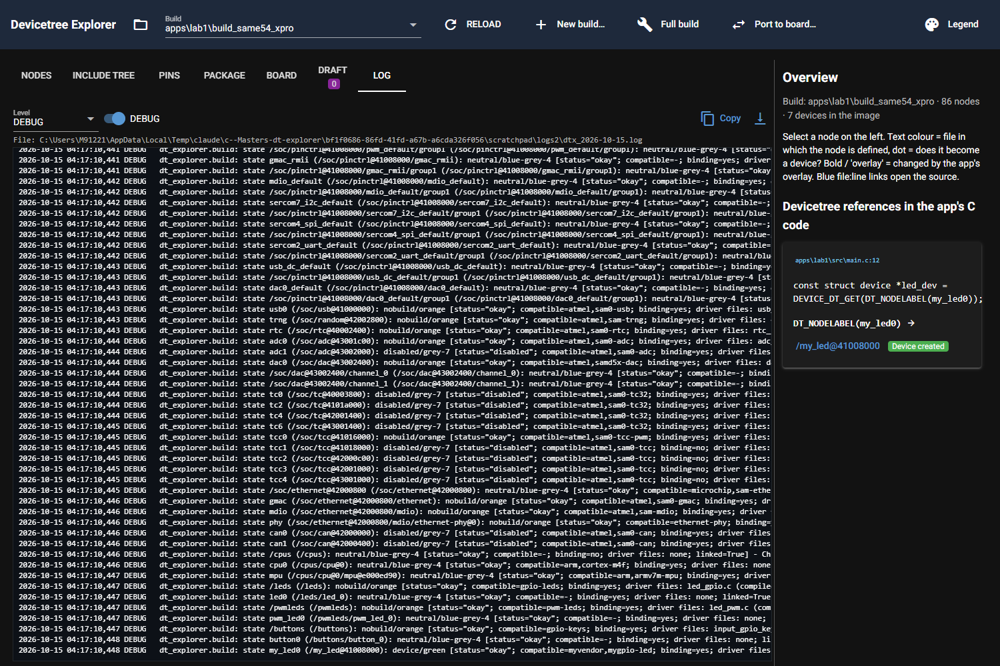

# P8.1 evidence: Log tab and log file

Server for the checks: own launcher patching ui.run to port 8795 (8765/8766 untouched), started and stopped by PID.
Environment: DTX_RTOS4_WS=C:/Masters/26020_RTOS4/zephyrproject, DTX_MAIN_WS=C:/Masters/zephyr-main,
DTX_DESIGN_FILES=C:/Masters/board_design_files.

## 1. Log file and its first 40 lines after opening lab1 (INFO, default folder)

Path: `C:\Users\M91221\.dt_explorer\logs\dtx_2026-10-15.log`. Run: `py launch.py C:/Masters/26020_RTOS4/zephyrproject --no-browser`,
then GET `/?build=apps/lab1/build_same54_xpro`. Complete first 40 lines (the tool commit is the last commit
before this card; the working tree was uncommitted):

```text
2026-10-15 04:15:24,015 INFO    dt_explorer.app: Devicetree Explorer starting, log file: C:\Users\M91221\.dt_explorer\logs\dtx_2026-10-15.log
2026-10-15 04:15:24,281 INFO    dt_explorer.context: ---- context ----
2026-10-15 04:15:24,281 INFO    dt_explorer.context: tool commit: 885e5f2463
2026-10-15 04:15:24,281 INFO    dt_explorer.context: Python: 3.14.8 (C:\Program Files\Python314\python.exe)
2026-10-15 04:15:24,282 INFO    dt_explorer.context: NiceGUI: 3.17.1
2026-10-15 04:15:24,282 INFO    dt_explorer.context: plugins provider: microchip-atdf
2026-10-15 04:15:24,282 INFO    dt_explorer.context: plugins formatter: atmel_sam0, microchip_port_g1
2026-10-15 04:15:24,283 INFO    dt_explorer.context: plugins recipe: atmel_sam0_sercom
2026-10-15 04:15:24,283 INFO    dt_explorer.context: plugins translation: atmel,sam0-gclk->microchip,sam-d5x-e5x-gclkperiph, atmel,sam0-gpio->microchip,port-g1-gpio, atmel,sam0-i2c->None, atmel,sam0-i2c->microchip,sercom-g1-i2c, atmel,sam0-mclk->microchip,sam-d5x-e5x-mclkperiph, atmel,sam0-osc32kctrl->microchip,sam-d5x-e5x-rtc, atmel,sam0-pinctrl->microchip,port-g1-pinctrl, atmel,sam0-pinctrl/child->microchip,port-g1-pinctrl/child, atmel,sam0-pinmux->None, atmel,sam0-sercom->microchip,sercom-g1, atmel,sam0-spi->None, atmel,sam0-spi->microchip,sercom-g1-spi, atmel,sam0-uart->microchip,sercom-g1-uart
2026-10-15 04:15:24,283 INFO    dt_explorer.context: plugins board_reader: altium_pcbdoc
2026-10-15 04:15:24,283 INFO    dt_explorer.context: plugins connector: arduino_uno_r3, mikrobus, xplained_pro_ext
2026-10-15 04:15:30,291 INFO    dt_explorer.app: folder C:\Masters\26020_RTOS4\zephyrproject: 10 build(s) found
2026-10-15 04:15:30,812 INFO    dt_explorer.build: loading build C:\Masters\26020_RTOS4\zephyrproject\apps\lab1\build_same54_xpro
2026-10-15 04:15:30,816 INFO    dt_explorer.build: ZEPHYR_BASE=C:\Masters\26020_RTOS4\zephyrproject\zephyr APPLICATION_SOURCE_DIR=C:\Masters\26020_RTOS4\zephyrproject\apps\lab1 WEST_TOPDIR=C:\Masters\26020_RTOS4\zephyrproject
2026-10-15 04:15:30,850 INFO    dt_explorer.build: read C:\Masters\26020_RTOS4\zephyrproject\apps\lab1\build_same54_xpro\zephyr\edt.pickle (edtlib from C:\Masters\26020_RTOS4\zephyrproject\zephyr): 86 nodes in 0.03s
2026-10-15 04:15:30,856 INFO    dt_explorer.build: read C:\Masters\26020_RTOS4\zephyrproject\apps\lab1\build_same54_xpro\zephyr\zephyr.dts: origins of 86 nodes in 0.01s
2026-10-15 04:15:30,858 INFO    dt_explorer.build: read C:\Masters\26020_RTOS4\zephyrproject\apps\lab1\build_same54_xpro\zephyr\zephyr.dts.pre: include tree built
2026-10-15 04:15:31,023 INFO    dt_explorer.build: ran C:/Users/M91221/zephyr-sdk-0.17.4/arm-zephyr-eabi/bin/arm-zephyr-eabi-nm.exe C:\Masters\26020_RTOS4\zephyrproject\apps\lab1\build_same54_xpro\zephyr\zephyr.elf -> rc=0 in 0.2s
2026-10-15 04:15:31,087 INFO    dt_explorer.build: image: linked=True, 7 device ordinals, 112 compiled source files
2026-10-15 04:15:36,930 INFO    dt_explorer.build: driver index: 2028 compatibles in 4 scanned folders (5.84s, cached per folder set)
2026-10-15 04:15:37,858 INFO    dt_explorer.build: binding index: 3278 YAML files in 7 roots
2026-10-15 04:15:37,861 INFO    dt_explorer.build: build loaded: 86 nodes, 29 aliases, 1 code references in 7.05s total
2026-10-15 04:15:37,994 INFO    dt_explorer.context: ---- context ----
2026-10-15 04:15:37,994 INFO    dt_explorer.context: tool commit: 885e5f2463
2026-10-15 04:15:37,994 INFO    dt_explorer.context: Python: 3.14.8 (C:\Program Files\Python314\python.exe)
2026-10-15 04:15:37,994 INFO    dt_explorer.context: NiceGUI: 3.17.1
2026-10-15 04:15:37,994 INFO    dt_explorer.context: Zephyr: 4.3.0
2026-10-15 04:15:37,994 INFO    dt_explorer.context: workspace: C:\Masters\26020_RTOS4\zephyrproject
2026-10-15 04:15:37,994 INFO    dt_explorer.context: build folder: C:\Masters\26020_RTOS4\zephyrproject\apps\lab1\build_same54_xpro
2026-10-15 04:15:37,994 INFO    dt_explorer.context: board: same54_xpro/same54p20a
2026-10-15 04:15:37,994 INFO    dt_explorer.context: SoC: same54p20a
2026-10-15 04:15:37,994 INFO    dt_explorer.context: ATDF: C:\Masters\26020_RTOS4\zephyrproject\modules\hal\microchip\packs\sam\sam_d5x_e5x\atsame54\atdf\ATSAME54P20A.atdf (schema 4.4) via provider microchip-atdf
2026-10-15 04:15:37,995 INFO    dt_explorer.context: plugins provider: microchip-atdf
2026-10-15 04:15:37,995 INFO    dt_explorer.context: plugins formatter: atmel_sam0, microchip_port_g1
2026-10-15 04:15:37,995 INFO    dt_explorer.context: plugins recipe: atmel_sam0_sercom
2026-10-15 04:15:37,995 INFO    dt_explorer.context: plugins translation: atmel,sam0-gclk->microchip,sam-d5x-e5x-gclkperiph, atmel,sam0-gpio->microchip,port-g1-gpio, atmel,sam0-i2c->None, atmel,sam0-i2c->microchip,sercom-g1-i2c, atmel,sam0-mclk->microchip,sam-d5x-e5x-mclkperiph, atmel,sam0-osc32kctrl->microchip,sam-d5x-e5x-rtc, atmel,sam0-pinctrl->microchip,port-g1-pinctrl, atmel,sam0-pinctrl/child->microchip,port-g1-pinctrl/child, atmel,sam0-pinmux->None, atmel,sam0-sercom->microchip,sercom-g1, atmel,sam0-spi->None, atmel,sam0-spi->microchip,sercom-g1-spi, atmel,sam0-uart->microchip,sercom-g1-uart
2026-10-15 04:15:37,995 INFO    dt_explorer.context: plugins board_reader: altium_pcbdoc
2026-10-15 04:15:37,995 INFO    dt_explorer.context: plugins connector: arduino_uno_r3, mikrobus, xplained_pro_ext
```

## 2. DEBUG run: state() reasons

Run with `--debug` and `DTX_LOG_DIR` set to a scratch folder; page opened with `tab=log`. Complete lines for
my_led0 (green), sercom2 (green), sercom0 (grey), the orange nodes of this build (sercom4, wdog, nvmctrl) and
eeprom (no binding, deep orange). The file holds 124 lines in total (one state line per node and state, logged once per loaded build).

```text
2026-10-15 04:17:10,438 DEBUG   dt_explorer.build: state nvmctrl (/soc/nvmctrl@41004000): nobuild/orange [status="okay"; compatible=atmel,sam0-nvmctrl; binding=yes; driver files: flash_sam0.c (compiled: none); linked=True] - A driver exists but is disabled in Kconfig and was not compiled
2026-10-15 04:17:10,439 DEBUG   dt_explorer.build: state wdog (/soc/watchdog@40002000): nobuild/orange [status="okay"; compatible=atmel,sam0-watchdog; binding=yes; driver files: wdt_sam0.c (compiled: none); linked=True] - A driver exists but is disabled in Kconfig and was not compiled
2026-10-15 04:17:10,439 DEBUG   dt_explorer.build: state sercom0 (/soc/sercom@40003000): disabled/grey-7 [status="disabled"; compatible=atmel,sam0-sercom; binding=yes; driver files: none; linked=True] - status = "disabled" -> no device is created
2026-10-15 04:17:10,439 DEBUG   dt_explorer.build: state sercom2 (/soc/sercom@41012000): device/green [status="okay"; compatible=atmel,sam0-uart; binding=yes; driver files: uart_sam0.c (compiled: uart_sam0.c); linked=True] - Device created: __device_dts_ord_41 is in the image
2026-10-15 04:17:10,440 DEBUG   dt_explorer.build: state sercom4 (/soc/sercom@43000000): nobuild/orange [status="okay"; compatible=atmel,sam0-spi; binding=yes; driver files: spi_sam0.c (compiled: none); linked=True] - A driver exists but is disabled in Kconfig and was not compiled
2026-10-15 04:17:10,440 DEBUG   dt_explorer.build: state eeprom (/soc/sercom@43000c00/eeprom@5e): nobinding/deep-orange [status="okay"; compatible=atmel,24mac402; binding=no; driver files: none; linked=True] - No binding found for compatible "atmel,24mac402"
2026-10-15 04:17:10,448 DEBUG   dt_explorer.build: state my_led0 (/my_led@41008000): device/green [status="okay"; compatible=myvendor,mygpio-led; binding=yes; driver files: my_led_driver.c (compiled: my_led_driver.c); linked=True] - Device created: __device_dts_ord_3 is in the image
```

## 3. A west call in the log (core/verify.py, cmake-only into %TEMP%)

`core.verify.verify()` on lab1 with an empty overlay and conf, scratch root in %TEMP%; the build folder is only read.
Complete output of the script (the log file shows plan, command with rc and duration, result):

```text
log file: C:\Users\M91221\AppData\Local\Temp\dtx_p81_mf19286m\logs\dtx_2026-10-15.log
ok: True rc: 0 duration: 35.1s
---- log file ----
2026-10-15 04:32:09,037 INFO    dt_explorer.verify: verify plan for C:\Masters\26020_RTOS4\zephyrproject\apps\lab1\build_same54_xpro: board=same54_xpro/same54p20a app=C:\Masters\26020_RTOS4\zephyrproject\apps\lab1 workspace=C:\Masters\26020_RTOS4\zephyrproject; scratch files C:\Users\M91221\AppData\Local\Temp\dtx_p81_mf19286m\scratch\bbd6c8f77f\dt_explorer.overlay (14 chars), C:\Users\M91221\AppData\Local\Temp\dtx_p81_mf19286m\scratch\bbd6c8f77f\dt_explorer.conf (10 chars)
2026-10-15 04:32:09,040 INFO    dt_explorer.west: starting C:\Masters\26020_RTOS4\zephyrproject\.venv\Scripts\python.exe -m west build -b same54_xpro/same54p20a -d C:\Users\M91221\AppData\Local\Temp\dtx_p81_mf19286m\scratch\bbd6c8f77f\build --cmake-only C:\Masters\26020_RTOS4\zephyrproject\apps\lab1 -- -DEXTRA_DTC_OVERLAY_FILE=C:/Users/M91221/AppData/Local/Temp/dtx_p81_mf19286m/scratch/bbd6c8f77f/dt_explorer.overlay -DEXTRA_CONF_FILE=C:/Users/M91221/AppData/Local/Temp/dtx_p81_mf19286m/scratch/bbd6c8f77f/dt_explorer.conf (cwd C:\Masters\26020_RTOS4\zephyrproject)
2026-10-15 04:32:44,105 INFO    dt_explorer.west: ran C:\Masters\26020_RTOS4\zephyrproject\.venv\Scripts\python.exe -m west build -b same54_xpro/same54p20a -d C:\Users\M91221\AppData\Local\Temp\dtx_p81_mf19286m\scratch\bbd6c8f77f\build --cmake-only C:\Masters\26020_RTOS4\zephyrproject\apps\lab1 -- -DEXTRA_DTC_OVERLAY_FILE=C:/Users/M91221/AppData/Local/Temp/dtx_p81_mf19286m/scratch/bbd6c8f77f/dt_explorer.overlay -DEXTRA_CONF_FILE=C:/Users/M91221/AppData/Local/Temp/dtx_p81_mf19286m/scratch/bbd6c8f77f/dt_explorer.conf (cwd C:\Masters\26020_RTOS4\zephyrproject) -> rc=0 in 35.1s
2026-10-15 04:32:44,106 INFO    dt_explorer.verify: verify result: ok (rc=0, 35.1s), 0 error line(s), 0 warning(s)
```

## 4. Screenshot of the Log tab

DEBUG on, level DEBUG, file path shown above the lines, Copy and scroll buttons. The only browser console messages
are two "Anchor: target #c96/#c99 not found" messages (pre-existing, from the Overview C-code links).



## 5. Unit tests (tests/test_log.py, complete output)

```text
============================= test session starts =============================
platform win32 -- Python 3.14.8, pytest-9.1.1, pluggy-1.6.0 -- C:\Program Files\Python314\python.exe
cachedir: .pytest_cache
rootdir: C:\Masters\dt_explorer
configfile: pyproject.toml
plugins: anyio-4.13.0
collecting ... collected 15 items

tests/test_log.py::test_core_log_does_not_import_nicegui PASSED          [  6%]
tests/test_log.py::test_setup_writes_file_in_env_dir PASSED              [ 13%]
tests/test_log.py::test_default_dir_is_under_userprofile PASSED          [ 20%]
tests/test_log.py::test_rotation PASSED                                  [ 26%]
tests/test_log.py::test_old_day_files_are_pruned PASSED                  [ 33%]
tests/test_log.py::test_ring_buffer_limit_levels_and_since PASSED        [ 40%]
tests/test_log.py::test_debug_switch PASSED                              [ 46%]
tests/test_log.py::test_header_without_build PASSED                      [ 53%]
tests/test_log.py::test_header_with_build_fields PASSED                  [ 60%]
tests/test_log.py::test_zephyr_version_unknown PASSED                    [ 66%]
tests/test_log.py::test_atdf_version_from_path_and_root PASSED           [ 73%]
tests/test_log.py::test_log_external_levels PASSED                       [ 80%]
tests/test_log.py::test_apply_writes_are_logged PASSED                   [ 86%]
tests/test_log.py::test_crash_is_logged_with_traceback PASSED            [ 93%]
tests/test_log.py::test_state_reasons_and_unchanged_results PASSED       [100%]

============================= 15 passed in 7.44s ==============================
```

## 6. Whole suite, all three env vars

Goldens unchanged (no change under tests/golden). The output has 449 lines; the last 200 are shown.

```text
$ py -m pytest -q -rs
  /soc/dac@43002400  atmel,samd5x-dac  [soc]  no recipe
  /soc/tcc@41016000  atmel,sam0-tcc-pwm  [soc]  no recipe
  /soc/ethernet@42000800  microchip,sam-ethernet-controller  [soc]  no recipe
  /soc/ethernet@42000800/ethernet  atmel,sam0-gmac  [soc]  no recipe
  /soc/ethernet@42000800/mdio  atmel,sam-mdio  [soc]  no recipe
  /soc/ethernet@42000800/mdio/ethernet-phy@0  ethernet-phy  [board]  no recipe
  /cpus/cpu@0  arm,cortex-m4f  [soc]  no recipe
  /cpus/cpu@0/mpu@e000ed90  arm,armv7m-mpu  [soc]  no recipe
  /leds  gpio-leds  [board]  no recipe
  /pwmleds  pwm-leds  [board]  no recipe
  /buttons  gpio-keys  [board]  no recipe
  /my_http0  mycompany,my-http-temp  [overlay]  no recipe
not representable (2):
  /soc/sercom@41014000  child nodes: ['mytemp@4f'] stay in the source build (draft has no children yet)
  /soc/sercom@43000c00  child nodes: ['eeprom@5e'] stay in the source build (draft has no children yet)

--- draft ---
DraftNode(cls='uart', roles=['TX', 'RX'], props={'current-speed': 115200, '#address-cells': 1, '#size-cells': 0}, use=Use(chosen=['zephyr,console', 'zephyr,shell-uart'], aliases=[]), instance='SERCOM2', pins={'TX': 'PB25', 'RX': 'PB24'}, vendor_props={}, compatible='atmel,sam0-uart', label='sercom2')
DraftNode(cls='i2c', roles=['SDA', 'SCL'], props={'clock-frequency': 400000, '#address-cells': 1, '#size-cells': 0}, use=Use(chosen=[], aliases=['sercom3']), instance='SERCOM3', pins={'SDA': 'PA22', 'SCL': 'PA23'}, vendor_props={}, compatible='atmel,sam0-i2c', label='sercom3')
DraftNode(cls='spi', roles=['MOSI', 'MISO', 'SCK'], props={'#address-cells': 1, '#size-cells': 0}, use=Use(chosen=[], aliases=[]), instance='SERCOM4', pins={'MOSI': 'PB27', 'MISO': 'PB29', 'SCK': 'PB26'}, vendor_props={}, compatible='atmel,sam0-spi', label='sercom4')
DraftNode(cls='i2c', roles=['SDA', 'SCL'], props={'clock-frequency': 400000, '#address-cells': 1, '#size-cells': 0}, use=Use(chosen=[], aliases=['i2c-0']), instance='SERCOM7', pins={'SDA': 'PD08', 'SCL': 'PD09'}, vendor_props={}, compatible='atmel,sam0-i2c', label='sercom7')

--- per node compare (apply the node's rendered overlay to zephyr.dts without its board settings) ---
sercom2 (atmel,sam0-uart): compare MATCH; reset differs from original: True
sercom3 (atmel,sam0-i2c): compare MATCH; reset differs from original: True
sercom4 (atmel,sam0-spi): compare MATCH; reset differs from original: True
sercom7 (atmel,sam0-i2c): compare MATCH; reset differs from original: True

--- whole draft at once ---
sercom2: MATCH
sercom3: MATCH
sercom4: MATCH
sercom7: MATCH
result: 4/4 nodes match per node, whole draft matches
..................................................................... [ 72%]
....
TFBGA120: rows=['A', 'B', 'C', 'D', 'E', 'F', 'G', 'H', 'J', 'K', 'L', 'M', 'N', 'P', 'R'] (15), cols=[1, 2, 3, 4, 5, 6, 7, 8, 9, 10, 11, 12, 13, 14, 15] (15), balls=120, extras=[]
.
--- lab1 used pins ---
PA02   pinctrl  /soc/dac@43002400  VOUT0  [B DAC.VOUT0]  state=default
PA05   pinctrl  /soc/dac@43002400  VOUT1  [B DAC.VOUT1]  state=default
PA12   pinctrl  /soc/ethernet@42000800/ethernet  GRX1  [L GMAC.GRX1]  state=default
PA13   pinctrl  /soc/ethernet@42000800/ethernet  GRX0  [L GMAC.GRX0]  state=default
PA14   pinctrl  /soc/ethernet@42000800/ethernet  GTXCK  [L GMAC.GTXCK]  state=default
PA15   pinctrl  /soc/ethernet@42000800/ethernet  GRXER  [L GMAC.GRXER]  state=default
PA17   pinctrl  /soc/ethernet@42000800/ethernet  GTXEN  [L GMAC.GTXEN]  state=default
PA18   pinctrl  /soc/ethernet@42000800/ethernet  GTX0  [L GMAC.GTX0]  state=default
PA19   pinctrl  /soc/ethernet@42000800/ethernet  GTX1  [L GMAC.GTX1]  state=default
PA24   pinctrl  /soc/usb@41000000  DM  [H USB.DM]  state=default
PA25   pinctrl  /soc/usb@41000000  DP  [H USB.DP]  state=default
PB24   pinctrl  /soc/sercom@41012000  PAD1  [D SERCOM2.PAD1]  state=default
PB25   pinctrl  /soc/sercom@41012000  PAD0  [D SERCOM2.PAD0]  state=default
PB26   pinctrl  /soc/sercom@43000000  PAD1  [D SERCOM4.PAD1]  state=default
PB27   pinctrl  /soc/sercom@43000000  PAD0  [D SERCOM4.PAD0]  state=default
PB29   pinctrl  /soc/sercom@43000000  PAD3  [D SERCOM4.PAD3]  state=default
PB31   gpio     /buttons/button_0  gpios  [GPIO]  state=None
PC11   pinctrl  /soc/ethernet@42000800/mdio  GMDC  [L GMAC.GMDC]  state=default
PC12   pinctrl  /soc/ethernet@42000800/mdio  GMDIO  [L GMAC.GMDIO]  state=default
PC18   pinctrl  /soc/tcc@41016000  WO2  [F TCC0.WO2]  state=default
PC18   gpio     /leds/led_0  gpios  [GPIO]  state=None
PC20   pinctrl  /soc/ethernet@42000800/ethernet  GRXDV  [L GMAC.GRXDV]  state=default
PD08   pinctrl  /soc/sercom@43000c00  PAD0  [C SERCOM7.PAD0]  state=default
PD09   pinctrl  /soc/sercom@43000c00  PAD1  [C SERCOM7.PAD1]  state=default
.................................................................
--- source props (from lab1 edt.pickle) ---
sercom2 {
	reg = <1090592768 64>;
	interrupts = <54 0 55 0 56 0 57 0>;
	clocks = <&sercom2 23>, <&sercom2 24 9>;
	clock-names = "GCLK", "MCLK";
	atmel,assigned-clocks = <&sercom2 0>;
	atmel,assigned-clock-names = "GCLK";
	status = "okay";
	compatible = "atmel,sam0-uart";
	current-speed = <115200>;
	rxpo = <1>;
	txpo = <0>;
	#address-cells = <1>;
	#size-cells = <0>;
	pinctrl-0 = <&sercom2_uart_default>;
	pinctrl-names = "default";
};
--- translated node ---
&sercom2 {
	compatible = "microchip,sercom-g1-uart";
	reg = <1090592768 64>;
	interrupts = <54 0 55 0 56 0 57 0>;
	clocks = <&mclkperiph CLOCK_MCHP_MCLKPERIPH_ID_APBB_SERCOM2>, <&gclkperiph CLOCK_MCHP_GCLKPERIPH_ID_SERCOM2_CORE>;
	clock-names = "mclk", "gclk";
	status = "okay";
	current-speed = <115200>;
	rxpo = <1>;
	txpo = <0>;
	#address-cells = <1>;
	#size-cells = <0>;
	pinctrl-0 = <&sercom2_uart_default>;
	pinctrl-names = "default";
};
--- report lines ---
atmel,assigned-clocks: generator 0 moves to the clock controller. Add in the target board file: &clock { gclkperiph { sercom2 { subsystem = <CLOCK_MCHP_GCLKPERIPH_ID_SERCOM2_CORE>; gclkperiph-src = "gclk0"; gclkperiph-en = <1>; }; }; mclkperiph { sercom2 { subsystem = <CLOCK_MCHP_MCLKPERIPH_ID_APBB_SERCOM2>; mclk-en = <1>; }; }; };
dropped 'atmel,assigned-clock-names' (atmel,sam0-uart -> microchip,sercom-g1-uart): names the generator entry, which moves to gclkperiph-src on the clock controller
--- edtlib: matched microchip,sercom-g1-uart binding microchip,sercom-g1-uart.yaml ---
.. [ 90%]
.....
--- source props (lab1 sercom4, atmel,sam0-spi) ---
sercom4 {
	reg = <1124073472 64>;
	interrupts = <62 0 63 0 64 0 65 0>;
	clocks = <&sercom4 34>, <&sercom4 32 0>;
	clock-names = "GCLK", "MCLK";
	atmel,assigned-clocks = <&sercom4 0>;
	atmel,assigned-clock-names = "GCLK";
	status = "okay";
	compatible = "atmel,sam0-spi";
	dipo = <3>;
	dopo = <0>;
	#address-cells = <1>;
	#size-cells = <0>;
	pinctrl-0 = <&sercom4_spi_default>;
	pinctrl-names = "default";
};
--- translated node ---
&sercom4 {
	compatible = "microchip,sercom-g1-spi";
	reg = <1124073472 64>;
	interrupts = <62 0 63 0 64 0 65 0>;
	clocks = <&mclkperiph CLOCK_MCHP_MCLKPERIPH_ID_APBD_SERCOM4>, <&gclkperiph CLOCK_MCHP_GCLKPERIPH_ID_SERCOM4_CORE>;
	clock-names = "mclk", "gclk";
	status = "okay";
	dipo = <3>;
	dopo = <0>;
	#address-cells = <1>;
	#size-cells = <0>;
	pinctrl-0 = <&sercom4_spi_default>;
	pinctrl-names = "default";
};
--- pin state added to the target overlay ---
&pinctrl {
	sercom4_spi_default: sercom4_spi_default {
		group1 {
			pinmux = <PB26D_SERCOM4_PAD1 PB27D_SERCOM4_PAD0 PB29D_SERCOM4_PAD3>;
		};
	};
};

--- report lines ---
atmel,assigned-clocks: generator 0 moves to the clock controller. Add in the target board file: &clock { gclkperiph { sercom4 { subsystem = <CLOCK_MCHP_GCLKPERIPH_ID_SERCOM4_CORE>; gclkperiph-src = "gclk0"; gclkperiph-en = <1>; }; }; mclkperiph { sercom4 { subsystem = <CLOCK_MCHP_MCLKPERIPH_ID_APBD_SERCOM4>; mclk-en = <1>; }; }; };
dropped 'atmel,assigned-clock-names' (atmel,sam0-spi -> microchip,sercom-g1-spi): names the generator entry, which moves to gclkperiph-src on the clock controller
--- edtlib (Zephyr main): microchip,sercom-g1-spi binding microchip,sercom-g1-spi.yaml ---
.
--- source props (lab1 sercom7, atmel,sam0-i2c) ---
sercom7 {
	reg = <1124076544 64>;
	interrupts = <74 0 75 0 76 0 77 0>;
	clocks = <&sercom7 37>, <&sercom7 32 3>;
	clock-names = "GCLK", "MCLK";
	atmel,assigned-clocks = <&sercom7 0>;
	atmel,assigned-clock-names = "GCLK";
	status = "okay";
	compatible = "atmel,sam0-i2c";
	clock-frequency = <400000>;
	#address-cells = <1>;
	#size-cells = <0>;
	pinctrl-0 = <&sercom7_i2c_default>;
	pinctrl-names = "default";
};
--- translated node ---
&sercom7 {
	compatible = "microchip,sercom-g1-i2c";
	reg = <1124076544 64>;
	interrupts = <74 0 75 0 76 0 77 0>;
	clocks = <&mclkperiph CLOCK_MCHP_MCLKPERIPH_ID_APBD_SERCOM7>, <&gclkperiph CLOCK_MCHP_GCLKPERIPH_ID_SERCOM7_CORE>;
	clock-names = "mclk", "gclk";
	status = "okay";
	clock-frequency = <400000>;
	#address-cells = <1>;
	#size-cells = <0>;
	pinctrl-0 = <&sercom7_i2c_default>;
	pinctrl-names = "default";
};
--- pin state added to the target overlay ---
&pinctrl {
	sercom7_i2c_default: sercom7_i2c_default {
		group1 {
			pinmux = <PD8C_SERCOM7_PAD0 PD9C_SERCOM7_PAD1>;
		};
	};
};

--- report lines ---
atmel,assigned-clocks: generator 0 moves to the clock controller. Add in the target board file: &clock { gclkperiph { sercom7 { subsystem = <CLOCK_MCHP_GCLKPERIPH_ID_SERCOM7_CORE>; gclkperiph-src = "gclk0"; gclkperiph-en = <1>; }; }; mclkperiph { sercom7 { subsystem = <CLOCK_MCHP_MCLKPERIPH_ID_APBD_SERCOM7>; mclk-en = <1>; }; }; };
dropped 'atmel,assigned-clock-names' (atmel,sam0-i2c -> microchip,sercom-g1-i2c): names the generator entry, which moves to gclkperiph-src on the clock controller
child eeprom@5e (compatible atmel,24mac402): not part of the node translation, carry over by hand
--- edtlib (Zephyr main): microchip,sercom-g1-i2c binding microchip,sercom-g1-i2c.yaml ---
.....
g1-i2c: source properties 39 = table rows 39; target properties 42 = mapped 37 + target-only 5; unmapped source rows 2 (drop/derive without target)
.
g1-spi: source properties 41 = table rows 41; target properties 42 = mapped 39 + target-only 3; unmapped source rows 2 (drop/derive without target)
........................                                     [100%]
396 passed in 339.08s (0:05:39)
```
