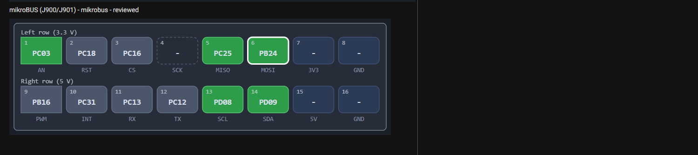
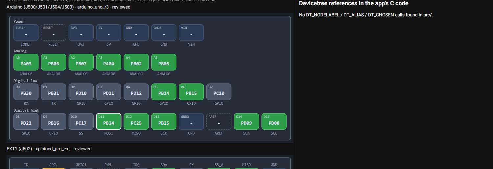
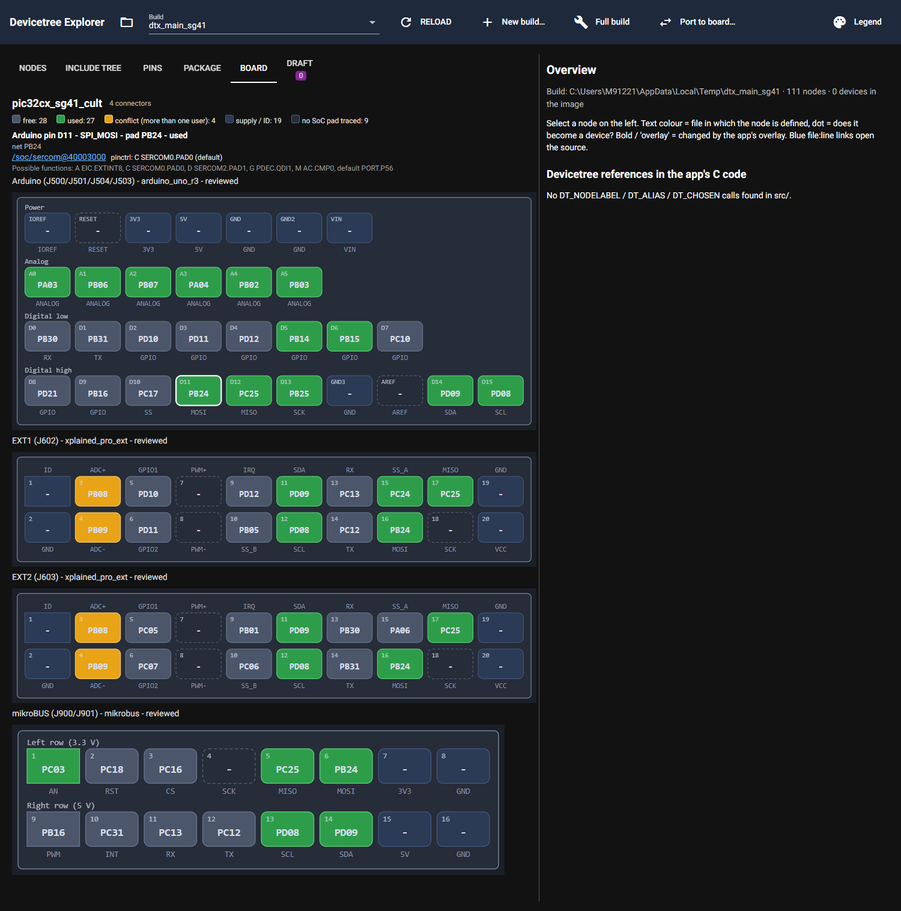

# P8.12 Importer: mikroBUS and Arduino headers

Environment: `DTX_RTOS4_WS=C:\Masters\26020_RTOS4\zephyrproject`, `DTX_MAIN_WS=C:\Masters\zephyr-main`,
`DTX_DESIGN_FILES=C:\Masters\board_design_files`. Files: `dt_explorer/importers/pipeline.py`,
`dt_explorer/connectors/arduino_uno_r3.py`, `dt_explorer/connectors/mikrobus.py` (label keys and merge helpers only),
`dt_explorer/boards/pic32cx_sg41_cult.yaml`, `pic32cx_sg61_cult.yaml`, `dt_explorer/ui/board_view.py`,
`tests/test_import_pipeline.py`, `tests/test_board_view.py`.

## What was found on the boards

SG41/SG61 Curiosity Ultra (same PCB "SGxx" R5, U401 = TQFP128):

- **mikroBUS = J900 + J901**, two `HDR_F_2.54_1x8` parts 22.9 mm apart, same rotation. J900 pin 7 = `VCC_3P3V`
  (left row, keys 1-8), J901 pin 7 = `VCC_5P0V` (right row, keys 9-16). The silkscreen writes the name on two lines
  ("mikro" over "BUS", 3.4 mm apart), so the importer joins stacked silkscreen texts before matching the name pattern.
  The role words AN/RST/CS/SCK/MISO/MOSI/+3.3V/GND and PWM/INT/RX/TX/SCL/SDA/+5V/GND are on the silkscreen next to the
  rows and agree with the standard.
- **Arduino Uno R3 = J500 (power, 8 pins) + J501 (analog, 6) + J504 (digital low, 8) + J503 (digital high, 10)**.
  J503 pin n = D8..D13 (1-6), GND (7), AREF (8), SDA/D14 (9), SCL/D15 (10). Pin 1 of J500 is NC (no label), pin 8 is VIN
  with no net on this board. J502 (2x3 ICSP) is not one of the four headers and stays out.
- **No silkscreen text "Arduino" near the headers.** The only text with that word is the mechanical-layer text
  "Curiosity Ultra MCU Arduino Connector Placement" (70 mm away); each header has a mechanical-layer text "J500 Power",
  "J501 Analog Low", "J504 Digital Low", "J503 Digital High". HC-6 decision: `reviewed: builder` only when a text with
  the word Arduino exists on the board **and** every header text agrees with the function found from the pin pattern;
  the evidence is written into `reason`. Otherwise the connector is still written (name "Arduino") but `suggested`.
  (Note: the board text for J501 says "Analog Low"; the pattern uses the first word only for "Analog".)

SAME54 Xplained Pro: **no mikroBUS and no Arduino headers.** Its only 6/8/10-pad connector parts are J100, J102, J302,
J500, J601-J603 (6 pads), J400 (8 pads) and J404 (10 pads); none of them forms a 3.3 V / 5 V pair of 1x8 headers or a
power/analog/digital set, and none scores >= 0.5 for any connector type. The YAML is unchanged (see the reports below).

## Importer changes

- `find_mikrobus`: pairs of 1x8 parts (pads 1-8) with the same footprint and layer, at most 40 mm apart, whose pin 7 nets
  identify a 3.3 V row and a 5 V row (`mikrobus.merge_rows`); detection score of the merged 16 pins >= 0.5. The left
  row is chosen by the supply, not by the designator order.
- `find_arduino`: classifies free 1xN parts (`arduino_uno_r3.header_kind`: 6 analog, 10 digital high, 8 power with
  GND on pins 6/7 and a supply on pin 5, 8 digital low without any supply net) and merges one of each within 150 mm into
  label keys (`merge_headers`: IOREF, RESET, 3V3, 5V, GND, GND2, VIN, A0-A5, D0-D7, D8-D13, GND3, AREF, D14, D15; the NC
  pin gets no key). `GND2`/`GND3` were added to the type's `ROLES`.
- Merged connectors carry `designator: J900/J901` (parts joined by `/`), the part centre as `position`, and every pin a
  `part: J900.1` entry (header and pad) next to role/pad/net. Existing keys and values of the EXT entries are untouched.
- Review (`review()` for all types): signal pins for the 75 % rule exclude the roles RESET, AREF, IOREF, VIN besides the
  supply/ID roles (no effect on EXT). IOREF/VIN are not reported as gaps (like ID); RESET and AREF are.
- Board view: mikroBUS as two captioned 1x8 rows with the mikroBUS role names, Arduino as four captioned header rows
  (Power, Analog, Digital low, Digital high) keyed by the Arduino labels; supply pins (3V3, 5V, VIN, IOREF, GND) are
  "supply / ID", colours as for EXT. EXT drawing checked byte-identical to the previous renderer for all 5 EXT
  connectors (script compare, all True).

## Acceptance 1: pin tables, YAML freshness, SG61, Xpro, synthetic tests

`py -m pytest -v -rs -s tests/test_import_pipeline.py tests/test_board_view.py` (complete output, all three env vars set;
the mikroBUS and Arduino tables are printed by `test_sg41_mikrobus_and_arduino`):

```
============================= test session starts =============================
platform win32 -- Python 3.14.8, pytest-9.1.1, pluggy-1.6.0 -- C:\Program Files\Python314\python.exe
cachedir: .pytest_cache
rootdir: C:\Masters\dt_explorer\.claude\worktrees\agent-a4db73b7d430232a6
configfile: pyproject.toml
plugins: anyio-4.13.0
collecting ... collected 40 items

tests/test_import_pipeline.py::test_synthetic_pipeline PASSED
tests/test_import_pipeline.py::test_unnamed_connector_stays_suggested PASSED
tests/test_import_pipeline.py::test_wrong_name_type_stays_suggested PASSED
tests/test_import_pipeline.py::test_mcu_match_uses_package_not_pad_count PASSED
tests/test_import_pipeline.py::test_unavailable_pad_is_marked PASSED
tests/test_import_pipeline.py::test_no_nc_positions_changes_nothing PASSED
tests/test_import_pipeline.py::test_yaml_roundtrip PASSED
tests/test_import_pipeline.py::test_mikrobus_pair_is_one_connector PASSED
tests/test_import_pipeline.py::test_mikrobus_rows_follow_the_supply_not_the_designator PASSED
tests/test_import_pipeline.py::test_two_halves_with_the_same_supply_are_no_mikrobus PASSED
tests/test_import_pipeline.py::test_mikrobus_without_name_stays_suggested PASSED
tests/test_import_pipeline.py::test_split_silkscreen_name_is_joined PASSED
tests/test_import_pipeline.py::test_arduino_headers_merge_into_one_connector PASSED
tests/test_import_pipeline.py::test_arduino_name_evidence_levels PASSED
tests/test_import_pipeline.py::test_incomplete_arduino_set_is_not_written PASSED
tests/test_import_pipeline.py::test_mikrobus_and_arduino_side_by_side PASSED
tests/test_import_pipeline.py::test_header_helpers PASSED
tests/test_import_pipeline.py::test_connectors_match_documented_tables[same54_xpro-ref0] 
same54_xpro: side-by-side, doc (CONFIGURATOR.md) vs import
EXT1 pin  3: doc PB04  import PB04  ok
EXT1 pin  4: doc PB05  import PB05  ok
EXT1 pin  5: doc PA06  import PA06  ok
EXT1 pin  6: doc PA07  import PA07  ok
EXT1 pin  7: doc PB08  import PB08  ok
EXT1 pin  8: doc PB09  import PB09  ok
EXT1 pin  9: doc PB07  import PB07  ok
EXT1 pin 10: doc PA27  import PA27  ok
EXT1 pin 11: doc PA22  import PA22  ok
EXT1 pin 12: doc PA23  import PA23  ok
EXT1 pin 13: doc PA05  import PA05  ok
EXT1 pin 14: doc PA04  import PA04  ok
EXT1 pin 15: doc PB28  import PB28  ok
EXT1 pin 16: doc PB27  import PB27  ok
EXT1 pin 17: doc PB29  import PB29  ok
EXT1 pin 18: doc PB26  import PB26  ok
EXT2 pin  3: doc PB00  import PB00  ok
EXT2 pin  4: doc PA03  import PA03  ok
EXT2 pin  5: doc PB01  import PB01  ok
EXT2 pin  6: doc PB06  import PB06  ok
EXT2 pin  7: doc PB14  import PB14  ok
EXT2 pin  8: doc PB15  import PB15  ok
EXT2 pin  9: doc PD00  import PD00  ok
EXT2 pin 10: doc PB02  import PB02  ok
EXT2 pin 11: doc PD08  import PD08  ok
EXT2 pin 12: doc PD09  import PD09  ok
EXT2 pin 13: doc PB17  import PB17  ok
EXT2 pin 14: doc PB16  import PB16  ok
EXT2 pin 15: doc PC06  import PC06  ok
EXT2 pin 16: doc PC04  import PC04  ok
EXT2 pin 17: doc PC07  import PC07  ok
EXT2 pin 18: doc PC05  import PC05  ok
EXT3 pin  3: doc PC02  import PC02  ok
EXT3 pin  4: doc PC03  import PC03  ok
EXT3 pin  5: doc PC01  import PC01  ok
EXT3 pin  6: doc PC10  import PC10  ok
EXT3 pin  7: doc PD10  import PD10  ok
EXT3 pin  8: doc PD11  import PD11  ok
EXT3 pin  9: doc PC30  import PC30  ok
EXT3 pin 10: doc PC31  import PC31  ok
EXT3 pin 11: doc PD08  import PD08  ok
EXT3 pin 12: doc PD09  import PD09  ok
EXT3 pin 13: doc PC23  import PC23  ok
EXT3 pin 14: doc PC22  import PC22  ok
EXT3 pin 15: doc PC14  import PC14  ok
EXT3 pin 16: doc PC04  import PC04  ok
EXT3 pin 17: doc PC07  import PC07  ok
EXT3 pin 18: doc PC05  import PC05  ok
PASSED
tests/test_import_pipeline.py::test_connectors_match_documented_tables[pic32cx_sg41_cult-ref1] 
pic32cx_sg41_cult: side-by-side, doc (CONFIGURATOR.md) vs import
EXT1 pin  3: doc PB08  import PB08  ok
EXT1 pin  4: doc PB09  import PB09  ok
EXT1 pin  5: doc PD10  import PD10  ok
EXT1 pin  6: doc PD11  import PD11  ok
EXT1 pin  7: doc -     import -     ok
EXT1 pin  8: doc -     import -     ok
EXT1 pin  9: doc PD12  import PD12  ok
EXT1 pin 10: doc PB05  import PB05  ok
EXT1 pin 11: doc PD09  import PD09  ok
EXT1 pin 12: doc PD08  import PD08  ok
EXT1 pin 13: doc PC13  import PC13  ok
EXT1 pin 14: doc PC12  import PC12  ok
EXT1 pin 15: doc PC24  import PC24  ok
EXT1 pin 16: doc PB24  import PB24  ok
EXT1 pin 17: doc PC25  import PC25  ok
EXT1 pin 18: doc -     import -     ok
EXT2 pin  3: doc PB08  import PB08  ok
EXT2 pin  4: doc PB09  import PB09  ok
EXT2 pin  5: doc PC05  import PC05  ok
EXT2 pin  6: doc PC07  import PC07  ok
EXT2 pin  7: doc -     import -     ok
EXT2 pin  8: doc -     import -     ok
EXT2 pin  9: doc PB01  import PB01  ok
EXT2 pin 10: doc PC06  import PC06  ok
EXT2 pin 11: doc PD09  import PD09  ok
EXT2 pin 12: doc PD08  import PD08  ok
EXT2 pin 13: doc PB30  import PB30  ok
EXT2 pin 14: doc PB31  import PB31  ok
EXT2 pin 15: doc PA06  import PA06  ok
EXT2 pin 16: doc PB24  import PB24  ok
EXT2 pin 17: doc PC25  import PC25  ok
EXT2 pin 18: doc -     import -     ok
PASSED
tests/test_import_pipeline.py::test_sg41_gaps_reported PASSED
tests/test_import_pipeline.py::test_connector_names_and_status PASSED
tests/test_import_pipeline.py::test_committed_yaml_is_current PASSED
tests/test_import_pipeline.py::test_sg61_matches_sg41_except_unavailable PASSED
tests/test_import_pipeline.py::test_sg61_committed_yaml_is_current PASSED
tests/test_import_pipeline.py::test_sg41_mikrobus_and_arduino 
pic32cx_sg41_cult mikroBUS (J900 left row = keys 1-8, J901 right row = keys 9-16)
key   role      pad    net            part    gap
1     AN        PC03   PC03           J900.1  
2     RST       PC18   PC18           J900.2  
3     CS        PC16   PC16           J900.3  
4     SCK       -      NetJ900_4      J900.4  net ends without reaching the MCU (also on R461)
5     MISO      PC25   PC25           J900.5  
6     MOSI      PB24   PB24           J900.6  
7     3V3       -      VCC_3P3V       J900.7  
8     GND       -      GND            J900.8  
9     PWM       PB16   PB16           J901.1  
10    INT       PC31   PC31           J901.2  
11    RX        PC13   NetJ901_3      J901.3  
12    TX        PC12   NetJ901_4      J901.4  
13    SCL       PD08   PD08           J901.5  
14    SDA       PD09   PD09           J901.6  
15    5V        -      VCC_5P0V       J901.7  
16    GND       -      GND            J901.8  

pic32cx_sg41_cult Arduino (J500 power, J501 analog, J504 digital low, J503 digital high)
key   role      pad    net            part    gap
IOREF IOREF     -      VCC_3P3V       J500.2  
RESET RESET     -      RESET_UNO      J500.3  routed through part with more than 2 pads: J502 (6 pads)
3V3   3V3       -      VCC_3P3V       J500.4  
5V    5V        -      VCC_5P0V       J500.5  
GND   GND       -      GND            J500.6  
GND2  GND       -      GND            J500.7  
VIN   VIN       -      -              J500.8  
A0    ANALOG    PA03   PA03           J501.1  
A1    ANALOG    PB06   PB06           J501.2  
A2    ANALOG    PB07   PB07           J501.3  
A3    ANALOG    PA04   PA04           J501.4  
A4    ANALOG    PB02   PB02           J501.5  
A5    ANALOG    PB03   PB03           J501.6  
D0    UART_RX   PB30   PB30           J504.1  
D1    UART_TX   PB31   PB31           J504.2  
D2    GPIO      PD10   PD10           J504.3  
D3    GPIO      PD11   PD11           J504.4  
D4    GPIO      PD12   PD12           J504.5  
D5    GPIO      PB14   PB14           J504.6  
D6    GPIO      PB15   PB15           J504.7  
D7    GPIO      PC10   PC10           J504.8  
D8    GPIO      PD21   PD21           J503.1  
D9    GPIO      PB16   PB16           J503.2  
D10   SPI_SS    PC17   PC17           J503.3  
D11   SPI_MOSI  PB24   PB24           J503.4  
D12   SPI_MISO  PC25   PC25           J503.5  
D13   SPI_SCK   PB25   PB25           J503.6  
GND3  GND       -      GND            J503.7  
AREF  AREF      -      NetJ503_8      J503.8  net ends without reaching the MCU (also on R410)
D14   I2C_SDA   PD09   PD09           J503.9  
D15   I2C_SCL   PD08   PD08           J503.10 
PASSED
tests/test_import_pipeline.py::test_sg61_has_the_same_mikrobus_and_arduino PASSED
tests/test_import_pipeline.py::test_xpro_has_no_mikrobus_or_arduino PASSED
tests/test_board_view.py::test_load_and_title PASSED
tests/test_board_view.py::test_bad_schema_is_reported_with_file_name PASSED
tests/test_board_view.py::test_short_role PASSED
tests/test_board_view.py::test_connector_role_lines PASSED
tests/test_board_view.py::test_no_such_connector_and_other_type PASSED
tests/test_board_view.py::test_missing_descriptions PASSED
tests/test_board_view.py::test_report_section_only_when_computed PASSED
tests/test_board_view.py::test_pin_states PASSED
tests/test_board_view.py::test_connector_svg PASSED
tests/test_board_view.py::test_mikrobus_is_drawn_as_two_rows_of_eight PASSED
tests/test_board_view.py::test_arduino_is_drawn_as_four_header_rows PASSED
tests/test_board_view.py::test_unknown_pins_of_a_multi_header_connector_are_still_drawn PASSED
tests/test_board_view.py::test_other_types_keep_their_layout PASSED

============================= 40 passed in 1.04s ==============================
```

Comparison of mikroBUS with CONFIGURATOR.md: that file has no mikroBUS table (it only lists J900/J901 as traced), so the
check is against the mikroBUS standard roles (P7.2: pins 1-8 AN..GND, 9-16 PWM..GND) and against the SG41 EXT1 table
of CONFIGURATOR.md: on the same SoC the mikroBUS and EXT1 signals must land on the same pads.

| mikroBUS signal | pin | pad | EXT1 equivalent (CONFIGURATOR.md) | pad |
|---|---|---|---|---|
| MOSI | 6 | PB24 | pin 16 SPI MOSI | PB24 |
| MISO | 5 | PC25 | pin 17 SPI MISO | PC25 |
| SCK | 4 | - (`NetJ900_4`, gap) | pin 18 SPI SCK | - (`NetJ602_18`, gap) |
| RX | 11 | PC13 (via R463) | pin 13 UART RX | PC13 |
| TX | 12 | PC12 (via R462) | pin 14 UART TX | PC12 |
| SCL | 13 | PD08 | pin 12 TWI SCL | PD08 |
| SDA | 14 | PD09 | pin 11 TWI SDA | PD09 |

(asserted in the test.) Arduino D0/D1 = PB30/PB31 equal EXT2 pins 13/14; D11/D12/D14/D15 = PB24/PC25/PD09/PD08 equal
EXT1 pins 16/17/11/12.

## Acceptance 2: importer reports (SG41, SG61, Xpro regenerated with the committed arguments)

`regen.py` (scratch script that calls `pipeline.import_files` with the arguments of the committed YAMLs and writes
`dt_explorer/boards/*.yaml`); "no connector type >= 0.5" lines of the Xpro are listed completely:

```
same54_xpro [('EXT1', 'J401', 'xplained_pro_ext', 'reviewed'), ('EXT2', 'J402', 'xplained_pro_ext', 'reviewed'), ('EXT3', 'J403', 'xplained_pro_ext', 'reviewed')]
MCU: U200 (AP6-00477) fits package TQFP128 100% (128 pads, package 128)
NC positions of TQFP128 on ATSAME54P20A (footprint pads without a pin): 5
J100: no connector type >= 0.5 (best arduino_uno_r3 0.0); not written
J102: no connector type >= 0.5 (best arduino_uno_r3 0.0); not written
J302: no connector type >= 0.5 (best arduino_uno_r3 0.0); not written
J303: no connector type >= 0.5 (best arduino_uno_r3 0.0); not written
J400: no connector type >= 0.5 (best arduino_uno_r3 0.0); not written
J404: no connector type >= 0.5 (best arduino_uno_r3 0.0); not written
J405: no connector type >= 0.5 (best arduino_uno_r3 0.0); not written
J406: no connector type >= 0.5 (best xplained_pro_ext 0.3); not written
J500: no connector type >= 0.5 (best arduino_uno_r3 0.0); not written
J600: no connector type >= 0.5 (best arduino_uno_r3 0.0); not written
J601: no connector type >= 0.5 (best arduino_uno_r3 0.0); not written
J602: no connector type >= 0.5 (best arduino_uno_r3 0.0); not written
J603: no connector type >= 0.5 (best arduino_uno_r3 0.0); not written
J700: no connector type >= 0.5 (best arduino_uno_r3 0.0); not written
J800: no connector type >= 0.5 (best arduino_uno_r3 0.0); not written
J401: type xplained_pro_ext (1.0), name EXT1, reviewed: silkscreen 'EXT1' fits type xplained_pro_ext, score 1.0, GND/VCC pins as in the standard, 16/16 signal pins traced to the MCU
J402: type xplained_pro_ext (1.0), name EXT2, reviewed: silkscreen 'EXT2' fits type xplained_pro_ext, score 1.0, GND/VCC pins as in the standard, 16/16 signal pins traced to the MCU
J403: type xplained_pro_ext (1.0), name EXT3, reviewed: silkscreen 'EXT3' fits type xplained_pro_ext, score 1.0, GND/VCC pins as in the standard, 16/16 signal pins traced to the MCU
GAPS

pic32cx_sg41_cult [('Arduino', 'J500/J501/J504/J503', 'arduino_uno_r3', 'reviewed'), ('EXT1', 'J602', 'xplained_pro_ext', 'reviewed'), ('EXT2', 'J603', 'xplained_pro_ext', 'reviewed'), ('mikroBUS', 'J900/J901', 'mikrobus', 'reviewed')]
MCU: U401 (TQFP-128_14x14_EP4.9x4.9) fits package TQFP128 100% (129 pads, package 128)
NC positions of TQFP128 on PIC32CX1025SG41128 (footprint pads without a pin): 5
J900/J901: merged mikrobus connector from J900, J901
J500/J501/J504/J503: merged arduino_uno_r3 connector from J500, J501, J504, J503
J200: no connector type >= 0.5 (best arduino_uno_r3 0.0); not written
J302: no connector type >= 0.5 (best arduino_uno_r3 0.0); not written
J400: no connector type >= 0.5 (best arduino_uno_r3 0.0); not written
J502: no connector type >= 0.5 (best arduino_uno_r3 0.0); not written
J601: no connector type >= 0.5 (best xplained_pro_ext 0.1); not written
J704: no connector type >= 0.5 (best arduino_uno_r3 0.0); not written
J800: no connector type >= 0.5 (best arduino_uno_r3 0.0); not written
J802: no connector type >= 0.5 (best arduino_uno_r3 0.0); not written
J902: no connector type >= 0.5 (best xplained_pro_ext 0.2); not written
J903: no connector type >= 0.5 (best arduino_uno_r3 0.0); not written
J602: type xplained_pro_ext (0.6), name EXT1, reviewed: silkscreen 'EXT1' fits type xplained_pro_ext, score 0.6, GND/VCC pins as in the standard, 13/16 signal pins traced to the MCU
J603: type xplained_pro_ext (0.6), name EXT2, reviewed: silkscreen 'EXT2' fits type xplained_pro_ext, score 0.6, GND/VCC pins as in the standard, 13/16 signal pins traced to the MCU
J900/J901 pin 11 (RX): NetJ901_3 -> PC13 via R463
J900/J901 pin 12 (TX): NetJ901_4 -> PC12 via R462
J900/J901: type mikrobus (0.6), name mikroBUS, reviewed: silkscreen 'mikroBUS' fits type mikrobus, score 0.6, GND/VCC pins as in the standard, 11/12 signal pins traced to the MCU
J500/J501/J504/J503: type arduino_uno_r3 (0.75), name Arduino, reviewed: board text 'Curiosity Ultra MCU Arduino Connector Placement' and header texts J500 Power, J501 Analog, J504 Digital low, J503 Digital high fits type arduino_uno_r3, score 0.75, GND/VCC pins as in the standard, 22/22 signal pins traced to the MCU
GAPS
J602 pin 7 (PWM+): net TCC4/WO0: routed through part with more than 2 pads: J402 (3 pads), J603 (20 pads)
J602 pin 8 (PWM-): net TCC4/WO1: routed through part with more than 2 pads: J403 (3 pads)
J602 pin 18 (SPI_SCK): net NetJ602_18: net ends without reaching the MCU (also on R424)
J603 pin 7 (PWM+): net TCC4/WO0: routed through part with more than 2 pads: J402 (3 pads), J602 (20 pads)
J603 pin 8 (PWM-): net NetJ603_8: net ends without reaching the MCU (also on R425)
J603 pin 18 (SPI_SCK): net NetJ603_18: net ends without reaching the MCU (also on R426)
J900/J901 pin 4 (SCK): net NetJ900_4: net ends without reaching the MCU (also on R461)
J500/J501/J504/J503 pin RESET (RESET): net RESET_UNO: routed through part with more than 2 pads: J502 (6 pads)
J500/J501/J504/J503 pin AREF (AREF): net NetJ503_8: net ends without reaching the MCU (also on R410)
pic32cx_sg61_cult [('Arduino', 'J500/J501/J504/J503', 'arduino_uno_r3', 'reviewed'), ('EXT1', 'J602', 'xplained_pro_ext', 'reviewed'), ('EXT2', 'J603', 'xplained_pro_ext', 'reviewed'), ('mikroBUS', 'J900/J901', 'mikrobus', 'reviewed')]
MCU: U401 (TQFP-128_14x14_EP4.9x4.9) fits package TQFP128 100% (129 pads, package 128)
NC positions of TQFP128 on PIC32CX1025SG61128 (footprint pads without a pin): 5, 27, 102, 103, 104, 105
J900/J901: merged mikrobus connector from J900, J901
J500/J501/J504/J503: merged arduino_uno_r3 connector from J500, J501, J504, J503
J200: no connector type >= 0.5 (best arduino_uno_r3 0.0); not written
J302: no connector type >= 0.5 (best arduino_uno_r3 0.0); not written
J400: no connector type >= 0.5 (best arduino_uno_r3 0.0); not written
J502: no connector type >= 0.5 (best arduino_uno_r3 0.0); not written
J601: no connector type >= 0.5 (best xplained_pro_ext 0.1); not written
J704: no connector type >= 0.5 (best arduino_uno_r3 0.0); not written
J800: no connector type >= 0.5 (best arduino_uno_r3 0.0); not written
J802: no connector type >= 0.5 (best arduino_uno_r3 0.0); not written
J902: no connector type >= 0.5 (best xplained_pro_ext 0.2); not written
J903: no connector type >= 0.5 (best arduino_uno_r3 0.0); not written
J602: type xplained_pro_ext (0.6), name EXT1, reviewed: silkscreen 'EXT1' fits type xplained_pro_ext, score 0.6, GND/VCC pins as in the standard, 13/16 signal pins traced to the MCU
J603: type xplained_pro_ext (0.6), name EXT2, reviewed: silkscreen 'EXT2' fits type xplained_pro_ext, score 0.6, GND/VCC pins as in the standard, 13/16 signal pins traced to the MCU
J900/J901 pin 11 (RX): NetJ901_3 -> PC13 via R463
J900/J901 pin 12 (TX): NetJ901_4 -> PC12 via R462
J900/J901: type mikrobus (0.6), name mikroBUS, reviewed: silkscreen 'mikroBUS' fits type mikrobus, score 0.6, GND/VCC pins as in the standard, 11/12 signal pins traced to the MCU
J500/J501/J504/J503: type arduino_uno_r3 (0.75), name Arduino, reviewed: board text 'Curiosity Ultra MCU Arduino Connector Placement' and header texts J500 Power, J501 Analog, J504 Digital low, J503 Digital high fits type arduino_uno_r3, score 0.75, GND/VCC pins as in the standard, 22/22 signal pins traced to the MCU
GAPS
J602 pin 7 (PWM+): net TCC4/WO0: routed through part with more than 2 pads: J402 (3 pads), J603 (20 pads)
J602 pin 8 (PWM-): net TCC4/WO1: routed through part with more than 2 pads: J403 (3 pads)
J602 pin 18 (SPI_SCK): net NetJ602_18: net ends without reaching the MCU (also on R424)
J603 pin 7 (PWM+): net TCC4/WO0: routed through part with more than 2 pads: J402 (3 pads), J602 (20 pads)
J603 pin 8 (PWM-): net NetJ603_8: net ends without reaching the MCU (also on R425)
J603 pin 18 (SPI_SCK): net NetJ603_18: net ends without reaching the MCU (also on R426)
J900/J901 pin 4 (SCK): net NetJ900_4: net ends without reaching the MCU (also on R461)
J500/J501/J504/J503 pin RESET (RESET): net RESET_UNO: routed through part with more than 2 pads: J502 (6 pads)
J500/J501/J504/J503 pin AREF (AREF): net NetJ503_8: net ends without reaching the MCU (also on R410)
```

## Acceptance 3: git diff of the YAMLs

`git diff --numstat -- dt_explorer/boards` (columns: added, removed, file; the SAME54 file is rewritten byte-identical
and therefore does not appear):

```
277	0	dt_explorer/boards/pic32cx_sg41_cult.yaml
277	0	dt_explorer/boards/pic32cx_sg61_cult.yaml
```

`git diff --stat -- dt_explorer/boards`:

```
 dt_explorer/boards/pic32cx_sg41_cult.yaml | 277 ++++++++++++++++++++++++++++++
 dt_explorer/boards/pic32cx_sg61_cult.yaml | 277 ++++++++++++++++++++++++++++++
 2 files changed, 554 insertions(+)
```

Removed lines in the SG41 diff: 0; in the SG61 diff: 0. Added lines: SG41 277, SG61
277. The SG61 added lines are identical to the SG41 ones: True. SAME54 diff: (empty).

Full `git diff -- dt_explorer/boards/pic32cx_sg41_cult.yaml` (the SG61 diff differs only in the hunk header line numbers):

```
diff --git a/dt_explorer/boards/pic32cx_sg41_cult.yaml b/dt_explorer/boards/pic32cx_sg41_cult.yaml
index 04b32c6..9e9661b 100644
--- a/dt_explorer/boards/pic32cx_sg41_cult.yaml
+++ b/dt_explorer/boards/pic32cx_sg41_cult.yaml
@@ -12,6 +12,179 @@ mcu:
   package: TQFP128
   fit: 1.0
 connectors:
+- name: Arduino
+  designator: J500/J501/J504/J503
+  type: arduino_uno_r3
+  zephyr_binding: arduino-header-r3
+  detection_score: 0.75
+  status: reviewed
+  reason: board text 'Curiosity Ultra MCU Arduino Connector Placement' and header texts J500 Power, J501
+    Analog, J504 Digital low, J503 Digital high fits type arduino_uno_r3, score 0.75, GND/VCC pins as
+    in the standard, 22/22 signal pins traced to the MCU
+  reviewed: builder
+  position:
+    x: 180.28
+    y: 152.92
+    rotation: 270.0
+    layer: top
+  pins:
+    IOREF:
+      role: IOREF
+      pad: null
+      net: VCC_3P3V
+      part: J500.2
+    RESET:
+      role: RESET
+      pad: null
+      net: RESET_UNO
+      gap: 'routed through part with more than 2 pads: J502 (6 pads)'
+      part: J500.3
+    3V3:
+      role: 3V3
+      pad: null
+      net: VCC_3P3V
+      part: J500.4
+    5V:
+      role: 5V
+      pad: null
+      net: VCC_5P0V
+      part: J500.5
+    GND:
+      role: GND
+      pad: null
+      net: GND
+      part: J500.6
+    GND2:
+      role: GND
+      pad: null
+      net: GND
+      part: J500.7
+    VIN:
+      role: VIN
+      pad: null
+      net: null
+      part: J500.8
+    A0:
+      role: ANALOG
+      pad: PA03
+      net: PA03
+      part: J501.1
+    A1:
+      role: ANALOG
+      pad: PB06
+      net: PB06
+      part: J501.2
+    A2:
+      role: ANALOG
+      pad: PB07
+      net: PB07
+      part: J501.3
+    A3:
+      role: ANALOG
+      pad: PA04
+      net: PA04
+      part: J501.4
+    A4:
+      role: ANALOG
+      pad: PB02
+      net: PB02
+      part: J501.5
+    A5:
+      role: ANALOG
+      pad: PB03
+      net: PB03
+      part: J501.6
+    D0:
+      role: UART_RX
+      pad: PB30
+      net: PB30
+      part: J504.1
+    D1:
+      role: UART_TX
+      pad: PB31
+      net: PB31
+      part: J504.2
+    D2:
+      role: GPIO
+      pad: PD10
+      net: PD10
+      part: J504.3
+    D3:
+      role: GPIO
+      pad: PD11
+      net: PD11
+      part: J504.4
+    D4:
+      role: GPIO
+      pad: PD12
+      net: PD12
+      part: J504.5
+    D5:
+      role: GPIO
+      pad: PB14
+      net: PB14
+      part: J504.6
+    D6:
+      role: GPIO
+      pad: PB15
+      net: PB15
+      part: J504.7
+    D7:
+      role: GPIO
+      pad: PC10
+      net: PC10
+      part: J504.8
+    D8:
+      role: GPIO
+      pad: PD21
+      net: PD21
+      part: J503.1
+    D9:
+      role: GPIO
+      pad: PB16
+      net: PB16
+      part: J503.2
+    D10:
+      role: SPI_SS
+      pad: PC17
+      net: PC17
+      part: J503.3
+    D11:
+      role: SPI_MOSI
+      pad: PB24
+      net: PB24
+      part: J503.4
+    D12:
+      role: SPI_MISO
+      pad: PC25
+      net: PC25
+      part: J503.5
+    D13:
+      role: SPI_SCK
+      pad: PB25
+      net: PB25
+      part: J503.6
+    GND3:
+      role: GND
+      pad: null
+      net: GND
+      part: J503.7
+    AREF:
+      role: AREF
+      pad: null
+      net: NetJ503_8
+      gap: net ends without reaching the MCU (also on R410)
+      part: J503.8
+    D14:
+      role: I2C_SDA
+      pad: PD09
+      net: PD09
+      part: J503.9
+    D15:
+      role: I2C_SCL
+      pad: PD08
+      net: PD08
+      part: J503.10
 - name: EXT1
   designator: J602
   type: xplained_pro_ext
@@ -210,6 +383,106 @@ connectors:
       role: VCC
       pad: null
       net: VCC_3P3V
+- name: mikroBUS
+  designator: J900/J901
+  type: mikrobus
+  zephyr_binding: mikro-bus
+  detection_score: 0.6
+  status: reviewed
+  reason: silkscreen 'mikroBUS' fits type mikrobus, score 0.6, GND/VCC pins as in the standard, 11/12
+    signal pins traced to the MCU
+  reviewed: builder
+  position:
+    x: 166.58
+    y: 83.82
+    rotation: 90.0
+    layer: top
+  pins:
+    '1':
+      role: AN
+      pad: PC03
+      net: PC03
+      part: J900.1
+    '2':
+      role: RST
+      pad: PC18
+      net: PC18
+      part: J900.2
+    '3':
+      role: CS
+      pad: PC16
+      net: PC16
+      part: J900.3
+    '4':
+      role: SCK
+      pad: null
+      net: NetJ900_4
+      gap: net ends without reaching the MCU (also on R461)
+      part: J900.4
+    '5':
+      role: MISO
+      pad: PC25
+      net: PC25
+      part: J900.5
+    '6':
+      role: MOSI
+      pad: PB24
+      net: PB24
+      part: J900.6
+    '7':
+      role: 3V3
+      pad: null
+      net: VCC_3P3V
+      part: J900.7
+    '8':
+      role: GND
+      pad: null
+      net: GND
+      part: J900.8
+    '9':
+      role: PWM
+      pad: PB16
+      net: PB16
+      part: J901.1
+    '10':
+      role: INT
+      pad: PC31
+      net: PC31
+      part: J901.2
+    '11':
+      role: RX
+      pad: PC13
+      net: NetJ901_3
+      via:
+      - R463
+      part: J901.3
+    '12':
+      role: TX
+      pad: PC12
+      net: NetJ901_4
+      via:
+      - R462
+      part: J901.4
+    '13':
+      role: SCL
+      pad: PD08
+      net: PD08
+      part: J901.5
+    '14':
+      role: SDA
+      pad: PD09
+      net: PD09
+      part: J901.6
+    '15':
+      role: 5V
+      pad: null
+      net: VCC_5P0V
+      part: J901.7
+    '16':
+      role: GND
+      pad: null
+      net: GND
+      part: J901.8
 gaps:
 - 'J602 pin 7 (PWM+): net TCC4/WO0: routed through part with more than 2 pads: J402 (3 pads), J603 (20
   pads)'
@@ -219,3 +492,7 @@ gaps:
   pads)'
 - 'J603 pin 8 (PWM-): net NetJ603_8: net ends without reaching the MCU (also on R425)'
 - 'J603 pin 18 (SPI_SCK): net NetJ603_18: net ends without reaching the MCU (also on R426)'
+- 'J900/J901 pin 4 (SCK): net NetJ900_4: net ends without reaching the MCU (also on R461)'
+- 'J500/J501/J504/J503 pin RESET (RESET): net RESET_UNO: routed through part with more than 2 pads: J502
+  (6 pads)'
+- 'J500/J501/J504/J503 pin AREF (AREF): net NetJ503_8: net ends without reaching the MCU (also on R410)'
```

## Acceptance 4: screenshots

Headless Chrome (Playwright) against my own server on port 8851 (launcher patching `ui.run`'s port; the server was
started from this worktree with the SG41 hello_world build `%TEMP%\dtx_main_sg41` as root and stopped by PID),
URL `/?tab=board`; pin `mikroBUS:6` (MOSI) and `Arduino:D11` (MOSI) were clicked. No console errors in the browser.







Green = pad used in the build, grey = free, dark blue = supply / ID, dashed = no SoC pad traced (SCK, RESET, AREF).

## Acceptance 5: whole suite

`py -m pytest -q -rs` with the three environment variables (output of the last lines; the full run printed dots and the
report lines of the translation tests only, no skip line):

```
.
g1-spi: source properties 41 = table rows 41; target properties 42 = mapped 39 + target-only 3; unmapped source rows 2 (drop/derive without target)
........................                                   [100%]
398 passed in 328.27s (0:05:28)
```

