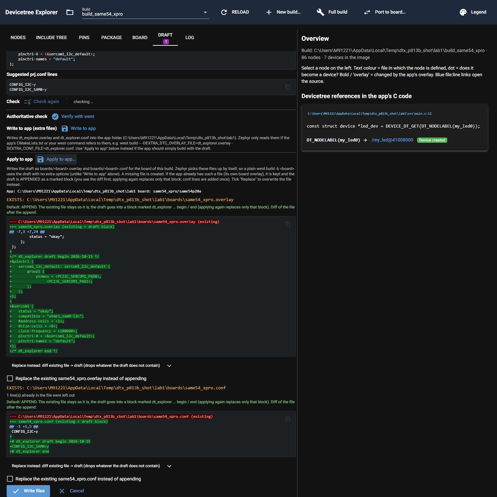
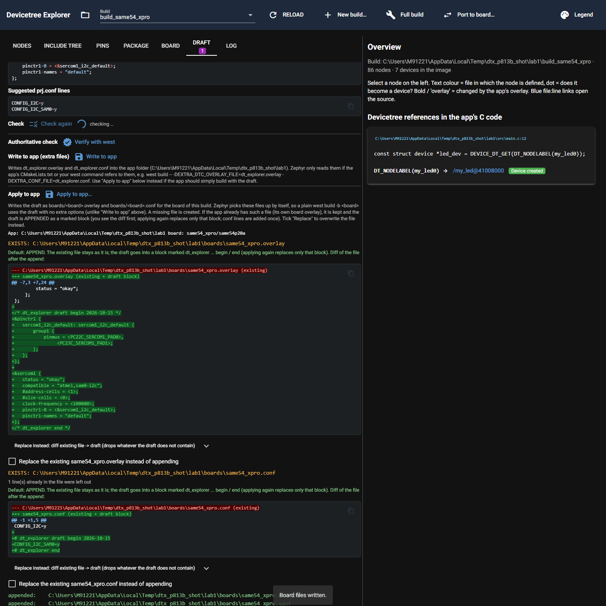
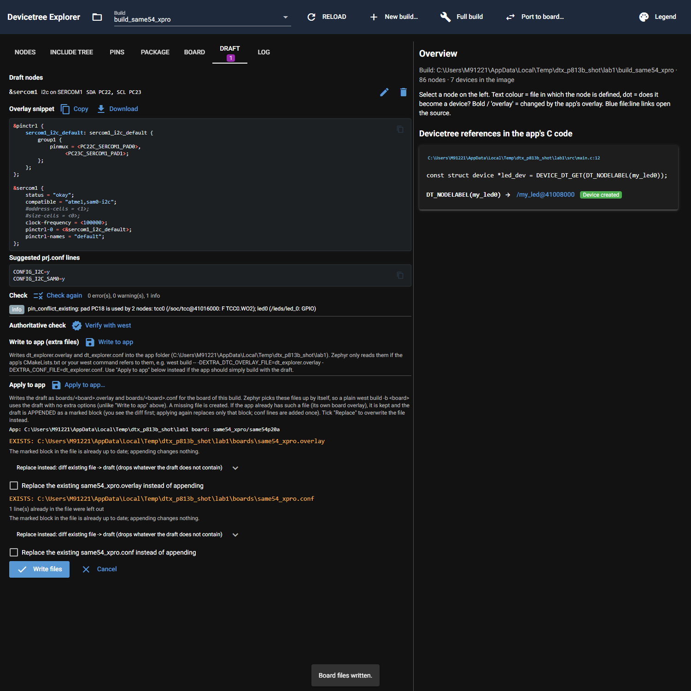

# P8.13b evidence: append the draft to an existing app overlay

Environment: `DTX_RTOS4_WS=C:\Masters\26020_RTOS4\zephyrproject`, `DTX_MAIN_WS=C:\Masters\zephyr-main`,
`DTX_DESIGN_FILES=C:\Masters\board_design_files`. Zephyr SDK 0.17.4. All writes went to copies under `%TEMP%\dtx_p813b`
(layout from P5.6: `apps\lab1` plus `modules\led`). Draft: SERCOM1 as I2C on PC22 (SDA) / PC23 (SCL), built on the
read-only build `apps\lab1\build_same54_xpro` (never saved there). The real `apps\` and `_soltest\` were not written
(file listing with sizes and times before and after is identical, see the last section).

## What was built

* `core/apply.py`: `merge_block(kind, existing, new, source, today)` builds "existing + one marked block". Overlay markers:
  `/* dt_explorer <source> begin <date> */` ... `/* dt_explorer end */` (`<source>` is `draft` in the Draft tab and `port` in
  the port dialog); conf markers: `# dt_explorer <source> begin <date>` ... `# dt_explorer end`. An old block (any source or
  date) is replaced in place, the text around it stays byte for byte; otherwise the block goes to the end. For a conf, lines
  the rest of the file already has are left out (note "N line(s) already in the file were left out"); no statement left means
  no block. `FilePlan` gets `merged`, `append_diff`, `append_note`; `ApplyResult` gets `appended`;
  `apply(plan, overwrite=None, append=None)`: a file in `append` gets the merged text (skipped when the block is already up to
  date), `overwrite` wins over `append`, a file in neither is still refused (old behaviour, old tests unchanged).
  `plan_apply`/`draft_plan` get a `today` argument (tests, evidence). `plan_lines` prints both diffs.
* `ui/draft_tab.py` and `ui/port.py` (same flow in both): for an existing file the default is **append**: hint
  `*-apply-append-hint-<kind>`, diff of the file after the append `*-apply-diff-<kind>`; the replace diff moved into a fold-out
  `*-apply-replace-box-<kind>` / `*-apply-diff-replace-<kind>`; the box `*-apply-replace-<kind>` ("Replace the existing ...
  instead of appending") is the explicit replace. **Write files** passes `append=` for every existing file whose box is not
  ticked. Result lines show `appended:`. New files unchanged.
* **`#include` decision:** a draft overlay with `#include` lines keeps them inside the block (cpp accepts `#include` anywhere,
  and moving lines out of the block would break "replace only the block"). Checked with a real cmake run on a copy
  (`%TEMP%\dtx_p813b_inc`, rc 0): the block starts with `#include <zephyr/dt-bindings/gpio/gpio.h>` and uses `GPIO_ACTIVE_LOW`;
  the new `zephyr.dts` shows `foo = < 0x1 >`. The drafts the tool renders today have no `#include`.

## Acceptance 1: lab1 copy, first apply (script `acc.py`, `load_plugins()` first)

The app's own `boards/same54_xpro.conf` did not exist in lab1; the copy got a seeded one (`CONFIG_I2C=y` and a comment) so
the conf append and the duplicate skipping can be shown.

```text
copied to C:\Users\M91221\AppData\Local\Temp\dtx_p813b\apps\lab1
--- original boards/same54_xpro.overlay ---
/ {
    my_led0: my_led@41008000 {
        compatible = "myvendor,mygpio-led";
        reg = <0x41008000 0x2000>;
        port = <2>;
        pin = <18>;
        status = "okay";
    };
};

--- seeded boards/same54_xpro.conf ---
# the app's own board conf
CONFIG_I2C=y

##### FIRST APPLY
--- draft overlay ---
&pinctrl {
	sercom1_i2c_default: sercom1_i2c_default {
		group1 {
			pinmux = <PC22C_SERCOM1_PAD0>,
				 <PC23C_SERCOM1_PAD1>;
		};
	};
};

&sercom1 {
	status = "okay";
	compatible = "atmel,sam0-i2c";
	#address-cells = <1>;
	#size-cells = <0>;
	clock-frequency = <100000>;
	pinctrl-0 = <&sercom1_i2c_default>;
	pinctrl-names = "default";
};
--- draft conf ---
CONFIG_I2C=y
CONFIG_I2C_SAM0=y

apply to C:\Users\M91221\AppData\Local\Temp\dtx_p813b\apps\lab1 for same54_xpro/same54p20a
  exists                 C:\Users\M91221\AppData\Local\Temp\dtx_p813b\apps\lab1\boards\same54_xpro.overlay
      append (default):
      --- C:\Users\M91221\AppData\Local\Temp\dtx_p813b\apps\lab1\boards\same54_xpro.overlay (existing)
      +++ same54_xpro.overlay (existing + draft block)
      @@ -7,3 +7,24 @@
               status = "okay";
           };
       };
      +
      +/* dt_explorer draft begin 2026-10-15 */
      +&pinctrl {
      +	sercom1_i2c_default: sercom1_i2c_default {
      +		group1 {
      +			pinmux = <PC22C_SERCOM1_PAD0>,
      +				 <PC23C_SERCOM1_PAD1>;
      +		};
      +	};
      +};
      +
      +&sercom1 {
      +	status = "okay";
      +	compatible = "atmel,sam0-i2c";
      +	#address-cells = <1>;
      +	#size-cells = <0>;
      +	clock-frequency = <100000>;
      +	pinctrl-0 = <&sercom1_i2c_default>;
      +	pinctrl-names = "default";
      +};
      +/* dt_explorer end */
      replace (explicit tick):
      --- C:\Users\M91221\AppData\Local\Temp\dtx_p813b\apps\lab1\boards\same54_xpro.overlay (existing)
      +++ same54_xpro.overlay (draft)
      @@ -1,9 +1,18 @@
      -/ {
      -    my_led0: my_led@41008000 {
      -        compatible = "myvendor,mygpio-led";
      -        reg = <0x41008000 0x2000>;
      -        port = <2>;
      -        pin = <18>;
      -        status = "okay";
      -    };
      +&pinctrl {
      +	sercom1_i2c_default: sercom1_i2c_default {
      +		group1 {
      +			pinmux = <PC22C_SERCOM1_PAD0>,
      +				 <PC23C_SERCOM1_PAD1>;
      +		};
      +	};
       };
      +
      +&sercom1 {
      +	status = "okay";
      +	compatible = "atmel,sam0-i2c";
      +	#address-cells = <1>;
      +	#size-cells = <0>;
      +	clock-frequency = <100000>;
      +	pinctrl-0 = <&sercom1_i2c_default>;
      +	pinctrl-names = "default";
      +};
  exists                 C:\Users\M91221\AppData\Local\Temp\dtx_p813b\apps\lab1\boards\same54_xpro.conf
      note: 1 line(s) already in the file were left out
      append (default):
      --- C:\Users\M91221\AppData\Local\Temp\dtx_p813b\apps\lab1\boards\same54_xpro.conf (existing)
      +++ same54_xpro.conf (existing + draft block)
      @@ -1,2 +1,6 @@
       # the app's own board conf
       CONFIG_I2C=y
      +
      +# dt_explorer draft begin 2026-10-15
      +CONFIG_I2C_SAM0=y
      +# dt_explorer end
      replace (explicit tick):
      --- C:\Users\M91221\AppData\Local\Temp\dtx_p813b\apps\lab1\boards\same54_xpro.conf (existing)
      +++ same54_xpro.conf (draft)
      @@ -1,2 +1,2 @@
      -# the app's own board conf
       CONFIG_I2C=y
      +CONFIG_I2C_SAM0=y
appended:    C:\Users\M91221\AppData\Local\Temp\dtx_p813b\apps\lab1\boards\same54_xpro.overlay
appended:    C:\Users\M91221\AppData\Local\Temp\dtx_p813b\apps\lab1\boards\same54_xpro.conf

=== boards/same54_xpro.overlay after the first apply ===
/ {
    my_led0: my_led@41008000 {
        compatible = "myvendor,mygpio-led";
        reg = <0x41008000 0x2000>;
        port = <2>;
        pin = <18>;
        status = "okay";
    };
};

/* dt_explorer draft begin 2026-10-15 */
&pinctrl {
	sercom1_i2c_default: sercom1_i2c_default {
		group1 {
			pinmux = <PC22C_SERCOM1_PAD0>,
				 <PC23C_SERCOM1_PAD1>;
		};
	};
};

&sercom1 {
	status = "okay";
	compatible = "atmel,sam0-i2c";
	#address-cells = <1>;
	#size-cells = <0>;
	clock-frequency = <100000>;
	pinctrl-0 = <&sercom1_i2c_default>;
	pinctrl-names = "default";
};
/* dt_explorer end */

=== boards/same54_xpro.conf after the first apply ===
# the app's own board conf
CONFIG_I2C=y

# dt_explorer draft begin 2026-10-15
CONFIG_I2C_SAM0=y
# dt_explorer end
```

## Acceptance 2: full west build of the copy (no extra options)

Command from the RTOS4 workspace root: `.venv\Scripts\python.exe -m west build -b same54_xpro -d %TEMP%\dtx_p813b\build %TEMP%\dtx_p813b\apps\lab1`;
rc=0  elapsed=00:02:04.8184327. The log has 201 lines; head and tail:

```text
-- west build: generating a build system
-- DEBUG: CMAKE_SOURCE_DIR is: C:/Users/M91221/AppData/Local/Temp/dtx_p813b/apps/lab1
python.exe : Loading Zephyr default modules (Zephyr base).
At line:5 char:1
+ & .\.venv\Scripts\python.exe -m west build -b same54_xpro -d $b "$env ...
+ ~~~~~~~~~~~~~~~~~~~~~~~~~~~~~~~~~~~~~~~~~~~~~~~~~~~~~~~~~~~~~~~~~~~~~
    + CategoryInfo          : NotSpecified: (Loading Zephyr ... (Zephyr base).:String) [], RemoteException
    + FullyQualifiedErrorId : NativeCommandError
 
-- Application: C:/Users/M91221/AppData/Local/Temp/dtx_p813b/apps/lab1
-- CMake version: 4.1.2
-- Found Python3: C:/Masters/26020_RTOS4/zephyrproject/.venv/Scripts/python.exe (found suitable version "3.12.10", minimum required is "3.10") found components: Interpreter
... (161 lines omitted; the log has 201 lines) ...
[124/146] Linking C static library zephyr\libzephyr.a
[125/146] Building C object zephyr/kernel/CMakeFiles/kernel.dir/mempool.c.obj
[126/146] Building C object zephyr/kernel/CMakeFiles/kernel.dir/timer.c.obj
[127/146] Linking C static library zephyr\arch\arch\arm\core\cortex_m\libarch__arm__core__cortex_m.a
[128/146] Linking C static library zephyr\arch\arch\arm\core\mpu\libarch__arm__core__mpu.a
[129/146] Linking C static library zephyr\lib\libc\common\liblib__libc__common.a
[130/146] Linking C static library zephyr\lib\libc\picolibc\liblib__libc__picolibc.a
[131/146] Linking C static library zephyr\lib\posix\c_lib_ext\liblib__posix__c_lib_ext.a
[132/146] Linking C static library zephyr\drivers\interrupt_controller\libdrivers__interrupt_controller.a
[133/146] Linking C static library zephyr\drivers\console\libdrivers__console.a
[134/146] Linking C static library zephyr\drivers\gpio\libdrivers__gpio.a
[135/146] Linking C static library zephyr\drivers\pinctrl\libdrivers__pinctrl.a
[136/146] Linking C static library zephyr\drivers\i2c\libdrivers__i2c.a
[137/146] Linking C static library zephyr\drivers\timer\libdrivers__timer.a
[138/146] Linking C static library modules\led\drivers\led\lib..__..__..__..__Users__M91221__AppData__Local__Temp__dtx_p813b__modules__led__drivers__led.a
[139/146] Linking C static library zephyr\drivers\serial\libdrivers__serial.a
[140/146] Linking C static library zephyr\kernel\libkernel.a
[141/146] Linking C executable zephyr\zephyr_pre0.elf; Logical command for additional byproducts on target: zephyr_pre0
[142/146] Generating linker.cmd
[143/146] Generating isr_tables.c, isr_tables_vt.ld, isr_tables_swi.ld
[144/146] Building C object zephyr/CMakeFiles/zephyr_final.dir/misc/empty_file.c.obj
[145/146] Building C object zephyr/CMakeFiles/zephyr_final.dir/isr_tables.c.obj
[146/146] Linking C executable zephyr\zephyr.elf
Memory region         Used Size  Region Size  %age Used
           FLASH:       28324 B         1 MB      2.70%
             RAM:        6656 B       256 KB      2.54%
        IDT_LIST:          0 GB        32 KB      0.00%
Generating files from C:/Users/M91221/AppData/Local/Temp/dtx_p813b/build/zephyr/zephyr.elf for board: same54_xpro
```

Verification on the new build (`verify.py`; `-- Found devicetree overlay: ...apps/lab1/boards/same54_xpro.overlay` is in the log;
`.config` has `CONFIG_MY_LED=y`, `CONFIG_I2C=y`, `CONFIG_I2C_SAM0=y`):

```text
--- my_led0 in the new zephyr.dts ---
	my_led0: my_led@41008000 {
		compatible = "myvendor,mygpio-led";
		reg = < 0x41008000 0x2000 >;
		port = < 0x2 >;
		pin = < 0x12 >;
		status = "okay";
	};
--- sercom1 in the new zephyr.dts ---
		sercom1: sercom@40003400 {
			reg = < 0x40003400 0x40 >;
			interrupts = < 0x32 0x0 >,
			             < 0x33 0x0 >,
			             < 0x34 0x0 >,
			             < 0x35 0x0 >;
			clocks = < &gclk 0x8 >,
			         < &mclk 0x14 0xd >;
			clock-names = "GCLK",
			              "MCLK";
			atmel,assigned-clocks = < &gclk 0x0 >;
			atmel,assigned-clock-names = "GCLK";
			status = "okay";
			compatible = "atmel,sam0-i2c";
			#address-cells = < 0x1 >;
			#size-cells = < 0x0 >;
			clock-frequency = < 0x186a0 >;
			pinctrl-0 = < &sercom1_i2c_default >;
			pinctrl-names = "default";
		};
/my_led@41008000: status=okay compats=['myvendor,mygpio-led'] dep_ordinal=3
/soc/sercom@40003400: status=okay compats=['atmel,sam0-i2c'] dep_ordinal=40
--- nm zephyr.elf | grep __device_dts_ord ---
00005d54 R __device_dts_ord_12
00005d14 R __device_dts_ord_28
00005dd4 R __device_dts_ord_3
00005e14 R __device_dts_ord_40
00005db4 R __device_dts_ord_42
00005d74 R __device_dts_ord_6
00005df4 R __device_dts_ord_70
00005d94 R __device_dts_ord_77
00005d34 R __device_dts_ord_78
00005cb4 r __init___device_dts_ord_12
00005cbc r __init___device_dts_ord_28
00005cfc r __init___device_dts_ord_3
00005d04 r __init___device_dts_ord_40
00005cd4 r __init___device_dts_ord_42
00005cac r __init___device_dts_ord_6
00005d0c r __init___device_dts_ord_70
00005cc4 r __init___device_dts_ord_77
00005ccc r __init___device_dts_ord_78
000064b0 r __pinctrl_dev_config__device_dts_ord_40
00006500 r __pinctrl_dev_config__device_dts_ord_42
00006478 r __pinctrl_dev_config__device_dts_ord_70
000064c0 r __pinctrl_state_pins_0__device_dts_ord_40
00006510 r __pinctrl_state_pins_0__device_dts_ord_42
00006488 r __pinctrl_state_pins_0__device_dts_ord_70
000064b8 r __pinctrl_states__device_dts_ord_40
00006508 r __pinctrl_states__device_dts_ord_42
00006480 r __pinctrl_states__device_dts_ord_70
my_led device symbol present: True
```

`my_led0` (`/my_led@41008000`, dep_ordinal 3) and `sercom1` (`atmel,sam0-i2c`, status okay, ordinal 40) are both in the
image: `__device_dts_ord_3` and `__device_dts_ord_40` are in `nm zephyr.elf`.

## Acceptance 3: second apply with a changed draft, third apply with the same draft

```text
##### SECOND APPLY (draft changed: clock-frequency 400000, date 2026-10-16)
--- draft overlay ---
&pinctrl {
	sercom1_i2c_default: sercom1_i2c_default {
		group1 {
			pinmux = <PC22C_SERCOM1_PAD0>,
				 <PC23C_SERCOM1_PAD1>;
		};
	};
};

&sercom1 {
	status = "okay";
	compatible = "atmel,sam0-i2c";
	#address-cells = <1>;
	#size-cells = <0>;
	clock-frequency = <400000>;
	pinctrl-0 = <&sercom1_i2c_default>;
	pinctrl-names = "default";
};
--- draft conf ---
CONFIG_I2C=y
CONFIG_I2C_SAM0=y

apply to C:\Users\M91221\AppData\Local\Temp\dtx_p813b\apps\lab1 for same54_xpro/same54p20a
  exists                 C:\Users\M91221\AppData\Local\Temp\dtx_p813b\apps\lab1\boards\same54_xpro.overlay
      append (default):
      --- C:\Users\M91221\AppData\Local\Temp\dtx_p813b\apps\lab1\boards\same54_xpro.overlay (existing)
      +++ same54_xpro.overlay (existing + draft block)
      @@ -8,7 +8,7 @@
           };
       };
       
      -/* dt_explorer draft begin 2026-10-15 */
      +/* dt_explorer draft begin 2026-10-16 */
       &pinctrl {
       	sercom1_i2c_default: sercom1_i2c_default {
       		group1 {
      @@ -23,7 +23,7 @@
       	compatible = "atmel,sam0-i2c";
       	#address-cells = <1>;
       	#size-cells = <0>;
      -	clock-frequency = <100000>;
      +	clock-frequency = <400000>;
       	pinctrl-0 = <&sercom1_i2c_default>;
       	pinctrl-names = "default";
       };
      replace (explicit tick):
      --- C:\Users\M91221\AppData\Local\Temp\dtx_p813b\apps\lab1\boards\same54_xpro.overlay (existing)
      +++ same54_xpro.overlay (draft)
      @@ -1,14 +1,3 @@
      -/ {
      -    my_led0: my_led@41008000 {
      -        compatible = "myvendor,mygpio-led";
      -        reg = <0x41008000 0x2000>;
      -        port = <2>;
      -        pin = <18>;
      -        status = "okay";
      -    };
      -};
      -
      -/* dt_explorer draft begin 2026-10-15 */
       &pinctrl {
       	sercom1_i2c_default: sercom1_i2c_default {
       		group1 {
      @@ -23,8 +12,7 @@
       	compatible = "atmel,sam0-i2c";
       	#address-cells = <1>;
       	#size-cells = <0>;
      -	clock-frequency = <100000>;
      +	clock-frequency = <400000>;
       	pinctrl-0 = <&sercom1_i2c_default>;
       	pinctrl-names = "default";
       };
      -/* dt_explorer end */
  exists                 C:\Users\M91221\AppData\Local\Temp\dtx_p813b\apps\lab1\boards\same54_xpro.conf
      note: 1 line(s) already in the file were left out
      append (default):
      --- C:\Users\M91221\AppData\Local\Temp\dtx_p813b\apps\lab1\boards\same54_xpro.conf (existing)
      +++ same54_xpro.conf (existing + draft block)
      @@ -1,6 +1,6 @@
       # the app's own board conf
       CONFIG_I2C=y
       
      -# dt_explorer draft begin 2026-10-15
      +# dt_explorer draft begin 2026-10-16
       CONFIG_I2C_SAM0=y
       # dt_explorer end
      replace (explicit tick):
      --- C:\Users\M91221\AppData\Local\Temp\dtx_p813b\apps\lab1\boards\same54_xpro.conf (existing)
      +++ same54_xpro.conf (draft)
      @@ -1,6 +1,2 @@
      -# the app's own board conf
       CONFIG_I2C=y
      -
      -# dt_explorer draft begin 2026-10-15
       CONFIG_I2C_SAM0=y
      -# dt_explorer end
appended:    C:\Users\M91221\AppData\Local\Temp\dtx_p813b\apps\lab1\boards\same54_xpro.overlay
appended:    C:\Users\M91221\AppData\Local\Temp\dtx_p813b\apps\lab1\boards\same54_xpro.conf

=== diff of same54_xpro.overlay: before -> after the second apply ===
--- before
+++ after
@@ -8,7 +8,7 @@
     };
 };
 
-/* dt_explorer draft begin 2026-10-15 */
+/* dt_explorer draft begin 2026-10-16 */
 &pinctrl {
 	sercom1_i2c_default: sercom1_i2c_default {
 		group1 {
@@ -23,7 +23,7 @@
 	compatible = "atmel,sam0-i2c";
 	#address-cells = <1>;
 	#size-cells = <0>;
-	clock-frequency = <100000>;
+	clock-frequency = <400000>;
 	pinctrl-0 = <&sercom1_i2c_default>;
 	pinctrl-names = "default";
 };


=== diff of same54_xpro.conf: before -> after the second apply ===
--- before
+++ after
@@ -1,6 +1,6 @@
 # the app's own board conf
 CONFIG_I2C=y
 
-# dt_explorer draft begin 2026-10-15
+# dt_explorer draft begin 2026-10-16
 CONFIG_I2C_SAM0=y
 # dt_explorer end

##### THIRD APPLY (same draft again)
--- draft overlay ---
&pinctrl {
	sercom1_i2c_default: sercom1_i2c_default {
		group1 {
			pinmux = <PC22C_SERCOM1_PAD0>,
				 <PC23C_SERCOM1_PAD1>;
		};
	};
};

&sercom1 {
	status = "okay";
	compatible = "atmel,sam0-i2c";
	#address-cells = <1>;
	#size-cells = <0>;
	clock-frequency = <400000>;
	pinctrl-0 = <&sercom1_i2c_default>;
	pinctrl-names = "default";
};
--- draft conf ---
CONFIG_I2C=y
CONFIG_I2C_SAM0=y

apply to C:\Users\M91221\AppData\Local\Temp\dtx_p813b\apps\lab1 for same54_xpro/same54p20a
  exists                 C:\Users\M91221\AppData\Local\Temp\dtx_p813b\apps\lab1\boards\same54_xpro.overlay
      append: block already up to date
      replace (explicit tick):
      --- C:\Users\M91221\AppData\Local\Temp\dtx_p813b\apps\lab1\boards\same54_xpro.overlay (existing)
      +++ same54_xpro.overlay (draft)
      @@ -1,14 +1,3 @@
      -/ {
      -    my_led0: my_led@41008000 {
      -        compatible = "myvendor,mygpio-led";
      -        reg = <0x41008000 0x2000>;
      -        port = <2>;
      -        pin = <18>;
      -        status = "okay";
      -    };
      -};
      -
      -/* dt_explorer draft begin 2026-10-16 */
       &pinctrl {
       	sercom1_i2c_default: sercom1_i2c_default {
       		group1 {
      @@ -27,4 +16,3 @@
       	pinctrl-0 = <&sercom1_i2c_default>;
       	pinctrl-names = "default";
       };
      -/* dt_explorer end */
  exists                 C:\Users\M91221\AppData\Local\Temp\dtx_p813b\apps\lab1\boards\same54_xpro.conf
      note: 1 line(s) already in the file were left out
      append: block already up to date
      replace (explicit tick):
      --- C:\Users\M91221\AppData\Local\Temp\dtx_p813b\apps\lab1\boards\same54_xpro.conf (existing)
      +++ same54_xpro.conf (draft)
      @@ -1,6 +1,2 @@
      -# the app's own board conf
       CONFIG_I2C=y
      -
      -# dt_explorer draft begin 2026-10-16
       CONFIG_I2C_SAM0=y
      -# dt_explorer end
skipped:     C:\Users\M91221\AppData\Local\Temp\dtx_p813b\apps\lab1\boards\same54_xpro.overlay
skipped:     C:\Users\M91221\AppData\Local\Temp\dtx_p813b\apps\lab1\boards\same54_xpro.conf
##### FINAL FILES
=== same54_xpro.overlay ===
/ {
    my_led0: my_led@41008000 {
        compatible = "myvendor,mygpio-led";
        reg = <0x41008000 0x2000>;
        port = <2>;
        pin = <18>;
        status = "okay";
    };
};

/* dt_explorer draft begin 2026-10-16 */
&pinctrl {
	sercom1_i2c_default: sercom1_i2c_default {
		group1 {
			pinmux = <PC22C_SERCOM1_PAD0>,
				 <PC23C_SERCOM1_PAD1>;
		};
	};
};

&sercom1 {
	status = "okay";
	compatible = "atmel,sam0-i2c";
	#address-cells = <1>;
	#size-cells = <0>;
	clock-frequency = <400000>;
	pinctrl-0 = <&sercom1_i2c_default>;
	pinctrl-names = "default";
};
/* dt_explorer end */

=== same54_xpro.conf ===
# the app's own board conf
CONFIG_I2C=y

# dt_explorer draft begin 2026-10-16
CONFIG_I2C_SAM0=y
# dt_explorer end
```

Only the marked block changed (date and `clock-frequency`); `my_led0` and the app's conf lines are untouched. The third run
reports "append: block already up to date" and skips both files. The `#include` run is in `inc.txt` below.

```text
/ {
    my_led0: my_led@41008000 {
        compatible = "myvendor,mygpio-led";
        reg = <0x41008000 0x2000>;
        port = <2>;
        pin = <18>;
        status = "okay";
    };
};

/* dt_explorer draft begin 2026-10-15 */
#include <zephyr/dt-bindings/gpio/gpio.h>

&sercom1 {
	status = "okay";
};

/ {
	inc_test {
		foo = <GPIO_ACTIVE_LOW>;
	};
};
/* dt_explorer end */

-- west build: generating a build system
-- DEBUG: CMAKE_SOURCE_DIR is: C:/Users/M91221/AppData/Local/Temp/dtx_p813b_inc/apps/lab1
python.exe : Loading Zephyr default modules (Zephyr base).
At line:5 char:1
+ & .\.venv\Scripts\python.exe -m west build -b same54_xpro --cmake-onl ...
+ ~~~~~~~~~~~~~~~~~~~~~~~~~~~~~~~~~~~~~~~~~~~~~~~~~~~~~~~~~~~~~~~~~~~~~
    + CategoryInfo          : NotSpecified: (Loading Zephyr ... (Zephyr base).:String) [], RemoteException
    + FullyQualifiedErrorId : NativeCommandError
 
-- Application: C:/Users/M91221/AppData/Local/Temp/dtx_p813b_inc/apps/lab1
-- CMake version: 4.1.2
-- Found Python3: C:/Masters/26020_RTOS4/zephyrproject/.venv/Scripts/python.exe (found suitable version "3.12.10", minimum required is "3.10") found components: Interpreter
-- Cache files will be written to: C:/Masters/26020_RTOS4/zephyrproject/zephyr/.cache
-- Zephyr version: 4.3.0 (C:/Masters/26020_RTOS4/zephyrproject/zephyr)
-- Found west (found suitable version "1.5.0", minimum required is "0.14.0")
-- Board: same54_xpro, qualifiers: same54p20a
-- ZEPHYR_TOOLCHAIN_VARIANT not set, trying to locate Zephyr SDK
-- Found host-tools: zephyr 0.17.4 (C:/Users/M91221/zephyr-sdk-0.17.4)
-- Found toolchain: zephyr 0.17.4 (C:/Users/M91221/zephyr-sdk-0.17.4)
-- Found Dtc: C:/Users/M91221/AppData/Local/Microsoft/WinGet/Packages/oss-winget.dtc_Microsoft.Winget.Source_8wekyb3d8bbwe/usr/bin/dtc.exe (found suitable version "1.6.1", minimum required is "1.4.6")
-- Found BOARD.dts: C:/Masters/26020_RTOS4/zephyrproject/zephyr/boards/atmel/sam0/same54_xpro/same54_xpro.dts
-- Found devicetree overlay: C:/Users/M91221/AppData/Local/Temp/dtx_p813b_inc/apps/lab1/boards/same54_xpro.overlay
-- Generated zephyr.dts: C:/Users/M91221/AppData/Local/Temp/dtx_p813b_inc/build/zephyr/zephyr.dts
-- Generated pickled edt: C:/Users/M91221/AppData/Local/Temp/dtx_p813b_inc/build/zephyr/edt.pickle
-- Generated devicetree_generated.h: C:/Users/M91221/AppData/Local/Temp/dtx_p813b_inc/build/zephyr/include/generated/zephyr/devicetree_generated.h
Parsing C:/Masters/26020_RTOS4/zephyrproject/zephyr/Kconfig
Loaded configuration 'C:/Masters/26020_RTOS4/zephyrproject/zephyr/boards/atmel/sam0/same54_xpro/same54_xpro_defconfig'
Merged configuration 'C:/Users/M91221/AppData/Local/Temp/dtx_p813b_inc/apps/lab1/prj.conf'
Configuration saved to 'C:/Users/M91221/AppData/Local/Temp/dtx_p813b_inc/build/zephyr/.config'
Kconfig header saved to 'C:/Users/M91221/AppData/Local/Temp/dtx_p813b_inc/build/zephyr/include/generated/zephyr/autoconf.h'
-- Found GnuLd: c:/users/m91221/zephyr-sdk-0.17.4/arm-zephyr-eabi/arm-zephyr-eabi/bin/ld.bfd.exe (found version "2.38")
-- The C compiler identification is GNU 12.2.0
-- The CXX compiler identification is GNU 12.2.0
-- The ASM compiler identification is GNU
-- Found assembler: C:/Users/M91221/zephyr-sdk-0.17.4/arm-zephyr-eabi/bin/arm-zephyr-eabi-gcc.exe
-- Using ccache: C:/Users/M91221/AppData/Local/Microsoft/WinGet/Packages/BrechtSanders.WinLibs.POSIX.UCRT_Microsoft.Winget.Source_8wekyb3d8bbwe/mingw64/bin/ccache.exe
-- DEBUG: ZEPHYR_CURRENT_LIBRARY=..__..__..__..__Users__M91221__AppData__Local__Temp__dtx_p813b_inc__modules__led__drivers__led
-- Found gen_kobject_list: C:/Masters/26020_RTOS4/zephyrproject/zephyr/scripts/build/gen_kobject_list.py
-- Configuring done (37.1s)
-- Generating done (1.5s)
-- Build files have been written to: C:/Users/M91221/AppData/Local/Temp/dtx_p813b_inc/build
rc=0
```

## Acceptance 4: UI (simulated, no browser) and screenshots

`tests/ui/test_ui_apply.py` (4 tests): existing own overlay is appended by default (ids `draft-apply-diff-overlay`,
`draft-apply-append-hint-overlay`, `draft-apply-diff-replace-overlay`, tick off by default; result `appended:`; the file starts
with the old content; a second apply says "already up to date"); the replace tick overwrites; new file then identical; and
**the port dialog offers the same option** (`test_port_dialog_offers_the_same_append_option`: port lab1 -> sam_e54_xpro with an
existing `boards/sam_e54_xpro.overlay` in a copy of the app; `port-apply-diff-overlay`, `port-apply-replace-overlay`,
`port-apply-diff-replace-overlay`, result `appended:`, block `dt_explorer port begin`). Core: 9 new tests in `tests/test_apply.py`.

Screenshots from a real browser run on a copy (`shots.py`, own port, stopped by PID): `img/P8.13b_append_plan.png` (plan with the
append diff), `img/P8.13b_appended.png` (result), `img/P8.13b_second_apply.png` (second apply, block up to date).







## Whole suite

`py -m pytest -q -rs` with the three env vars (tail; the head is dots and the usual `-rs` listing):

```text
.....
g1-i2c: source properties 39 = table rows 39; target properties 42 = mapped 37 + target-only 5; unmapped source rows 2 (drop/derive without target)
.
g1-spi: source properties 41 = table rows 41; target properties 42 = mapped 39 + target-only 3; unmapped source rows 2 (drop/derive without target)
.................. [ 94%]
.........................                                                [100%]
============================ UI smoke screenshots =============================
C:\Users\M91221\AppData\Local\Temp\dtx_ui_shots\configure_check.png
C:\Users\M91221\AppData\Local\Temp\dtx_ui_shots\configure_check_verify.png
C:\Users\M91221\AppData\Local\Temp\dtx_ui_shots\port_report.png
C:\Users\M91221\AppData\Local\Temp\dtx_ui_shots\board_view.png
457 passed in 679.13s (0:11:19)
```

## Real apps untouched

Listing of `apps\` and `_soltest\` (all files except `build*` folders, path size mtime) before and after: identical (58 files, same names, sizes and mtimes)
