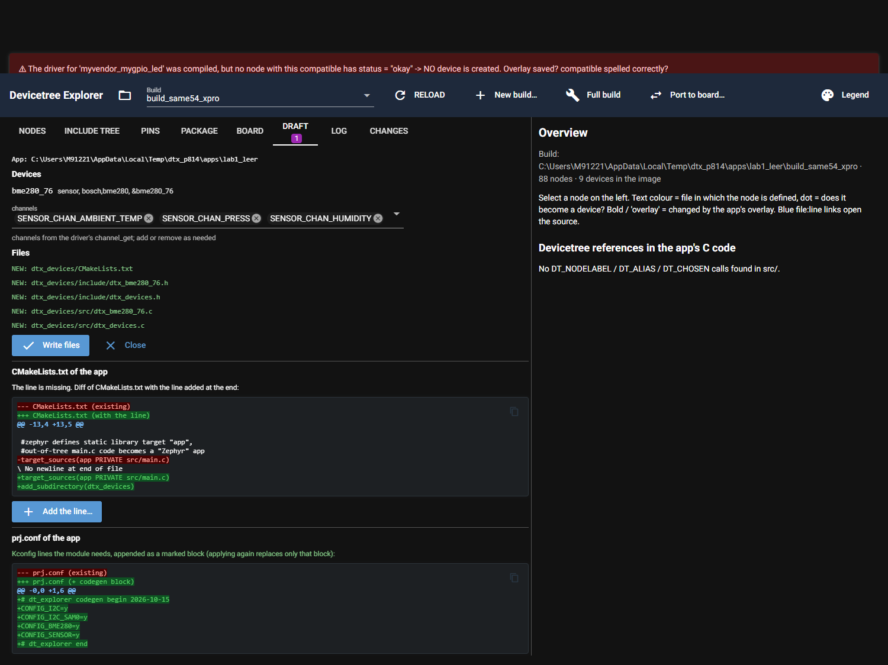
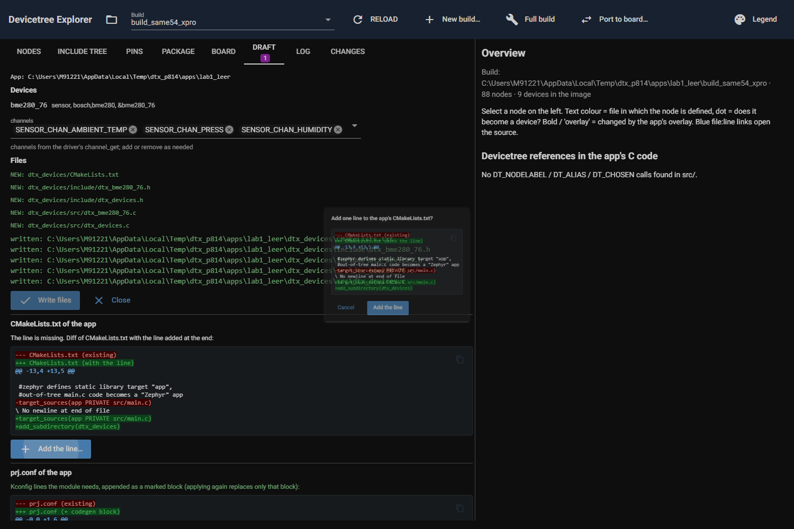
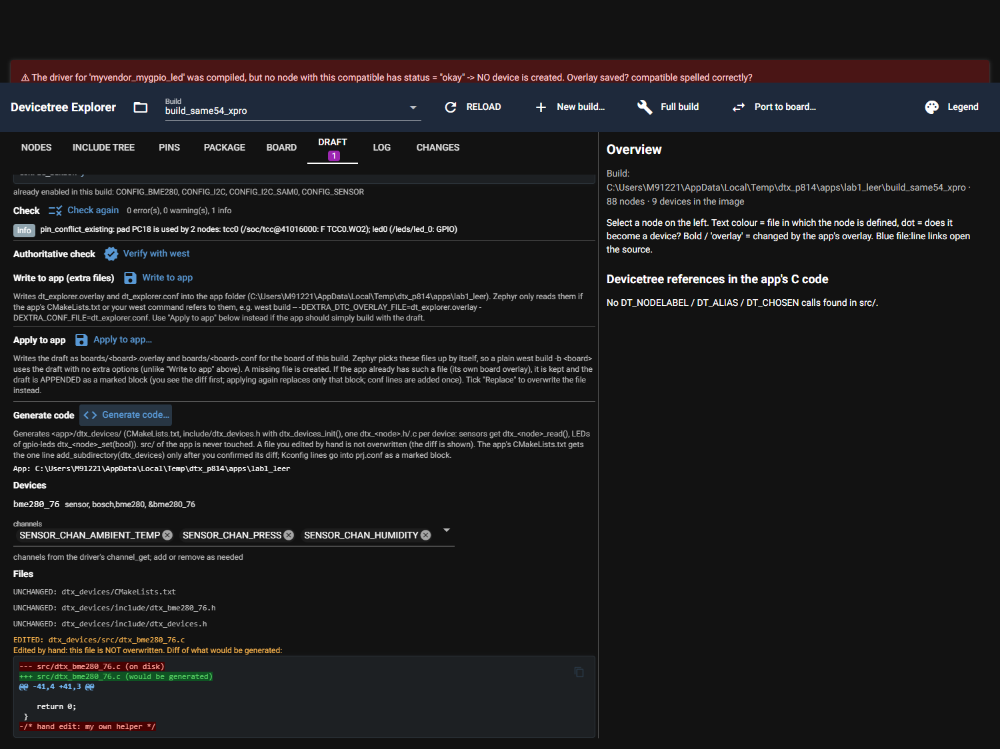

# P8.14 Generated device module `dtx_devices/`

Card: Draft tab "Generate code…" writes `<app>/dtx_devices/` for the devices of the draft. Code: `dt_explorer/core/codegen.py`
(plan, files, header + checksum, CMake line), `dt_explorer/codegen_templates/*.tmpl` (`string.Template`, no new dependency),
`ui/draft_tab.py` (section "Generate code"), `core/apply.py` (additions only: `plan_prj_conf`, `apply_prj_conf`).
`core/git_status.py` needed no change: its `dtx` rule already covers `dtx_devices/` and a CMakeLists.txt that names it.

Setup: a COPY of `_soltest\apps\lab1_leer` under `%TEMP%\dtx_p814\apps\lab1_leer` (plus `%TEMP%\dtx_p814\modules\led`, because the lab sets
`ZEPHYR_EXTRA_MODULES` relative), built once with `west build -b same54_xpro -d <copy>\build_same54_xpro <copy>` from the RTOS4 workspace
root (rc 0). The Explorer ran on that copy (its CMakeCache names the copy as app, so no redirect was needed). The draft is made in the UI:
SERCOM1 I2C on PC22/PC23 + `bosch,bme280` @0x76 (as in P8.6). Nothing was written into `apps\` or `_soltest\`.
Environment: DTX_RTOS4_WS, DTX_MAIN_WS, DTX_DESIGN_FILES set. The UI steps below are driven by the same simulated UI layer as the tests
(`nicegui.testing`, a throw-away driver script, not committed); the screenshots come from an own server on a free port, stopped by PID.

## Acceptance 1: draft, board files, generate, CMakeLists confirmation, prj.conf (complete output)

Order of the run: draft -> **Apply to app…** (existing path, appends to the app's own overlay, writes the board conf) -> **Generate code…** plan
(nothing written) -> **Write files** -> CMakeLists.txt unchanged until the dialog is confirmed -> dialog shows the diff -> OK -> prj.conf diff -> append -> second plan.


```

=== draft overlay snippet ===
&pinctrl {
	sercom1_i2c_default: sercom1_i2c_default {
		group1 {
			pinmux = <PC22C_SERCOM1_PAD0>,
				 <PC23C_SERCOM1_PAD1>;
		};
	};
};

&sercom1 {
	status = "okay";
	compatible = "atmel,sam0-i2c";
	#address-cells = <1>;
	#size-cells = <0>;
	clock-frequency = <100000>;
	pinctrl-0 = <&sercom1_i2c_default>;
	pinctrl-names = "default";

	bme280_76: bme280@76 {
		compatible = "bosch,bme280";
		reg = <0x76>;
	};
};

=== suggested prj.conf lines ===
CONFIG_I2C=y
CONFIG_I2C_SAM0=y
CONFIG_BME280=y
CONFIG_SENSOR=y

=== Apply to app plan ===
App: C:\Users\M91221\AppData\Local\Temp\dtx_p814\apps\lab1_leer   board: same54_xpro/same54p20a
EXISTS: C:\Users\M91221\AppData\Local\Temp\dtx_p814\apps\lab1_leer\boards\same54_xpro.overlay
Default: APPEND. The existing file stays as it is; the draft goes into a block marked dt_explorer ... begin / end (applying again replaces only that block). Diff of the file after the append:
--- C:\Users\M91221\AppData\Local\Temp\dtx_p814\apps\lab1_leer\boards\same54_xpro.overlay (existing)
+++ same54_xpro.overlay (existing + draft block)
@@ -0,0 +1,25 @@
+/* dt_explorer draft begin 2026-10-15 */
+&pinctrl {
+	sercom1_i2c_default: sercom1_i2c_default {
+		group1 {
+			pinmux = <PC22C_SERCOM1_PAD0>,
+				 <PC23C_SERCOM1_PAD1>;
+		};
+	};
+};
+
+&sercom1 {
+	status = "okay";
+	compatible = "atmel,sam0-i2c";
+	#address-cells = <1>;
+	#size-cells = <0>;
+	clock-frequency = <100000>;
+	pinctrl-0 = <&sercom1_i2c_default>;
+	pinctrl-names = "default";
+
+	bme280_76: bme280@76 {
+		compatible = "bosch,bme280";
+		reg = <0x76>;
+	};
+};
+/* dt_explorer end */
```diff
--- C:\Users\M91221\AppData\Local\Temp\dtx_p814\apps\lab1_leer\boards\same54_xpro.overlay (existing)
+++ same54_xpro.overlay (existing + draft block)
@@ -0,0 +1,25 @@
+/* dt_explorer draft begin 2026-10-15 */
+&pinctrl {
+	sercom1_i2c_default: sercom1_i2c_default {
+		group1 {
+			pinmux = <PC22C_SERCOM1_PAD0>,
+				 <PC23C_SERCOM1_PAD1>;
+		};
+	};
+};
+
+&sercom1 {
+	status = "okay";
+	compatible = "atmel,sam0-i2c";
+	#address-cells = <1>;
+	#size-cells = <0>;
+	clock-frequency = <100000>;
+	pinctrl-0 = <&sercom1_i2c_default>;
+	pinctrl-names = "default";
+
+	bme280_76: bme280@76 {
+		compatible = "bosch,bme280";
+		reg = <0x76>;
+	};
+};
+/* dt_explorer end */
```
Replace instead: diff existing file -> draft (drops whatever the draft does not contain)
Replace instead: diff existing file -> draft (drops whatever the draft does not contain)
--- C:\Users\M91221\AppData\Local\Temp\dtx_p814\apps\lab1_leer\boards\same54_xpro.overlay (existing)
+++ same54_xpro.overlay (draft)
@@ -0,0 +1,23 @@
+&pinctrl {
+	sercom1_i2c_default: sercom1_i2c_default {
+		group1 {
+			pinmux = <PC22C_SERCOM1_PAD0>,
+				 <PC23C_SERCOM1_PAD1>;
+		};
+	};
+};
+
+&sercom1 {
+	status = "okay";
+	compatible = "atmel,sam0-i2c";
+	#address-cells = <1>;
+	#size-cells = <0>;
+	clock-frequency = <100000>;
+	pinctrl-0 = <&sercom1_i2c_default>;
+	pinctrl-names = "default";
+
+	bme280_76: bme280@76 {
+		compatible = "bosch,bme280";
+		reg = <0x76>;
+	};
+};
```diff
--- C:\Users\M91221\AppData\Local\Temp\dtx_p814\apps\lab1_leer\boards\same54_xpro.overlay (existing)
+++ same54_xpro.overlay (draft)
@@ -0,0 +1,23 @@
+&pinctrl {
+	sercom1_i2c_default: sercom1_i2c_default {
+		group1 {
+			pinmux = <PC22C_SERCOM1_PAD0>,
+				 <PC23C_SERCOM1_PAD1>;
+		};
+	};
+};
+
+&sercom1 {
+	status = "okay";
+	compatible = "atmel,sam0-i2c";
+	#address-cells = <1>;
+	#size-cells = <0>;
+	clock-frequency = <100000>;
+	pinctrl-0 = <&sercom1_i2c_default>;
+	pinctrl-names = "default";
+
+	bme280_76: bme280@76 {
+		compatible = "bosch,bme280";
+		reg = <0x76>;
+	};
+};
```
Replace the existing same54_xpro.overlay instead of appending
NEW: C:\Users\M91221\AppData\Local\Temp\dtx_p814\apps\lab1_leer\boards\same54_xpro.conf
Write files
Write files
Cancel
Cancel

=== Apply to app result ===
written:     C:\Users\M91221\AppData\Local\Temp\dtx_p814\apps\lab1_leer\boards\same54_xpro.conf
appended:    C:\Users\M91221\AppData\Local\Temp\dtx_p814\apps\lab1_leer\boards\same54_xpro.overlay
Next: west build -b same54_xpro/same54p20a C:\Users\M91221\AppData\Local\Temp\dtx_p814\apps\lab1_leer

=== Generate code: plan (before writing) ===
App: C:\Users\M91221\AppData\Local\Temp\dtx_p814\apps\lab1_leer
Devices
bme280_76
sensor, bosch,bme280, &bme280_76
channels
channels from the driver's channel_get; add or remove as needed
Files
NEW: dtx_devices/CMakeLists.txt
NEW: dtx_devices/include/dtx_bme280_76.h
NEW: dtx_devices/include/dtx_devices.h
NEW: dtx_devices/src/dtx_bme280_76.c
NEW: dtx_devices/src/dtx_devices.c
Write files
Write files
Close
Close
CMakeLists.txt of the app
The line is missing. Diff of CMakeLists.txt with the line added at the end:
--- CMakeLists.txt (existing)
+++ CMakeLists.txt (with the line)
@@ -13,4 +13,5 @@
 
 #zephyr defines static library target "app",
 #out-of-tree main.c code becomes a "Zephyr" app
-target_sources(app PRIVATE src/main.c)
\ No newline at end of file
+target_sources(app PRIVATE src/main.c)
+add_subdirectory(dtx_devices)
```diff
--- CMakeLists.txt (existing)
+++ CMakeLists.txt (with the line)
@@ -13,4 +13,5 @@
 
 #zephyr defines static library target "app",
 #out-of-tree main.c code becomes a "Zephyr" app
-target_sources(app PRIVATE src/main.c)
\ No newline at end of file
+target_sources(app PRIVATE src/main.c)
+add_subdirectory(dtx_devices)
```
Add the line…
Add the line…
prj.conf of the app
Kconfig lines the module needs, appended as a marked block (applying again replaces only that block):
--- prj.conf (existing)
+++ prj.conf (+ codegen block)
@@ -0,0 +1,6 @@
+# dt_explorer codegen begin 2026-10-15
+CONFIG_I2C=y
+CONFIG_I2C_SAM0=y
+CONFIG_BME280=y
+CONFIG_SENSOR=y
+# dt_explorer end
```diff
--- prj.conf (existing)
+++ prj.conf (+ codegen block)
@@ -0,0 +1,6 @@
+# dt_explorer codegen begin 2026-10-15
+CONFIG_I2C=y
+CONFIG_I2C_SAM0=y
+CONFIG_BME280=y
+CONFIG_SENSOR=y
+# dt_explorer end
```
Append to prj.conf
Append to prj.conf

=== Generate code: write result ===
written: C:\Users\M91221\AppData\Local\Temp\dtx_p814\apps\lab1_leer\dtx_devices\CMakeLists.txt
written: C:\Users\M91221\AppData\Local\Temp\dtx_p814\apps\lab1_leer\dtx_devices\include\dtx_bme280_76.h
written: C:\Users\M91221\AppData\Local\Temp\dtx_p814\apps\lab1_leer\dtx_devices\include\dtx_devices.h
written: C:\Users\M91221\AppData\Local\Temp\dtx_p814\apps\lab1_leer\dtx_devices\src\dtx_bme280_76.c
written: C:\Users\M91221\AppData\Local\Temp\dtx_p814\apps\lab1_leer\dtx_devices\src\dtx_devices.c

=== CMakeLists.txt: before confirmation (unchanged on disk) ===
cmake_minimum_required(VERSION 3.20.0)

message(STATUS "DEBUG: CMAKE_SOURCE_DIR is: ${CMAKE_SOURCE_DIR}")
set(ZEPHYR_EXTRA_MODULES "${CMAKE_SOURCE_DIR}/../../modules/led")


#locates and loads Zephyr’s build system, toolchain,
#to make project as zephyr app
find_package(Zephyr REQUIRED HINTS $ENV{ZEPHYR_BASE})

#declares project name, enables languages
project(my_led)

#zephyr defines static library target "app",
#out-of-tree main.c code becomes a "Zephyr" app
target_sources(app PRIVATE src/main.c)

=== CMakeLists.txt: confirmation dialog ===
Add one line to the app's CMakeLists.txt?
--- CMakeLists.txt (existing)
+++ CMakeLists.txt (with the line)
@@ -13,4 +13,5 @@
 
 #zephyr defines static library target "app",
 #out-of-tree main.c code becomes a "Zephyr" app
-target_sources(app PRIVATE src/main.c)
\ No newline at end of file
+target_sources(app PRIVATE src/main.c)
+add_subdirectory(dtx_devices)
```diff
--- CMakeLists.txt (existing)
+++ CMakeLists.txt (with the line)
@@ -13,4 +13,5 @@
 
 #zephyr defines static library target "app",
 #out-of-tree main.c code becomes a "Zephyr" app
-target_sources(app PRIVATE src/main.c)
\ No newline at end of file
+target_sources(app PRIVATE src/main.c)
+add_subdirectory(dtx_devices)
```
Cancel
Cancel
Add the line
Add the line

=== CMakeLists.txt: result ===
added add_subdirectory(dtx_devices) to C:\Users\M91221\AppData\Local\Temp\dtx_p814\apps\lab1_leer\CMakeLists.txt

=== prj.conf diff ===
--- prj.conf (existing)
+++ prj.conf (+ codegen block)
@@ -0,0 +1,6 @@
+# dt_explorer codegen begin 2026-10-15
+CONFIG_I2C=y
+CONFIG_I2C_SAM0=y
+CONFIG_BME280=y
+CONFIG_SENSOR=y
+# dt_explorer end

=== prj.conf result ===
appended:    C:\Users\M91221\AppData\Local\Temp\dtx_p814\apps\lab1_leer\prj.conf

=== Generate code: second plan ===
App: C:\Users\M91221\AppData\Local\Temp\dtx_p814\apps\lab1_leer
Devices
bme280_76
sensor, bosch,bme280, &bme280_76
channels
channels from the driver's channel_get; add or remove as needed
Files
UNCHANGED: dtx_devices/CMakeLists.txt
UNCHANGED: dtx_devices/include/dtx_bme280_76.h
UNCHANGED: dtx_devices/include/dtx_devices.h
UNCHANGED: dtx_devices/src/dtx_bme280_76.c
UNCHANGED: dtx_devices/src/dtx_devices.c
Write files
Write files
Close
Close
Nothing to write (all files are unchanged or edited by hand).
CMakeLists.txt of the app
add_subdirectory(dtx_devices) is already in CMakeLists.txt; nothing to do.
prj.conf of the app
prj.conf already has these lines (or the block is up to date); nothing to add.
.
1 passed, 1 deselected in 25.54s
```

## Generated files (tree and content)


```
dtx_devices/
  CMakeLists.txt
  include/dtx_bme280_76.h
  include/dtx_devices.h
  src/dtx_bme280_76.c
  src/dtx_devices.c
```

`dtx_devices/CMakeLists.txt`

```cmake
# generated by dt_explorer (dtx_devices), checksum d97fb06867adf933 - edit the file and it is no longer overwritten
# Device module of the draft. Add it to the app with one line in the app's CMakeLists.txt:
#   add_subdirectory(dtx_devices)
target_include_directories(app PRIVATE include)
target_sources(app PRIVATE
	src/dtx_devices.c
	src/dtx_bme280_76.c)
```

`dtx_devices/include/dtx_bme280_76.h`

```c
/* generated by dt_explorer (dtx_devices), checksum a98187502aaaaecf - edit the file and it is no longer overwritten */
#ifndef DTX_BME280_76_H_
#define DTX_BME280_76_H_

/* bosch,bme280 at DT_NODELABEL(bme280_76). Channels: SENSOR_CHAN_AMBIENT_TEMP, SENSOR_CHAN_PRESS, SENSOR_CHAN_HUMIDITY */
#include <zephyr/device.h>
#include <zephyr/drivers/sensor.h>

#ifdef __cplusplus
extern "C" {
#endif

struct dtx_bme280_76_data {
	struct sensor_value ambient_temp;	/* SENSOR_CHAN_AMBIENT_TEMP */
	struct sensor_value press;	/* SENSOR_CHAN_PRESS */
	struct sensor_value humidity;	/* SENSOR_CHAN_HUMIDITY */
};

/** The device behind the node. */
const struct device *dtx_bme280_76_get(void);

/** 0 when device_is_ready(), otherwise -ENODEV. */
int dtx_bme280_76_init(void);

/** sensor_sample_fetch() and sensor_channel_get() for each channel above. Returns 0 or a negative errno. */
int dtx_bme280_76_read(struct dtx_bme280_76_data *out);

#ifdef __cplusplus
}
#endif

#endif /* DTX_BME280_76_H_ */
```

`dtx_devices/include/dtx_devices.h`

```c
/* generated by dt_explorer (dtx_devices), checksum 3d1fdd073a37e006 - edit the file and it is no longer overwritten */
#ifndef DTX_DEVICES_H_
#define DTX_DEVICES_H_

/* Umbrella header of the generated device module: include this one file from the application. */

#include "dtx_bme280_76.h"

#ifdef __cplusplus
extern "C" {
#endif

/**
 * Check device_is_ready() for every device of the module.
 * Returns 0 when all are ready, otherwise -ENODEV (the devices that are not ready are logged by name).
 */
int dtx_devices_init(void);

#ifdef __cplusplus
}
#endif

#endif /* DTX_DEVICES_H_ */
```

`dtx_devices/src/dtx_bme280_76.c`

```c
/* generated by dt_explorer (dtx_devices), checksum 618dcc0caaac5fe1 - edit the file and it is no longer overwritten */
#include "dtx_bme280_76.h"

#define DTX_BME280_76_NODE DT_NODELABEL(bme280_76)
BUILD_ASSERT(DT_NODE_HAS_STATUS(DTX_BME280_76_NODE, okay), "node bme280_76 is not enabled");

const struct device *dtx_bme280_76_get(void)
{
	return DEVICE_DT_GET(DTX_BME280_76_NODE);
}

int dtx_bme280_76_init(void)
{
	return device_is_ready(dtx_bme280_76_get()) ? 0 : -ENODEV;
}

int dtx_bme280_76_read(struct dtx_bme280_76_data *out)
{
	const struct device *dev = dtx_bme280_76_get();
	int rc;

	if (!device_is_ready(dev)) {
		return -ENODEV;
	}
	rc = sensor_sample_fetch(dev);
	if (rc != 0) {
		return rc;
	}
	rc = sensor_channel_get(dev, SENSOR_CHAN_AMBIENT_TEMP, &out->ambient_temp);
	if (rc != 0) {
		return rc;
	}
	rc = sensor_channel_get(dev, SENSOR_CHAN_PRESS, &out->press);
	if (rc != 0) {
		return rc;
	}
	rc = sensor_channel_get(dev, SENSOR_CHAN_HUMIDITY, &out->humidity);
	if (rc != 0) {
		return rc;
	}

	return 0;
}
/* hand edit: my own helper */
```

`dtx_devices/src/dtx_devices.c`

```c
/* generated by dt_explorer (dtx_devices), checksum 548e206dcc248c70 - edit the file and it is no longer overwritten */
#include <zephyr/kernel.h>
#include <zephyr/sys/printk.h>
#include "dtx_devices.h"

int dtx_devices_init(void)
{
	int rc = 0;
	if (dtx_bme280_76_init() != 0) {
		printk("dtx_devices: bme280_76 is not ready\n");
		rc = -ENODEV;
	}

	return rc;
}
```

Resulting `CMakeLists.txt` tail and `prj.conf` of the app copy:


```
#zephyr defines static library target "app",
#out-of-tree main.c code becomes a "Zephyr" app
target_sources(app PRIVATE src/main.c)
add_subdirectory(dtx_devices)
--- prj.conf
# dt_explorer codegen begin 2026-10-15
CONFIG_I2C=y
CONFIG_I2C_SAM0=y
CONFIG_BME280=y
CONFIG_SENSOR=y
# dt_explorer end
```

## Acceptance 2: a test main.c in the COPY includes dtx_devices.h and links

`apps\lab1_leer\src\main.c` of the copy (test code written by hand, not by the tool; the tool never writes `src/`):


```c
/* TEST CODE written by hand for the P8.14 acceptance (not generated by dt_explorer). */
#include <zephyr/kernel.h>
#include <zephyr/sys/printk.h>
#include "dtx_devices.h"

int main(void)
{
	struct dtx_bme280_76_data d;
	int rc = dtx_devices_init();

	printk("dtx_devices_init: %d\n", rc);
	rc = dtx_bme280_76_read(&d);
	printk("bme280 read: %d, temp %d.%06d, press %d.%06d\n", rc,
	       d.ambient_temp.val1, d.ambient_temp.val2, d.press.val1, d.press.val2);
	return 0;
}
```

Command from the RTOS4 workspace root: `.venv\Scripts\python.exe -m west build -b same54_xpro -d %TEMP%\dtx_p814\apps\lab1_leer\build_same54_xpro %TEMP%\dtx_p814\apps\lab1_leer`
rc 0 (189 lines, complete output; the 5 `warning` lines are from the lab's own `my_led_driver.c`, nothing from `dtx_devices`):


```
[0/1] Re-running CMake...
-- DEBUG: CMAKE_SOURCE_DIR is: C:/Users/M91221/AppData/Local/Temp/dtx_p814/apps/lab1_leer
Loading Zephyr default modules (Zephyr base (cached)).
-- Application: C:/Users/M91221/AppData/Local/Temp/dtx_p814/apps/lab1_leer
-- CMake version: 4.1.2
-- Cache files will be written to: C:/Masters/26020_RTOS4/zephyrproject/zephyr/.cache
-- Zephyr version: 4.3.0 (C:/Masters/26020_RTOS4/zephyrproject/zephyr)
-- Found west (found suitable version "1.5.0", minimum required is "0.14.0")
-- Board: same54_xpro, qualifiers: same54p20a
-- Found host-tools: zephyr 0.17.4 (C:/Users/M91221/zephyr-sdk-0.17.4)
-- Found toolchain: zephyr 0.17.4 (C:/Users/M91221/zephyr-sdk-0.17.4)
-- Found BOARD.dts: C:/Masters/26020_RTOS4/zephyrproject/zephyr/boards/atmel/sam0/same54_xpro/same54_xpro.dts
-- Found devicetree overlay: C:/Users/M91221/AppData/Local/Temp/dtx_p814/apps/lab1_leer/boards/same54_xpro.overlay
-- Generated zephyr.dts: C:/Users/M91221/AppData/Local/Temp/dtx_p814/apps/lab1_leer/build_same54_xpro/zephyr/zephyr.dts
-- Generated pickled edt: C:/Users/M91221/AppData/Local/Temp/dtx_p814/apps/lab1_leer/build_same54_xpro/zephyr/edt.pickle
-- Generated devicetree_generated.h: C:/Users/M91221/AppData/Local/Temp/dtx_p814/apps/lab1_leer/build_same54_xpro/zephyr/include/generated/zephyr/devicetree_generated.h
Parsing C:/Masters/26020_RTOS4/zephyrproject/zephyr/Kconfig
Loaded configuration 'C:/Masters/26020_RTOS4/zephyrproject/zephyr/boards/atmel/sam0/same54_xpro/same54_xpro_defconfig'
Merged configuration 'C:/Users/M91221/AppData/Local/Temp/dtx_p814/apps/lab1_leer/prj.conf'
Configuration saved to 'C:/Users/M91221/AppData/Local/Temp/dtx_p814/apps/lab1_leer/build_same54_xpro/zephyr/.config'
Kconfig header saved to 'C:/Users/M91221/AppData/Local/Temp/dtx_p814/apps/lab1_leer/build_same54_xpro/zephyr/include/generated/zephyr/autoconf.h'
-- Using ccache: C:/Users/M91221/AppData/Local/Microsoft/WinGet/Packages/BrechtSanders.WinLibs.POSIX.UCRT_Microsoft.Winget.Source_8wekyb3d8bbwe/mingw64/bin/ccache.exe
-- DEBUG: ZEPHYR_CURRENT_LIBRARY=..__..__..__..__Users__M91221__AppData__Local__Temp__dtx_p814__modules__led__drivers__led
-- Found gen_kobject_list: C:/Masters/26020_RTOS4/zephyrproject/zephyr/scripts/build/gen_kobject_list.py
-- Configuring done (33.6s)
-- Generating done (1.9s)
-- Build files have been written to: C:/Users/M91221/AppData/Local/Temp/dtx_p814/apps/lab1_leer/build_same54_xpro
[1/145] Generating misc/generated/syscalls.json, misc/generated/struct_tags.json
[2/145] Generating include/generated/device-api-sections.ld, include/generated/device-api-sections.cmake
[3/145] Generating include/generated/zephyr/driver-validation.h
[4/145] Generating include/generated/zephyr/kobj-types-enum.h, include/generated/zephyr/otype-to-str.h, include/generated/zephyr/otype-to-size.h
[5/145] Generating include/generated/zephyr/syscall_dispatch.c, include/generated/zephyr/syscall_exports_llext.c, syscall_weakdefs_llext.c, include/generated/zephyr/syscall_list.h
[6/145] Building C object zephyr/CMakeFiles/offsets.dir/arch/arm/core/offsets/offsets.c.obj
[7/145] Generating include/generated/zephyr/offsets.h
[8/145] Building C object zephyr/CMakeFiles/zephyr.dir/lib/utils/dec.c.obj
[9/145] Building C object zephyr/CMakeFiles/zephyr.dir/lib/utils/hex.c.obj
[10/145] Building C object zephyr/CMakeFiles/zephyr.dir/lib/libc/validate_libc.c.obj
[11/145] Building C object CMakeFiles/app.dir/dtx_devices/src/dtx_bme280_76.c.obj
[12/145] Building C object CMakeFiles/app.dir/dtx_devices/src/dtx_devices.c.obj
[13/145] Building C object zephyr/arch/common/CMakeFiles/isr_tables.dir/isr_tables.c.obj
[14/145] Building C object CMakeFiles/app.dir/src/main.c.obj
[15/145] Building C object zephyr/CMakeFiles/zephyr.dir/lib/os/thread_entry.c.obj
[16/145] Building C object zephyr/CMakeFiles/zephyr.dir/lib/os/printk.c.obj
[17/145] Building C object zephyr/CMakeFiles/zephyr.dir/lib/os/sem.c.obj
[18/145] Building C object zephyr/CMakeFiles/zephyr.dir/lib/utils/timeutil.c.obj
[19/145] Building C object zephyr/CMakeFiles/zephyr.dir/lib/os/assert.c.obj
[20/145] Building C object zephyr/CMakeFiles/zephyr.dir/lib/os/cbprintf_packaged.c.obj
[21/145] Building C object zephyr/CMakeFiles/zephyr.dir/lib/os/clock.c.obj
[22/145] Building C object zephyr/CMakeFiles/zephyr.dir/lib/os/cbprintf_complete.c.obj
[23/145] Building C object zephyr/CMakeFiles/zephyr.dir/lib/heap/heap.c.obj
[24/145] Building C object zephyr/CMakeFiles/zephyr.dir/lib/utils/bitmask.c.obj
[25/145] Building C object zephyr/CMakeFiles/zephyr.dir/lib/utils/last_section_id.c.obj
[26/145] Building C object zephyr/CMakeFiles/zephyr.dir/lib/utils/ring_buffer.c.obj
[27/145] Building C object zephyr/CMakeFiles/zephyr.dir/lib/utils/rb.c.obj
[28/145] Building C object zephyr/CMakeFiles/zephyr.dir/soc/atmel/sam0/common/soc_port.c.obj
[29/145] Generating linker_zephyr_pre0.cmd
[30/145] Building C object zephyr/arch/common/CMakeFiles/arch__common.dir/init.c.obj
[31/145] Building C object zephyr/CMakeFiles/zephyr.dir/misc/generated/configs.c.obj
[32/145] Building ASM object zephyr/arch/arch/arm/core/CMakeFiles/arch__arm__core.dir/nmi_on_reset.S.obj
[33/145] Building C object zephyr/CMakeFiles/zephyr.dir/lib/utils/bitarray.c.obj
[34/145] Linking C static library zephyr\arch\common\libisr_tables.a
[35/145] Building C object zephyr/CMakeFiles/zephyr.dir/soc/atmel/sam0/common/soc_samd5x.c.obj
[36/145] Building ASM object zephyr/arch/arch/arm/core/cortex_m/CMakeFiles/arch__arm__core__cortex_m.dir/fault_s.S.obj
[37/145] Building C object zephyr/CMakeFiles/zephyr.dir/subsys/mem_mgmt/mem_attr.c.obj
[38/145] Building ASM object zephyr/arch/arch/arm/core/cortex_m/CMakeFiles/arch__arm__core__cortex_m.dir/reset.S.obj
[39/145] Building C object zephyr/CMakeFiles/zephyr.dir/subsys/tracing/tracing_none.c.obj
[40/145] Building C object zephyr/arch/common/CMakeFiles/arch__common.dir/sw_isr_common.c.obj
[41/145] Building C object zephyr/arch/arch/arm/core/CMakeFiles/arch__arm__core.dir/fatal.c.obj
[42/145] Building C object zephyr/arch/arch/arm/core/CMakeFiles/arch__arm__core.dir/nmi.c.obj
[43/145] Building ASM object zephyr/arch/arch/arm/core/cortex_m/CMakeFiles/arch__arm__core__cortex_m.dir/swap_helper.S.obj
[44/145] Building C object zephyr/arch/common/CMakeFiles/arch__common.dir/xip.c.obj
[45/145] Building C object zephyr/arch/arch/arm/core/CMakeFiles/arch__arm__core.dir/tls.c.obj
[46/145] Building ASM object zephyr/arch/arch/arm/core/cortex_m/CMakeFiles/arch__arm__core__cortex_m.dir/vector_table.S.obj
[47/145] Building C object zephyr/arch/arch/arm/core/cortex_m/CMakeFiles/arch__arm__core__cortex_m.dir/exc_exit.c.obj
[48/145] Building C object zephyr/arch/arch/arm/core/cortex_m/CMakeFiles/arch__arm__core__cortex_m.dir/fpu.c.obj
[49/145] Building C object zephyr/arch/arch/arm/core/cortex_m/CMakeFiles/arch__arm__core__cortex_m.dir/fault.c.obj
[50/145] Building ASM object zephyr/arch/arch/arm/core/cortex_m/CMakeFiles/arch__arm__core__cortex_m.dir/__aeabi_read_tp.S.obj
[51/145] Building C object zephyr/arch/arch/arm/core/cortex_m/CMakeFiles/arch__arm__core__cortex_m.dir/scb.c.obj
[52/145] Building C object zephyr/arch/arch/arm/core/cortex_m/CMakeFiles/arch__arm__core__cortex_m.dir/thread_abort.c.obj
[53/145] Building C object zephyr/arch/arch/arm/core/mpu/CMakeFiles/arch__arm__core__mpu.dir/arm_mpu_regions.c.obj
[54/145] Building C object zephyr/arch/arch/arm/core/cortex_m/CMakeFiles/arch__arm__core__cortex_m.dir/prep_c.c.obj
[55/145] Building C object zephyr/arch/arch/arm/core/cortex_m/CMakeFiles/arch__arm__core__cortex_m.dir/irq_manage.c.obj
[56/145] Building C object zephyr/arch/arch/arm/core/cortex_m/CMakeFiles/arch__arm__core__cortex_m.dir/irq_init.c.obj
[57/145] Building C object zephyr/arch/arch/arm/core/cortex_m/CMakeFiles/arch__arm__core__cortex_m.dir/thread.c.obj
[58/145] Building C object zephyr/arch/arch/arm/core/cortex_m/CMakeFiles/arch__arm__core__cortex_m.dir/cpu_idle.c.obj
[59/145] Building C object zephyr/arch/arch/arm/core/cortex_m/CMakeFiles/arch__arm__core__cortex_m.dir/isr_wrapper.c.obj
[60/145] Building C object zephyr/arch/arch/arm/core/mpu/CMakeFiles/arch__arm__core__mpu.dir/arm_core_mpu.c.obj
[61/145] Building C object zephyr/lib/libc/picolibc/CMakeFiles/lib__libc__picolibc.dir/assert.c.obj
[62/145] Building C object zephyr/lib/libc/picolibc/CMakeFiles/lib__libc__picolibc.dir/cbprintf.c.obj
[63/145] Building C object zephyr/arch/arch/arm/core/mpu/CMakeFiles/arch__arm__core__mpu.dir/arm_mpu.c.obj
[64/145] Building C object zephyr/lib/posix/c_lib_ext/CMakeFiles/lib__posix__c_lib_ext.dir/fnmatch.c.obj
[65/145] Building C object zephyr/lib/libc/common/CMakeFiles/lib__libc__common.dir/source/time/time.c.obj
[66/145] Building C object zephyr/lib/libc/picolibc/CMakeFiles/lib__libc__picolibc.dir/errno_wrap.c.obj
[67/145] Building C object zephyr/lib/libc/picolibc/CMakeFiles/lib__libc__picolibc.dir/chk_fail.c.obj
[68/145] Building C object zephyr/lib/libc/picolibc/CMakeFiles/lib__libc__picolibc.dir/exit.c.obj
[69/145] Building C object zephyr/lib/libc/common/CMakeFiles/lib__libc__common.dir/source/stdlib/abort.c.obj
[70/145] Building C object zephyr/lib/libc/picolibc/CMakeFiles/lib__libc__picolibc.dir/stdio.c.obj
[71/145] Building C object zephyr/lib/libc/picolibc/CMakeFiles/lib__libc__picolibc.dir/locks.c.obj
[72/145] Building C object zephyr/lib/libc/common/CMakeFiles/lib__libc__common.dir/source/stdlib/malloc.c.obj
[73/145] Building C object zephyr/lib/posix/c_lib_ext/CMakeFiles/lib__posix__c_lib_ext.dir/getentropy.c.obj
[74/145] Building C object zephyr/lib/posix/c_lib_ext/CMakeFiles/lib__posix__c_lib_ext.dir/getopt/getopt.c.obj
[75/145] Building C object zephyr/lib/posix/c_lib_ext/CMakeFiles/lib__posix__c_lib_ext.dir/getopt/getopt_common.c.obj
[76/145] Building C object zephyr/drivers/interrupt_controller/CMakeFiles/drivers__interrupt_controller.dir/intc_sam0_eic.c.obj
[77/145] Building C object zephyr/drivers/console/CMakeFiles/drivers__console.dir/uart_console.c.obj
[78/145] Building C object zephyr/drivers/pinctrl/CMakeFiles/drivers__pinctrl.dir/common.c.obj
[79/145] Building C object zephyr/drivers/gpio/CMakeFiles/drivers__gpio.dir/gpio_sam0.c.obj
[80/145] Building C object zephyr/drivers/i2c/CMakeFiles/drivers__i2c.dir/i2c_common.c.obj
[81/145] Building C object zephyr/drivers/pinctrl/CMakeFiles/drivers__pinctrl.dir/pinctrl_sam0.c.obj
[82/145] Building C object zephyr/drivers/i2c/CMakeFiles/drivers__i2c.dir/i2c_sam0.c.obj
[83/145] Building C object zephyr/drivers/sensor/bosch/bme280/CMakeFiles/drivers__sensor__bosch__bme280.dir/bme280_spi.c.obj
[84/145] Building C object zephyr/drivers/sensor/bosch/bme280/CMakeFiles/drivers__sensor__bosch__bme280.dir/bme280.c.obj
[85/145] Building C object zephyr/drivers/timer/CMakeFiles/drivers__timer.dir/sys_clock_init.c.obj
[86/145] Building C object zephyr/drivers/serial/CMakeFiles/drivers__serial.dir/uart_sam0.c.obj
[87/145] Building C object zephyr/drivers/sensor/bosch/bme280/CMakeFiles/drivers__sensor__bosch__bme280.dir/bme280_i2c.c.obj
[88/145] Building C object zephyr/drivers/timer/CMakeFiles/drivers__timer.dir/cortex_m_systick.c.obj
[89/145] Building C object modules/led/drivers/led/CMakeFiles/..__..__..__..__Users__M91221__AppData__Local__Temp__dtx_p814__modules__led__drivers__led.dir/my_led_driver.c.obj
C:/Users/M91221/AppData/Local/Temp/dtx_p814/modules/led/drivers/led/my_led_driver.c:15:2: warning: #warning "Compiling my_led_driver.c" [-Wcpp]
   15 | #warning "Compiling my_led_driver.c"
      |  ^~~~~~~
C:/Users/M91221/AppData/Local/Temp/dtx_p814/modules/led/drivers/led/my_led_driver.c:244:2: warning: #warning "Expanding MY_LED_DEVICE macro..." [-Wcpp]
  244 | #warning "Expanding MY_LED_DEVICE macro..."
      |  ^~~~~~~
C:/Users/M91221/AppData/Local/Temp/dtx_p814/modules/led/drivers/led/my_led_driver.c:141:12: warning: 'my_led_init' defined but not used [-Wunused-function]
  141 | static int my_led_init(const struct device *dev)
      |            ^~~~~~~~~~~
[90/145] Building C object zephyr/kernel/CMakeFiles/kernel.dir/main_weak.c.obj
[91/145] Building C object zephyr/kernel/CMakeFiles/kernel.dir/banner.c.obj
[92/145] Building C object zephyr/kernel/CMakeFiles/kernel.dir/device.c.obj
[93/145] Building C object zephyr/kernel/CMakeFiles/kernel.dir/busy_wait.c.obj
[94/145] Building C object zephyr/kernel/CMakeFiles/kernel.dir/version.c.obj
[95/145] Building C object zephyr/kernel/CMakeFiles/kernel.dir/errno.c.obj
[96/145] Building C object zephyr/kernel/CMakeFiles/kernel.dir/fatal.c.obj
[97/145] Building C object zephyr/kernel/CMakeFiles/kernel.dir/init.c.obj
[98/145] Building C object zephyr/kernel/CMakeFiles/kernel.dir/kheap.c.obj
[99/145] Building C object zephyr/kernel/CMakeFiles/kernel.dir/mem_slab.c.obj
[100/145] Building C object zephyr/kernel/CMakeFiles/kernel.dir/float.c.obj
[101/145] Building C object zephyr/kernel/CMakeFiles/kernel.dir/msg_q.c.obj
[102/145] Building C object zephyr/kernel/CMakeFiles/kernel.dir/idle.c.obj
[103/145] Building C object zephyr/kernel/CMakeFiles/kernel.dir/mailbox.c.obj
[104/145] Building C object zephyr/kernel/CMakeFiles/kernel.dir/mutex.c.obj
[105/145] Building C object zephyr/kernel/CMakeFiles/kernel.dir/queue.c.obj
[106/145] Building C object zephyr/kernel/CMakeFiles/kernel.dir/stack.c.obj
[107/145] Building C object zephyr/kernel/CMakeFiles/kernel.dir/system_work_q.c.obj
[108/145] Building C object zephyr/kernel/CMakeFiles/kernel.dir/sem.c.obj
[109/145] Building C object zephyr/kernel/CMakeFiles/kernel.dir/work.c.obj
[110/145] Building C object zephyr/kernel/CMakeFiles/kernel.dir/condvar.c.obj
[111/145] Building C object zephyr/kernel/CMakeFiles/kernel.dir/thread.c.obj
[112/145] Building C object zephyr/CMakeFiles/zephyr_pre0.dir/misc/empty_file.c.obj
[113/145] Building C object zephyr/kernel/CMakeFiles/kernel.dir/sched.c.obj
[114/145] Building C object zephyr/kernel/CMakeFiles/kernel.dir/pipe.c.obj
[115/145] Building C object zephyr/kernel/CMakeFiles/kernel.dir/timeout.c.obj
[116/145] Building C object zephyr/kernel/CMakeFiles/kernel.dir/timeslicing.c.obj
[117/145] Linking C static library app\libapp.a
[118/145] Linking C static library zephyr\libzephyr.a
[119/145] Linking C static library zephyr\arch\arch\arm\core\libarch__arm__core.a
[120/145] Linking C static library zephyr\arch\arch\arm\core\mpu\libarch__arm__core__mpu.a
[121/145] Linking C static library zephyr\arch\common\libarch__common.a
[122/145] Linking C static library zephyr\arch\arch\arm\core\cortex_m\libarch__arm__core__cortex_m.a
[123/145] Building C object zephyr/kernel/CMakeFiles/kernel.dir/timer.c.obj
[124/145] Building C object zephyr/kernel/CMakeFiles/kernel.dir/dynamic_disabled.c.obj
[125/145] Building C object zephyr/kernel/CMakeFiles/kernel.dir/mempool.c.obj
[126/145] Linking C static library zephyr\lib\libc\picolibc\liblib__libc__picolibc.a
[127/145] Linking C static library zephyr\lib\libc\common\liblib__libc__common.a
[128/145] Linking C static library zephyr\lib\posix\c_lib_ext\liblib__posix__c_lib_ext.a
[129/145] Linking C static library zephyr\drivers\console\libdrivers__console.a
[130/145] Linking C static library zephyr\drivers\gpio\libdrivers__gpio.a
[131/145] Linking C static library zephyr\drivers\interrupt_controller\libdrivers__interrupt_controller.a
[132/145] Linking C static library zephyr\drivers\pinctrl\libdrivers__pinctrl.a
[133/145] Linking C static library zephyr\drivers\i2c\libdrivers__i2c.a
[134/145] Linking C static library zephyr\drivers\serial\libdrivers__serial.a
[135/145] Linking C static library modules\led\drivers\led\lib..__..__..__..__Users__M91221__AppData__Local__Temp__dtx_p814__modules__led__drivers__led.a
[136/145] Linking C static library zephyr\drivers\sensor\bosch\bme280\libdrivers__sensor__bosch__bme280.a
[137/145] Linking C static library zephyr\drivers\timer\libdrivers__timer.a
[138/145] Linking C static library zephyr\kernel\libkernel.a
[139/145] Linking C executable zephyr\zephyr_pre0.elf; Logical command for additional byproducts on target: zephyr_pre0
[140/145] Generating linker.cmd
[141/145] Generating isr_tables.c, isr_tables_vt.ld, isr_tables_swi.ld
[142/145] Building C object zephyr/CMakeFiles/zephyr_final.dir/misc/empty_file.c.obj
[143/145] Building C object zephyr/CMakeFiles/zephyr_final.dir/isr_tables.c.obj
[144/145] Linking C executable zephyr\zephyr.elf
Memory region         Used Size  Region Size  %age Used
           FLASH:       20848 B         1 MB      1.99%
             RAM:        4480 B       256 KB      1.71%
        IDT_LIST:          0 GB        32 KB      0.00%
Generating files from C:/Users/M91221/AppData/Local/Temp/dtx_p814/apps/lab1_leer/build_same54_xpro/zephyr/zephyr.elf for board: same54_xpro

real	1m44.124s
user	0m0.046s
sys	0m0.046s
```

## Acceptance 3: `west build -p always` keeps dtx_devices

Same command with `-p always` (pristine), rc 0, 202 lines, complete output (no tail needed):


```
-- west build: making build dir C:\Users\M91221\AppData\Local\Temp\dtx_p814\apps\lab1_leer\build_same54_xpro pristine
-- west build: generating a build system
-- DEBUG: CMAKE_SOURCE_DIR is: C:/Users/M91221/AppData/Local/Temp/dtx_p814/apps/lab1_leer
Loading Zephyr default modules (Zephyr base).
-- Application: C:/Users/M91221/AppData/Local/Temp/dtx_p814/apps/lab1_leer
-- CMake version: 4.1.2
-- Found Python3: C:/Masters/26020_RTOS4/zephyrproject/.venv/Scripts/python.exe (found suitable version "3.12.10", minimum required is "3.10") found components: Interpreter
-- Cache files will be written to: C:/Masters/26020_RTOS4/zephyrproject/zephyr/.cache
-- Zephyr version: 4.3.0 (C:/Masters/26020_RTOS4/zephyrproject/zephyr)
-- Found west (found suitable version "1.5.0", minimum required is "0.14.0")
-- Board: same54_xpro, qualifiers: same54p20a
-- ZEPHYR_TOOLCHAIN_VARIANT not set, trying to locate Zephyr SDK
-- Found host-tools: zephyr 0.17.4 (C:/Users/M91221/zephyr-sdk-0.17.4)
-- Found toolchain: zephyr 0.17.4 (C:/Users/M91221/zephyr-sdk-0.17.4)
-- Found Dtc: C:/Users/M91221/AppData/Local/Microsoft/WinGet/Packages/oss-winget.dtc_Microsoft.Winget.Source_8wekyb3d8bbwe/usr/bin/dtc.exe (found suitable version "1.6.1", minimum required is "1.4.6")
-- Found BOARD.dts: C:/Masters/26020_RTOS4/zephyrproject/zephyr/boards/atmel/sam0/same54_xpro/same54_xpro.dts
-- Found devicetree overlay: C:/Users/M91221/AppData/Local/Temp/dtx_p814/apps/lab1_leer/boards/same54_xpro.overlay
-- Generated zephyr.dts: C:/Users/M91221/AppData/Local/Temp/dtx_p814/apps/lab1_leer/build_same54_xpro/zephyr/zephyr.dts
-- Generated pickled edt: C:/Users/M91221/AppData/Local/Temp/dtx_p814/apps/lab1_leer/build_same54_xpro/zephyr/edt.pickle
-- Generated devicetree_generated.h: C:/Users/M91221/AppData/Local/Temp/dtx_p814/apps/lab1_leer/build_same54_xpro/zephyr/include/generated/zephyr/devicetree_generated.h
Parsing C:/Masters/26020_RTOS4/zephyrproject/zephyr/Kconfig
Loaded configuration 'C:/Masters/26020_RTOS4/zephyrproject/zephyr/boards/atmel/sam0/same54_xpro/same54_xpro_defconfig'
Merged configuration 'C:/Users/M91221/AppData/Local/Temp/dtx_p814/apps/lab1_leer/prj.conf'
Merged configuration 'C:/Users/M91221/AppData/Local/Temp/dtx_p814/apps/lab1_leer/boards/same54_xpro.conf'
Configuration saved to 'C:/Users/M91221/AppData/Local/Temp/dtx_p814/apps/lab1_leer/build_same54_xpro/zephyr/.config'
Kconfig header saved to 'C:/Users/M91221/AppData/Local/Temp/dtx_p814/apps/lab1_leer/build_same54_xpro/zephyr/include/generated/zephyr/autoconf.h'
-- Found GnuLd: c:/users/m91221/zephyr-sdk-0.17.4/arm-zephyr-eabi/arm-zephyr-eabi/bin/ld.bfd.exe (found version "2.38")
-- The C compiler identification is GNU 12.2.0
-- The CXX compiler identification is GNU 12.2.0
-- The ASM compiler identification is GNU
-- Found assembler: C:/Users/M91221/zephyr-sdk-0.17.4/arm-zephyr-eabi/bin/arm-zephyr-eabi-gcc.exe
-- Using ccache: C:/Users/M91221/AppData/Local/Microsoft/WinGet/Packages/BrechtSanders.WinLibs.POSIX.UCRT_Microsoft.Winget.Source_8wekyb3d8bbwe/mingw64/bin/ccache.exe
-- DEBUG: ZEPHYR_CURRENT_LIBRARY=..__..__..__..__Users__M91221__AppData__Local__Temp__dtx_p814__modules__led__drivers__led
-- Found gen_kobject_list: C:/Masters/26020_RTOS4/zephyrproject/zephyr/scripts/build/gen_kobject_list.py
-- Configuring done (43.4s)
-- Generating done (1.9s)
-- Build files have been written to: C:/Users/M91221/AppData/Local/Temp/dtx_p814/apps/lab1_leer/build_same54_xpro
-- west build: building application
[1/145] Generating include/generated/zephyr/version.h
-- Zephyr version: 4.3.0 (C:/Masters/26020_RTOS4/zephyrproject/zephyr), build: v4.3.0
[2/145] Generating misc/generated/syscalls.json, misc/generated/struct_tags.json
[3/145] Generating include/generated/device-api-sections.ld, include/generated/device-api-sections.cmake
[4/145] Generating include/generated/zephyr/driver-validation.h
[5/145] Generating include/generated/zephyr/kobj-types-enum.h, include/generated/zephyr/otype-to-str.h, include/generated/zephyr/otype-to-size.h
[6/145] Generating include/generated/zephyr/syscall_dispatch.c, include/generated/zephyr/syscall_exports_llext.c, syscall_weakdefs_llext.c, include/generated/zephyr/syscall_list.h
[7/145] Building C object zephyr/CMakeFiles/offsets.dir/arch/arm/core/offsets/offsets.c.obj
[8/145] Generating include/generated/zephyr/offsets.h
[9/145] Building C object zephyr/arch/common/CMakeFiles/isr_tables.dir/isr_tables.c.obj
[10/145] Building C object CMakeFiles/app.dir/src/main.c.obj
[11/145] Building C object CMakeFiles/app.dir/dtx_devices/src/dtx_devices.c.obj
[12/145] Building C object CMakeFiles/app.dir/dtx_devices/src/dtx_bme280_76.c.obj
[13/145] Building C object zephyr/CMakeFiles/zephyr.dir/lib/libc/validate_libc.c.obj
[14/145] Building C object zephyr/CMakeFiles/zephyr.dir/lib/heap/heap.c.obj
[15/145] Building C object zephyr/CMakeFiles/zephyr.dir/lib/os/cbprintf_packaged.c.obj
[16/145] Building C object zephyr/CMakeFiles/zephyr.dir/lib/os/clock.c.obj
[17/145] Building C object zephyr/CMakeFiles/zephyr.dir/lib/os/printk.c.obj
[18/145] Building C object zephyr/CMakeFiles/zephyr.dir/lib/os/sem.c.obj
[19/145] Building C object zephyr/CMakeFiles/zephyr.dir/lib/os/thread_entry.c.obj
[20/145] Building C object zephyr/CMakeFiles/zephyr.dir/lib/os/cbprintf_complete.c.obj
[21/145] Building C object zephyr/CMakeFiles/zephyr.dir/lib/os/assert.c.obj
[22/145] Building C object zephyr/CMakeFiles/zephyr.dir/lib/utils/dec.c.obj
[23/145] Building C object zephyr/CMakeFiles/zephyr.dir/lib/utils/hex.c.obj
[24/145] Building C object zephyr/CMakeFiles/zephyr.dir/lib/utils/rb.c.obj
[25/145] Building C object zephyr/CMakeFiles/zephyr.dir/lib/utils/timeutil.c.obj
[26/145] Building C object zephyr/CMakeFiles/zephyr.dir/lib/utils/bitarray.c.obj
[27/145] Building C object zephyr/CMakeFiles/zephyr.dir/lib/utils/bitmask.c.obj
[28/145] Building C object zephyr/CMakeFiles/zephyr.dir/lib/utils/ring_buffer.c.obj
[29/145] Building C object zephyr/CMakeFiles/zephyr.dir/lib/utils/last_section_id.c.obj
[30/145] Building C object zephyr/CMakeFiles/zephyr.dir/misc/generated/configs.c.obj
[31/145] Building C object zephyr/CMakeFiles/zephyr.dir/soc/atmel/sam0/common/soc_port.c.obj
[32/145] Building C object zephyr/CMakeFiles/zephyr.dir/soc/atmel/sam0/common/soc_samd5x.c.obj
[33/145] Building C object zephyr/CMakeFiles/zephyr.dir/subsys/mem_mgmt/mem_attr.c.obj
[34/145] Building C object zephyr/CMakeFiles/zephyr.dir/subsys/tracing/tracing_none.c.obj
[35/145] Generating linker_zephyr_pre0.cmd
[36/145] Building C object zephyr/arch/common/CMakeFiles/arch__common.dir/sw_isr_common.c.obj
[37/145] Building C object zephyr/arch/common/CMakeFiles/arch__common.dir/init.c.obj
[38/145] Building C object zephyr/arch/common/CMakeFiles/arch__common.dir/xip.c.obj
[39/145] Building C object zephyr/arch/arch/arm/core/CMakeFiles/arch__arm__core.dir/fatal.c.obj
[40/145] Building C object zephyr/arch/arch/arm/core/CMakeFiles/arch__arm__core.dir/nmi.c.obj
[41/145] Building ASM object zephyr/arch/arch/arm/core/CMakeFiles/arch__arm__core.dir/nmi_on_reset.S.obj
[42/145] Building C object zephyr/arch/arch/arm/core/CMakeFiles/arch__arm__core.dir/tls.c.obj
[43/145] Building C object zephyr/arch/arch/arm/core/cortex_m/CMakeFiles/arch__arm__core__cortex_m.dir/exc_exit.c.obj
[44/145] Building C object zephyr/arch/arch/arm/core/cortex_m/CMakeFiles/arch__arm__core__cortex_m.dir/fault.c.obj
[45/145] Building ASM object zephyr/arch/arch/arm/core/cortex_m/CMakeFiles/arch__arm__core__cortex_m.dir/fault_s.S.obj
[46/145] Building C object zephyr/arch/arch/arm/core/cortex_m/CMakeFiles/arch__arm__core__cortex_m.dir/fpu.c.obj
[47/145] Building ASM object zephyr/arch/arch/arm/core/cortex_m/CMakeFiles/arch__arm__core__cortex_m.dir/reset.S.obj
[48/145] Building C object zephyr/arch/arch/arm/core/cortex_m/CMakeFiles/arch__arm__core__cortex_m.dir/scb.c.obj
[49/145] Building C object zephyr/arch/arch/arm/core/cortex_m/CMakeFiles/arch__arm__core__cortex_m.dir/thread_abort.c.obj
[50/145] Building ASM object zephyr/arch/arch/arm/core/cortex_m/CMakeFiles/arch__arm__core__cortex_m.dir/vector_table.S.obj
[51/145] Building ASM object zephyr/arch/arch/arm/core/cortex_m/CMakeFiles/arch__arm__core__cortex_m.dir/swap_helper.S.obj
[52/145] Building C object zephyr/arch/arch/arm/core/cortex_m/CMakeFiles/arch__arm__core__cortex_m.dir/irq_manage.c.obj
[53/145] Building C object zephyr/arch/arch/arm/core/cortex_m/CMakeFiles/arch__arm__core__cortex_m.dir/prep_c.c.obj
[54/145] Building C object zephyr/arch/arch/arm/core/cortex_m/CMakeFiles/arch__arm__core__cortex_m.dir/thread.c.obj
[55/145] Building C object zephyr/arch/arch/arm/core/cortex_m/CMakeFiles/arch__arm__core__cortex_m.dir/cpu_idle.c.obj
[56/145] Building C object zephyr/arch/arch/arm/core/cortex_m/CMakeFiles/arch__arm__core__cortex_m.dir/irq_init.c.obj
[57/145] Building C object zephyr/arch/arch/arm/core/cortex_m/CMakeFiles/arch__arm__core__cortex_m.dir/isr_wrapper.c.obj
[58/145] Linking C static library zephyr\arch\common\libisr_tables.a
[59/145] Building ASM object zephyr/arch/arch/arm/core/cortex_m/CMakeFiles/arch__arm__core__cortex_m.dir/__aeabi_read_tp.S.obj
[60/145] Building C object zephyr/arch/arch/arm/core/mpu/CMakeFiles/arch__arm__core__mpu.dir/arm_core_mpu.c.obj
[61/145] Building C object zephyr/arch/arch/arm/core/mpu/CMakeFiles/arch__arm__core__mpu.dir/arm_mpu.c.obj
[62/145] Building C object zephyr/arch/arch/arm/core/mpu/CMakeFiles/arch__arm__core__mpu.dir/arm_mpu_regions.c.obj
[63/145] Building C object zephyr/lib/libc/picolibc/CMakeFiles/lib__libc__picolibc.dir/assert.c.obj
[64/145] Building C object zephyr/lib/libc/picolibc/CMakeFiles/lib__libc__picolibc.dir/cbprintf.c.obj
[65/145] Building C object zephyr/lib/libc/picolibc/CMakeFiles/lib__libc__picolibc.dir/chk_fail.c.obj
[66/145] Building C object zephyr/lib/libc/picolibc/CMakeFiles/lib__libc__picolibc.dir/errno_wrap.c.obj
[67/145] Building C object zephyr/lib/libc/picolibc/CMakeFiles/lib__libc__picolibc.dir/exit.c.obj
[68/145] Building C object zephyr/lib/libc/picolibc/CMakeFiles/lib__libc__picolibc.dir/locks.c.obj
[69/145] Building C object zephyr/lib/libc/picolibc/CMakeFiles/lib__libc__picolibc.dir/stdio.c.obj
[70/145] Building C object zephyr/lib/libc/common/CMakeFiles/lib__libc__common.dir/source/stdlib/abort.c.obj
[71/145] Building C object zephyr/lib/libc/common/CMakeFiles/lib__libc__common.dir/source/time/time.c.obj
[72/145] Building C object zephyr/lib/libc/common/CMakeFiles/lib__libc__common.dir/source/stdlib/malloc.c.obj
[73/145] Building C object zephyr/lib/posix/c_lib_ext/CMakeFiles/lib__posix__c_lib_ext.dir/fnmatch.c.obj
[74/145] Building C object zephyr/lib/posix/c_lib_ext/CMakeFiles/lib__posix__c_lib_ext.dir/getentropy.c.obj
[75/145] Building C object zephyr/lib/posix/c_lib_ext/CMakeFiles/lib__posix__c_lib_ext.dir/getopt/getopt.c.obj
[76/145] Building C object zephyr/lib/posix/c_lib_ext/CMakeFiles/lib__posix__c_lib_ext.dir/getopt/getopt_common.c.obj
[77/145] Building C object zephyr/drivers/interrupt_controller/CMakeFiles/drivers__interrupt_controller.dir/intc_sam0_eic.c.obj
[78/145] Building C object zephyr/drivers/console/CMakeFiles/drivers__console.dir/uart_console.c.obj
[79/145] Building C object zephyr/drivers/gpio/CMakeFiles/drivers__gpio.dir/gpio_sam0.c.obj
[80/145] Building C object zephyr/drivers/i2c/CMakeFiles/drivers__i2c.dir/i2c_common.c.obj
[81/145] Building C object zephyr/drivers/i2c/CMakeFiles/drivers__i2c.dir/i2c_sam0.c.obj
[82/145] Building C object zephyr/drivers/pinctrl/CMakeFiles/drivers__pinctrl.dir/common.c.obj
[83/145] Building C object zephyr/drivers/pinctrl/CMakeFiles/drivers__pinctrl.dir/pinctrl_sam0.c.obj
[84/145] Building C object zephyr/drivers/sensor/bosch/bme280/CMakeFiles/drivers__sensor__bosch__bme280.dir/bme280.c.obj
[85/145] Building C object zephyr/drivers/sensor/bosch/bme280/CMakeFiles/drivers__sensor__bosch__bme280.dir/bme280_spi.c.obj
[86/145] Building C object zephyr/drivers/sensor/bosch/bme280/CMakeFiles/drivers__sensor__bosch__bme280.dir/bme280_i2c.c.obj
[87/145] Building C object zephyr/drivers/serial/CMakeFiles/drivers__serial.dir/uart_sam0.c.obj
[88/145] Building C object zephyr/drivers/timer/CMakeFiles/drivers__timer.dir/sys_clock_init.c.obj
[89/145] Building C object zephyr/drivers/timer/CMakeFiles/drivers__timer.dir/cortex_m_systick.c.obj
[90/145] Building C object zephyr/kernel/CMakeFiles/kernel.dir/main_weak.c.obj
[91/145] Building C object zephyr/kernel/CMakeFiles/kernel.dir/banner.c.obj
[92/145] Building C object zephyr/kernel/CMakeFiles/kernel.dir/busy_wait.c.obj
[93/145] Building C object zephyr/kernel/CMakeFiles/kernel.dir/device.c.obj
[94/145] Building C object zephyr/kernel/CMakeFiles/kernel.dir/errno.c.obj
[95/145] Building C object zephyr/kernel/CMakeFiles/kernel.dir/fatal.c.obj
[96/145] Building C object zephyr/kernel/CMakeFiles/kernel.dir/init.c.obj
[97/145] Building C object zephyr/kernel/CMakeFiles/kernel.dir/kheap.c.obj
[98/145] Building C object zephyr/kernel/CMakeFiles/kernel.dir/mem_slab.c.obj
[99/145] Building C object zephyr/kernel/CMakeFiles/kernel.dir/float.c.obj
[100/145] Building C object zephyr/kernel/CMakeFiles/kernel.dir/version.c.obj
[101/145] Building C object zephyr/kernel/CMakeFiles/kernel.dir/idle.c.obj
[102/145] Building C object zephyr/kernel/CMakeFiles/kernel.dir/mailbox.c.obj
[103/145] Building C object zephyr/kernel/CMakeFiles/kernel.dir/msg_q.c.obj
[104/145] Building C object zephyr/kernel/CMakeFiles/kernel.dir/mutex.c.obj
[105/145] Building C object modules/led/drivers/led/CMakeFiles/..__..__..__..__Users__M91221__AppData__Local__Temp__dtx_p814__modules__led__drivers__led.dir/my_led_driver.c.obj
C:/Users/M91221/AppData/Local/Temp/dtx_p814/modules/led/drivers/led/my_led_driver.c:15:2: warning: #warning "Compiling my_led_driver.c" [-Wcpp]
   15 | #warning "Compiling my_led_driver.c"
      |  ^~~~~~~
C:/Users/M91221/AppData/Local/Temp/dtx_p814/modules/led/drivers/led/my_led_driver.c:244:2: warning: #warning "Expanding MY_LED_DEVICE macro..." [-Wcpp]
  244 | #warning "Expanding MY_LED_DEVICE macro..."
      |  ^~~~~~~
C:/Users/M91221/AppData/Local/Temp/dtx_p814/modules/led/drivers/led/my_led_driver.c:141:12: warning: 'my_led_init' defined but not used [-Wunused-function]
  141 | static int my_led_init(const struct device *dev)
      |            ^~~~~~~~~~~
[106/145] Building C object zephyr/kernel/CMakeFiles/kernel.dir/queue.c.obj
[107/145] Building C object zephyr/kernel/CMakeFiles/kernel.dir/sem.c.obj
[108/145] Building C object zephyr/kernel/CMakeFiles/kernel.dir/stack.c.obj
[109/145] Building C object zephyr/kernel/CMakeFiles/kernel.dir/system_work_q.c.obj
[110/145] Building C object zephyr/kernel/CMakeFiles/kernel.dir/work.c.obj
[111/145] Building C object zephyr/kernel/CMakeFiles/kernel.dir/condvar.c.obj
[112/145] Building C object zephyr/kernel/CMakeFiles/kernel.dir/thread.c.obj
[113/145] Building C object zephyr/kernel/CMakeFiles/kernel.dir/sched.c.obj
[114/145] Building C object zephyr/kernel/CMakeFiles/kernel.dir/pipe.c.obj
[115/145] Building C object zephyr/kernel/CMakeFiles/kernel.dir/timeslicing.c.obj
[116/145] Building C object zephyr/kernel/CMakeFiles/kernel.dir/timeout.c.obj
[117/145] Building C object zephyr/kernel/CMakeFiles/kernel.dir/timer.c.obj
[118/145] Building C object zephyr/kernel/CMakeFiles/kernel.dir/mempool.c.obj
[119/145] Building C object zephyr/kernel/CMakeFiles/kernel.dir/dynamic_disabled.c.obj
[120/145] Building C object zephyr/CMakeFiles/zephyr_pre0.dir/misc/empty_file.c.obj
[121/145] Linking C static library zephyr\arch\arch\arm\core\mpu\libarch__arm__core__mpu.a
[122/145] Linking C static library app\libapp.a
[123/145] Linking C static library zephyr\arch\common\libarch__common.a
[124/145] Linking C static library zephyr\libzephyr.a
[125/145] Linking C static library zephyr\drivers\console\libdrivers__console.a
[126/145] Linking C static library zephyr\arch\arch\arm\core\libarch__arm__core.a
[127/145] Linking C static library zephyr\drivers\interrupt_controller\libdrivers__interrupt_controller.a
[128/145] Linking C static library zephyr\lib\libc\common\liblib__libc__common.a
[129/145] Linking C static library zephyr\arch\arch\arm\core\cortex_m\libarch__arm__core__cortex_m.a
[130/145] Linking C static library zephyr\lib\libc\picolibc\liblib__libc__picolibc.a
[131/145] Linking C static library zephyr\drivers\i2c\libdrivers__i2c.a
[132/145] Linking C static library zephyr\drivers\sensor\bosch\bme280\libdrivers__sensor__bosch__bme280.a
[133/145] Linking C static library zephyr\drivers\pinctrl\libdrivers__pinctrl.a
[134/145] Linking C static library zephyr\drivers\gpio\libdrivers__gpio.a
[135/145] Linking C static library zephyr\lib\posix\c_lib_ext\liblib__posix__c_lib_ext.a
[136/145] Linking C static library zephyr\drivers\serial\libdrivers__serial.a
[137/145] Linking C static library modules\led\drivers\led\lib..__..__..__..__Users__M91221__AppData__Local__Temp__dtx_p814__modules__led__drivers__led.a
[138/145] Linking C static library zephyr\drivers\timer\libdrivers__timer.a
[139/145] Linking C static library zephyr\kernel\libkernel.a
[140/145] Linking C executable zephyr\zephyr_pre0.elf; Logical command for additional byproducts on target: zephyr_pre0
[141/145] Generating linker.cmd
[142/145] Generating isr_tables.c, isr_tables_vt.ld, isr_tables_swi.ld
[143/145] Building C object zephyr/CMakeFiles/zephyr_final.dir/misc/empty_file.c.obj
[144/145] Building C object zephyr/CMakeFiles/zephyr_final.dir/isr_tables.c.obj
[145/145] Linking C executable zephyr\zephyr.elf
Memory region         Used Size  Region Size  %age Used
           FLASH:       20848 B         1 MB      1.99%
             RAM:        4480 B       256 KB      1.71%
        IDT_LIST:          0 GB        32 KB      0.00%
Generating files from C:/Users/M91221/AppData/Local/Temp/dtx_p814/apps/lab1_leer/build_same54_xpro/zephyr/zephyr.elf for board: same54_xpro

real	1m20.943s
user	0m0.031s
sys	0m0.077s
```

```
### nm of zephyr.elf after the pristine build (dtx_ symbols)
00000840 T dtx_bme280_76_init
00000858 T dtx_bme280_76_read
00000810 T dtx_devices_init

### .config (selected)
CONFIG_I2C=y
CONFIG_I2C_SAM0=y
CONFIG_SENSOR=y
CONFIG_BME280=y
```

## Acceptance 4: a generated file edited by hand is not overwritten, the diff is shown

`dtx_devices/src/dtx_bme280_76.c` got the line `/* hand edit: my own helper */` appended; **Generate code…** again (complete output):


```

=== Generate code: plan after a hand edit ===
App: C:\Users\M91221\AppData\Local\Temp\dtx_p814\apps\lab1_leer
Devices
bme280_76
sensor, bosch,bme280, &bme280_76
channels
channels from the driver's channel_get; add or remove as needed
Files
UNCHANGED: dtx_devices/CMakeLists.txt
UNCHANGED: dtx_devices/include/dtx_bme280_76.h
UNCHANGED: dtx_devices/include/dtx_devices.h
EDITED: dtx_devices/src/dtx_bme280_76.c
Edited by hand: this file is NOT overwritten. Diff of what would be generated:
--- src/dtx_bme280_76.c (on disk)
+++ src/dtx_bme280_76.c (would be generated)
@@ -41,4 +41,3 @@
 
 	return 0;
 }
-/* hand edit: my own helper */
```diff
--- src/dtx_bme280_76.c (on disk)
+++ src/dtx_bme280_76.c (would be generated)
@@ -41,4 +41,3 @@
 
 	return 0;
 }
-/* hand edit: my own helper */
```
UNCHANGED: dtx_devices/src/dtx_devices.c
Write files
Write files
Close
Close
Nothing to write (all files are unchanged or edited by hand).
CMakeLists.txt of the app
add_subdirectory(dtx_devices) is already in CMakeLists.txt; nothing to do.
prj.conf of the app
prj.conf already has these lines (or the block is up to date); nothing to add.

=== Generate code: write result after a hand edit ===
(Write files disabled: nothing to write)
.
1 passed, 1 deselected in 23.90s
```

The file still ends with the hand edit (checked: `tail -3` of the file shows `/* hand edit: my own helper */` after the generated closing brace).

Screenshots (own server on a free port, copy of lab1_leer; server stopped by PID):








## Tests

* `tests/test_codegen.py` (11 tests, pure core in tmp_path): channels from a synthetic driver and from the real `bme280.c` (skipped without DTX_RTOS4_WS);
  devices from a draft (sensor, LED, label-less child reported); files have header + checksum, API names and CMake sources; header states
  (intact / edited / foreign, CRLF is no edit); generate -> unchanged -> hand edit + draft change -> `regenerate` for the tool's file, `edited` untouched with
  diff, `src/` unchanged; foreign file and stale files reported not deleted; CMakeLists line added once (old last line without newline), second plan `present`;
  prj.conf block appended, duplicates left out, second plan skipped; prj.conf created when missing.
* `tests/ui/test_ui_codegen.py` (2 simulated UI tests, `-m ui`, on a lab1_leer copy with the app dir redirected): full flow (channels from the driver, user changes
  the channel list, plan writes nothing, write, CMake dialog cancel then OK, prj.conf block, second plan unchanged, hand edit -> EDITED + diff + Write disabled,
  `src/main.c` byte-identical) and the empty draft message.

## Whole suite

`py -m pytest -q -rs` with DTX_RTOS4_WS, DTX_MAIN_WS and DTX_DESIGN_FILES set (complete output):


```
........................................................................ [ 12%]
..................
round trip uart: 6 valid combinations checked
.
round trip spi: 6 valid combinations checked
.
round trip i2c: 1 valid combinations checked
.exhaustive uart: 6 accepted, 618 rejected
exhaustive i2c: 1 accepted, 23 rejected
exhaustive spi: 6 accepted, 618 rejected
.sercom2 {'compatible': 'atmel,sam0-uart', 'rxpo': 1, 'txpo': 0} pads={'PAD0': 'PB25', 'PAD1': 'PB24'} -> {'TX': 'PB25', 'RX': 'PB24'}
sercom4 {'compatible': 'atmel,sam0-spi', 'dipo': 3, 'dopo': 0} pads={'PAD1': 'PB26', 'PAD0': 'PB27', 'PAD3': 'PB29'} -> {'MOSI': 'PB27', 'MISO': 'PB29', 'SCK': 'PB26'}
sercom7 {'compatible': 'atmel,sam0-i2c'} pads={'PAD0': 'PD08', 'PAD1': 'PD09'} -> {'SDA': 'PD08', 'SCL': 'PD09'}
.sercom2 {'compatible': 'atmel,sam0-uart', 'rxpo': 1, 'txpo': 0} pads={'PAD0': 'PB25', 'PAD1': 'PB24'} -> {'TX': 'PB25', 'RX': 'PB24'}
sercom4 {'compatible': 'atmel,sam0-spi', 'dipo': 3, 'dopo': 0} pads={'PAD1': 'PB26', 'PAD0': 'PB27', 'PAD3': 'PB29'} -> {'MOSI': 'PB27', 'MISO': 'PB29', 'SCK': 'PB26'}
sercom7 {'compatible': 'atmel,sam0-i2c'} pads={'PAD0': 'PD08', 'PAD1': 'PD09'} -> {'SDA': 'PD08', 'SCL': 'PD09'}
........
--- g1 overlay (SG41) ---
&pinctrl {
	sercom1_i2c_default: sercom1_i2c_default {
		group1 {
			pinmux = <PA0D_SERCOM1_PAD0>,
				 <PA1D_SERCOM1_PAD1>;
		};
	};

	sercom3_uart_default: sercom3_uart_default {
		group1 {
			pinmux = <PA22C_SERCOM3_PAD0>,
				 <PA23C_SERCOM3_PAD1>;
		};
	};
};

&sercom1 {
	status = "okay";
	compatible = "microchip,sercom-g1-i2c";
	#address-cells = <1>;
	#size-cells = <0>;
	clock-frequency = <100000>;
	pinctrl-0 = <&sercom1_i2c_default>;
	pinctrl-names = "default";
};

&sercom3 {
	status = "okay";
	compatible = "microchip,sercom-g1-uart";
	current-speed = <115200>;
	rxpo = <1>;
	txpo = <0>;
	pinctrl-0 = <&sercom3_uart_default>;
	pinctrl-names = "default";
};

Finding(severity='info', kind='pin_conflict_existing', message='pad PB08 is used by 2 nodes: adc0 (/soc/adc@43001c00: B ADC0.AIN2); adc1 (/soc/adc@43002000: B ADC1.AIN0)', node='/soc/adc@43001c00', pad='PB08', nodes=('/soc/adc@43001c00', '/soc/adc@43002000'), overlay=False)
Finding(severity='info', kind='pin_conflict_existing', message='pad PB09 is used by 2 nodes: adc0 (/soc/adc@43001c00: B ADC0.AIN3); adc1 (/soc/adc@43002000: B ADC1.AIN1)', node='/soc/adc@43001c00', pad='PB09', nodes=('/soc/adc@43001c00', '/soc/adc@43002000'), overlay=False)
Finding(severity='info', kind='pin_conflict_existing', message='pad PC21 is used by 2 nodes: tcc0 (/soc/tcc@41016000: F TCC0.WO5); led1 (/leds/led_1: GPIO)', node='/soc/tcc@41016000', pad='PC21', nodes=('/soc/tcc@41016000', '/leds/led_1'), overlay=False)
......................................... [ 25%]
........................................................................ [ 37%]
...........................................................F
--- Kconfig symbols of the old-port tables, checked in the RTOS4 workspace tree ---
atmel,sam0-gmac            CONFIG_NETWORKING            prompt
atmel,sam0-gmac            CONFIG_NET_L2_ETHERNET       prompt
atmel,sam0-gmac            CONFIG_ETH_DRIVER            prompt
atmel,sam0-gmac            CONFIG_ETH_SAM_GMAC          prompt
atmel,sam-mdio             CONFIG_MDIO_ATMEL_SAM        prompt
.F...
--- SG41 MDC/MDIO without a hint (used by other nodes: ['PB14', 'PB15']) ---
role    pad    how        alternatives
MDC     PC11   chosen     PB14, PC11, PC22, PA20   [IOSET 2: lowest IOSET no other node uses]
MDIO    PC12   chosen     PB15, PC12, PC23, PA21   [IOSET 2: lowest IOSET no other node uses]
mdio: IOSET 1 (PB14/PB15) not offered as default: PB14, PB15 used by another node
.
--- RMII/MDIO role -> pad (GMAC on pic32cx_sg41_cult) ---
role    pad    how        alternatives
GTXCK   PA14   automatic  -
GTXEN   PA17   automatic  -
GTX0    PA18   automatic  -
GTX1    PA19   automatic  -
GRXDV   PC20   automatic  -
GRX0    PA13   automatic  -
GRX1    PA12   automatic  -
GRXER   PA15   automatic  -
role    pad    how        alternatives
MDC     PC22   chosen     PB14, PC11, PC22, PA20   [IOSET 3: the pair the node has now, no other node uses it]
MDIO    PC23   chosen     PB15, PC12, PC23, PA21   [IOSET 3: the pair the node has now, no other node uses it]
notes:
  mdio: IOSET 1 (PB14/PB15) not offered as default: PB14, PB15 used by another node

--- overlay ---
&pinctrl {
	gmac_ethernet_default: gmac_ethernet_default {
		group1 {
			pinmux = <PA14L_GMAC_GTXCK>,
				 <PA17L_GMAC_GTXEN>,
				 <PA18L_GMAC_GTX0>,
				 <PA19L_GMAC_GTX1>,
				 <PC20L_GMAC_GRXDV>,
				 <PA13L_GMAC_GRX0>,
				 <PA12L_GMAC_GRX1>,
				 <PA15L_GMAC_GRXER>;
		};
	};

	mdio_mdio_default: mdio_mdio_default {
		group1 {
			pinmux = <PC22L_GMAC_GMDC>,
				 <PC23L_GMAC_GMDIO>;
		};
	};
};

&gmac {
	status = "okay";
	compatible = "microchip,gmac-g1-eth";
	phy-handle = <&phy>;
	pinctrl-0 = <&gmac_ethernet_default>;
	pinctrl-names = "default";
};

&mdio {
	status = "okay";
	compatible = "microchip,gmac-g1-mdio";
	#address-cells = <1>;
	#size-cells = <0>;
	pinctrl-0 = <&mdio_mdio_default>;
	pinctrl-names = "default";

	phy: ethernet-phy@0 {
		compatible = "ethernet-phy";
		reg = <0x0>;
		status = "okay";
	};
};

--- conf ---
CONFIG_NETWORKING=y
CONFIG_NET_L2_ETHERNET=y
CONFIG_ETH_DRIVER=y
CONFIG_ETH_MCHP_GMAC_G1=y
CONFIG_MDIO_MCHP_GMAC_G1=y

--- validate: 3 finding(s) ---
Finding(severity='info', kind='pin_conflict_existing', message='pad PB08 is used by 2 nodes: adc0 (/soc/adc@43001c00: B ADC0.AIN2); adc1 (/soc/adc@43002000: B ADC1.AIN0)', node='/soc/adc@43001c00', pad='PB08', nodes=('/soc/adc@43001c00', '/soc/adc@43002000'), overlay=False)
Finding(severity='info', kind='pin_conflict_existing', message='pad PB09 is used by 2 nodes: adc0 (/soc/adc@43001c00: B ADC0.AIN3); adc1 (/soc/adc@43002000: B ADC1.AIN1)', node='/soc/adc@43001c00', pad='PB09', nodes=('/soc/adc@43001c00', '/soc/adc@43002000'), overlay=False)
Finding(severity='info', kind='pin_conflict_existing', message='pad PC21 is used by 2 nodes: tcc0 (/soc/tcc@41016000: F TCC0.WO5); led1 (/leds/led_1: GPIO)', node='/soc/tcc@41016000', pad='PC21', nodes=('/soc/tcc@41016000', '/leds/led_1'), overlay=False)
--- verify: ok=True rc=0 35.9s ---
    CONFIG_NETWORKING=y
    CONFIG_NET_L2_ETHERNET=y
    CONFIG_ETH_DRIVER=y
    CONFIG_ETH_MCHP_GMAC_G1=y
    CONFIG_MDIO_MCHP_GMAC_G1=y
    CONFIG_PHY_GENERIC_MII=y
.
--- lab1 lift of gmac + mdio + phy ---
  /soc/ethernet@42000800/ethernet  label=gmac  atmel,sam0-gmac  class=ethernet  roles={'GTXCK': 'PA14', 'GTXEN': 'PA17', 'GTX0': 'PA18', 'GTX1': 'PA19', 'GRXDV': 'PC20', 'GRX0': 'PA13', 'GRX1': 'PA12', 'GRXER': 'PA15'}
  /soc/ethernet@42000800/mdio  label=mdio  atmel,sam-mdio  class=mdio  roles={'MDC': 'PC11', 'MDIO': 'PC12'}
  child nodes in the draft: ['/soc/ethernet@42000800/mdio/ethernet-phy@0']
  gmac props: {'phy-handle': [Ref(label='phy')]} {'mac-eeprom': [Ref(label='eeprom')]}
gmac (atmel,sam0-gmac): compared ['status', 'pinctrl-0', 'pinctrl-names', 'compatible', 'status'] + phandle targets {'phy-handle': '/soc/ethernet@42000800/mdio/ethernet-phy@0', 'mac-eeprom': '/soc/sercom@43000c00/eeprom@5e'}; children []: MATCH
mdio (atmel,sam-mdio): compared ['status', 'pinctrl-0', 'pinctrl-names', 'compatible', 'status'] + phandle targets {'phy-handle': None, 'mac-eeprom': None}; children ['ethernet-phy@0']: MATCH
--- whole draft at once ---
gmac: MATCH
mdio: MATCH
result: 2/2 nodes match per node, whole draft matches
..... [ 50%]
..................
same54_xpro: side-by-side, doc (CONFIGURATOR.md) vs import
EXT1 pin  3: doc PB04  import PB04  ok
EXT1 pin  4: doc PB05  import PB05  ok
EXT1 pin  5: doc PA06  import PA06  ok
EXT1 pin  6: doc PA07  import PA07  ok
EXT1 pin  7: doc PB08  import PB08  ok
EXT1 pin  8: doc PB09  import PB09  ok
EXT1 pin  9: doc PB07  import PB07  ok
EXT1 pin 10: doc PA27  import PA27  ok
EXT1 pin 11: doc PA22  import PA22  ok
EXT1 pin 12: doc PA23  import PA23  ok
EXT1 pin 13: doc PA05  import PA05  ok
EXT1 pin 14: doc PA04  import PA04  ok
EXT1 pin 15: doc PB28  import PB28  ok
EXT1 pin 16: doc PB27  import PB27  ok
EXT1 pin 17: doc PB29  import PB29  ok
EXT1 pin 18: doc PB26  import PB26  ok
EXT2 pin  3: doc PB00  import PB00  ok
EXT2 pin  4: doc PA03  import PA03  ok
EXT2 pin  5: doc PB01  import PB01  ok
EXT2 pin  6: doc PB06  import PB06  ok
EXT2 pin  7: doc PB14  import PB14  ok
EXT2 pin  8: doc PB15  import PB15  ok
EXT2 pin  9: doc PD00  import PD00  ok
EXT2 pin 10: doc PB02  import PB02  ok
EXT2 pin 11: doc PD08  import PD08  ok
EXT2 pin 12: doc PD09  import PD09  ok
EXT2 pin 13: doc PB17  import PB17  ok
EXT2 pin 14: doc PB16  import PB16  ok
EXT2 pin 15: doc PC06  import PC06  ok
EXT2 pin 16: doc PC04  import PC04  ok
EXT2 pin 17: doc PC07  import PC07  ok
EXT2 pin 18: doc PC05  import PC05  ok
EXT3 pin  3: doc PC02  import PC02  ok
EXT3 pin  4: doc PC03  import PC03  ok
EXT3 pin  5: doc PC01  import PC01  ok
EXT3 pin  6: doc PC10  import PC10  ok
EXT3 pin  7: doc PD10  import PD10  ok
EXT3 pin  8: doc PD11  import PD11  ok
EXT3 pin  9: doc PC30  import PC30  ok
EXT3 pin 10: doc PC31  import PC31  ok
EXT3 pin 11: doc PD08  import PD08  ok
EXT3 pin 12: doc PD09  import PD09  ok
EXT3 pin 13: doc PC23  import PC23  ok
EXT3 pin 14: doc PC22  import PC22  ok
EXT3 pin 15: doc PC14  import PC14  ok
EXT3 pin 16: doc PC04  import PC04  ok
EXT3 pin 17: doc PC07  import PC07  ok
EXT3 pin 18: doc PC05  import PC05  ok
.
pic32cx_sg41_cult: side-by-side, doc (CONFIGURATOR.md) vs import
EXT1 pin  3: doc PB08  import PB08  ok
EXT1 pin  4: doc PB09  import PB09  ok
EXT1 pin  5: doc PD10  import PD10  ok
EXT1 pin  6: doc PD11  import PD11  ok
EXT1 pin  7: doc -     import -     ok
EXT1 pin  8: doc -     import -     ok
EXT1 pin  9: doc PD12  import PD12  ok
EXT1 pin 10: doc PB05  import PB05  ok
EXT1 pin 11: doc PD09  import PD09  ok
EXT1 pin 12: doc PD08  import PD08  ok
EXT1 pin 13: doc PC13  import PC13  ok
EXT1 pin 14: doc PC12  import PC12  ok
EXT1 pin 15: doc PC24  import PC24  ok
EXT1 pin 16: doc PB24  import PB24  ok
EXT1 pin 17: doc PC25  import PC25  ok
EXT1 pin 18: doc -     import -     ok
EXT2 pin  3: doc PB08  import PB08  ok
EXT2 pin  4: doc PB09  import PB09  ok
EXT2 pin  5: doc PC05  import PC05  ok
EXT2 pin  6: doc PC07  import PC07  ok
EXT2 pin  7: doc -     import -     ok
EXT2 pin  8: doc -     import -     ok
EXT2 pin  9: doc PB01  import PB01  ok
EXT2 pin 10: doc PC06  import PC06  ok
EXT2 pin 11: doc PD09  import PD09  ok
EXT2 pin 12: doc PD08  import PD08  ok
EXT2 pin 13: doc PB30  import PB30  ok
EXT2 pin 14: doc PB31  import PB31  ok
EXT2 pin 15: doc PA06  import PA06  ok
EXT2 pin 16: doc PB24  import PB24  ok
EXT2 pin 17: doc PC25  import PC25  ok
EXT2 pin 18: doc -     import -     ok
......
pic32cx_sg41_cult mikroBUS (J900 left row = keys 1-8, J901 right row = keys 9-16)
key   role      pad    net            part    gap
1     AN        PC03   PC03           J900.1  
2     RST       PC18   PC18           J900.2  
3     CS        PC16   PC16           J900.3  
4     SCK       -      NetJ900_4      J900.4  net ends without reaching the MCU (also on R461)
5     MISO      PC25   PC25           J900.5  
6     MOSI      PB24   PB24           J900.6  
7     3V3       -      VCC_3P3V       J900.7  
8     GND       -      GND            J900.8  
9     PWM       PB16   PB16           J901.1  
10    INT       PC31   PC31           J901.2  
11    RX        PC13   NetJ901_3      J901.3  
12    TX        PC12   NetJ901_4      J901.4  
13    SCL       PD08   PD08           J901.5  
14    SDA       PD09   PD09           J901.6  
15    5V        -      VCC_5P0V       J901.7  
16    GND       -      GND            J901.8  

pic32cx_sg41_cult Arduino (J500 power, J501 analog, J504 digital low, J503 digital high)
key   role      pad    net            part    gap
IOREF IOREF     -      VCC_3P3V       J500.2  
RESET RESET     -      RESET_UNO      J500.3  routed through part with more than 2 pads: J502 (6 pads)
3V3   3V3       -      VCC_3P3V       J500.4  
5V    5V        -      VCC_5P0V       J500.5  
GND   GND       -      GND            J500.6  
GND2  GND       -      GND            J500.7  
VIN   VIN       -      -              J500.8  
A0    ANALOG    PA03   PA03           J501.1  
A1    ANALOG    PB06   PB06           J501.2  
A2    ANALOG    PB07   PB07           J501.3  
A3    ANALOG    PA04   PA04           J501.4  
A4    ANALOG    PB02   PB02           J501.5  
A5    ANALOG    PB03   PB03           J501.6  
D0    UART_RX   PB30   PB30           J504.1  
D1    UART_TX   PB31   PB31           J504.2  
D2    GPIO      PD10   PD10           J504.3  
D3    GPIO      PD11   PD11           J504.4  
D4    GPIO      PD12   PD12           J504.5  
D5    GPIO      PB14   PB14           J504.6  
D6    GPIO      PB15   PB15           J504.7  
D7    GPIO      PC10   PC10           J504.8  
D8    GPIO      PD21   PD21           J503.1  
D9    GPIO      PB16   PB16           J503.2  
D10   SPI_SS    PC17   PC17           J503.3  
D11   SPI_MOSI  PB24   PB24           J503.4  
D12   SPI_MISO  PC25   PC25           J503.5  
D13   SPI_SCK   PB25   PB25           J503.6  
GND3  GND       -      GND            J503.7  
AREF  AREF      -      NetJ503_8      J503.8  net ends without reaching the MCU (also on R410)
D14   I2C_SDA   PD09   PD09           J503.9  
D15   I2C_SCL   PD08   PD08           J503.10 
............
===== apps/lab1/build_same54_xpro =====
lift report for build_same54_xpro
covered nodes (5):
  /soc/sercom@41012000  label=sercom2  atmel,sam0-uart  class=uart  roles={'TX': 'PB25', 'RX': 'PB24'}
  /soc/sercom@43000000  label=sercom4  atmel,sam0-spi  class=spi  roles={'MOSI': 'PB27', 'MISO': 'PB29', 'SCK': 'PB26'}
  /soc/sercom@43000c00  label=sercom7  atmel,sam0-i2c  class=i2c  roles={'SDA': 'PD08', 'SCL': 'PD09'}
  /soc/ethernet@42000800/ethernet  label=gmac  atmel,sam0-gmac  class=ethernet  roles={'GTXCK': 'PA14', 'GTXEN': 'PA17', 'GTX0': 'PA18', 'GTX1': 'PA19', 'GRXDV': 'PC20', 'GRX0': 'PA13', 'GRX1': 'PA12', 'GRXER': 'PA15'}
  /soc/ethernet@42000800/mdio  label=mdio  atmel,sam-mdio  class=mdio  roles={'MDC': 'PC11', 'MDIO': 'PC12'}
uncovered enabled nodes (37; by origin {'soc': 32, 'board': 4, 'overlay': 1}):
  /  same54,xpro  [soc]  no recipe
  /soc  simple-bus  [soc]  no recipe
  /soc/interrupt-controller@e000e100  arm,v7m-nvic  [soc]  no recipe
  /soc/timer@e000e010  arm,armv7m-systick  [soc]  no recipe
  /soc/memory@20000000  mmio-sram  [soc]  no recipe
  /soc/memory@47000000  mmio-sram  [soc]  no recipe
  /soc/device_id@8061fc  atmel,sam0-id  [soc]  no recipe
  /soc/mclk@40000800  atmel,sam0-mclk  [soc]  no recipe
  /soc/osc32kctrl@40001400  atmel,sam0-osc32kctrl  [soc]  no recipe
  /soc/gclk@40001c00  atmel,sam0-gclk  [soc]  no recipe
  /soc/nvmctrl@41004000  atmel,sam0-nvmctrl  [soc]  no recipe
  /soc/nvmctrl@41004000/flash@0  soc-nv-flash  [soc]  no recipe
  /soc/nvmctrl@41004000/flash@0/partitions  fixed-partitions  [board]  no recipe
  /soc/eic@40002800  atmel,sam0-eic  [soc]  no recipe
  /soc/pinmux@41008000  atmel,sam0-pinmux  [soc]  no recipe
  /soc/pinmux@41008080  atmel,sam0-pinmux  [soc]  no recipe
  /soc/pinmux@41008100  atmel,sam0-pinmux  [soc]  no recipe
  /soc/pinmux@41008180  atmel,sam0-pinmux  [soc]  no recipe
  /soc/watchdog@40002000  atmel,sam0-watchdog  [soc]  no recipe
  /soc/pinctrl@41008000  atmel,sam0-pinctrl  [soc]  no recipe
  /soc/pinctrl@41008000/gpio@41008000  atmel,sam0-gpio  [soc]  no recipe
  /soc/pinctrl@41008000/gpio@41008080  atmel,sam0-gpio  [soc]  no recipe
  /soc/pinctrl@41008000/gpio@41008100  atmel,sam0-gpio  [soc]  no recipe
  /soc/pinctrl@41008000/gpio@41008180  atmel,sam0-gpio  [soc]  no recipe
  /soc/usb@41000000  atmel,sam0-usb  [soc]  no recipe
  /soc/random@42002800  atmel,sam-trng  [soc]  no recipe
  /soc/rtc@40002400  atmel,sam0-rtc  [soc]  no recipe
  /soc/adc@43001c00  atmel,sam0-adc  [soc]  no recipe
  /soc/dac@43002400  atmel,samd5x-dac  [soc]  no recipe
  /soc/tcc@41016000  atmel,sam0-tcc-pwm  [soc]  no recipe
  /soc/ethernet@42000800  microchip,sam-ethernet-controller  [soc]  no recipe
  /cpus/cpu@0  arm,cortex-m4f  [soc]  no recipe
  /cpus/cpu@0/mpu@e000ed90  arm,armv7m-mpu  [soc]  no recipe
  /leds  gpio-leds  [board]  no recipe
  /pwmleds  pwm-leds  [board]  no recipe
  /buttons  gpio-keys  [board]  no recipe
  /my_led@41008000  myvendor,mygpio-led  [overlay]  no recipe
child nodes in the draft (2):
  /soc/sercom@43000c00/eeprom@5e
  /soc/ethernet@42000800/mdio/ethernet-phy@0
not representable (0):

--- draft ---
DraftNode(cls='uart', roles=['TX', 'RX'], props={'current-speed': 115200, '#address-cells': 1, '#size-cells': 0}, use=Use(chosen=['zephyr,console', 'zephyr,shell-uart'], aliases=[]), instance='SERCOM2', pins={'TX': 'PB25', 'RX': 'PB24'}, vendor_props={}, compatible='atmel,sam0-uart', label='sercom2', children=[])
DraftNode(cls='spi', roles=['MOSI', 'MISO', 'SCK'], props={'#address-cells': 1, '#size-cells': 0}, use=Use(chosen=[], aliases=[]), instance='SERCOM4', pins={'MOSI': 'PB27', 'MISO': 'PB29', 'SCK': 'PB26'}, vendor_props={}, compatible='atmel,sam0-spi', label='sercom4', children=[])
DraftNode(cls='i2c', roles=['SDA', 'SCL'], props={'clock-frequency': 400000, '#address-cells': 1, '#size-cells': 0}, use=Use(chosen=[], aliases=['i2c-0']), instance='SERCOM7', pins={'SDA': 'PD08', 'SCL': 'PD09'}, vendor_props={}, compatible='atmel,sam0-i2c', label='sercom7', children=[DraftChild(name='eeprom', unit='5e', compatible=['atmel,24mac402'], labels=['eeprom'], props={'reg': [94]}, children=[])])

--- per node compare (apply the node's rendered overlay to zephyr.dts without its board settings) ---
sercom2: 0 child node(s) in the draft, 0 compared (compatible, labels, written properties)
sercom2 (atmel,sam0-uart): compare MATCH; reset differs from original: True
sercom4: 0 child node(s) in the draft, 0 compared (compatible, labels, written properties)
sercom4 (atmel,sam0-spi): compare MATCH; reset differs from original: True
sercom7: 1 child node(s) in the draft, 1 compared (compatible, labels, written properties)
sercom7 (atmel,sam0-i2c): compare MATCH; reset differs from original: True

--- whole draft at once ---
sercom2: MATCH
sercom4: MATCH
sercom7: MATCH
result: 3/3 nodes match per node, whole draft matches
.
===== apps/lab3/build_same54_xpro =====
lift report for build_same54_xpro
covered nodes (6):
  /soc/sercom@41012000  label=sercom2  atmel,sam0-uart  class=uart  roles={'TX': 'PB25', 'RX': 'PB24'}
  /soc/sercom@41014000  label=sercom3  atmel,sam0-i2c  class=i2c  roles={'SDA': 'PA22', 'SCL': 'PA23'}
  /soc/sercom@43000000  label=sercom4  atmel,sam0-spi  class=spi  roles={'MOSI': 'PB27', 'MISO': 'PB29', 'SCK': 'PB26'}
  /soc/sercom@43000c00  label=sercom7  atmel,sam0-i2c  class=i2c  roles={'SDA': 'PD08', 'SCL': 'PD09'}
  /soc/ethernet@42000800/ethernet  label=gmac  atmel,sam0-gmac  class=ethernet  roles={'GTXCK': 'PA14', 'GTXEN': 'PA17', 'GTX0': 'PA18', 'GTX1': 'PA19', 'GRXDV': 'PC20', 'GRX0': 'PA13', 'GRX1': 'PA12', 'GRXER': 'PA15'}
  /soc/ethernet@42000800/mdio  label=mdio  atmel,sam-mdio  class=mdio  roles={'MDC': 'PC11', 'MDIO': 'PC12'}
uncovered enabled nodes (37; by origin {'soc': 32, 'board': 4, 'overlay': 1}):
  /  same54,xpro  [soc]  no recipe
  /soc  simple-bus  [soc]  no recipe
  /soc/interrupt-controller@e000e100  arm,v7m-nvic  [soc]  no recipe
  /soc/timer@e000e010  arm,armv7m-systick  [soc]  no recipe
  /soc/memory@20000000  mmio-sram  [soc]  no recipe
  /soc/memory@47000000  mmio-sram  [soc]  no recipe
  /soc/device_id@8061fc  atmel,sam0-id  [soc]  no recipe
  /soc/mclk@40000800  atmel,sam0-mclk  [soc]  no recipe
  /soc/osc32kctrl@40001400  atmel,sam0-osc32kctrl  [soc]  no recipe
  /soc/gclk@40001c00  atmel,sam0-gclk  [soc]  no recipe
  /soc/nvmctrl@41004000  atmel,sam0-nvmctrl  [soc]  no recipe
  /soc/nvmctrl@41004000/flash@0  soc-nv-flash  [soc]  no recipe
  /soc/nvmctrl@41004000/flash@0/partitions  fixed-partitions  [board]  no recipe
  /soc/eic@40002800  atmel,sam0-eic  [soc]  no recipe
  /soc/pinmux@41008000  atmel,sam0-pinmux  [soc]  no recipe
  /soc/pinmux@41008080  atmel,sam0-pinmux  [soc]  no recipe
  /soc/pinmux@41008100  atmel,sam0-pinmux  [soc]  no recipe
  /soc/pinmux@41008180  atmel,sam0-pinmux  [soc]  no recipe
  /soc/watchdog@40002000  atmel,sam0-watchdog  [soc]  no recipe
  /soc/pinctrl@41008000  atmel,sam0-pinctrl  [soc]  no recipe
  /soc/pinctrl@41008000/gpio@41008000  atmel,sam0-gpio  [soc]  no recipe
  /soc/pinctrl@41008000/gpio@41008080  atmel,sam0-gpio  [soc]  no recipe
  /soc/pinctrl@41008000/gpio@41008100  atmel,sam0-gpio  [soc]  no recipe
  /soc/pinctrl@41008000/gpio@41008180  atmel,sam0-gpio  [soc]  no recipe
  /soc/usb@41000000  atmel,sam0-usb  [soc]  no recipe
  /soc/random@42002800  atmel,sam-trng  [soc]  no recipe
  /soc/rtc@40002400  atmel,sam0-rtc  [soc]  no recipe
  /soc/adc@43001c00  atmel,sam0-adc  [soc]  no recipe
  /soc/dac@43002400  atmel,samd5x-dac  [soc]  no recipe
  /soc/tcc@41016000  atmel,sam0-tcc-pwm  [soc]  no recipe
  /soc/ethernet@42000800  microchip,sam-ethernet-controller  [soc]  no recipe
  /cpus/cpu@0  arm,cortex-m4f  [soc]  no recipe
  /cpus/cpu@0/mpu@e000ed90  arm,armv7m-mpu  [soc]  no recipe
  /leds  gpio-leds  [board]  no recipe
  /pwmleds  pwm-leds  [board]  no recipe
  /buttons  gpio-keys  [board]  no recipe
  /my_http0  mycompany,my-http-temp  [overlay]  no recipe
child nodes in the draft (3):
  /soc/sercom@41014000/mytemp@4f
  /soc/sercom@43000c00/eeprom@5e
  /soc/ethernet@42000800/mdio/ethernet-phy@0
not representable (0):

--- draft ---
DraftNode(cls='uart', roles=['TX', 'RX'], props={'current-speed': 115200, '#address-cells': 1, '#size-cells': 0}, use=Use(chosen=['zephyr,console', 'zephyr,shell-uart'], aliases=[]), instance='SERCOM2', pins={'TX': 'PB25', 'RX': 'PB24'}, vendor_props={}, compatible='atmel,sam0-uart', label='sercom2', children=[])
DraftNode(cls='i2c', roles=['SDA', 'SCL'], props={'clock-frequency': 400000, '#address-cells': 1, '#size-cells': 0}, use=Use(chosen=[], aliases=['sercom3']), instance='SERCOM3', pins={'SDA': 'PA22', 'SCL': 'PA23'}, vendor_props={}, compatible='atmel,sam0-i2c', label='sercom3', children=[DraftChild(name='mytemp', unit='4f', compatible=['mycompany,my-temp-sensor'], labels=['mytemp0'], props={'reg': [79], 'temp-reg': 0, 'resolution-bits': 9, 'status': 'okay'}, children=[])])
DraftNode(cls='spi', roles=['MOSI', 'MISO', 'SCK'], props={'#address-cells': 1, '#size-cells': 0}, use=Use(chosen=[], aliases=[]), instance='SERCOM4', pins={'MOSI': 'PB27', 'MISO': 'PB29', 'SCK': 'PB26'}, vendor_props={}, compatible='atmel,sam0-spi', label='sercom4', children=[])
DraftNode(cls='i2c', roles=['SDA', 'SCL'], props={'clock-frequency': 400000, '#address-cells': 1, '#size-cells': 0}, use=Use(chosen=[], aliases=['i2c-0']), instance='SERCOM7', pins={'SDA': 'PD08', 'SCL': 'PD09'}, vendor_props={}, compatible='atmel,sam0-i2c', label='sercom7', children=[DraftChild(name='eeprom', unit='5e', compatible=['atmel,24mac402'], labels=['eeprom'], props={'reg': [94]}, children=[])])

--- per node compare (apply the node's rendered overlay to zephyr.dts without its board settings) ---
sercom2: 0 child node(s) in the draft, 0 compared (compatible, labels, written properties)
sercom2 (atmel,sam0-uart): compare MATCH; reset differs from original: True
sercom3: 1 child node(s) in the draft, 1 compared (compatible, labels, written properties)
sercom3 (atmel,sam0-i2c): compare MATCH; reset differs from original: True
sercom4: 0 child node(s) in the draft, 0 compared (compatible, labels, written properties)
sercom4 (atmel,sam0-spi): compare MATCH; reset differs from original: True
sercom7: 1 child node(s) in the draft, 1 compared (compatible, labels, written properties)
sercom7 (atmel,sam0-i2c): compare MATCH; reset differs from original: True

--- whole draft at once ---
sercom2: MATCH
sercom3: MATCH
sercom4: MATCH
sercom7: MATCH
result: 4/4 nodes match per node, whole draft matches
.................................. [ 62%]
........................................
TFBGA120: rows=['A', 'B', 'C', 'D', 'E', 'F', 'G', 'H', 'J', 'K', 'L', 'M', 'N', 'P', 'R'] (15), cols=[1, 2, 3, 4, 5, 6, 7, 8, 9, 10, 11, 12, 13, 14, 15] (15), balls=120, extras=[]
.
--- lab1 used pins ---
PA02   pinctrl  /soc/dac@43002400  VOUT0  [B DAC.VOUT0]  state=default
PA05   pinctrl  /soc/dac@43002400  VOUT1  [B DAC.VOUT1]  state=default
PA12   pinctrl  /soc/ethernet@42000800/ethernet  GRX1  [L GMAC.GRX1]  state=default
PA13   pinctrl  /soc/ethernet@42000800/ethernet  GRX0  [L GMAC.GRX0]  state=default
PA14   pinctrl  /soc/ethernet@42000800/ethernet  GTXCK  [L GMAC.GTXCK]  state=default
PA15   pinctrl  /soc/ethernet@42000800/ethernet  GRXER  [L GMAC.GRXER]  state=default
PA17   pinctrl  /soc/ethernet@42000800/ethernet  GTXEN  [L GMAC.GTXEN]  state=default
PA18   pinctrl  /soc/ethernet@42000800/ethernet  GTX0  [L GMAC.GTX0]  state=default
PA19   pinctrl  /soc/ethernet@42000800/ethernet  GTX1  [L GMAC.GTX1]  state=default
PA24   pinctrl  /soc/usb@41000000  DM  [H USB.DM]  state=default
PA25   pinctrl  /soc/usb@41000000  DP  [H USB.DP]  state=default
PB24   pinctrl  /soc/sercom@41012000  PAD1  [D SERCOM2.PAD1]  state=default
PB25   pinctrl  /soc/sercom@41012000  PAD0  [D SERCOM2.PAD0]  state=default
PB26   pinctrl  /soc/sercom@43000000  PAD1  [D SERCOM4.PAD1]  state=default
PB27   pinctrl  /soc/sercom@43000000  PAD0  [D SERCOM4.PAD0]  state=default
PB29   pinctrl  /soc/sercom@43000000  PAD3  [D SERCOM4.PAD3]  state=default
PB31   gpio     /buttons/button_0  gpios  [GPIO]  state=None
PC11   pinctrl  /soc/ethernet@42000800/mdio  GMDC  [L GMAC.GMDC]  state=default
PC12   pinctrl  /soc/ethernet@42000800/mdio  GMDIO  [L GMAC.GMDIO]  state=default
PC18   pinctrl  /soc/tcc@41016000  WO2  [F TCC0.WO2]  state=default
PC18   gpio     /leds/led_0  gpios  [GPIO]  state=None
PC20   pinctrl  /soc/ethernet@42000800/ethernet  GRXDV  [L GMAC.GRXDV]  state=default
PD08   pinctrl  /soc/sercom@43000c00  PAD0  [C SERCOM7.PAD0]  state=default
PD09   pinctrl  /soc/sercom@43000c00  PAD1  [C SERCOM7.PAD1]  state=default
............................... [ 75%]
....................................................
--- source props (from lab1 edt.pickle) ---
sercom2 {
	reg = <1090592768 64>;
	interrupts = <54 0 55 0 56 0 57 0>;
	clocks = <&sercom2 23>, <&sercom2 24 9>;
	clock-names = "GCLK", "MCLK";
	atmel,assigned-clocks = <&sercom2 0>;
	atmel,assigned-clock-names = "GCLK";
	status = "okay";
	compatible = "atmel,sam0-uart";
	current-speed = <115200>;
	rxpo = <1>;
	txpo = <0>;
	#address-cells = <1>;
	#size-cells = <0>;
	pinctrl-0 = <&sercom2_uart_default>;
	pinctrl-names = "default";
};
--- translated node ---
&sercom2 {
	compatible = "microchip,sercom-g1-uart";
	reg = <1090592768 64>;
	interrupts = <54 0 55 0 56 0 57 0>;
	clocks = <&mclkperiph CLOCK_MCHP_MCLKPERIPH_ID_APBB_SERCOM2>, <&gclkperiph CLOCK_MCHP_GCLKPERIPH_ID_SERCOM2_CORE>;
	clock-names = "mclk", "gclk";
	status = "okay";
	current-speed = <115200>;
	rxpo = <1>;
	txpo = <0>;
	#address-cells = <1>;
	#size-cells = <0>;
	pinctrl-0 = <&sercom2_uart_default>;
	pinctrl-names = "default";
};
--- report lines ---
atmel,assigned-clocks: generator 0 moves to the clock controller. Add in the target board file: &clock { gclkperiph { sercom2 { subsystem = <CLOCK_MCHP_GCLKPERIPH_ID_SERCOM2_CORE>; gclkperiph-src = "gclk0"; gclkperiph-en = <1>; }; }; mclkperiph { sercom2 { subsystem = <CLOCK_MCHP_MCLKPERIPH_ID_APBB_SERCOM2>; mclk-en = <1>; }; }; };
dropped 'atmel,assigned-clock-names' (atmel,sam0-uart -> microchip,sercom-g1-uart): names the generator entry, which moves to gclkperiph-src on the clock controller
--- edtlib: matched microchip,sercom-g1-uart binding microchip,sercom-g1-uart.yaml ---
.......
--- source props (lab1 sercom4, atmel,sam0-spi) ---
sercom4 {
	reg = <1124073472 64>;
	interrupts = <62 0 63 0 64 0 65 0>;
	clocks = <&sercom4 34>, <&sercom4 32 0>;
	clock-names = "GCLK", "MCLK";
	atmel,assigned-clocks = <&sercom4 0>;
	atmel,assigned-clock-names = "GCLK";
	status = "okay";
	compatible = "atmel,sam0-spi";
	dipo = <3>;
	dopo = <0>;
	#address-cells = <1>;
	#size-cells = <0>;
	pinctrl-0 = <&sercom4_spi_default>;
	pinctrl-names = "default";
};
--- translated node ---
&sercom4 {
	compatible = "microchip,sercom-g1-spi";
	reg = <1124073472 64>;
	interrupts = <62 0 63 0 64 0 65 0>;
	clocks = <&mclkperiph CLOCK_MCHP_MCLKPERIPH_ID_APBD_SERCOM4>, <&gclkperiph CLOCK_MCHP_GCLKPERIPH_ID_SERCOM4_CORE>;
	clock-names = "mclk", "gclk";
	status = "okay";
	dipo = <3>;
	dopo = <0>;
	#address-cells = <1>;
	#size-cells = <0>;
	pinctrl-0 = <&sercom4_spi_default>;
	pinctrl-names = "default";
};
--- pin state added to the target overlay ---
&pinctrl {
	sercom4_spi_default: sercom4_spi_default {
		group1 {
			pinmux = <PB26D_SERCOM4_PAD1 PB27D_SERCOM4_PAD0 PB29D_SERCOM4_PAD3>;
		};
	};
};

--- report lines ---
atmel,assigned-clocks: generator 0 moves to the clock controller. Add in the target board file: &clock { gclkperiph { sercom4 { subsystem = <CLOCK_MCHP_GCLKPERIPH_ID_SERCOM4_CORE>; gclkperiph-src = "gclk0"; gclkperiph-en = <1>; }; }; mclkperiph { sercom4 { subsystem = <CLOCK_MCHP_MCLKPERIPH_ID_APBD_SERCOM4>; mclk-en = <1>; }; }; };
dropped 'atmel,assigned-clock-names' (atmel,sam0-spi -> microchip,sercom-g1-spi): names the generator entry, which moves to gclkperiph-src on the clock controller
--- edtlib (Zephyr main): microchip,sercom-g1-spi binding microchip,sercom-g1-spi.yaml ---
.
--- source props (lab1 sercom7, atmel,sam0-i2c) ---
sercom7 {
	reg = <1124076544 64>;
	interrupts = <74 0 75 0 76 0 77 0>;
	clocks = <&sercom7 37>, <&sercom7 32 3>;
	clock-names = "GCLK", "MCLK";
	atmel,assigned-clocks = <&sercom7 0>;
	atmel,assigned-clock-names = "GCLK";
	status = "okay";
	compatible = "atmel,sam0-i2c";
	clock-frequency = <400000>;
	#address-cells = <1>;
	#size-cells = <0>;
	pinctrl-0 = <&sercom7_i2c_default>;
	pinctrl-names = "default";
};
--- translated node ---
&sercom7 {
	compatible = "microchip,sercom-g1-i2c";
	reg = <1124076544 64>;
	interrupts = <74 0 75 0 76 0 77 0>;
	clocks = <&mclkperiph CLOCK_MCHP_MCLKPERIPH_ID_APBD_SERCOM7>, <&gclkperiph CLOCK_MCHP_GCLKPERIPH_ID_SERCOM7_CORE>;
	clock-names = "mclk", "gclk";
	status = "okay";
	clock-frequency = <400000>;
	#address-cells = <1>;
	#size-cells = <0>;
	pinctrl-0 = <&sercom7_i2c_default>;
	pinctrl-names = "default";
};
--- pin state added to the target overlay ---
&pinctrl {
	sercom7_i2c_default: sercom7_i2c_default {
		group1 {
			pinmux = <PD8C_SERCOM7_PAD0 PD9C_SERCOM7_PAD1>;
		};
	};
};

--- report lines ---
atmel,assigned-clocks: generator 0 moves to the clock controller. Add in the target board file: &clock { gclkperiph { sercom7 { subsystem = <CLOCK_MCHP_GCLKPERIPH_ID_SERCOM7_CORE>; gclkperiph-src = "gclk0"; gclkperiph-en = <1>; }; }; mclkperiph { sercom7 { subsystem = <CLOCK_MCHP_MCLKPERIPH_ID_APBD_SERCOM7>; mclk-en = <1>; }; }; };
dropped 'atmel,assigned-clock-names' (atmel,sam0-i2c -> microchip,sercom-g1-i2c): names the generator entry, which moves to gclkperiph-src on the clock controller
child eeprom@5e (compatible atmel,24mac402): not part of the node translation, carry over by hand
--- edtlib (Zephyr main): microchip,sercom-g1-i2c binding microchip,sercom-g1-i2c.yaml ---
.....
g1-i2c: source properties 39 = table rows 39; target properties 42 = mapped 37 + target-only 5; unmapped source rows 2 (drop/derive without target)
.
g1-spi: source properties 41 = table rows 41; target properties 42 = mapped 39 + target-only 3; unmapped source rows 2 (drop/derive without target)
...... [ 87%]
................................................F....................... [100%]
================================== FAILURES ===================================
__________________ test_kconfig_symbols_have_prompts_on_main __________________

build_dir = WindowsPath('C:/Users/M91221/AppData/Local/Temp/dtx_main_sg41')

    def load_kconfig(build_dir: Path | str):
        """The workspace's kconfiglib ``Kconfig`` object for a build folder (cached)."""
        build = Path(build_dir).resolve()
        if build in _tree_cache:
            return _tree_cache[build]
        env, zb = _kconfig_env(build)
        kdir = zb / "scripts" / "kconfig"
        if not (kdir / "kconfiglib.py").is_file():
            raise KconfigLoadError(f"{kdir / 'kconfiglib.py'} not found")
        # edtlib is needed by the workspace's kconfigfunctions.py
        paths = [str(kdir), str(zb / "scripts" / "dts" / "python-devicetree" / "src")]
        with _patched(env, paths):
            sys.modules.pop("kconfiglib", None)     # the workspace copy, not one imported earlier
            sys.modules.pop("kconfigfunctions", None)
            try:
                import kconfiglib  # type: ignore
>               tree = kconfiglib.Kconfig(str(zb / "Kconfig"), warn=False, warn_to_stderr=False)
                       ^^^^^^^^^^^^^^^^^^^^^^^^^^^^^^^^^^^^^^^^^^^^^^^^^^^^^^^^^^^^^^^^^^^^^^^^^

dt_explorer\core\kconfig_suggest.py:151: 
_ _ _ _ _ _ _ _ _ _ _ _ _ _ _ _ _ _ _ _ _ _ _ _ _ _ _ _ _ _ _ _ _ _ _ _ _ _ _ _
..\zephyr-main\zephyr\scripts\kconfig\kconfiglib.py:936: in __init__
    self._init(filename, warn, warn_to_stderr, encoding)
..\zephyr-main\zephyr\scripts\kconfig\kconfiglib.py:1021: in _init
    importlib.import_module(
C:\Program Files\Python314\Lib\importlib\__init__.py:88: in import_module
    return _bootstrap._gcd_import(name[level:], package, level)
           ^^^^^^^^^^^^^^^^^^^^^^^^^^^^^^^^^^^^^^^^^^^^^^^^^^^^
_ _ _ _ _ _ _ _ _ _ _ _ _ _ _ _ _ _ _ _ _ _ _ _ _ _ _ _ _ _ _ _ _ _ _ _ _ _ _ _

    # Copyright (c) 2018-2019 Linaro
    # Copyright (c) 2019 Nordic Semiconductor ASA
    #
    # SPDX-License-Identifier: Apache-2.0
    
    import functools
    import inspect
    import operator
    import os
    import pickle
    import re
    import sys
    from pathlib import Path
    
    ZEPHYR_BASE = str(Path(__file__).resolve().parents[2])
    sys.path.insert(0, os.path.join(ZEPHYR_BASE, "scripts", "dts",
                                    "python-devicetree", "src"))
    
    # Types we support
    # 'string', 'int', 'hex', 'bool'
    
    doc_mode = os.environ.get('KCONFIG_DOC_MODE') == "1"
    
    if not doc_mode:
        EDT_PICKLE = os.environ.get("EDT_PICKLE")
    
        # The "if" handles a missing dts.
        if EDT_PICKLE is not None and os.path.isfile(EDT_PICKLE):
            with open(EDT_PICKLE, 'rb') as f:
>               edt = pickle.load(f)
                      ^^^^^^^^^^^^^^
E               AttributeError: module 'devicetree.edtlib' has no attribute '_LocalProps'

..\zephyr-main\zephyr\scripts\kconfig\kconfigfunctions.py:30: AttributeError

The above exception was the direct cause of the following exception:

main_sg41_build = WindowsPath('C:/Users/M91221/AppData/Local/Temp/dtx_main_sg41')
capsys = <_pytest.capture.CaptureFixture object at 0x0000024EB1927950>

    def test_kconfig_symbols_have_prompts_on_main(main_sg41_build, capsys):
>       rows = _assert_all_have_prompt(main_sg41_build, [NEW, "microchip,gmac-g1-mdio"])
               ^^^^^^^^^^^^^^^^^^^^^^^^^^^^^^^^^^^^^^^^^^^^^^^^^^^^^^^^^^^^^^^^^^^^^^^^^

tests\test_gmac_recipe.py:210: 
_ _ _ _ _ _ _ _ _ _ _ _ _ _ _ _ _ _ _ _ _ _ _ _ _ _ _ _ _ _ _ _ _ _ _ _ _ _ _ _
tests\test_gmac_recipe.py:198: in _assert_all_have_prompt
    tree, visible = _tree_symbols(build)
                    ^^^^^^^^^^^^^^^^^^^^
tests\test_gmac_recipe.py:193: in _tree_symbols
    tree = load_kconfig(build)
           ^^^^^^^^^^^^^^^^^^^
_ _ _ _ _ _ _ _ _ _ _ _ _ _ _ _ _ _ _ _ _ _ _ _ _ _ _ _ _ _ _ _ _ _ _ _ _ _ _ _

build_dir = WindowsPath('C:/Users/M91221/AppData/Local/Temp/dtx_main_sg41')

    def load_kconfig(build_dir: Path | str):
        """The workspace's kconfiglib ``Kconfig`` object for a build folder (cached)."""
        build = Path(build_dir).resolve()
        if build in _tree_cache:
            return _tree_cache[build]
        env, zb = _kconfig_env(build)
        kdir = zb / "scripts" / "kconfig"
        if not (kdir / "kconfiglib.py").is_file():
            raise KconfigLoadError(f"{kdir / 'kconfiglib.py'} not found")
        # edtlib is needed by the workspace's kconfigfunctions.py
        paths = [str(kdir), str(zb / "scripts" / "dts" / "python-devicetree" / "src")]
        with _patched(env, paths):
            sys.modules.pop("kconfiglib", None)     # the workspace copy, not one imported earlier
            sys.modules.pop("kconfigfunctions", None)
            try:
                import kconfiglib  # type: ignore
                tree = kconfiglib.Kconfig(str(zb / "Kconfig"), warn=False, warn_to_stderr=False)
            except Exception as exc:  # noqa: BLE001 - report, never crash the caller
>               raise KconfigLoadError(f"kconfiglib could not load the tree: {exc}") from exc
E               dt_explorer.core.kconfig_suggest.KconfigLoadError: kconfiglib could not load the tree: module 'devicetree.edtlib' has no attribute '_LocalProps'

dt_explorer\core\kconfig_suggest.py:153: KconfigLoadError
___________ test_kconfig_table_covers_what_derivation_finds_on_main ___________

build_dir = WindowsPath('C:/Users/M91221/AppData/Local/Temp/dtx_main_sg41')

    def load_kconfig(build_dir: Path | str):
        """The workspace's kconfiglib ``Kconfig`` object for a build folder (cached)."""
        build = Path(build_dir).resolve()
        if build in _tree_cache:
            return _tree_cache[build]
        env, zb = _kconfig_env(build)
        kdir = zb / "scripts" / "kconfig"
        if not (kdir / "kconfiglib.py").is_file():
            raise KconfigLoadError(f"{kdir / 'kconfiglib.py'} not found")
        # edtlib is needed by the workspace's kconfigfunctions.py
        paths = [str(kdir), str(zb / "scripts" / "dts" / "python-devicetree" / "src")]
        with _patched(env, paths):
            sys.modules.pop("kconfiglib", None)     # the workspace copy, not one imported earlier
            sys.modules.pop("kconfigfunctions", None)
            try:
                import kconfiglib  # type: ignore
>               tree = kconfiglib.Kconfig(str(zb / "Kconfig"), warn=False, warn_to_stderr=False)
                       ^^^^^^^^^^^^^^^^^^^^^^^^^^^^^^^^^^^^^^^^^^^^^^^^^^^^^^^^^^^^^^^^^^^^^^^^^

dt_explorer\core\kconfig_suggest.py:151: 
_ _ _ _ _ _ _ _ _ _ _ _ _ _ _ _ _ _ _ _ _ _ _ _ _ _ _ _ _ _ _ _ _ _ _ _ _ _ _ _
..\zephyr-main\zephyr\scripts\kconfig\kconfiglib.py:936: in __init__
    self._init(filename, warn, warn_to_stderr, encoding)
..\zephyr-main\zephyr\scripts\kconfig\kconfiglib.py:1021: in _init
    importlib.import_module(
C:\Program Files\Python314\Lib\importlib\__init__.py:88: in import_module
    return _bootstrap._gcd_import(name[level:], package, level)
           ^^^^^^^^^^^^^^^^^^^^^^^^^^^^^^^^^^^^^^^^^^^^^^^^^^^^
_ _ _ _ _ _ _ _ _ _ _ _ _ _ _ _ _ _ _ _ _ _ _ _ _ _ _ _ _ _ _ _ _ _ _ _ _ _ _ _

    # Copyright (c) 2018-2019 Linaro
    # Copyright (c) 2019 Nordic Semiconductor ASA
    #
    # SPDX-License-Identifier: Apache-2.0
    
    import functools
    import inspect
    import operator
    import os
    import pickle
    import re
    import sys
    from pathlib import Path
    
    ZEPHYR_BASE = str(Path(__file__).resolve().parents[2])
    sys.path.insert(0, os.path.join(ZEPHYR_BASE, "scripts", "dts",
                                    "python-devicetree", "src"))
    
    # Types we support
    # 'string', 'int', 'hex', 'bool'
    
    doc_mode = os.environ.get('KCONFIG_DOC_MODE') == "1"
    
    if not doc_mode:
        EDT_PICKLE = os.environ.get("EDT_PICKLE")
    
        # The "if" handles a missing dts.
        if EDT_PICKLE is not None and os.path.isfile(EDT_PICKLE):
            with open(EDT_PICKLE, 'rb') as f:
>               edt = pickle.load(f)
                      ^^^^^^^^^^^^^^
E               AttributeError: module 'devicetree.edtlib' has no attribute '_LocalProps'

..\zephyr-main\zephyr\scripts\kconfig\kconfigfunctions.py:30: AttributeError

The above exception was the direct cause of the following exception:

main_sg41_build = WindowsPath('C:/Users/M91221/AppData/Local/Temp/dtx_main_sg41')

    def test_kconfig_table_covers_what_derivation_finds_on_main(main_sg41_build):
        from dt_explorer.core.kconfig_suggest import derive
>       tree, _ = _tree_symbols(main_sg41_build)
                  ^^^^^^^^^^^^^^^^^^^^^^^^^^^^^^

tests\test_gmac_recipe.py:228: 
_ _ _ _ _ _ _ _ _ _ _ _ _ _ _ _ _ _ _ _ _ _ _ _ _ _ _ _ _ _ _ _ _ _ _ _ _ _ _ _
tests\test_gmac_recipe.py:193: in _tree_symbols
    tree = load_kconfig(build)
           ^^^^^^^^^^^^^^^^^^^
_ _ _ _ _ _ _ _ _ _ _ _ _ _ _ _ _ _ _ _ _ _ _ _ _ _ _ _ _ _ _ _ _ _ _ _ _ _ _ _

build_dir = WindowsPath('C:/Users/M91221/AppData/Local/Temp/dtx_main_sg41')

    def load_kconfig(build_dir: Path | str):
        """The workspace's kconfiglib ``Kconfig`` object for a build folder (cached)."""
        build = Path(build_dir).resolve()
        if build in _tree_cache:
            return _tree_cache[build]
        env, zb = _kconfig_env(build)
        kdir = zb / "scripts" / "kconfig"
        if not (kdir / "kconfiglib.py").is_file():
            raise KconfigLoadError(f"{kdir / 'kconfiglib.py'} not found")
        # edtlib is needed by the workspace's kconfigfunctions.py
        paths = [str(kdir), str(zb / "scripts" / "dts" / "python-devicetree" / "src")]
        with _patched(env, paths):
            sys.modules.pop("kconfiglib", None)     # the workspace copy, not one imported earlier
            sys.modules.pop("kconfigfunctions", None)
            try:
                import kconfiglib  # type: ignore
                tree = kconfiglib.Kconfig(str(zb / "Kconfig"), warn=False, warn_to_stderr=False)
            except Exception as exc:  # noqa: BLE001 - report, never crash the caller
>               raise KconfigLoadError(f"kconfiglib could not load the tree: {exc}") from exc
E               dt_explorer.core.kconfig_suggest.KconfigLoadError: kconfiglib could not load the tree: module 'devicetree.edtlib' has no attribute '_LocalProps'

dt_explorer\core\kconfig_suggest.py:153: KconfigLoadError
__________________ test_add_spi_device_with_cs_and_int_gpio ___________________

lab1_leer_copy = (WindowsPath('C:/Users/M91221/AppData/Local/Temp/dtx_ui_leer_jiwtecru/lab1_leer'), WindowsPath('C:/Users/M91221/AppData/Local/Temp/dtx_ui_leer_jiwtecru/lab1_leer/build_same54_xpro'))
ui_run = <function ui_run.<locals>.run at 0x0000024EC2540460>

    def test_add_spi_device_with_cs_and_int_gpio(lab1_leer_copy, ui_run):
        app, _ = lab1_leer_copy
    
        async def scenario():
            async with simulated_app(app) as user:
                await user.open(f"/?build={BUILD}&node={SERCOM5}")
                click(user, "cfg-open")
                select_value(user, "cfg-class", "spi")
                for role, pad in (("MOSI", "PA21"), ("MISO", "PA20"), ("SCK", "PA22")):
                    select_value(user, f"cfg-role-{role}", pad)
                click(user, "cfg-child-add")
                assert "Add SPI device to &sercom5" in page_text(user, "child-dialog")
                assert el(user, "child-address").value == "0"                              # the next free chip select
                select_value(user, "child-compatible", "bosch,bmi160")
                # the SPI form: the required spi-max-frequency is flagged, the GPIO properties are pad pickers
                assert el(user, "child-problems").text == "To fix: spi-max-frequency: required"
                assert {"child-gpio-int-gpios", "child-gpio-supply-gpios"} <= _ids(user, "child-gpio-")
                assert "PB24  - used by sercom2" in el(user, "child-cs-pad").options["PB24"]
                assert el(user, "child-cs-pad").options["PB14"] == "PB14"
                select_value(user, "child-prop-spi-max-frequency", "1000000")
                select_value(user, "child-cs-pad", "PB14")
                select_value(user, "child-gpio-int-gpios", "PB15")
                assert el(user, "child-problems").text == "" and el(user, "child-save").enabled
                click(user, "child-save")
                assert "bmi160@0" in page_text(user, "cfg-child-bmi160-0")
                # PB14 / PB15 are now taken by this dialog: a second device sees them
                click(user, "cfg-child-add")
                assert "this dialog" in el(user, "child-cs-pad").options["PB14"]
                assert "bmi160@0 int-gpios (this dialog)" in el(user, "child-cs-pad").options["PB15"]
                select_value(user, "child-address", "3")                                   # beyond the cs-gpios list
                select_value(user, "child-compatible", "bosch,bmi160")
                select_value(user, "child-prop-spi-max-frequency", "1000000")
                select_value(user, "child-cs-pad", "PB13")
                assert el(user, "child-problems").text == "To fix: cs: chip select 3 needs cs-gpios entries 0..2 first"
                click(user, "child-cancel")
                # remove and add again: removing the only chip select drops its cs-gpios entry
                click(user, "cfg-child-remove-bmi160-0")
                assert not by_id(user, "cfg-child-bmi160-0")
                click(user, "cfg-child-add")
                select_value(user, "child-compatible", "bosch,bmi160")
                select_value(user, "child-prop-spi-max-frequency", "2000000")
                select_value(user, "child-cs-pad", "PB24")                                 # a used pad: allowed, Check flags it
                select_value(user, "child-cs-flags", "active high")
                click(user, "child-save")
                click(user, "cfg-save")
    
                await wait_until(lambda: by_id(user, "draft-snippet"), timeout=15, what="the Draft tab")
                snippet = el(user, "draft-snippet").content
                assert "cs-gpios = <&portb 24 0>;" in snippet and "bmi160_0: bmi160@0 {" in snippet
                assert "spi-max-frequency = <2000000>;" in snippet and "PB14" not in snippet
                assert "CONFIG_BMI160=y" in el(user, "draft-kconfig").content
                findings = await _findings(user)
                assert "pin_conflict" in findings and "pad PB24 is used by 2 nodes" in findings
    
        ui_run(scenario)
        stored = json.loads((app / ".dt_explorer" / f"{BUILD}.draft.json").read_text(encoding="utf-8"))
        node = stored["nodes"][0]
>       assert node["props"]["cs-gpios"] == [[{"label": "portb"}, 24, 0]]       # node properties are written by asdict()
        ^^^^^^^^^^^^^^^^^^^^^^^^^^^^^^^^^^^^^^^^^^^^^^^^^^^^^^^^^^^^^^^^^
E       AssertionError: assert [[{'ref': 'portb'}, 24, 0]] == [[{'label': 'portb'}, 24, 0]]
E         
E         At index 0 diff: [{'ref': 'portb'}, 24, 0] != [{'label': 'portb'}, 24, 0]
E         Use -v to get more diff

tests\ui\test_ui_child.py:155: AssertionError
============================ UI smoke screenshots =============================
C:\Users\M91221\AppData\Local\Temp\dtx_ui_shots\configure_check.png
C:\Users\M91221\AppData\Local\Temp\dtx_ui_shots\configure_check_verify.png
C:\Users\M91221\AppData\Local\Temp\dtx_ui_shots\port_report.png
C:\Users\M91221\AppData\Local\Temp\dtx_ui_shots\board_view.png
3 failed, 573 passed in 959.09s (0:15:59)

real	16m10.977s
user	0m0.015s
sys	0m0.110s
```

Result: **573 passed, 3 failed**, none caused by this card:

* `tests/test_kconfig_suggest.py::test_kconfig_symbols_have_prompts_on_main` and `::test_kconfig_table_covers_what_derivation_finds_on_main` fail in the whole run
  with `module 'devicetree.edtlib' has no attribute '_LocalProps'` (edtlib module order dependence, known since P6.0). Alone they pass:
  `py -m pytest -q tests/test_kconfig_suggest.py` -> `8 passed`. With this card's files stashed (`git stash -u`), the subset
  `tests/test_[a-j]*.py tests/test_kconfig_suggest.py` still gave `2 failed, 311 passed`, so the failure exists without the card.
* `tests/ui/test_ui_child.py::test_add_spi_device_with_cs_and_int_gpio` (line 155) expects `{"label": "portb"}` in the stored draft JSON, but commit d1401ae
  ("draft JSON encodes node-level Ref values") now writes `{"ref": "portb"}`. The test is stale since d1401ae; test file and `core/draft.py` are not in this card's scope and unchanged.
* The two new files: `tests/test_codegen.py` 11 passed, `tests/ui/test_ui_codegen.py` 2 passed (all in the run above).
