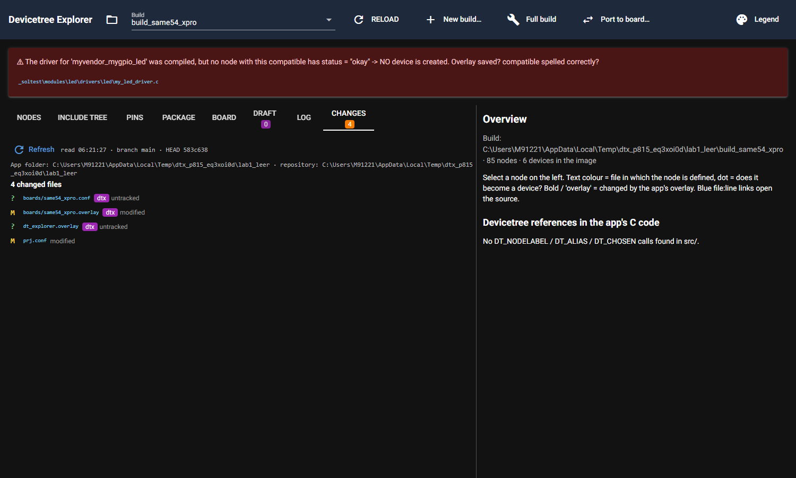
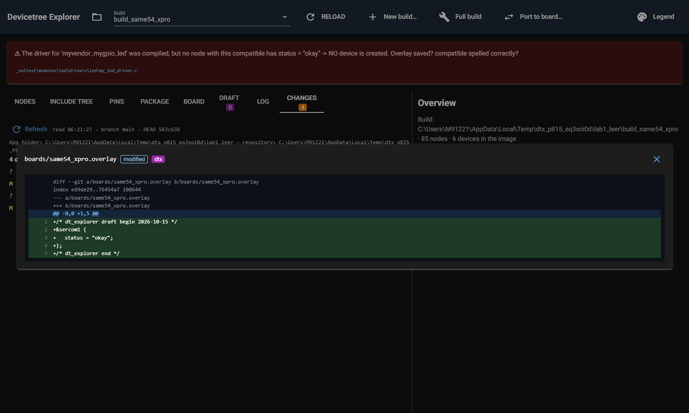
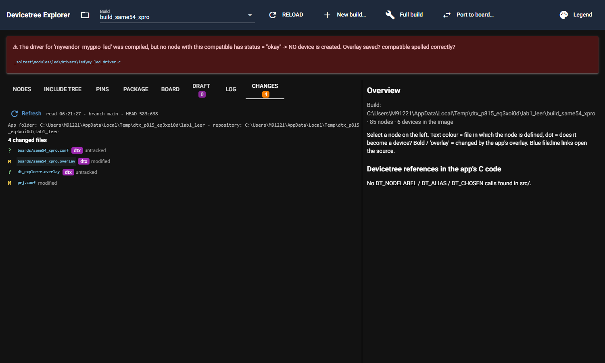
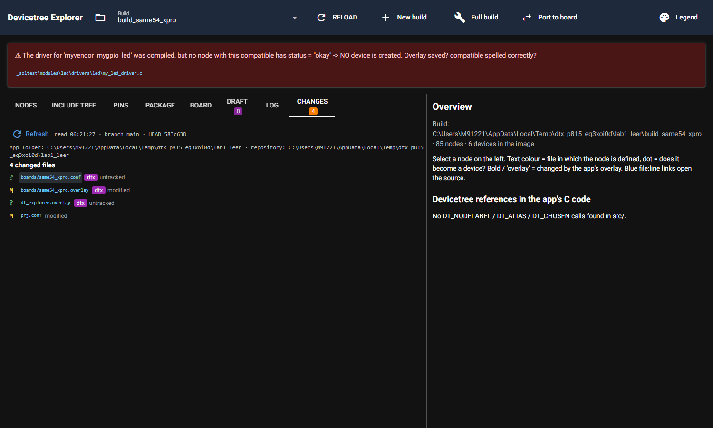
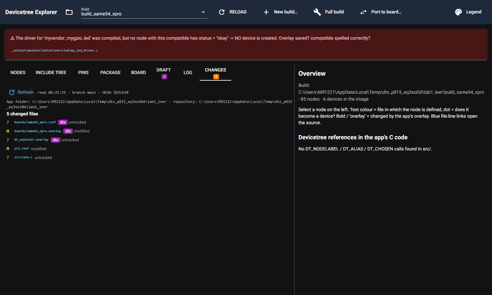
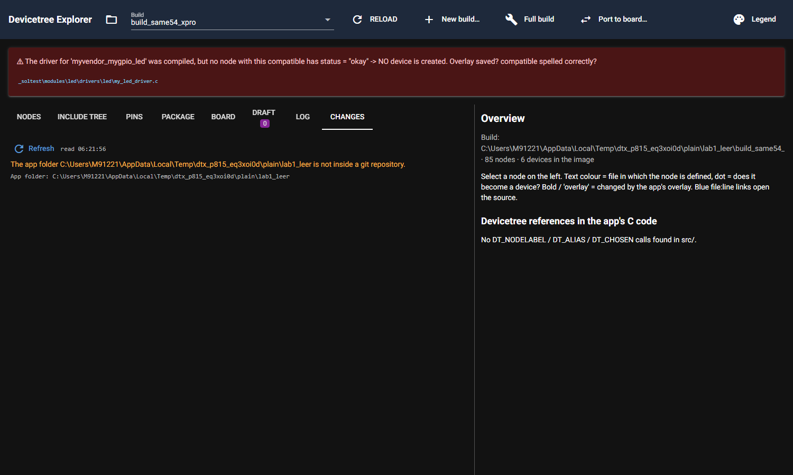
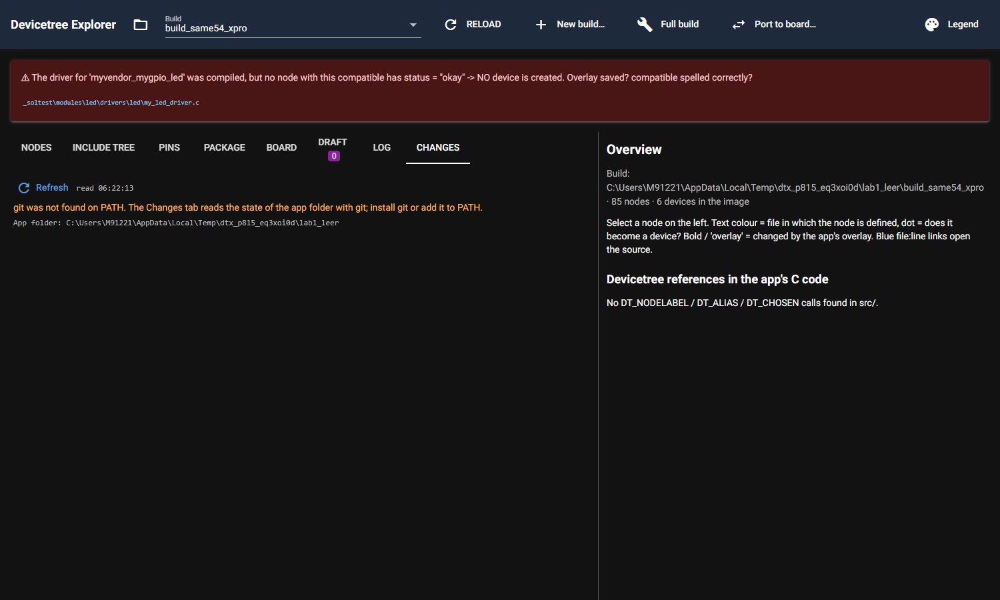

# P8.15 evidence: Changes tab (read-only git view of the app folder)

Environment: `DTX_RTOS4_WS=C:\Masters\26020_RTOS4\zephyrproject`, `DTX_MAIN_WS=C:\Masters\zephyr-main`, `DTX_DESIGN_FILES=C:\Masters\board_design_files`. git on PATH. All git work ran on temporary repos under `%TEMP%` (copy of `_soltest\apps\lab1_leer` with its build, `APPLICATION_SOURCE_DIR` rewritten in the copied CMakeCache, as in P8.13). No real repository was changed.

## What was built

* `dt_explorer/core/git_status.py` (new, no NiceGUI): `read_status(app, stems)` runs `rev-parse --show-toplevel --show-prefix`, `symbolic-ref`, `rev-parse --short HEAD` and `status --porcelain=v1 -z --untracked-files=all -- .` (limited to the app folder, `.gitignore` respected, `GIT_OPTIONAL_LOCKS=0`, 20 s timeout, every call logged through `core/log.log_external`). `read_diff` runs `git diff HEAD` (`--cached` in a repo without commits); an untracked file becomes one hunk of added lines; binary files are only named. `dtx_paths` marks the files the tool writes. Only `rev-parse`, `symbolic-ref`, `status`, `diff` exist in the module (a test spies on every call). git missing, not a repo, timeout, missing folder: `ok=False` with a message, never an exception.
* `dt_explorer/ui/changes_tab.py` (new): list with kind letter, path button (opens the diff in the existing source viewer dialog), `dtx` badge, Refresh button, line "read HH:MM:SS - branch - HEAD hash". Stable ids: `changes-refresh`, `changes-info`, `changes-app`, `changes-count`, `changes-clean`, `changes-message`, `changes-row-N`, `changes-kind-N`, `changes-file-N`, `changes-dtx-N`, `changes-badge` (tab), `changes-diff`, `changes-diff-title` (viewer).
* `dt_explorer/ui/page.py` (tab block only): tab "Changes" with count badge (hidden until the first read), panel, `on_tab` branch, `set_changes_count`, deep link `tab=changes`, and a small `open_diff` closure that reuses the source viewer dialog (`src_dlg`, `src_head`, `src_box`) for diff rows.
* Badge rules (`dtx`): `boards/<stem>.overlay|.conf` for the build's board stems, `dt_explorer.overlay|.conf`, anything below `dtx_devices/` or `.dt_explorer/`, any file containing a `dt_explorer ... begin` ... `dt_explorer end` block, a `CMakeLists.txt` naming `dtx_devices`.
* Tab count appears after the first read (the state is read only when the tab opens and on Refresh, so before that nothing is shown).
* README.md row and docs/GUI.md section 11b; URL parameter lists updated.

## Acceptance 1: real browser on a temp git repo copy (script run, complete output, temp folder name shortened)

```
work dir C:\Users\M91221\AppData\Local\Temp\dtx_p815_XXXX; rewrote 16 path(s) in the copied CMakeCache
git status at start: ''
apply: ['written:     C:\\Users\\M91221\\AppData\\Local\\Temp\\dtx_p815_XXXX\\lab1_leer\\boards\\same54_xpro.conf', 'appended:    C:\\Users\\M91221\\AppData\\Local\\Temp\\dtx_p815_XXXX\\lab1_leer\\boards\\same54_xpro.overlay']
git status porcelain:
 M boards/same54_xpro.overlay
 M prj.conf
?? boards/same54_xpro.conf
?? dt_explorer.overlay

server a: port 56456 pid 28524
badge visible before the tab opens: False
info line : read 06:21:27 · branch main · HEAD 583c638
count line: 4 changed files | tab badge: 4
  row 0 | ? boards/same54_xpro.conf dtx untracked | dtx badge: True
  row 1 | M boards/same54_xpro.overlay dtx modified | dtx badge: True
  row 2 | ? dt_explorer.overlay dtx untracked | dtx badge: True
  row 3 | M prj.conf modified | dtx badge: False
--- diff boards/same54_xpro.overlay (viewer text) ---
diff --git a/boards/same54_xpro.overlay b/boards/same54_xpro.overlay
index e69de29..76454a7 100644
--- a/boards/same54_xpro.overlay
+++ b/boards/same54_xpro.overlay
@@ -0,0 +1,5 @@
1+/* dt_explorer draft begin 2026-10-15 */
2+&sercom1 {
3+	status = "okay";
4+};
5+/* dt_explorer end */
--- diff boards/same54_xpro.conf (untracked, viewer text) ---
new file (untracked): boards/same54_xpro.conf
@@ -0,0 +1,1 @@
1+CONFIG_I2C=y
3 s after an outside change, no Refresh : 4 changed files | late.c listed: False
after Refresh                            : 5 changed files | late.c listed: True | read 06:21:35 · branch main · HEAD 583c638
browser console errors: []
server norepo: port 60206 pid 11656
no repo message: The app folder C:\Users\M91221\AppData\Local\Temp\dtx_p815_XXXX\plain\lab1_leer is not inside a git repository. | tab badge shown: False
server nogit: port 53696 pid 26328
git missing message: git was not found on PATH. The Changes tab reads the state of the app folder with git; install git or add it to PATH.
servers stopped by PID: [28524, 11656, 26328]
```

Writes were made by the real `core/apply` (Apply to app: conf new, overlay appended as a marked block), plus a `dt_explorer.overlay` ("Write to app" name) and a user edit of `prj.conf`. Result: 4 files listed, badge on the three tool files and not on `prj.conf`; diffs shown (the app's own overlay in `lab1_leer` is empty, so its diff is all added lines); the untracked conf is shown whole as added; a file created 3 s after the read is NOT listed until **Refresh**, then 5 files; time, branch and HEAD hash shown; no browser console errors (tooltips were replaced by `title=` after the first run showed Quasar "Anchor target not found" errors when Refresh re-rendered the list).

Screenshots (real browser): list img/P8.15_list.png, diff of the modified overlay img/P8.15_diff_modified.png, untracked file img/P8.15_diff_untracked.png, before Refresh img/P8.15_before_refresh.png, after Refresh img/P8.15_after_refresh.png, no repository img/P8.15_no_repo.png, git not on PATH img/P8.15_no_git.png.















## Acceptance 2: real RTOS4 data (read only)

`apps\lab1` and `_soltest\apps\lab1_leer` are not inside a git repository (no `.git` in the app, `apps`, the workspace, `26020_RTOS4`, `C:\Masters`). `read_status` on both returns the message "The app folder ... is not inside a git repository." (rc 128 of `git rev-parse`), which the tab shows; nothing was changed there.

## Acceptance 3: unit and simulated UI tests

`tests/test_git_status.py` (14 tests: clean, modified/added/deleted/untracked/ignored, limited to the app folder in a bigger repo, diff numbers and untracked whole file, binary, rename, dtx marks, marker detection, snapshot until re-read, no commits, not a repo, missing folder, git missing from PATH, timeout, only read-only verbs) and `tests/ui/test_ui_changes.py` (5 simulated tests: list + diff + dtx + Refresh only on demand, clean repo, tab click reads, no repository message, git missing message). Collected tests:
```
tests/test_git_status.py::test_clean_repo
tests/test_git_status.py::test_modified_added_deleted_untracked_and_ignored
tests/test_git_status.py::test_limited_to_app_folder_in_a_bigger_repo
tests/test_git_status.py::test_diff_numbers_and_untracked_whole_file
tests/test_git_status.py::test_deleted_file_diff_and_rename
tests/test_git_status.py::test_dtx_marks
tests/test_git_status.py::test_marked_block_detection
tests/test_git_status.py::test_read_is_stable_until_asked_again
tests/test_git_status.py::test_no_commits_yet
tests/test_git_status.py::test_not_a_repository
tests/test_git_status.py::test_missing_folder
tests/test_git_status.py::test_git_missing_from_path
tests/test_git_status.py::test_git_timeout_becomes_a_message
tests/test_git_status.py::test_only_read_only_git_commands_are_used
tests/ui/test_ui_changes.py::test_changes_tab_lists_diffs_and_refreshes_on_demand
tests/ui/test_ui_changes.py::test_clean_repo_says_so
tests/ui/test_ui_changes.py::test_tab_click_reads_git
tests/ui/test_ui_changes.py::test_no_repository_message
tests/ui/test_ui_changes.py::test_git_missing_message

19 tests collected in 0.08s
```

## Acceptance 4: whole suite

`py -m pytest -q -rs` with the three DTX_* variables, run in the worktree (output is 515 lines; the tail is shown, the rest is progress dots and test prints):
```
&pinctrl {
	sercom7_i2c_default: sercom7_i2c_default {
		group1 {
			pinmux = <PD8C_SERCOM7_PAD0 PD9C_SERCOM7_PAD1>;
		};
	};
};

--- report lines ---
atmel,assigned-clocks: generator 0 moves to the clock controller. Add in the target board file: &clock { gclkperiph { sercom7 { subsystem = <CLOCK_MCHP_GCLKPERIPH_ID_SERCOM7_CORE>; gclkperiph-src = "gclk0"; gclkperiph-en = <1>; }; }; mclkperiph { sercom7 { subsystem = <CLOCK_MCHP_MCLKPERIPH_ID_APBD_SERCOM7>; mclk-en = <1>; }; }; };
dropped 'atmel,assigned-clock-names' (atmel,sam0-i2c -> microchip,sercom-g1-i2c): names the generator entry, which moves to gclkperiph-src on the clock controller
child eeprom@5e (compatible atmel,24mac402): not part of the node translation, carry over by hand
--- edtlib (Zephyr main): microchip,sercom-g1-i2c binding microchip,sercom-g1-i2c.yaml ---
.....
g1-i2c: source properties 39 = table rows 39; target properties 42 = mapped 37 + target-only 5; unmapped source rows 2 (drop/derive without target)
.
g1-spi: source properties 41 = table rows 41; target properties 42 = mapped 39 + target-only 3; unmapped source rows 2 (drop/derive without target)
..................................................... [ 98%]
..........                                                               [100%]
============================ UI smoke screenshots =============================
C:\Users\M91221\AppData\Local\Temp\dtx_ui_shots\configure_check.png
C:\Users\M91221\AppData\Local\Temp\dtx_ui_shots\configure_check_verify.png
C:\Users\M91221\AppData\Local\Temp\dtx_ui_shots\port_report.png
C:\Users\M91221\AppData\Local\Temp\dtx_ui_shots\board_view.png
514 passed in 1085.71s (0:18:05)
```
