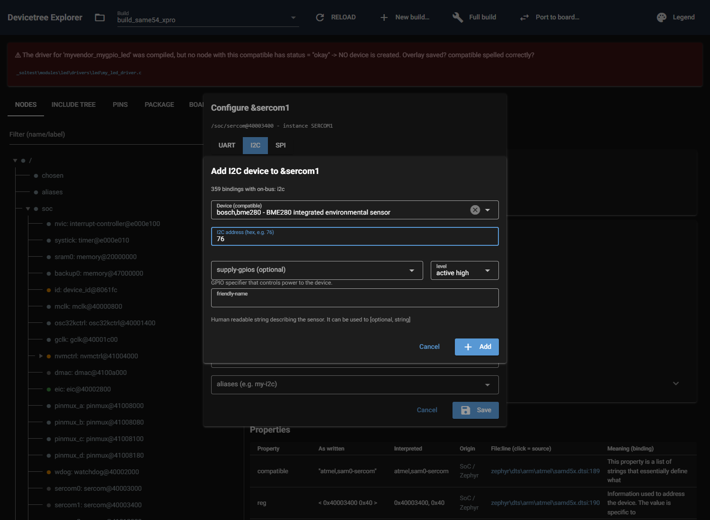
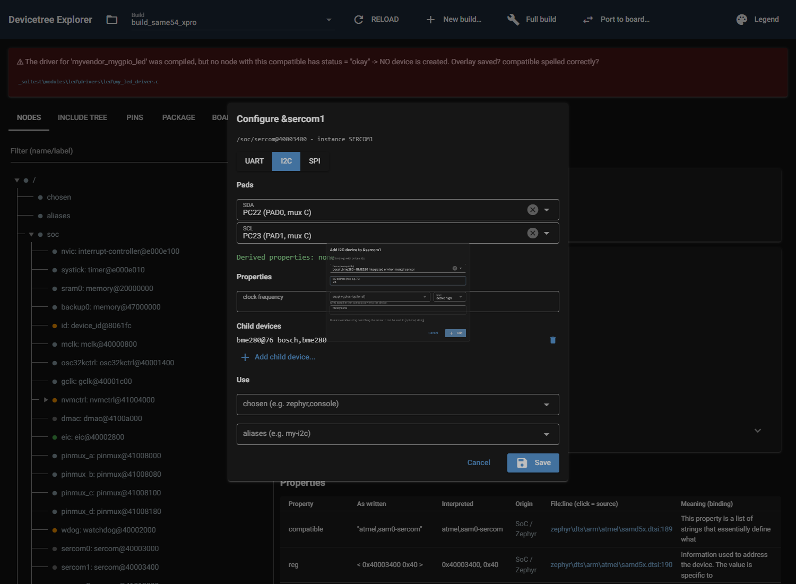
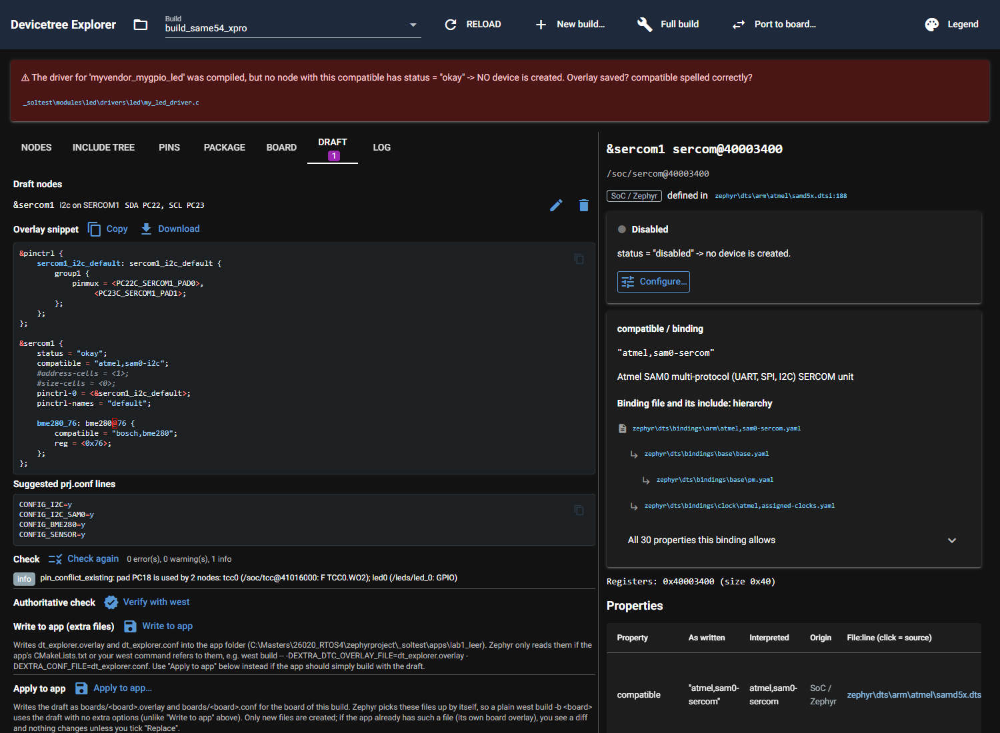

# P8.6 Child node form and bus checks: evidence

Environment: `DTX_RTOS4_WS=C:\Masters\26020_RTOS4\zephyrproject`, `DTX_MAIN_WS=C:\Masters\zephyr-main`,
`DTX_DESIGN_FILES=C:\Masters\board_design_files`. All work on a COPY of `_soltest\apps\lab1_leer` under
`%TEMP%` (app and build folder). Drafts stay in memory in the acceptance script (`ConfigSession.save()` is never
called) and are redirected to the copy in the UI tests; nothing is written into `apps\` or `_soltest\`. Verify with
west runs in a scratch folder (`core/verify.py`, west `--cmake-only`). Screenshot servers run on a free port and are
stopped by PID.

## What was built

* `core/generic.py`: bus-aware binding lookup (`child_options`, `binding_for`: a compatible can have a file per bus,
  `bosch,bme280-i2c.yaml` and `-spi.yaml`; the bindings on offer are those whose include chain carries `on-bus: <bus>`),
  child form spec (`child_form`, `gpio_specs`, `check_child`), address rules (`parse_address`: I2C hex 0..0x7f, SPI
  chip-select index), unique node names (`unique_name`: `bme280`, `bme280-2` so the compiler cannot merge two nodes),
  pad -> GPIO controller/pin map (`gpio_pad_map`, the inverse of the lookup in `core/pins.py`), `gpio_entry`,
  `build_child`, `set_cs_entry` / `drop_cs_entry` for the controller's `cs-gpios`.
* `core/validate.py`: `bus_address_duplicate` (two I2C devices at one address / two SPI devices at one chip select;
  error when the overlay is involved, otherwise `info` `bus_address_duplicate_existing`), `spi_cs_missing` (chip select
  beyond the `cs-gpios` list), and `pin_conflict` now also fires for one node that uses a pad both as pinctrl pin and
  as GPIO (cross-node GPIO clashes were already found, because `core/pins.py` counts `*-gpios` of every node).
* `ui/configure.py`: "Child devices" section with "Add child device..." in the I2C/SPI class dialog; children and
  `cs-gpios` are part of the draft node; board children are listed as "from the board" and cannot be removed;
  `ConfigSession.kconfig()` also suggests the drivers of the children; `revive_refs` (see Findings).
* `ui/generic_form.py`: `open_child` (the child dialog), reusing the generic-form field rules.
* Ids: `cfg-children`, `cfg-child-add`, `cfg-child-<name>-<unit>`, `cfg-child-remove-<name>-<unit>`, `cfg-cancel`;
  `child-dialog`, `child-compatible`, `child-address`, `child-address-hint`, `child-prop-<name>`,
  `child-gpio-<prop>` (+ `-flags`), `child-cs-pad`, `child-cs-flags`, `child-problems`, `child-save`, `child-cancel`.
  (A `ui.select` with search and a `ui.input` carry no DOM id; browser tests find them by label.)

## Findings

* **`Draft.to_dict` writes node-level properties with `asdict()`.** A `Ref` in `DraftNode.props` (here the
  controller's `cs-gpios = <&portb 14 1>`) therefore lands in the JSON as `{"label": "portb"}`, and `from_dict`
  gives that dict back, not a `Ref`. Child properties are encoded properly (`{"ref": ...}`). `core/draft.py` is outside
  this card's scope, so `ConfigSession` calls `revive_refs()` after loading the draft. **Better fix (builder, in
  draft.py):** run `_enc` / `_dec` over `DraftNode.props` and `vendor_props` too. Any code that reads a draft file
  without a `ConfigSession` would otherwise see the dict.
* The compatible `bosch,bmp280` does not exist in Zephyr (the BMP280 uses `bosch,bme280`); tests use `bosch,bme680` as
  second I2C device.
* GPIO flags are written as plain numbers (`<&portb 14 1>`): a `Sym` would be lost in the draft JSON.
* `#gpio-cells` is assumed to be 2 (pin, flags); every Zephyr GPIO binding of the SoCs in use has it.
* A removed SPI child drops its `cs-gpios` entry only when it is the last one; an inner entry stays (later ones would
  shift their chip-select index).

## 1. Acceptance run on the lab1_leer copy

Script `p86_accept.py` (kept here in full; it was run from the worktree):

```python
"""P8.6 acceptance: bus devices on a COPY of _soltest/apps/lab1_leer: I2C bme280, SPI bmi160 with CS GPIO and
int-gpios, and the bus checks (duplicate address, GPIO pad used elsewhere)."""
import copy
import shutil
import sys
import tempfile
from pathlib import Path

sys.path.insert(0, r"C:\Masters\dt_explorer\.claude\worktrees\agent-a11581bfafd97b4bb")
from dt_explorer.app import load_plugins
from dt_explorer.core import generic as G
from dt_explorer.core import verify
from dt_explorer.core.build import BuildModel
from dt_explorer.ui import configure as C
from dt_explorer.ui.draft_tab import kconfig_lines

load_plugins()
src = Path(r"C:\Masters\26020_RTOS4\zephyrproject\_soltest\apps\lab1_leer")
work = Path(tempfile.gettempdir()) / "dtx_p86_accept"
shutil.rmtree(work, ignore_errors=True)
app = work / "lab1_leer"
shutil.copytree(src, app)
build = app / "build_same54_xpro"
print("copy:", build)

m = BuildModel(build)
s = C.ConfigSession(m)          # drafts stay in memory: session.save() is never called
gmap = s.gpio_map()
print("gpio map: %d pads, PB24 -> %s, PB14 -> %s" % (len(gmap), gmap["PB24"], gmap["PB14"]))


def show(title, findings):
    print(f"--- {title}: {len(findings)} finding(s) ---")
    for f in findings:
        print(f"  {f.severity} {f.kind} {f.node} {f.message}")
    return [f for f in findings if f.severity == "error"]


def node_for(label, cls, pins, props=None, children=(), extra=None):
    n = s.node_for_label(label)
    opt = next(o for o in s.options_for(n) if o.cls == cls)
    inst = s.instance_of(n)
    dn = C.build_node(option=opt, instance=inst, label=label, pins=pins, roles_order=C.option_roles(opt, inst),
                      props=props, children=children)
    if extra:
        dn.props.update(extra)
    return dn


def do_verify(tag):
    overlay = s.overlay()
    conf = "\n".join(kconfig_lines(s.kconfig())) + "\n"
    res = verify.verify(build, overlay, conf, on_line=None, scratch_root=work / ("verify_" + tag), timeout=900)
    print(f"--- Verify with west ({tag}) ---")
    print("rc:", res.returncode, "ok:", res.ok, "duration: %.1f s" % res.duration)
    print("errors:", res.errors)
    print("warnings:", res.warnings)
    print("conf used:", repr(conf))
    print("cmd:", " ".join(res.cmd))
    print("log tail:\n" + "\n".join(res.log_tail[-8:]))
    return res


# ---- 1. SERCOM1 as I2C (PC22/PC23) with a bme280 at 0x76 --------------------------------------------------
print("\n== 1. I2C bus with bosch,bme280 at 0x76 ==")
opts = G.child_options(s.index, "i2c")
print("i2c devices on offer:", len(opts), "| bosch,bme280 among them:", any(o.compatible == "bosch,bme280" for o in opts))
bme = G.build_child(bus="i2c", compatible="bosch,bme280", address=G.parse_address("i2c", "76"))
print("child:", bme.node_name, bme.labels, bme.compatible, bme.props)
s.upsert(node_for("sercom1", "i2c", {"SDA": "PC22", "SCL": "PC23"}, props={"clock-frequency": 100000},
                  children=[bme]))
print("\n--- overlay ---\n" + s.overlay())
errs = show("validate", s.check())
print("errors:", errs)
assert not errs
r1 = do_verify("i2c")
assert r1.returncode == 0

# ---- 2. an SPI bus with bmi160 (CS GPIO + int-gpios) ------------------------------------------------------
print("\n== 2. SPI bus (SERCOM5) with bosch,bmi160: cs-gpios PB14, int-gpios PB15 ==")
n5 = s.node_for_label("sercom5")
opt5 = next(o for o in s.options_for(n5) if o.cls == "spi")
inst5 = s.instance_of(n5)
used = s.used_by()
roles5 = C.option_roles(opt5, inst5)
pins5 = {}
for r in roles5:
    if r == "CS":
        continue
    cand = C.role_candidates(inst5, opt5, roles5, pins5, used)[r]
    pins5[r] = next(c.pad for c in cand if not c.used_by)
print("SPI pins:", pins5)
print("bosch,bmi160 on spi: fields", [(f.name, f.required) for f in G.child_form("bosch,bmi160", s.index, "spi")][:3],
      "... gpio props", [g.name for g in G.gpio_specs("bosch,bmi160", s.index, "spi")])
bmi = G.build_child(bus="spi", compatible="bosch,bmi160", address=0, props={"spi-max-frequency": 1000000},
                    gpio_props={"int-gpios": G.gpio_entry(gmap, "PB15", 0)})
cs_props = G.set_cs_entry({}, 0, G.gpio_entry(gmap, "PB14", G.GPIO_FLAGS["active low"]))
s.upsert(node_for("sercom5", "spi", pins5, children=[bmi], extra=cs_props))
print("\n--- overlay (I2C + SPI) ---\n" + s.overlay())
errs = show("validate", s.check())
print("errors:", errs)
assert not errs
r2 = do_verify("i2c_spi")
assert r2.returncode == 0

# ---- 3. negative: a second I2C device at 0x76 -------------------------------------------------------------
print("\n== 3. negative: a second device at 0x76 on the same I2C bus ==")
dup = G.build_child(bus="i2c", compatible="bosch,bme680", address=0x76,
                    siblings=s.draft_node("sercom1").children)
print("second child:", dup.node_name, dup.props)
saved = copy.deepcopy(s.draft)
s.draft.nodes = [n for n in s.draft.nodes]
s.draft_node("sercom1").children.append(dup)
s.findings = None
fs = show("validate (duplicate address)", s.check())
assert any(f.kind == "bus_address_duplicate" for f in fs), "expected a bus_address_duplicate error"
print("negative can fail: with the duplicate removed the same check gives:")
s.draft_node("sercom1").children.remove(dup)
assert not show("validate (no duplicate)", s.check())

# ---- 4. negative: CS GPIO on a used pad -------------------------------------------------------------------
print("\n== 4. negative: cs-gpios on PB24 (the console RX pad of sercom2) ==")
s.draft_node("sercom5").props = G.set_cs_entry(s.draft_node("sercom5").props, 0, G.gpio_entry(gmap, "PB24", 1))
fs = show("validate (CS on a used pad)", s.check())
assert any(f.kind == "pin_conflict" and f.pad == "PB24" for f in fs), "expected a pin_conflict on PB24"
print("negative can fail: CS back on PB14 gives:")
s.draft_node("sercom5").props = G.set_cs_entry(s.draft_node("sercom5").props, 0, G.gpio_entry(gmap, "PB14", 1))
assert not show("validate (CS on PB14)", s.check())

print("\n== 5. negative: int-gpios on the pad that is also the CS ==")
s.draft_node("sercom5").children[0].props["int-gpios"] = [G.gpio_entry(gmap, "PB14", 0)]
fs = show("validate (int-gpios == cs pad)", s.check())
assert any(f.kind == "pin_conflict" and f.pad == "PB14" for f in fs)
print("\n== 6. negative: cs-gpios on the SPI node's own MOSI pad (same node, pinctrl and GPIO) ==")
d5 = s.draft_node("sercom5")
d5.children[0].props["int-gpios"] = [G.gpio_entry(gmap, "PB15", 0)]
d5.props = G.set_cs_entry(d5.props, 0, G.gpio_entry(gmap, "PA21", 1))
fs = show("validate (CS on own MOSI pad)", s.check())
assert any(f.kind == "pin_conflict" and f.pad == "PA21" for f in fs)

print("\n== 7. negative: SPI device at chip select 1, only one cs-gpios entry ==")
d5.props = G.set_cs_entry(d5.props, 0, G.gpio_entry(gmap, "PB14", 1))
d5.children[0].props["reg"] = [1]
d5.children[0].unit = "1"
d5.children[0].name = "bmi160"
fs = show("validate (chip select 1 without entry)", s.check())
assert any(f.kind == "spi_cs_missing" for f in fs)
print("ALL ACCEPTANCE CHECKS DONE")
```

Complete output:

```
copy: C:\Users\M91221\AppData\Local\Temp\dtx_p86_accept\lab1_leer\build_same54_xpro
gpio map: 99 pads, PB24 -> ('portb', 24), PB14 -> ('portb', 14)

== 1. I2C bus with bosch,bme280 at 0x76 ==
i2c devices on offer: 359 | bosch,bme280 among them: True
child: bme280@76 ['bme280_76'] ['bosch,bme280'] {'reg': [118]}

--- overlay ---
&pinctrl {
	sercom1_i2c_default: sercom1_i2c_default {
		group1 {
			pinmux = <PC22C_SERCOM1_PAD0>,
				 <PC23C_SERCOM1_PAD1>;
		};
	};
};

&sercom1 {
	status = "okay";
	compatible = "atmel,sam0-i2c";
	#address-cells = <1>;
	#size-cells = <0>;
	clock-frequency = <100000>;
	pinctrl-0 = <&sercom1_i2c_default>;
	pinctrl-names = "default";

	bme280_76: bme280@76 {
		compatible = "bosch,bme280";
		reg = <0x76>;
	};
};

--- validate: 1 finding(s) ---
  info pin_conflict_existing /soc/tcc@41016000 pad PC18 is used by 2 nodes: tcc0 (/soc/tcc@41016000: F TCC0.WO2); led0 (/leds/led_0: GPIO)
errors: []
--- Verify with west (i2c) ---
rc: 0 ok: True duration: 52.1 s
errors: []
warnings: []
conf used: 'CONFIG_I2C=y\nCONFIG_I2C_SAM0=y\nCONFIG_BME280=y\nCONFIG_SENSOR=y\n'
cmd: C:\Masters\26020_RTOS4\zephyrproject\.venv\Scripts\python.exe -m west build -b same54_xpro/same54p20a -d C:\Users\M91221\AppData\Local\Temp\dtx_p86_accept\verify_i2c\5baeae9c38\build --cmake-only C:\Masters\26020_RTOS4\zephyrproject\_soltest\apps\lab1_leer -- -DEXTRA_DTC_OVERLAY_FILE=C:/Users/M91221/AppData/Local/Temp/dtx_p86_accept/verify_i2c/5baeae9c38/dt_explorer.overlay -DEXTRA_CONF_FILE=C:/Users/M91221/AppData/Local/Temp/dtx_p86_accept/verify_i2c/5baeae9c38/dt_explorer.conf
log tail:
-- The ASM compiler identification is GNU
-- Found assembler: C:/Users/M91221/zephyr-sdk-0.17.4/arm-zephyr-eabi/bin/arm-zephyr-eabi-gcc.exe
-- Using ccache: C:/Users/M91221/AppData/Local/Microsoft/WinGet/Packages/BrechtSanders.WinLibs.POSIX.UCRT_Microsoft.Winget.Source_8wekyb3d8bbwe/mingw64/bin/ccache.exe
-- DEBUG: ZEPHYR_CURRENT_LIBRARY=..___soltest__modules__led__drivers__led
-- Found gen_kobject_list: C:/Masters/26020_RTOS4/zephyrproject/zephyr/scripts/build/gen_kobject_list.py
-- Configuring done (47.7s)
-- Generating done (1.8s)
-- Build files have been written to: C:/Users/M91221/AppData/Local/Temp/dtx_p86_accept/verify_i2c/5baeae9c38/build

== 2. SPI bus (SERCOM5) with bosch,bmi160: cs-gpios PB14, int-gpios PB15 ==
SPI pins: {'MOSI': 'PA21', 'MISO': 'PA20', 'SCK': 'PA22'}
bosch,bmi160 on spi: fields [('spi-max-frequency', True), ('duplex', False), ('frame-format', False)] ... gpio props ['supply-gpios', 'int-gpios']

--- overlay (I2C + SPI) ---
&pinctrl {
	sercom1_i2c_default: sercom1_i2c_default {
		group1 {
			pinmux = <PC22C_SERCOM1_PAD0>,
				 <PC23C_SERCOM1_PAD1>;
		};
	};

	sercom5_spi_default: sercom5_spi_default {
		group1 {
			pinmux = <PA21C_SERCOM5_PAD3>,
				 <PA20C_SERCOM5_PAD2>,
				 <PA22D_SERCOM5_PAD1>;
		};
	};
};

&sercom1 {
	status = "okay";
	compatible = "atmel,sam0-i2c";
	#address-cells = <1>;
	#size-cells = <0>;
	clock-frequency = <100000>;
	pinctrl-0 = <&sercom1_i2c_default>;
	pinctrl-names = "default";

	bme280_76: bme280@76 {
		compatible = "bosch,bme280";
		reg = <0x76>;
	};
};

&sercom5 {
	status = "okay";
	compatible = "atmel,sam0-spi";
	#address-cells = <1>;
	#size-cells = <0>;
	cs-gpios = <&portb 14 1>;
	dipo = <2>;
	dopo = <2>;
	pinctrl-0 = <&sercom5_spi_default>;
	pinctrl-names = "default";

	bmi160_0: bmi160@0 {
		compatible = "bosch,bmi160";
		reg = <0x0>;
		spi-max-frequency = <1000000>;
		int-gpios = <&portb 15 0>;
	};
};

--- validate: 1 finding(s) ---
  info pin_conflict_existing /soc/tcc@41016000 pad PC18 is used by 2 nodes: tcc0 (/soc/tcc@41016000: F TCC0.WO2); led0 (/leds/led_0: GPIO)
errors: []
--- Verify with west (i2c_spi) ---
rc: 0 ok: True duration: 47.0 s
errors: []
warnings: []
conf used: 'CONFIG_I2C=y\nCONFIG_I2C_SAM0=y\nCONFIG_SPI=y\nCONFIG_SPI_SAM0=y\nCONFIG_BME280=y\nCONFIG_SENSOR=y\nCONFIG_BMI160=y\n'
cmd: C:\Masters\26020_RTOS4\zephyrproject\.venv\Scripts\python.exe -m west build -b same54_xpro/same54p20a -d C:\Users\M91221\AppData\Local\Temp\dtx_p86_accept\verify_i2c_spi\5baeae9c38\build --cmake-only C:\Masters\26020_RTOS4\zephyrproject\_soltest\apps\lab1_leer -- -DEXTRA_DTC_OVERLAY_FILE=C:/Users/M91221/AppData/Local/Temp/dtx_p86_accept/verify_i2c_spi/5baeae9c38/dt_explorer.overlay -DEXTRA_CONF_FILE=C:/Users/M91221/AppData/Local/Temp/dtx_p86_accept/verify_i2c_spi/5baeae9c38/dt_explorer.conf
log tail:
-- The ASM compiler identification is GNU
-- Found assembler: C:/Users/M91221/zephyr-sdk-0.17.4/arm-zephyr-eabi/bin/arm-zephyr-eabi-gcc.exe
-- Using ccache: C:/Users/M91221/AppData/Local/Microsoft/WinGet/Packages/BrechtSanders.WinLibs.POSIX.UCRT_Microsoft.Winget.Source_8wekyb3d8bbwe/mingw64/bin/ccache.exe
-- DEBUG: ZEPHYR_CURRENT_LIBRARY=..___soltest__modules__led__drivers__led
-- Found gen_kobject_list: C:/Masters/26020_RTOS4/zephyrproject/zephyr/scripts/build/gen_kobject_list.py
-- Configuring done (43.2s)
-- Generating done (1.9s)
-- Build files have been written to: C:/Users/M91221/AppData/Local/Temp/dtx_p86_accept/verify_i2c_spi/5baeae9c38/build

== 3. negative: a second device at 0x76 on the same I2C bus ==
second child: bme680@76 {'reg': [118]}
--- validate (duplicate address): 2 finding(s) ---
  info pin_conflict_existing /soc/tcc@41016000 pad PC18 is used by 2 nodes: tcc0 (/soc/tcc@41016000: F TCC0.WO2); led0 (/leds/led_0: GPIO)
  error bus_address_duplicate /soc/sercom@40003400/bme280@76 I2C address 0x76 is used by 2 devices on &sercom1: bme280@76 (/soc/sercom@40003400/bme280@76), bme680@76 (/soc/sercom@40003400/bme680@76)
negative can fail: with the duplicate removed the same check gives:
--- validate (no duplicate): 1 finding(s) ---
  info pin_conflict_existing /soc/tcc@41016000 pad PC18 is used by 2 nodes: tcc0 (/soc/tcc@41016000: F TCC0.WO2); led0 (/leds/led_0: GPIO)

== 4. negative: cs-gpios on PB24 (the console RX pad of sercom2) ==
--- validate (CS on a used pad): 2 finding(s) ---
  error pin_conflict /soc/sercom@41012000 pad PB24 is used by 2 nodes: sercom2 (/soc/sercom@41012000: D SERCOM2.PAD1); sercom5 (/soc/sercom@43000400: GPIO)
  info pin_conflict_existing /soc/tcc@41016000 pad PC18 is used by 2 nodes: tcc0 (/soc/tcc@41016000: F TCC0.WO2); led0 (/leds/led_0: GPIO)
negative can fail: CS back on PB14 gives:
--- validate (CS on PB14): 1 finding(s) ---
  info pin_conflict_existing /soc/tcc@41016000 pad PC18 is used by 2 nodes: tcc0 (/soc/tcc@41016000: F TCC0.WO2); led0 (/leds/led_0: GPIO)

== 5. negative: int-gpios on the pad that is also the CS ==
--- validate (int-gpios == cs pad): 2 finding(s) ---
  error pin_conflict /soc/sercom@43000400 pad PB14 is used by 2 nodes: sercom5 (/soc/sercom@43000400: GPIO); bmi160_0 (/soc/sercom@43000400/bmi160@0: GPIO)
  info pin_conflict_existing /soc/tcc@41016000 pad PC18 is used by 2 nodes: tcc0 (/soc/tcc@41016000: F TCC0.WO2); led0 (/leds/led_0: GPIO)

== 6. negative: cs-gpios on the SPI node's own MOSI pad (same node, pinctrl and GPIO) ==
--- validate (CS on own MOSI pad): 2 finding(s) ---
  error pin_conflict /soc/sercom@43000400 pad PA21 is used by one node as pinctrl pin and as GPIO: sercom5 (/soc/sercom@43000400: C SERCOM5.PAD3, GPIO)
  info pin_conflict_existing /soc/tcc@41016000 pad PC18 is used by 2 nodes: tcc0 (/soc/tcc@41016000: F TCC0.WO2); led0 (/leds/led_0: GPIO)

== 7. negative: SPI device at chip select 1, only one cs-gpios entry ==
--- validate (chip select 1 without entry): 2 finding(s) ---
  info pin_conflict_existing /soc/tcc@41016000 pad PC18 is used by 2 nodes: tcc0 (/soc/tcc@41016000: F TCC0.WO2); led0 (/leds/led_0: GPIO)
  error spi_cs_missing /soc/sercom@43000400/bmi160@1 bmi160@1 uses chip select 1 but &sercom5 has only 1 cs-gpios entry
ALL ACCEPTANCE CHECKS DONE
```

## 2. Tests added (all passed; one run of the three files, filtered to result lines)

`tests/test_generic.py` (child options, bus-aware forms, address, cs entries, gpio map, real nodes), `tests/test_validate.py` (bus checks, negatives and their positive counterparts), `tests/ui/test_ui_child.py` (3 simulated UI tests + 1 Playwright smoke test).

```
tests/test_generic.py::test_form_spec_fields_and_exclusions PASSED       [  2%]
tests/test_generic.py::test_form_notes_and_pinctrl PASSED                [  4%]
tests/test_generic.py::test_required_empty_is_flagged PASSED             [  6%]
tests/test_generic.py::test_required_is_met_by_the_board_value PASSED    [  9%]
tests/test_generic.py::test_type_and_enum_problems PASSED                [ 11%]
tests/test_generic.py::test_boolean_set_by_the_board_cannot_be_switched_off PASSED [ 13%]
tests/test_generic.py::test_form_props_only_what_differs PASSED          [ 15%]
tests/test_generic.py::test_pin_roles_and_candidates PASSED              [ 18%]
tests/test_generic.py::test_pin_problems PASSED                          [ 20%]
tests/test_generic.py::test_build_generic_node_drops_empty_roles_and_values PASSED [ 22%]
tests/test_generic.py::test_generic_node_renders_without_recipe PASSED   [ 25%]
tests/test_generic.py::test_node_without_pins_needs_no_device PASSED     [ 27%]
tests/test_generic.py::test_real_nodes_have_the_generic_form PASSED      [ 29%]
tests/test_generic.py::test_real_wdog_and_tc0_render_and_check PASSED    [ 31%]
tests/test_generic.py::test_child_options_follow_on_bus PASSED           [ 34%]
tests/test_generic.py::test_child_form_is_bus_aware PASSED               [ 36%]
tests/test_generic.py::test_parse_address PASSED                         [ 38%]
tests/test_generic.py::test_check_child_problems PASSED                  [ 40%]
tests/test_generic.py::test_child_names_labels_and_unique_names PASSED   [ 43%]
tests/test_generic.py::test_cs_entries PASSED                            [ 45%]
tests/test_generic.py::test_gpio_entry_and_pad PASSED                    [ 47%]
tests/test_generic.py::test_real_bus_devices_of_the_workspace PASSED     [ 50%]
tests/test_generic.py::test_real_gpio_map_inverts_the_pad_lookup PASSED  [ 52%]
tests/test_generic.py::test_real_children_render_and_check PASSED        [ 54%]
tests/test_validate.py::test_conflict_on_pb24_names_both_nodes PASSED    [ 56%]
tests/test_validate.py::test_group_mix_is_warning_with_provider_text PASSED [ 59%]
tests/test_validate.py::test_correct_overlay_has_no_error_or_warning PASSED [ 61%]
tests/test_validate.py::test_missing_required_property PASSED            [ 63%]
tests/test_validate.py::test_syntax_and_preprocessor_errors PASSED       [ 65%]
tests/test_validate.py::test_warm_call_is_fast PASSED                    [ 68%]
tests/test_validate.py::test_from_edt_matches_constructor PASSED         [ 70%]
tests/test_validate.py::test_valid_bus_devices_pass PASSED               [ 72%]
tests/test_validate.py::test_duplicate_i2c_address_is_an_error PASSED    [ 75%]
tests/test_validate.py::test_same_address_on_two_buses_is_fine PASSED    [ 77%]
tests/test_validate.py::test_duplicate_spi_chip_select_is_an_error PASSED [ 79%]
tests/test_validate.py::test_spi_chip_select_beyond_cs_gpios_is_an_error PASSED [ 81%]
tests/test_validate.py::test_cs_gpio_on_a_used_pad_is_an_error PASSED    [ 84%]
tests/test_validate.py::test_int_gpio_on_a_used_pad_is_an_error PASSED   [ 86%]
tests/test_validate.py::test_gpio_on_the_nodes_own_pinctrl_pad_is_an_error PASSED [ 88%]
tests/test_validate.py::test_two_gpios_on_one_pad_are_an_error PASSED    [ 90%]
tests/ui/test_ui_child.py::test_add_bme280_to_i2c_and_a_duplicate_address PASSED [ 93%]
tests/ui/test_ui_child.py::test_add_spi_device_with_cs_and_int_gpio PASSED [ 95%]
tests/ui/test_ui_child.py::test_edit_pins_keeps_the_boards_child PASSED  [ 97%]
tests/ui/test_ui_child.py::test_smoke_child_dialog PASSED                [100%]
======================= 44 passed in 220.53s (0:03:40) ========================
```

## 3. Whole suite, all three environment variables set

`py -m pytest -q -rs` (the output is 27 KB of port-report lines; the tail is shown):

```
.....
g1-i2c: source properties 39 = table rows 39; target properties 42 = mapped 37 + target-only 5; unmapped source rows 2 (drop/derive without target)
.
g1-spi: source properties 41 = table rows 41; target properties 42 = mapped 39 + target-only 3; unmapped source rows 2 (drop/derive without target)
.................................................................. [ 99%]
...                                                                      [100%]
============================ UI smoke screenshots =============================
C:\Users\M91221\AppData\Local\Temp\dtx_ui_shots\configure_check.png
C:\Users\M91221\AppData\Local\Temp\dtx_ui_shots\configure_check_verify.png
C:\Users\M91221\AppData\Local\Temp\dtx_ui_shots\port_report.png
C:\Users\M91221\AppData\Local\Temp\dtx_ui_shots\board_view.png
507 passed in 904.74s (0:15:04)
```

## 4. Screenshots








